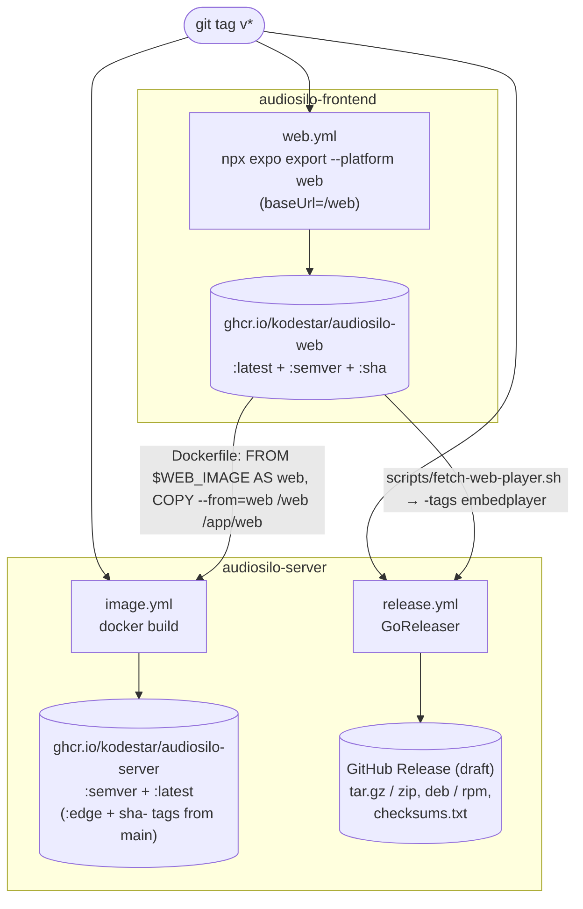

AudioSilo ships from three pipelines that hang off the same `v*` tag. One rule
ties them together:

> **The web image publishes first.** Both the server Docker image and the native
> binaries consume a pinned `audiosilo-web` image. Building them before the web
> image exists, or before it is current, bakes in the wrong player.

Separately, every push to the server's `main` publishes an `:edge` server image
for testing before a release (see
[Server Docker image](#2-server-docker-image---audiosilo-servergithubworkflowsimageyml)).

This page explains how the machinery fits together. The step-by-step operator
runbook is [Releasing](../contributing/releasing.md).

## The pipeline

## 1. Web image: `audiosilo-frontend/.github/workflows/web.yml` {/* #1-web-image---audiosilo-frontendgithubworkflowswebyml */}

`web.yml` runs on pushes to `main` **and** on `v*` tags, plus manual dispatch.

- It exports the player as a static site
  (`npx expo export --platform web --output-dir dist`). `app.json`
  `experiments.baseUrl: "/web"` makes asset URLs resolve under the server's `/web`
  mount.
- It packages the export into a tiny image with `Dockerfile.web`, pushed as
  `ghcr.io/<owner>/audiosilo-web`.

Tagging gives `:latest` only from the default branch, a semver tag on `v*` tags,
and a `:sha` tag always. GHCR references must be lowercase. `docker/metadata-action`
handles that here, so `web.yml` needs no explicit lowercase step. The server's
`image.yml` and `release.yml` lowercase the owner themselves.

## 2. Server Docker image: `audiosilo-server/.github/workflows/image.yml` {/* #2-server-docker-image---audiosilo-servergithubworkflowsimageyml */}

`image.yml` runs on `v*` tags, on pushes to `main`, and on manual dispatch (with a
`web_version` input, default `latest`). It tags through `docker/metadata-action`:

| Build | Tags | `VERSION` stamp |
|---|---|---|
| A `v*` tag, a `-rc` tag included, pushed or dispatched on the tag | the semver version and `:latest`. No `sha-` tag, because a release is pinned by its version. | the semver |
| A push to `main` | `sha-<short>` and `:edge` | `dev-<short sha>`, the same 7 characters as its `sha-` tag |
| A dispatch on `main` that leaves `web_version` at `latest` | `sha-<short>` and `:edge` | `dev-<short sha>` |
| A dispatch on another branch, or on `main` with another `web_version` | `sha-<short>` | `dev-<short sha>` |

A top-level `concurrency` group per ref cancels a superseded build of the same ref.
An edge image bakes whatever `audiosilo-web:latest` points at (frontend `main`).
Only a push to the server's `main`, or a dispatch on it, rebuilds it.

The multi-stage `Dockerfile`:

- builds the admin console in a `node:24-alpine` stage (`npm ci` and
  `npm run build` in `admin-ui/`). The stage runs on the build host's platform,
  since the output is plain JS and CSS. It copies `internal/web/adminui/dist` into
  the Go stage, where it is embedded (see
  [Built-in web UI](../server/web-ui.md#the-admin-console-admin-ui));

- builds the server binary with the **native SQLite engine** by default
  (`ARG SQLITE_ENGINE=native`; `--build-arg SQLITE_ENGINE=modernc` builds the
  pure-Go engine without cgo instead, see
  [SQLite choices](../server/data-model.md#sqlite-choices)):
  - `CGO_ENABLED=1`, `-tags "sqlite_native sqlite_fts5 sqlite_preupdate_hook
    sqlite_omit_load_extension netgo osusergo"`, `-trimpath`;
  - linked statically against glibc (`-linkmode external -extldflags -static`)
    on the Debian-based `golang:1.26` image, so the binary runs unchanged on the
    Alpine final stage and keeps glibc's allocator (with musl's, a first scan was
    27% slower than on the pure-Go engine). `netgo` and `osusergo` keep it off
    glibc's NSS;
  - the build runs on the build host's platform. A cross leg installs the
    target's cross compiler and C library (`gcc-aarch64-linux-gnu` and
    `libc6-dev-arm64-cross`, or `gcc-x86-64-linux-gnu` and `libc6-dev-amd64-cross`);
- stamps the release version via
  `-ldflags "-X github.com/kodestar/audiosilo-server/internal/api.Version=${VERSION}"`
  (`image.yml` passes the semver on a tag build, else `dev-<short sha>`, as the
  `VERSION` build-arg; the default is `dev`);
- pins the player: `FROM ${WEB_IMAGE} AS web` … `COPY --from=web /web /app/web`,
  with `ARG WEB_IMAGE=ghcr.io/kodestar/audiosilo-web:latest`;
- uses `alpine:3.24` for the final stage, with **ffmpeg installed from apk**.
  Unlike the native binaries, the Docker image does bundle ffmpeg. The stage also
  has a `PUID` and `PGID` entrypoint, which gives that user its folders and checks
  them (see [Folder permissions under Docker](../server/configuration.md#folder-permissions-under-docker)),
  and presets `AUDIOSILO_WEB_DIR=/app/web`.

Because the image pins one specific web build, the server and its bundled player
always ship as a **known-compatible pair**. Native apps talking to any server
version negotiate through the `GET /api/v1/server` capability flags instead.

## 3. Native binaries: `release.yml` and `.goreleaser.yml` {/* #3-native-binaries---releaseyml--goreleaseryml */}

The same `v*` tag triggers GoReleaser on a single Linux runner, in two builds:

- **Linux** (`audiosilo-linux`, `amd64` and `arm64`, for the tarballs and the
  `.deb` and `.rpm`) uses the **native SQLite engine**, with the Docker build
  stage's tags and static glibc link (section 2) plus `embedplayer`. The result is
  one static binary that runs on any distro, Alpine included. Each architecture
  needs its C compiler, named by its triplet in `CC` (`x86_64-linux-gnu-gcc`,
  `aarch64-linux-gnu-gcc`). `release.yml` installs the arm64 cross compiler
  (`gcc-aarch64-linux-gnu`, `libc6-dev-arm64-cross`) on the amd64 runner.
- **macOS and Windows** (`audiosilo`, `amd64` and `arm64`): CGO-free on the
  pure-Go SQLite engine (modernc), so they cross-compile from the same runner
  with no C toolchain.

Six binaries in all. The rest is shared:

- **Archives:** `.tar.gz` (Linux and macOS) and `.zip` (Windows), named
  `audiosilo_<version>_<os>_<arch>`. Each contains the binary plus README,
  LICENSE and RELEASING.
- **Linux packages:** `.deb` and `.rpm` (nfpm) that depend on the **distro's**
  ffmpeg and install a systemd unit (`packaging/systemd/audiosilo.service`).
- **`checksums.txt`**. GoReleaser creates the release as a **draft**, and a person
  reviews it before publishing. Its notes end with the `release.footer` in
  `.goreleaser.yml`: the install pointers and the one sponsor line, linking
  GitHub Sponsors.
- **Version stamping:** the same ldflags as the Docker build.
  `-X …/internal/api.Version={{ .Version }}` overrides `var Version = "dev"` in
  `internal/api/api.go`, and `GET /server`, the admin console and the web player
  all report it.

### Embedding the admin console

The admin console's build output is never committed, so a GoReleaser `before`
hook also runs `scripts/build-admin.sh --build-only`. `release.yml` sets up Node
from `admin-ui/.nvmrc`. Every native binary embeds the console. Skipping the hooks
produces a binary whose `/admin` serves a "console not built" page.

### Embedding the player: `-tags embedplayer`

Native binaries can't mount a baked-in `/app/web` directory, so the player is
compiled **into the binary**:

- A GoReleaser `before` hook runs `scripts/fetch-web-player.sh`. The script uses
  `docker create` and `docker cp` to copy the static export out of the pinned
  `audiosilo-web` image into `internal/web/player/` (gitignored). It fails if
  `index.html` is missing. The image is the `WEB_IMAGE` env var, which
  `release.yml` sets from the lowercased owner and the `web_version` dispatch
  input (default `latest`).
- Builds use `-tags=embedplayer`. `internal/web/player_embed.go` embeds that
  directory, while the default `player_disk.go` (`//go:build !embedplayer`) serves
  from `web_dir` at runtime. The embedded player takes precedence over `web_dir`,
  so `/web` works with zero configuration.
- Local snapshot builds skip the hook (`goreleaser build --snapshot --clean
  --skip=before --single-target`). A committed `internal/web/player/.gitkeep`
  keeps the embed compiling without a real player.

### ffmpeg/ffprobe are NOT bundled

They're large (~80 MB each) and usually already installed, so the archives stay
small. At startup `pkg/launcher` (`resolveTools` in `pkg/launcher/app.go`)
resolves each tool in order:

1. an explicit `--ffmpeg` or `--ffprobe` path,
2. a copy sitting **next to the binary**,
3. `$PATH`,
4. only if none is found: `internal/toolfetch` downloads a static build over
   HTTPS into `<data>/tools`, self-checks it by running `-version`, and caches it.

Offline or on an unsupported platform, the server runs without transcoding and
probing, which are both optional by design, and retries on the next start.
The `.deb`/`.rpm` packages sidestep all of this by declaring a dependency on the
distro's `ffmpeg`.

### Smoke test, and the LinuxServer.io image downstream

`release.yml`'s last step smoke-tests the archives while the release is still a
draft:

- the exact linux archive names and the binary at each archive's root;
- each binary's build settings (`go version -m`):
  - a Linux binary's tags `embedplayer`, `sqlite_native`, `netgo` and `osusergo`,
    `CGO_ENABLED=1`, its architecture, and static linking (`readelf` finds no ELF
    interpreter);
  - a macOS or Windows binary's `embedplayer` tag, `CGO_ENABLED=0` and
    architecture;
- an amd64 boot with `--data` only (the headless first run and the self-signed
  TLS default) that must serve `/healthz` and `/web/` and log `engine=native` at
  start.

That is a contract, because
[linuxserver/docker-audiosilo](https://github.com/linuxserver/docker-audiosilo)
(`lscr.io/linuxserver/audiosilo`, the image Unraid's Community Applications lists)
installs `audiosilo_<version>_linux_{amd64,arm64}.tar.gz` from the published release
onto Alpine. The binary is static, so that image runs the native engine too.

The LinuxServer.io CI polls `releases/latest` hourly, so publishing the draft is
what triggers a new `<tag>-ls<N>` image. The full list is in
`audiosilo-server/RELEASING.md` section 2c.

A static glibc binary carries two obligations of its own. The release notes'
footer states both.

- **The LGPL notice.** glibc is LGPL-2.1-or-later. So `NOTICE` ships in every
  archive, and at `/usr/share/doc/audiosilo/NOTICE` in the `.deb`, the `.rpm` and
  the Docker image. It says where the glibc source is and how to relink, since the
  full source and build recipe are public. The packages' license reads
  `AGPL-3.0 and LGPL-2.1-or-later`.
- **Docker 20.10.10 or newer.** glibc starts threads with `clone3`, which Docker's
  seccomp profile refused with `EPERM` before **20.10.10**. So in a container the
  server needs Docker 20.10.10 or newer. On older ones it stops at start-up with
  `pthread_create failed`.

## Ordering and compatibility, in one place

- **Web image first.** Both `image.yml` (`COPY --from`) and `release.yml`
  (`fetch-web-player.sh`) pull `audiosilo-web`. Publish it before either runs, or
  re-run them after. On a plain tag push all workflows fire together, and the web
  image they resolve is whatever `:latest` (or the dispatched `web_version`) points
  at. That is why the runbook publishes the web image first.
- **Publish the native draft last.** The draft is uploaded before `release.yml`'s
  smoke test runs, and the LinuxServer.io image follows its publication. Publish
  only once the run is green, and tick *Set as a pre-release* for a `-rc` tag.
- **Docker and native builds** share the server code and the pinned player. They
  differ in three ways:
  - ffmpeg is bundled in the image, and resolved or fetched at runtime for the
    binaries.
  - The image attaches the player with `/app/web` and `AUDIOSILO_WEB_DIR`, and the
    binaries with `-tags embedplayer`.
  - The SQLite engine is pure Go on macOS and Windows, and native in the image and
    the Linux binaries.
- **Version stamping** is the same mechanism everywhere. The ldflags set
  `api.Version`, which `GET /server` reports and the UIs show.
- **Compatibility between the native apps and the server** is *not* pinned. It is
  negotiated at runtime through the `GET /api/v1/server` capability flags (see
  [seam 8 of the cross-repo contract](cross-repo-contract.md#8-capability-flags-get-apiv1server)).

For the human checklist (what to click, in what order, and how to smoke-test the
result), see [Releasing](../contributing/releasing.md).
