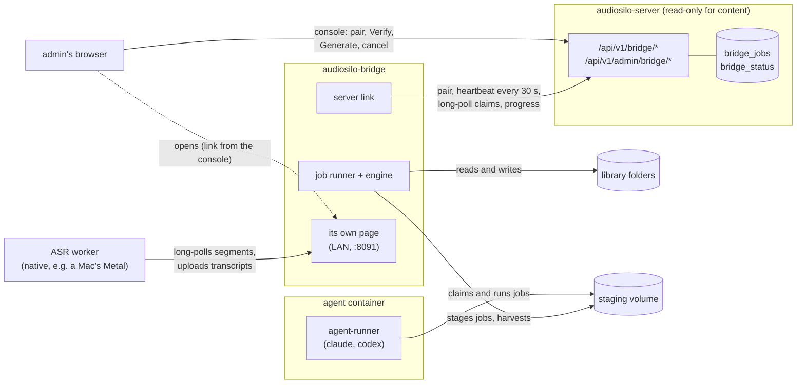

The **Bridge** is an optional, always-on companion to an AudioSilo server. It
**writes** to the library folders and runs the heavy jobs, so the server itself can
stay read-only and safe to expose to the internet. It is a separate program in its
own repository, `audiosilo-bridge`, and runs beside the server, usually as a second
container. The repository is **public**, and so are its images (see
[Compatibility and releases](#compatibility)).

## What it is for

The server never writes into a library. It reads the folders, indexes them and
streams them. Anything that has to **change** files, or that is too heavy to run in
the server (speech recognition, an AI agent), belongs to the Bridge. An admin
starts its jobs from the server's admin console, and a generate job also from the
player's admin-only action.

## What it does

Each job kind has its own page. The server offers a feature only when the job
kinds in the Bridge's heartbeat include it (see [Compatibility](#compatibility)).

- **Pairing and the proof job.** The Bridge pairs with the server, sends a
  heartbeat, claims jobs from a queue with leases and checks its library
  mappings. `bridge.verify` is the proof job that exercises all of this. The
  heartbeat also carries the setup checklist that the console shows. See
  [Pairing and jobs](pairing-and-jobs.md) and [Library mappings](mappings.md).
- **Characters and recaps.** [`sidecars.generate`](generating.md) writes a book's
  characters and recaps into its [`.audiosilo/` folder](attachments.md), using the
  sidecars engine. The AI agents run in a separate
  [agent container](agent-container.md).
- **Descriptions.** Every generate run also writes an own-words, spoiler-free
  [description](generating.md#the-description-step). `sidecars.describe` writes one
  alone for a book generated earlier.
- **Speech recognition on another machine.** An [ASR worker](workers.md) is the
  same binary run natively where speech recognition is fast (a Mac's Metal). It
  takes the transcription off the Bridge.
- **Chapters for chapterless books.** For a book with no chapter markers, the
  Bridge finds the chapters in the narration and writes them as `chapters.json`.
  `chapters.detect` does this on its own, with no agent. See
  [Chapterless books](chapters.md).
- **Contributions.** The Bridge's **Accounts** tab holds a GitHub sign-in through
  the AudioSilo Contributions App, and the Bridge hands the agent's credential to
  the agent container for each run. `sidecars.contribute` shares a book's results
  and `meta.correct` sends an admin's corrections. See
  [Contributions](contributions.md).
- **Read-along maps.** [`readalong.align`](readalong.md) lines a book's ebook up
  with its narration, with no agent, and the server serves the map. The player's
  [Text tab and Follow narration](../frontend/reader.md) read it (server and
  player 2.6.0).
- **Podcasts.** The Bridge runs the subscribe and poll jobs, fetches feed details
  and artwork through a guarded HTTP client, and keeps private-feed credentials
  sealed. It downloads episodes, applies the per-show retention policy the
  server holds, pins audio generations and writes MP3 CHAP attachments. When a listener
  plays an episode that is not downloaded yet, the Bridge fetches it on demand.
  It reports the fetch status, takes a Retry, prepares the next episode in a
  queue and keeps a download slot reserved for play requests. See
  [Podcasts](podcasts.md).
- **Podcast discovery and OPML.** Directory search and OPML import and export run
  on the server, with no Bridge change
  ([Discovery and OPML transfer](podcasts.md#discovery-and-opml-transfer)). The
  player's [podcast views](podcasts.md#player-phase-2d-1), first released in player
  2.4.0, need no Bridge change either. Its
  [discovery, follow by URL and OPML screens](podcasts.md#player-discovery-and-opml-phase-2d-2)
  needed a CORS change on the server only.
- **Audible.** The Bridge signs in to [Audible accounts](audible.md), lists what
  each account owns and matches it against a books library (`audible.poll`).
  [`audible.import`](audible.md#backing-up-a-title-audibleimport) backs a title up
  into the library: download, DRM removal, a no-replace install, a rescan and the
  ASIN. The console, an account's policy or a released preorder queues it.
  [`audible.sync`](audible.md#position-sync-audiblesync-and-the-push-loop) and a
  push loop over `GET /bridge/progress` sync listening places both ways, furthest
  only, for the accounts the console turns sync on for.

Some job families belong to a [managed module](../server/modules.md) of the
server, which the console turns on and off.

### Where the code came from

The engine came from **audiosilo-sidecars**. Its packages (speech recognition, the
agent pipeline, QA, spelling, contribution, the scheduler and supervisor) were
imported **with their history**, so `git log --follow` and `git blame` still reach
the reliability fixes made there. The shell around it (the server link, the job
runner, the mapping checks, the Bridge's own page) is new and smaller. The engine
runs behind `sidecars.generate` ([the engine wiring](generating.md#the-engine-wiring)).
The Audible client came the same way from **audiosilo-manager**
([Audible accounts](audible.md)).

:::note[The old tools are archived]
Both former tools were archived in November 2026 and get no new features or
fixes. The Bridge does their jobs now:

- **audiosilo-sidecars** (the contributor extraction tool) is replaced by
  [generating](generating.md) and [contributions](contributions.md). Its existing
  releases and images (including `-cuda`) stay downloadable.
- **audiosilo-manager** (the desktop manager) is replaced by the Bridge's
  [Audible accounts](audible.md) for backing up and syncing an Audible library.
  Its server set-up and book transfers over SFTP were not carried over. It never
  published installers, and its source was never public.
:::

## The pull-only rule

**The Bridge calls the server; the server never calls the Bridge.** There is no route
on the Bridge that the server calls and no Bridge address the server dials.

- The server **stores intents and status**: console and podcast jobs in
  `bridge_jobs`, follows and feed state in its catalog, and the Bridge's last
  heartbeat in `bridge_status`. It never opens a connection to the Bridge.
- The Bridge **pulls**. It sends a heartbeat every 30 seconds, long-polls for jobs,
  and reports progress, which renews each job's lease.
- The console links to the Bridge's own page (the heartbeat's `ui_url`) for the
  admin's browser to open, nothing more.
- **Saved content stays readable without the Bridge.** Its capability turns off
  two minutes after its last heartbeat. Feed polling and new Bridge work wait
  for its return. Podcast reads still require a compatible client and scope.

This keeps the server's surface unchanged. The server needs no route to the
Bridge, no credentials for it, and nothing about the Bridge's network.

## How it relates to the server

The Bridge is a client of the server's wire format alongside the player. The
server defines the contract and the Bridge mirrors it **by hand** in its
`internal/link`. There is no codegen. A change to the server's `internal/bridge`
or `handlers_bridge.go` is a change in `audiosilo-bridge` too, with a test on each
side. The seam is section 23 of the workspace `CROSS-REPO.md`, and this site's
digest of it is [the cross-repo contract](../architecture/cross-repo-contract.md#16-the-bridge).

| | Server (`audiosilo-server`) | Bridge (`audiosilo-bridge`) |
|---|---|---|
| Pairing | the console mints a code; `POST /bridge/pair` trades it for a token of kind `bridge` | exchanges the code once, keeps the token sealed |
| Status | stores the last heartbeat; `capabilities.bridge` while it is under 2 minutes old | `PUT /bridge/status` every 30 s |
| Jobs | `bridge_jobs`: the intent and the lease | `server_jobs`: the execution truth |
| Libraries | lists them (id, name, root) and each indexed book's files with their sizes | checks where it sees each one, and whether it can write there |
| UI | Settings > Bridge, the book page's Community card and the series cards in the admin console; the player's book page for an admin | its own page on port 8091 |
| Generated content | indexes a book's `.audiosilo/` files and serves them on `/meta` | writes them |

A few rules hold across the seam:

- **Console Bridge actions are admin-only.** Only an admin pairs a Bridge,
  queues console jobs or cancels them, and the Bridge's token works only while
  that admin is enabled. Following, unfollowing and checking a podcast are
  separate module actions for adult users, not demo accounts, and the server
  creates their jobs.
- **One Bridge per server.** Pairing another revokes the first.
- **Library mappings are checked, never assumed.** Before anything may write to a
  library, the Bridge proves it sees the server's copy of it (a known book's file
  sizes, or a podcast root marker). See [Library mappings](mappings.md).
- **Path is the identity**, as everywhere. A job is about `(library_id, rel_path)`,
  follows its book when it moves, and goes with its library.
- **Hidden folders stay hidden.** No server route reaches content through a
  dot-folder by name, and the server never indexes, lists, streams or serves one.
  So the folder the Bridge keeps its files in inside a book (`.audiosilo/`) can never
  become a phantom book or a streamable file. See
  [the hidden-path rule](attachments.md#the-hidden-path-rule).
- **Agents never touch the library.** The AI agent CLIs run only in the
  [agent container](agent-container.md), which sees a staging folder and its own
  config, nothing else.

## Compatibility and releases {/* #compatibility */}

**Nothing checks the version.** The server offers each feature by the job kinds
the Bridge's heartbeat reports, so an older Bridge pairs but lacks the newer
features.

| Bridge | Server | What it brings |
|---|---|---|
| v0.3.0 or later | 2.4.0, 2.5.0 or 2.5.1 | the release that speaks to server 2.4.0: podcasts, contributions, generating and detecting chapters |
| v0.4.0 | ships beside 2.5.0 | native binaries on each GitHub release (below) |
| v0.5.0 | ships beside 2.5.1 | read-alongs (`readalong.align`) |

Bridge 0.5.0 remains the minimum for `readalong.align`. The console names 0.5.0 to
an admin whose online Bridge lacks the `readalong` family.

**Server 2.6.0 and its accompanying new Bridge release must be deployed together
for Audible backups and position sync.** The old strict decoders can reject new
poll parameters or title fields, and older servers lack the progress feed that
sync uses. Use the actual paired tags from the release notes. Bridge 0.5.0 is not
the Audible compatibility target. See
[the Audible seam](../architecture/cross-repo-contract.md#16-the-bridge).

**Older servers.** Servers from before Bridge support have no Bridge routes and no
`bridge` flag. Pairing gets a `404` (or `405`) and says the server is too old. The
player's Bridge UI (admins only) is gated on the flag and the `sidecars` feature,
so it never shows against an older server. Players shipped before it never see
the Bridge. They do see generated characters and recaps for a book matched with
community metadata, merged into its `/meta` work without the mark (see
[generated content](../server/api/reference.md#generated-content)).

**Images and binaries.** The images, `ghcr.io/kodestar/audiosilo-bridge`, are
public from v0.3.0 and pull with no login ([Configuration](configuration.md)).
From v0.4.0, each `v*` tag's GitHub release carries native macOS and Linux
binaries that run a Bridge or an [ASR worker](workers.md#installing-a-worker). The
one-command worker install needs them.

## In these pages

- [Pairing and jobs](pairing-and-jobs.md) - the token, the heartbeat (its
  `accepts` negotiation and the setup checklist) and the capability, the job
  model (states, leases, attempts, cancel, resume after a restart) and
  `bridge.verify`.
- [Library mappings](mappings.md) - how the Bridge finds each library and proves it
  has the right one.
- [Characters and recaps](generating.md) - `sidecars.generate`: queueing, the
  estimate, the run, its progress, parks and result, the description step and
  `sidecars.describe`, budgets and the transcript retention.
- [Chapterless books](chapters.md) - the windows, the `chapter_detecting` stage
  and its detector, `chapters.detect`, and how the chapters reach the server.
- [Read-along](readalong.md) - `readalong.align`, the goal readalong path, the
  reuse table, the aligner, the `audiosilo-readalong/v1` map, and how the server
  indexes, checks and serves it.
- [The .audiosilo folder](attachments.md) - where the results go, their formats,
  and how the server finds, checks and serves them.
- [The agent container](agent-container.md) - where the AI agents run, the
  staging protocol, and the credential hand-off.
- [ASR workers](workers.md) - the worker protocol, the Bridge's ASR router and
  installing a worker.
- [Contributions](contributions.md) - the Accounts tab (the GitHub sign-in, the
  agent credentials), `sidecars.contribute` and `meta.correct`.
- [Podcasts](podcasts.md) - feed files, polling, downloads, retention,
  generation and publication recovery, CHAP, private credentials and the HTTP
  guard.
- [Audible](audible.md) - the Audible sign-in and the vault, `audible.poll` and
  its matching, `audible.import` (backups: resume, the hardened transfer,
  secrets), position sync (`audible.sync`, the push loop), the server's accounts,
  titles and queueing, the `audible` module and the build-tagged fake.
- [Configuration](configuration.md) - the Bridge's settings and environment, the
  images and the compose example.
- [Development](development.md) - the gate, the layout and the Bridge's own page.
- The server's routes are in the [API reference](../server/api/reference.md#the-bridge).
