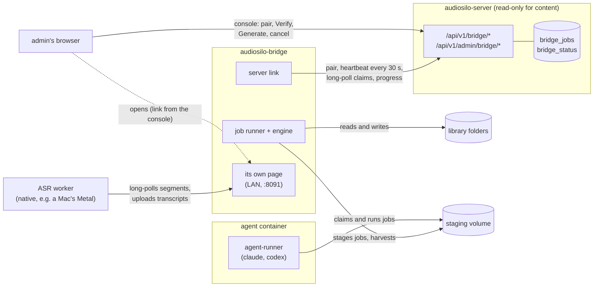

The **Bridge** is an optional, always-on companion to an AudioSilo server. It
**writes** to the library folders and runs the heavy jobs, so the server itself can
stay read-only and safe to expose to the internet. It is a separate program in its
own repository, `audiosilo-bridge`, and runs beside the server, usually as a second
container.

:::info Private repository, built in phases
The `audiosilo-bridge` repository (and its images, `ghcr.io/kodestar/audiosilo-bridge`)
is **private** for now, and the Bridge is being built in phases. **Phase 0** laid
the foundations: pairing, the heartbeat and the capability, the job queue with
leases, the library mapping checks and one proof job, `bridge.verify`. **Phase 1a**
added the first job that makes it useful,
[`sidecars.generate`](generating.md): characters and recaps for a book, written
into the book's [`.audiosilo/` folder](attachments.md) by the sidecars engine, with
its AI agents in a separate [agent container](agent-container.md). **Phase 1b**
added [ASR workers](workers.md): the same binary run natively where speech
recognition is fast (a Mac's Metal), taking the transcription off the Bridge.
**Phase 1c** added own-words, spoiler-free [descriptions](generating.md#the-description-step):
every generate run writes one too, and `sidecars.describe` writes one alone for a
book generated earlier. **Phase 1d** added [chapterless books](chapters.md): a book
with no chapter markers gets its chapters found in the narration, written as
`chapters.json`, and `chapters.detect` finds them on their own, with no agent.
**Phase 2a** added the server's managed modules, and **Phase 2b**
[contributions](contributions.md): an Accounts tab (a GitHub sign-in through the
AudioSilo Contributions App, and the agent's credential handed to the agent
container per run), `sidecars.contribute` and `meta.correct`, and the setup
checklist the heartbeat carries to the console.
Podcasts, read-along, Audible backups and file moves arrive in later phases.
:::

## What it is for

The server never writes into a library: it reads the folders, indexes them and
streams them. Anything that has to **change** files, or that is too heavy to run in
the server (speech recognition, an AI agent), belongs to the Bridge. Its jobs are
started from the server's admin console (and, for generating, from the player's
admin-only action).

The engine came from **audiosilo-sidecars**: its packages (speech recognition, the
agent pipeline, QA, spelling, contribution, the scheduler and supervisor) were
imported **with their history**, so `git log --follow` and `git blame` still reach
the reliability fixes made there. The shell around it (the server link, the job
runner, the mapping checks, the Bridge's own page) is new and smaller. Since Phase
1a the engine runs, behind `sidecars.generate`
([the engine wiring](generating.md#the-engine-wiring)).

## The pull-only rule

**The Bridge calls the server; the server never calls the Bridge.** There is no route
on the Bridge that the server calls and no Bridge address the server dials:

- The server **stores intents and status**: the jobs admins ask for
  (`bridge_jobs`) and the Bridge's last heartbeat (`bridge_status`). It never opens
  a connection to the Bridge.
- The Bridge **pulls**: it sends a heartbeat every 30 seconds, long-polls for jobs,
  and reports progress, which renews each job's lease.
- The console links to the Bridge's own page (the heartbeat's `ui_url`) for the
  admin's browser to open, nothing more.
- **Removing the Bridge breaks nothing.** Its capability turns off two minutes
  after its last heartbeat, and anything that needs it disappears from the UI.

This keeps the server's surface unchanged: it needs no route to the Bridge, no
credentials for it, and nothing about the Bridge's network.

## How it relates to the server

The Bridge is a client of the server's wire format alongside the player. The
server defines the contract and the Bridge mirrors it **by hand** (its
`internal/link`; there is no codegen). A
change to the server's `internal/bridge` or `handlers_bridge.go` is a change in
`audiosilo-bridge` too, with a test on each side. The seam is section 23 of the
workspace `CROSS-REPO.md`; this site's digest is
[the cross-repo contract](../architecture/cross-repo-contract.md#16-the-bridge).

| | Server (`audiosilo-server`) | Bridge (`audiosilo-bridge`) |
|---|---|---|
| Pairing | the console mints a code; `POST /bridge/pair` trades it for a token of kind `bridge` | exchanges the code once, keeps the token sealed |
| Status | stores the last heartbeat; `capabilities.bridge` while it is under 2 minutes old | `PUT /bridge/status` every 30 s |
| Jobs | `bridge_jobs`: the intent and the lease | `server_jobs`: the execution truth |
| Libraries | lists them (id, name, root) and each indexed book's files with their sizes | checks where it sees each one, and whether it can write there |
| UI | Settings > Bridge, the book page's Community card and the series cards in the admin console; the player's book page for an admin | its own page on port 8091 |
| Generated content | indexes a book's `.audiosilo/` files and serves them on `/meta` | writes them |

A few rules hold across the seam:

- **Bridge actions are admin-only.** Only an admin pairs a Bridge, queues its jobs
  or cancels them, and the Bridge's token works only while the admin who paired it
  is still an enabled admin.
- **One Bridge per server.** Pairing another revokes the first.
- **Library mappings are checked, never assumed.** The Bridge proves it sees the
  server's copy of a library (a known book's files, with the server's sizes) before
  anything may write there. See [Library mappings](mappings.md).
- **Path is the identity**, as everywhere: a job is about `(library_id, rel_path)`,
  follows its book when it moves, and goes with its library.
- **Hidden folders stay hidden.** No server route reaches content through a
  dot-folder by name (it never indexes, lists, streams or serves one), so the
  folder the Bridge keeps its files in, inside a book (`.audiosilo/`), can never
  become a phantom book or a streamable file. See
  [the hidden-path rule](attachments.md#the-hidden-path-rule).
- **Agents never touch the library.** The AI agent CLIs run only in the
  [agent container](agent-container.md), which sees a staging folder and its own
  config, nothing else.

## Compatibility

Everything is additive. An older server has no Bridge routes and no `bridge` flag:
the Bridge's pairing gets a `404` (or `405`) and says the server is too old. The
player's first Bridge UI (Phase 1a, admins only) is gated on the flag and the
`sidecars` feature, so it never shows against an older server. Players shipped
before it never see the Bridge, but they do see generated characters and recaps
for a book matched with community metadata (merged into its `/meta` work, without
the mark; see [generated content](../server/api/reference.md#generated-content)).

## In these pages

- [Pairing and jobs](pairing-and-jobs.md) - the token, the heartbeat (its
  `accepts` negotiation and the setup checklist) and the capability, the job model (states, leases, attempts, cancel, resume after a
  restart) and `bridge.verify`.
- [Library mappings](mappings.md) - how the Bridge finds each library and proves it
  has the right one.
- [Characters and recaps](generating.md) - `sidecars.generate`: queueing, the
  estimate, the run, its progress, parks and result, the description step and
  `sidecars.describe`, budgets and the transcript retention.
- [Chapterless books](chapters.md) - Phase 1d: the windows, the
  `chapter_detecting` stage and its detector, `chapters.detect`, and how the
  chapters reach the server.
- [The .audiosilo folder](attachments.md) - where the results go, their formats,
  and how the server finds, checks and serves them.
- [The agent container](agent-container.md) - where the AI agents run, the
  staging protocol, and the credential hand-off.
- [Contributions](contributions.md) - Phase 2b: the Accounts tab (the GitHub
  sign-in, the agent credentials), `sidecars.contribute` and `meta.correct`.
- [Configuration](configuration.md) - the Bridge's settings and environment, the
  images and the compose example.
- [Development](development.md) - the gate, the layout and the Bridge's own page.
- The server's routes are in the [API reference](../server/api/reference.md#the-bridge).
