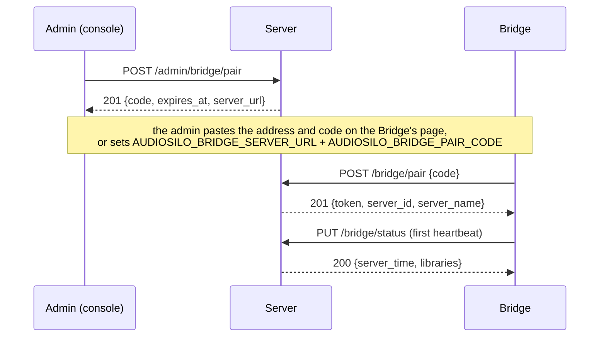
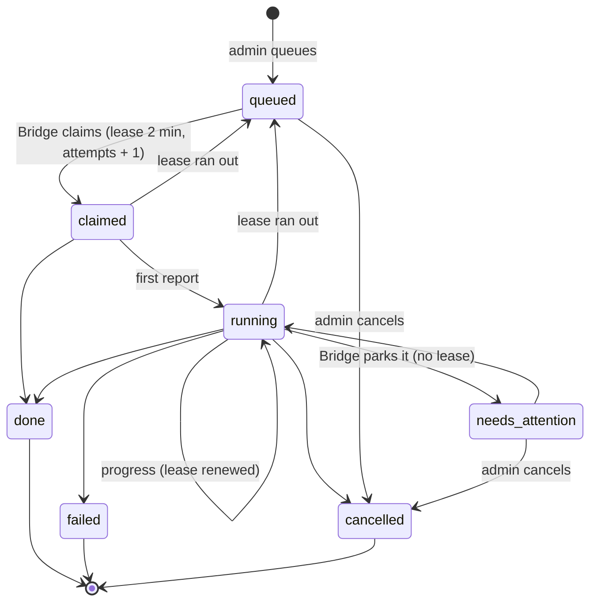

How the Bridge and the server find each other, how the server knows the Bridge is
there, and how work moves between them. Every route named here is in the
[API reference](../server/api/reference.md#the-bridge); server code is
`auth/bridge.go`, `internal/bridge` and `api/handlers_bridge.go`, and the Bridge's
is `internal/link` (the client), `internal/app` (pairing and the heartbeat) and
`internal/jobs` (the runner).

## Pairing



1. **An admin makes a code** in Settings > Bridge (`POST /admin/bridge/pair`, a
   session only: an API key is refused, since this mints a credential). The code
   is shown once, lasts **15 minutes**, and is stored only as a hash in the single
   `bridge_status` row. Making another replaces one still waiting; a Bridge that is
   already paired keeps working until a new Bridge exchanges the code. The answer's
   `server_url` is the address to give the Bridge: the server's home address when
   it has one (plain `http` on the local network for a self-signed server, whose
   certificate the Bridge can't verify), else its public or request address.
2. **The Bridge exchanges it** at the public `POST /bridge/pair`, which shares the
   per-address failure limit of `POST /auth/redeem`. In **one transaction** the
   server checks the code, its expiry and that the admin who made it is still an
   enabled admin, uses it up, revokes every earlier bridge token and clears the
   last Bridge's status, then mints a token of kind `bridge` for that admin. So
   there is **one Bridge per server**, and a new one starts from nothing.
3. **The Bridge keeps the token sealed** in its secrets folder, never in its
   config file (see [Configuration](configuration.md#secrets)), and sends its
   first heartbeat at once.

The Bridge pairs from its own page, or on its first start from the two environment
variables the console's dialog shows. It listens on its page's port **before** it
uses an environment code, so a start that can't serve never spends the code. A
Bridge that is already paired refuses to pair again until it is unpaired. Its page
words a failed pairing:

| What happened | What the page says |
|---|---|
| a wrong, used or expired code (`401`) | the code is wrong, used or expired: make a new one in the console |
| `404` or `405` | the server doesn't know about a Bridge: update it |
| another refusal (a `4xx`) | the server refused the pairing, with the server's message |
| the server's certificate can't be verified (a self-signed one) | pair with the server's `http://` address on the local network (the server also answers plain HTTP on the same port there) |
| an address that isn't an absolute `http(s)` URL | a `400` on the page's own API |
| no answer (the request itself failed, or the answer didn't finish in time) | `Couldn't reach <address>` with the reason in a few words (no such host, its name couldn't be looked up, nothing answered on that port, no route to that address, it didn't answer in time) and, for those, the address to use instead: the server's as this computer reaches it, like `http://192.168.1.10:8080` (a compose service name given to a Bridge outside that compose project is the usual cause). A `502` on the page's API |
| a `5xx` from the server | the server at that address answered with an error (its status and message): try again, then check the server's log. A `502` |
| an answer the Bridge can't use (not JSON, no token) | check the address is the AudioSilo server's and that it is up to date. A `502` |
| the server accepted the code, but the Bridge couldn't keep its token or the pairing (`pairNotSaved`) | the pairing wasn't saved: fix the cause (the Bridge's log), make a new code and pair again, since the code is spent. A `500` that shows this sentence (`api.ErrFailed`); the token is forgotten again, so a restart never comes back half paired |

`pairError` (`internal/app/backend.go`) does the wording, from v0.4.0. Once the
server has accepted the code, `Conn.Pair` saves without the caller's cancellation
(`context.WithoutCancel`), so a page closed mid-pairing doesn't lose a spent code.

**Unpairing** is either side's. The console's `DELETE /admin/bridge` revokes the
token and forgets the Bridge's status (its jobs stay). The Bridge's own Unpair only
forgets the token on its side, so the console still shows it paired until it is
unpaired there too.

**A refused token.** A `401` on any call means the server refuses the token: it was
unpaired in the console, another Bridge was paired, or the admin who paired it is no
longer an enabled admin. The Bridge **keeps the token** but stops calling in (no
heartbeat, no claims), says why on its page, and tries a heartbeat again every **5
minutes**. If the server takes the token again (the admin was made an admin again),
the Bridge carries on by itself, resuming the jobs the refusal stopped; an unpair or
a new pairing revoked the token for good, so it has to be paired again. A `503`
(the server couldn't check the token) is not a refusal: the Bridge just tries
again.

## The bridge token

A bridge token is a `tokens` row of kind `bridge`, hashed like every token. It is
the narrowest credential the server has:

- **The Bridge's routes only.** Routes opt in to the token kinds they accept, and
  only `/api/v1/bridge/*` lists `bridge`. Every other route refuses it with `401`,
  and the media routes' `?token=` never takes it. A route-table test sends a bridge
  token, in the header and as `?token=`, to every other authenticated route.
- **The header only**: `Authorization: Bearer <token>`.
- **Its admin's.** It belongs to the admin who made the code, and works only while
  that account exists, is enabled and is still an admin. Demoting or disabling the
  admin stops the Bridge at its next call.
- **Checked again inside the write.** The heartbeat checks the token again in its
  own transaction, and every claim checks it again on the reader and, if it goes on
  to write, in its transaction too (see [Claims and leases](#claims-and-leases)), so
  a call authenticated just before a pairing or an unpair revoked its token (a claim
  waiting out its long poll, say) saves nothing and claims nothing: `401`.
- **Never a device, never touched.** The device lists and sign-outs leave it out,
  and its calls don't bump `last_seen`: a heartbeat every 30 seconds is not its
  admin's activity.

The Bridge's routes refuse every other credential in turn: a session, an API key or
a cast token gets `401` there.

## The heartbeat and the capability

The Bridge sends `PUT /bridge/status` every **30 seconds**, and at once after
pairing and after a mapping check finishes:

| Field | What it carries |
|---|---|
| `version` | the Bridge's version |
| `kinds` | the job kinds it runs (`bridge.verify`, `sidecars.generate` since Phase 1a, `sidecars.describe` since Phase 1c, `chapters.detect` since Phase 1d, `sidecars.contribute` and `meta.correct` since Phase 2b, and `readalong.align` since Phase 3c) |
| `libraries` | its last [mapping check](mappings.md) of each library |
| `workers` | its [ASR workers](workers.md) that have connected at least once: `name`, `version`, `platform` (the GOOS/GOARCH and the speech recognition in one line, e.g. `darwin/arm64, mlx-whisper (metal)`) and `last_seen` |
| `ui_url` | its own page as the local network reaches it (its `public_url` setting), which the console links to |
| `estimates` | its figures for costing a job before it is queued, one block per family (`sidecars`: [the Bridge's figures](generating.md#the-bridges-figures)); absent until its engine has started |
| `setup` | Phase 2b, **only once the server accepts it** (below): the setup checklist (`items`), `can_contribute` and `github_login` |

The server checks its structure and refuses it when that is wrong (kinds of the
form `family.name`, listed once; library ids above 0, listed once; `ui_url` an
absolute `http(s)` URL, since the console renders it as a link). Its **free text**
(the version, the mappings' paths and errors, the workers) is **cleaned rather than
refused**: control characters become spaces and each text is cut to its limit. Much
of it comes from the outside world (a file name, an OS error), and a refused
heartbeat would leave the Bridge offline. The server keeps **only the last one**,
in `bridge_status`. Its answer lists the
server's libraries (`id`, `name`, `root`), which is how the Bridge learns which
libraries to map, and since Phase 2b `accepts`.

### Optional blocks: `accepts`

The server decodes the heartbeat **strictly** (an unknown field is a `400`), so a
newer Bridge can't simply add a field. Phase 2b negotiates instead: the reply
carries `accepts`, the optional protocol features this server reads
(`bridge.HeartbeatAccepts`, `["setup", "claim_min_priority"]` today; an older
server sends none). `setup` names a heartbeat block; `claim_min_priority`
permits a claim query option, not a new heartbeat request field. The
Bridge (`link.StatusReply.Accepting`, `internal/app`):

- sends `setup` only after a reply listed it, per pairing and in memory, and
  kicks a second beat at once when it first appears, so the console doesn't wait
  30 seconds for the checklist;
- on a `400` to a beat that carried an optional block (the server was downgraded),
  drops them all, resends once without them, and ignores `accepts` for an hour;
- forgets all of it on every pair and unpair, and when the server refuses its
  token or takes it again.

So a Phase 2b Bridge works with an older server (no checklist in the console) and
an older Bridge with a Phase 2b server (no `setup` sent, none shown).
The link separately remembers `claim_min_priority` for that pairing. Without
it, the runner makes ordinary claims and uses two ordinary download slots.

### The setup checklist

`setup` is the Bridge's onboarding checklist (FIRST-RUN-PLAN F2), built by the
Bridge's pure `setup.Checklist` from what the app already knows, in a fixed order:

| `id` | `required` | `done` when | `detail` |
|---|---|---|---|
| `paired` | yes | the Bridge is paired | |
| `libraries` | yes | the Bridge has checked libraries and every one is mapped and writable (a library counts once it has been checked) | "1 of 2 libraries writable" (or "the server has no libraries yet", also before the first check); `library_ids` lists the ones still to fix |
| `asr` | yes | the engine has started and something can transcribe now, not waiting for a worker | `local`, `worker`, "waiting for an ASR worker", "the engine is starting", or why it isn't available |
| `agent` | yes | the agent container is available (with its own or a handed-over credential) | the backend, or why it isn't ready |
| `budget` | yes | the monthly budget was saved on the page or is set by the environment (`Config.BudgetReviewed`) | "$100 a month" or "no monthly cap" |
| `github` | no | a GitHub token resolves and isn't refused | the login, "a token from the environment" or "the gh CLI's token" |

```json
"setup": {
  "items": [
    {"id": "paired", "done": true, "required": true},
    {"id": "libraries", "done": false, "required": true, "detail": "1 of 2 libraries writable", "library_ids": [3]},
    {"id": "asr", "done": true, "required": true, "detail": "local"},
    {"id": "agent", "done": false, "required": true, "detail": "claude has no credential: set one on the Bridge's Accounts tab (a `claude setup-token` value or an Anthropic API key), or give one to the agent container"},
    {"id": "budget", "done": true, "required": true, "detail": "$100 a month"},
    {"id": "github", "done": false, "required": false}
  ],
  "can_contribute": false
}
```

The `asr` item's "waiting for an ASR worker" is a stable string
(`setup.DetailASRWaiting`): from v0.4.0 the Bridge's Status tab, and the console's
Setup card from server 2.5.0 (`ASR_WAITING_DETAIL` in `setup-model.ts`), match it to
link the Bridge's Workers tab, so keep the words when changing the checklist.

The Bridge collapses each detail's whitespace and cuts it to 200 bytes (ending
"..."). The server reads the block
**leniently**, like `estimates` (`bridge/setup.go`; a block that doesn't decode is
dropped, never the heartbeat), within the bounds in the
[heartbeat reference](../server/api/reference.md#put-apiv1bridgestatus). An
**unknown id is kept**: the Bridge owns the list, and the console words the ids it
knows and shows the rest with a capital first letter, `_`, `.` and `-` read as
spaces (`ebook_reader` is "Ebook reader"). [`GET /admin/bridge`](../server/api/reference.md#get-apiv1adminbridge)
carries it (with the login, admins only); `GET /server` never does.

`can_contribute` here **wins** over `estimates.sidecars.can_contribute`
(`Status.CanContribute()`: the setup block's when one was sent and kept, else the
estimates'). The Bridge keeps sending both, so an older server still reads the
estimates' copy. The Bridge's page shows the same checklist as its Status tab's
"Get set up" card until every required item is done.

The server counts the Bridge **online** while the last heartbeat is under **two
minutes** old (`bridge.OnlineWindow`). Then, and only then, `GET /server` says
`capabilities.bridge: true`, with a top-level `bridge: {version, features}` beside
`capabilities`. `features` are the job families the Bridge runs **that the server
knows**: the part of each known kind before its dot, so `bridge.verify` gives
`bridge`, `sidecars.generate` (or `sidecars.describe`, `sidecars.contribute`) gives `sidecars`, `chapters.detect` gives `chapters`, `meta.correct` gives `meta` and `readalong.align` gives `readalong`; `podcast.subscribe` and `podcast.poll` give `podcast` (a list, `[]` for none, never `null`). `features` also lists `contribute` while the Bridge can contribute (`Status.CanContribute()`, above; `bridge.FeatureContribute`), the first feature that is not a job family. The server's `contributions` [module](../server/modules.md) needs that feature. **The `bridge` block goes only to a signed-in caller** (Phase 2b): a session or an API key of any role, not a demo account's (`api.signedIn` over `auth.Peek`, which records nothing on the token); an anonymous, refused, demo or bridge token sees the flag alone. The capability flags stay public. The server reuses the heartbeat it
read for up to **5 seconds**, so `GET /server`, which every client calls often,
rarely reads the database for it; a pairing or an unpair drops that copy at once. A
client checks the flag **and** the feature it needs; a feature the Bridge doesn't
advertise is off even while the flag is on. The console reads `GET /admin/bridge`
for its Bridge page, and both the console and the player gate
[Generate characters and recaps](generating.md#who-sees-the-action) on the flag
and the `sidecars` feature.

The Bridge counts itself online the same way on its own page: the last heartbeat
went through less than two minutes ago and the last one didn't fail. It runs no job
on a new link (after pairing, a restart or a refusal that ended) until a heartbeat
has gone through on it, so it knows the server's libraries first.

## The job model

Two rows describe every job:

- **The server's `bridge_jobs` row is the intent and the lease**: what an admin
  asked for, its state, and which claim holds it until when. It is path-keyed like
  durable user state (`library_id`, `rel_path`; no foreign key to the book index),
  moves with its book and goes with its library.
- **The Bridge's `server_jobs` row is the execution truth**: the jobs this Bridge
  claimed, by the server's job id and attempt, with what it found and whether the
  server has taken its final report.

### States



`queued`, `claimed`, `running` and `needs_attention` are **open**; a kind, a library
and a path have at most one open job (the `dedupe_key` and a unique partial index),
so a second press of the same button returns the open job (`200`, not `201`).
The Bridge may report a job it holds (`claimed`, `running` or `needs_attention`) as
`running`, `done`, `failed`, `needs_attention` or `cancelled`; it can never put a
job back in the queue.

### Claims and leases

The Bridge long-polls `GET /bridge/jobs/next?wait=25&kind=…`. The server picks the
highest-priority, oldest queued job among the kinds the last heartbeat named that
the server knows, narrowed to the `kind` values (the kinds the Bridge has a free
**lane** for), and leases it to the Bridge for **2 minutes** (`bridge.Lease`),
incrementing `attempts`. With none queued it waits up to 25 seconds, and a job
queued meanwhile (or one put back by a lapsed lease) wakes it; with no kind left after the
narrowing it answers `204` at once, and a server that is stopping ends the wait
with `204`. Before the first heartbeat a claim is `409 no_heartbeat`, and a claim
whose token a pairing or an unpair revoked during the wait is `401`.

**An idle claim writes nothing.** Each try first reads, on the reader pool
(`bridge.claimDue`), whether the token is still live and whether the claim has
anything to write: a lease that ran out, a private follow request whose feed URL
the server no longer holds, or a queued job it would hand out. Only then does it
take the writer, check the token again and claim, in one transaction committed
durably ([`WithDurableTx`](../server/data-model.md#sqlite-choices): an attempt
number is never handed out twice). An idle Bridge long-polls without pause, so a
write per claim would keep emptying the server's
[list answer cache](../server/overview.md#the-list-answer-cache) and token cache
for nothing. A job queued after the read still wakes the waiting
claim, and a lease that lapses later is due at the next one.

After `accepts` lists `claim_min_priority`, the reserved dispatcher uses
`GET /bridge/jobs/next?kind=podcast.fetch&min_priority=100&wait=25`.
The optional floor is one signed base-10 int32; malformed, empty, repeated or
out-of-range values are `400 invalid_request`. Omission keeps ordinary claim
behavior. Filtering happens inside the claim transaction before lease or
attempt mutation, alongside kind/module/token checks; priority descending
then id ascending still decides order. A request deadline answers 503.

The Bridge's `internal/jobs` runner has one ordinary and one reserved
dispatcher, reserving lane admission before claiming. Defaults are `light:2`,
`download:1`, `interactive:1`, `pipeline:25`. The reserve only accepts opted-in
handlers at priority at least 100 (`InteractiveHandler`, `podcast.fetch`
today), never background work. Ordinary slots can take interactive jobs too;
total enclosure concurrency stays at two. Without negotiated support,
`interactive` becomes zero and `download` two, so an older server ignoring an
unknown query cannot fill the reserve with background jobs. The lanes the page
lists (`Runner.Lanes`, in `GET /api/status`) leave out a lane with no capacity
and nothing running, so that folded `interactive` lane no longer shows as
"0 of 0" (v0.3.0).

A change to eligible kinds, pairing, negotiated reserve or capacities cancels
and joins the outstanding claim, then reissues immediately without cancellation
backoff. Unchanged heartbeats/progress do not restart the long poll. Admission
is kept until that call returns, so a job racing cancellation is still owned
and handled. Jobs recovered after restart or stranded by re-pairing resume
through ordinary admission because persisted execution rows have no priority.

If the claim committed a lease but the reply was not delivered (including
write/flush failure or Bridge disconnect), the server releases that untouched
claim without spending an attempt. State, attempt and lease must still match;
a reported/renewed claim is left alone. A successfully flushed reply is not
released merely because shutdown or a deadline follows it. Lost replies that
cannot be released still use normal lease recovery.

Every report (`PATCH /bridge/jobs/{id}`) renews the lease. A job's handler only
records its progress; a reporting loop beside it sends each new step at once, other
changes at most every 2 seconds, and a keepalive at least every **30 seconds** even
with nothing new (`jobs.DefaultKeepalive`), so a lease only runs out when the
Bridge stops. Every report is a server write that empties the caches keyed on the
write generation, so the keepalive is as rare as it can be: four still fit in the
2-minute lease. After a report that didn't reach the server (no answer, a 5xx, a
408 or a 429) the next goes after **10 seconds** (`jobs.DefaultReportRetry`) until
one gets through, so a few lost reports never let the lease lapse. After any other
4xx, which would be refused again however soon, it waits for the keepalive.

A report carries the `attempt` its claim returned: a report from an earlier claim is
`409 not_held`, as is one about a job that ended, was cancelled or no longer exists
(the route never answers `finished`). Its `error` text is cleaned rather than
refused (control characters become spaces, line breaks stay, cut at 2 KiB), since
a refused final report would be retried for ever while its job ran again; the
Bridge also keeps its own reports inside the server's limits (a step of 128 bytes,
a message of 1 KiB, an error of 1 KiB) and fails a job whose result wouldn't fit.

When a lease runs out the job goes back to `queued`, with the dead attempt's
`progress`, `result` and `error` reset, unless:

- it was on its **third** attempt (`bridge.MaxAttempts`): it **fails**, with the
  error "the Bridge stopped reporting on every attempt";
- an admin had asked to **cancel** it: it is cancelled.

Those two keep what was reported.

The server checks leases whenever a job is claimed, reported on, cancelled or read
by the console, so a Bridge that died mid-job leaves the job queued again (or
ended) by the time anyone looks.

### Cancelling

`POST /admin/bridge/jobs/{id}/cancel` ends a `queued` or `needs_attention` job at
once (nobody is working on it). For a `claimed` or `running` job it sets
`cancel_requested`: the Bridge reads it in the answer to its next report (within
about 32 seconds at a job with nothing new to report: the keepalive plus one
2-second reporter tick), stops the job and reports it `cancelled`. The console
shows the job as cancelling meanwhile. If the Bridge never reports again, the
lease runs out and the job is cancelled then. Cancelling an ended job is
`409 finished`. Until a cancelled job has stopped it is still open, so queuing the
same again returns it (the console says it is still stopping).

The Bridge's own page can cancel a job it is running too; that is reported to the
server as `cancelled`, the same as an admin's cancel.

### Resuming after a restart

A Bridge that stops (a restart, an update, a crash) leaves its `server_jobs` rows as
they were:

- **A job that was running** is resumed at the next start, once the link is up,
  **under the same claim**: its first report carries the old attempt. If the lease
  is still alive the job simply carries on. If it ran out meanwhile, the server
  has queued the job again (or claimed it as a later attempt), so that report gets
  `409`; the Bridge records the row as `lost` and the claim loop takes the job again
  as the next attempt.
- **A job that had finished** but whose final report never reached the server is
  reported again, every 30 seconds, until the server takes it or says it has moved
  on.
- A running job of a kind the Bridge no longer runs is failed.
- **A parked job** (`needs_attention`) resumes parked, and its first report
  sends the progress it last recorded, park code and all (v0.3.0). While it
  stays parked, a report whose progress names no park keeps the one before it
  (`Reporter.Progress`), since a resumed job reports its first steps before it
  hears its engine's park again. The server keeps the stored park too when an
  update to a parked job names none (`carryPark` in `internal/bridge`, server
  2.4.0), so a restart no longer reads as a park dropped and a new one raised:
  no spurious `bridge_job_failed` events, and the console keeps the reason.

When the server refuses the token (a `401`), a running job stops where it is,
without a final report, and is kept aside. When a link to the same server works
again (the refusal ended, or the Bridge was paired with that server again) it is
resumed under its claim, as after a restart: if the server took it back meanwhile,
its first report is a `409` and it is dropped. Paired with another server instead,
it is recorded as lost: each `server_jobs` row records the `server_id` of the server
that handed it out (Bridge store migration `0003`), so a start that finds an open
row of another server never reports it to the wrong one.

### Kinds are allow-listed twice

The server queues a job only when its kind is **one the server knows** (it can
check the job's parameters: `bridge.Known`, a per-kind table in `internal/bridge`)
**and one the paired Bridge advertised** in its last heartbeat. Otherwise
`POST /admin/bridge/jobs` is `409 kind_unavailable`. The Bridge may be offline: the
job waits for it. Likewise a claim only ever hands out kinds that are in both lists.
So neither side can be made to run something the other doesn't understand: a
Bridge can't advertise a kind into existence, and the server can't queue one the
Bridge doesn't have.

The server's table also says whether a kind **writes** into the library. Such a
kind (`sidecars.generate`, `sidecars.describe`, `chapters.detect`, `readalong.align`, `podcast.subscribe`,
`podcast.poll`, `podcast.fetch`, `podcast.retain`) is queued only for a library the last heartbeat reports
**mapped and writable**, else `409 library_not_writable`, after the dedupe (an open
job is still returned). `bridge.verify`, `sidecars.contribute` and `meta.correct`
write nothing. Book-writing jobs refuse a podcast library with
`409 not_book_library`; podcast jobs require a podcast library.

Two kinds write the same book's files, so the server keeps them apart
(`bridge.Service.Enqueue`, inside its transaction, after the dedupe): a
`sidecars.describe` job is refused with `409 generate_open` (`ErrGenerateOpen`)
while a `sidecars.generate` job is open for the book, which writes the description
itself when it finishes; and a `sidecars.generate` job queued while a
`sidecars.describe` job is open **cancels** that one (`cancelOpenTx`: at once when
it is queued or parked, else `cancel_requested`, its error "a generate job for the
book replaced it"). A generate job is never refused for an open describe job. See
[A description on its own](generating.md#a-description-on-its-own-sidecarsdescribe).

Phase 1d's `chapters.detect` and Phase 3c's `readalong.align` join them. `kindSpec`'s `refusedWhileOpen` and
`cancelsOpen` are the one statement of which open kind refuses, or gives way to,
which:

| New job | Refused while open for the book | Cancels |
|---|---|---|
| `sidecars.generate` | `chapters.detect` queued, claimed or running (`409 detect_open`: cancelling it would throw its transcription away, and a generate job queued after it reuses it); `sidecars.contribute` queued or working (`409 contribute_open`, `ErrContributeOpen`: it would replace the characters and recaps being filed), but not a queued one held while the `contributions` module is off (`Service.givesWay`, `Service.held`); `readalong.align` queued or working (`409 readalong_open`, `ErrReadalongOpen`: both transcribe the same audio, and a generate job after it continues its run) | an open `sidecars.describe`; a **parked** `chapters.detect` ("it finds the chapters itself"); a **parked** or **held** `sidecars.contribute` ("a generate job for the book replaced what it was sharing"); a **parked** `readalong.align` ("a generate job for the book replaced it; make the read-along again after") |
| `sidecars.describe` | `sidecars.generate` (`409 generate_open`), `chapters.detect` (`409 detect_open`: both rewrite the book's `bridge.json`) | nothing |
| `chapters.detect` | `sidecars.generate` (`409 generate_open`), `sidecars.describe` (`409 describe_open`), `readalong.align` (`409 readalong_open`) | nothing |
| `sidecars.contribute` | `sidecars.generate` (`409 generate_open`: that run replaces what it would file) | nothing |
| `meta.correct` | nothing | nothing |
| `readalong.align` | `sidecars.generate` (`409 generate_open`), `chapters.detect` (`409 detect_open`), parked ones too: the Bridge runs one engine book per audio source, so runs over the same audio never overlap | nothing |

A job being cancelled (`cancel_requested`) refuses nothing, since it ends without
writing (so a detect job queues behind a generate job being cancelled), and the
blocker kinds are asked in name order, so the answer is stable.
`Service.Blocker` names the open job that refuses a new job of a kind now (the
estimate's `open_job` uses it). The api also refuses `chapters.detect` with `409
chapters_chosen` for a book whose chapter source an admin chose (the catalog holds
the choice), since a found list stands in only with no choice, and
`readalong.align` with `409 no_ebook` for a book whose index holds no ebook
(before the queue). See [Read-along](readalong.md#the-job).

### Jobs of a managed module

Phase 2b's community jobs belong to the `contributions`
[module](../server/modules.md): `kindSpec.module` names it for `sidecars.contribute`
and `meta.correct`, and `bridge.ModuleFor(kind, params)` also names it for a
`sidecars.generate` job with `contribute: "issue"`. For such a job:

- `POST /admin/bridge/jobs` answers **`404 module_off`** while the module's toggle
  is off, before anything else about the job is checked (as the module's own
  routes would);
- `Enqueue` refuses it **`409 cannot_contribute`** unless `Status.CanContribute()`;
- while the toggle is off, a **queued** one is **held**: `nextQueued` passes over
  it (`bridge.Service.ModuleOn`, wired by `SetBridge`), so turning the module off
  leaves its queued jobs at rest, a requeued one included, until it is on again;
  a held `sidecars.contribute` job still gives way to a new `sidecars.generate`
  job for the book like a parked one (no `409 contribute_open`, not the estimate's
  `open_job`, cancelled). "Off" is the toggle alone: with it on, a queued share
  refuses a generate job even while the Bridge can't contribute. A job the Bridge
  already holds (claimed, running or parked) carries on.

On the Bridge, each kind has a handler and a **lane**: how many jobs of that lane
run at once. `light` has room for 2 (`bridge.verify`, and Phase 2b's
`sidecars.contribute` and `meta.correct`, a few reads and HTTP calls each); `pipeline` for 25
(`sidecars.generate`, whose jobs mostly wait on the engine's own scheduler, which
decides what actually runs, `sidecars.describe`, which can wait a long time
on an agent park, `chapters.detect`, which follows an engine book like
generate, and Phase 3c's `readalong.align`, likewise).

### Podcast jobs

`podcast.subscribe`, `podcast.poll`, `podcast.fetch` and `podcast.retain` belong
to `podcasts` and require a mapped, writable podcast library. Fetch runs in the
`download` lane (1 ordinary slot), with an additional reserved `interactive`
slot for priority 100 work after negotiation; the others run in `light` (2).
The server creates them from dedicated actions and its scheduler;
`POST /admin/bridge/jobs` refuses these internal kinds with `400`.
The module's toggle holds queued jobs while off, as for contributions.
Heartbeat replies always include library `kind`; the Bridge treats a missing
kind as `books`. Private subscribe URLs are injected only into the claim
response, sealed before local claim recording, and redacted on other reads.
Default admin job lists omit polls unless `kind=podcast.poll` is requested;
fetch and retain jobs are listed.
Phase 2c-3's OPML import queues the same `podcast.subscribe` jobs as a single
follow, so the Bridge sees no new kind or params; directory search runs on
the server ([Discovery and OPML](podcasts.md#discovery-and-opml-transfer)).
All podcast kinds are quiet and send no notifications. Fetch/retain outcomes
never update feed polling state. Triggers share one fetch intent per episode;
params, dedupe, priorities and promotion are in
[fetch and retain jobs](podcasts.md#fetch-and-retain-jobs).

[Podcasts](podcasts.md) describes job params/results, scheduling, privacy and
file ownership; the [reference](../server/api/reference.md#podcasts) lists the
listener routes.

### Notifications

The server tells admins about notable jobs itself (the Bridge has no route for
it); neither podcast kind is `Job.Notable`. When a notable job moves into `done`
it records `bridge_job_finished`, and into `failed`, or into
`needs_attention` with a park that isn't transient, `bridge_job_failed`, once per
move and only after the move has committed. That covers the Bridge's reports and a
lease that runs out on the last attempt alike. A report that leaves the state as it
was is never news. The rules (which parks are transient) are in
[Characters and recaps](generating.md#notifications), the events in
[Notifications](../server/backups-and-notifications.md#events).

## The proof job: `bridge.verify`

Phase 0's one kind proves the loop end to end without changing anything: the
console's **Verify** button on a library queues it.

| | |
|---|---|
| **Queued with** | `library_id` (required) and an optional book `path` (an indexed book; without one, the library's sample book, the one the mapping check uses: the first whole book among its first five by title) |
| **Params** | `{ "hold_seconds": 0-600 }`, optional: how long to wait before finishing, so a cancel, an unpair or a killed Bridge can be tried mid-job (0 is stored as `{}`) |
| **Lane** | `light` |

What the Bridge does:

1. Finds the library among the ones the server listed and where it sees it (its
   mapping, else the server's root path).
2. Asks the server for the book's files (`GET /bridge/libraries/{id}/book`).
3. Stats each file through its mount and compares the size with the server's.
4. When they all match, probes whether it can write in **the book's own folder**
   (a probe file created and removed; a folder can refuse writes where the
   library root allows them).
5. Holds for `hold_seconds`, reporting each second.

Progress is `{ step, message, done?, total? }`, with the steps `mapping`
("Finding the library"), `lookup` ("Asking the server for the book's files"),
`stat` ("Comparing the files", with the count), `writable` ("Checking the book's
folder can be written") and `hold` ("Holding, as asked", with the seconds). The
result:

```json
{
  "library_id": 1,
  "mount_path": "/audiobooks",
  "path": "Andy Weir/Project Hail Mary",
  "files": [
    { "path": "Andy Weir/Project Hail Mary/Project Hail Mary.m4b",
      "size": 912345678, "expected_size": 912345678, "ok": true }
  ],
  "writable": true,
  "elapsed_ms": 412
}
```

The full shape is `{library_id, mount_path, path, files[{path, size,
expected_size, ok, error?}], writable, writable_error?, elapsed_ms}`, with at most
50 files. A file that doesn't match carries an `error` ("not found here",
"permission denied", or "size differs: N bytes here, M on the server"); when the
book's folder isn't writable, `writable_error` says why. Both are left out when
there is nothing to say. A mismatch **fails the job with its result**,
so the console still shows which files didn't match. The console's job list sums
the result up in one line (how many files matched, whether it can write, how long
it took, where it looked) and shows the raw JSON under **Details**.
