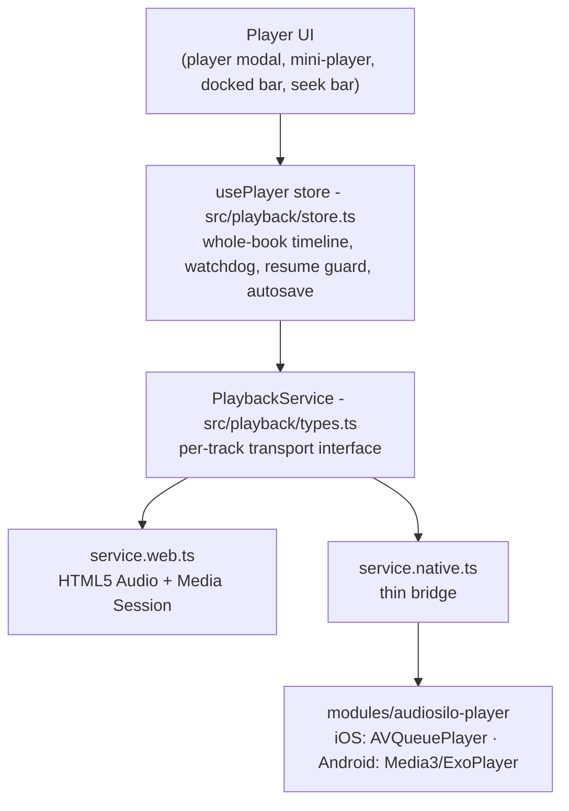
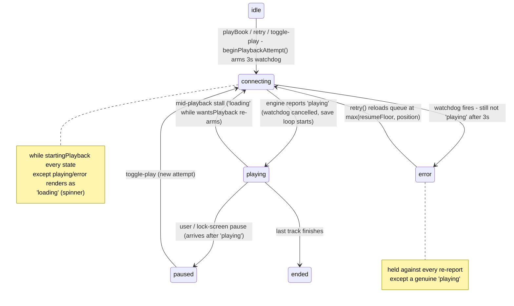

Playback is split into four layers, each with its own contract:

The engines only know about **tracks** (individual audio files) and report raw
transport state. The whole-book timeline, chapters, resume and the error policy
live in shared JS, so all three platforms behave identically.

## The `PlaybackService` interface

`src/playback/types.ts` defines the engine contract:

- `load(tracks, startIndex, positionInTrack, chapters?, book?)` replaces the queue.
  - `tracks` are `PlaybackTrack`s: a URL, optional auth `headers`, metadata and an
    optional `duration`.
  - `chapters` is an optional list of `PlaybackChapter` clips for the native lock
    screens' chapter view on both platforms (described below). The web accepts it
    and ignores it.
  - `book` (`BookRef`: connection id, library id, path) optionally names the book.
    A native engine that outlives the JS, such as the Android service played from
    the car, can then say later which book its queue is. `swapTo` takes it too.
- `play`, `pause`, `seekTo(positionInTrack)`, `skipToTrack(index, pos?)`, `setRate`
  and `reset`.
- `swapTo?(…)` is an optional gapless queue swap. It moves a streaming book onto its
  just-finished download without an audible gap, and returns `false` when it
  refuses (see [Offline](offline.md)).
- `setVolume(volume)` is a **required** linear output gain (0-1). It applies to the
  engine's own volume, **not** the device volume. It exists for the sleep timer's
  fade-out on **duration** timers ([The sleep timer](sleep-timer.md#the-timer-sleep-timerts)).
  - It is deliberately not optional. Both engines implement it, and each engine
    degrades its one real "no volume here" case internally, as its own private
    business ([Writing the gain](sleep-timer.md#writing-the-gain-setvolume-is-required-degraded-per-engine)).
  - Callers pass a value that is already clamped. `usePlayer.setOutputVolume` is
    the only route in, and it clamps once.
- `configure(config)` takes runtime tunables from the settings store: the
  auto-rewind window, the lock-screen skip intervals, and the `smartSpeed` and
  `voiceBoost` switches ([Smart speed and Voice boost](audio-effects.md)).
- Optional native hooks, none of which the web has:
  - `onRemoteMove(handler)`: the engine has **already** moved for something
    outside the JS API and landed at `(trackIndex, positionInTrack)` (see the
    [module's events](#the-native-module-modulesaudiosilo-player)).
  - `onRateChange(handler)`: the OS changed the speed, and the engine already runs
    at it.
  - `onSilenceSaved(handler)`: Smart speed's running total. It is not playback
    state, so it is not in the snapshot.
  - `adoptPlace(snapshot)`: seeds the merged snapshot without emitting, for
    [adopting](native-integrations.md#adopting-a-book-the-service-loaded) a book
    the Android service loaded.

  A bookmark button outside the app is not an engine hook. The car controller
  listens for the module's `onRemoteBookmark` itself (see
  [Native integrations](native-integrations.md#the-car-snapshot-srccar)).
- `getSnapshot()` and `subscribe(listener)` give a single merged
  `PlaybackSnapshot { state, trackIndex, position, duration, rate }`, with
  **per-track** positions only. The states are `idle | loading | ready | playing |
  paused | ended | error`.

Metro resolves the implementation per platform: `service.web.ts` on web and
`service.native.ts` on iOS and Android. `service.ts` is a **throwing fallback that
exists only so `tsc` can resolve the import**. Nothing ever executes it.

Both `createPlaybackService()`s return their engine wrapped in the Cast route
switch (`routed`, `src/cast/routed-service.ts`). Behind the same interface, the
switch hands playback to a Cast receiver while a session is connected, and back
after it (see [Chromecast](chromecast.md#casting-is-a-playback-route-not-a-second-player)).

### Web engine (`service.web.ts`)

The web engine is a single `HTMLAudioElement` that it advances by hand on `ended`,
since there is no native queue. Key points:

- The session token is already in the stream URL (`?token=`, see
  [State & data](state-and-data.md)). The browser's own Range requests for seeking
  and scrubbing therefore authenticate without headers.
- **Another origin's stream loads in CORS mode.** Before every `src` change (a
  load, a file skip, the `swapTo` element), the engine sets the element's
  `crossOrigin` from `corsModeFor` (`src/lib/cors-mode.ts`):
  - `'anonymous'` for an http(s) URL on an origin other than the page's;
  - none for the player's own origin at `/web`, the service worker's `_offline/`
    copies, `blob:` and `data:`.

  The server's `cors_origins` decides whether that load succeeds. CORS mode ignores
  `Cross-Origin-Resource-Policy` ([CORS](../server/api/index.md#cors)).
- The **Media Session API** wires the lock-screen and notification transport
  controls. It sets metadata per track, plus `play`, `pause`, `seekbackward` and
  `seekforward` handlers that use the configured jump intervals. Those seeks go back
  **through the store** (`onRemoteSeek`, which the store registers to
  `seekInTrack`), so a lock-screen seek lowers the resume floor and saves like any
  deliberate seek.
- **A browser autoplay refusal is a pause, not an error.** `play()` without a user
  gesture, such as a cold `/player` deep link, rejects with `NotAllowedError`. The
  engine settles its snapshot on `paused` and rethrows the error as
  `AutoplayBlockedError` (`types.ts`), which the store's `startEngine` catches.
- **A source that failed is a `PlaybackStartError('audio')`.** `playElement` reads
  two errors as a failed source: a `NotSupportedError` ("no supported sources"),
  and an `AbortError` from an element that has errored. It settles the snapshot on
  `error` and throws `PlaybackStartError` (`types.ts`) with reason `audio`. An
  `AbortError` from a healthy element is a `play()` that a pause or the next source
  superseded, so nothing is thrown.
- **A load ignores its own first `timeupdate`.** Setting `src` queues a
  `timeupdate` at `currentTime` 0 before any metadata arrives. The engine marks the
  element `placing` until `loadedmetadata` has made the start seek, or the element
  fires `seeked`, and ignores its `timeupdate`s meanwhile. The snapshot keeps the
  load's position. A source that then fails keeps it too, so Retry starts from that
  place, never from the dead element's 0:00.
- **A file advance is not a pause.** At a file's natural end the element fires
  `pause` just before `ended`. When another file follows, the engine ignores that
  `pause`, and the store keeps its intent through the next file's load. A chapter
  sleep timer aimed at that boundary therefore finds the book live and pauses it.
  A load plays on `loadedmetadata` only while `pendingAutoplay` is still set. A
  `pause()` during the load clears it and settles the snapshot on `paused`.
- Auto-rewind on resume: `play()` rewinds by up to `autoRewindMax` seconds, scaled
  by how long the pause lasted.
- **Voice boost** routes the element through one Web Audio compressor, built
  lazily, where the browser allows it. It never does on Safari, and only for a
  source Web Audio can hear: a same-origin source, or another origin's loaded in
  CORS mode. See
  [Smart speed and Voice boost](audio-effects.md#web-one-web-audio-graph).
- Every element listener is guarded by an `active()` check, so a second element
  that `swapTo` is buffering can't drive the snapshot until the switch commits.
- `swapTo` buffers the new (local) source on a **separate** element while the
  current one keeps playing. It switches only once `isSwapReady` holds:
  `readyState >= HAVE_FUTURE_DATA` and the playhead within about 1.5 s of the
  target. `isSwapReady` is exported pure so it can be unit-tested.
  - It refuses outright when the target is a synthetic `…/_offline/…` URL and no
    service worker controls the page, since the URL would 404 and kill playback.
  - It treats an 8 s buffering timeout as a failed swap.
  - It reads its own intent after the copy has buffered, not before. A pause made
    meanwhile stands, whether the listener's or the tab's own
    [giving way to another tab's play](#one-tab-plays-at-a-time-web).
- **A `playing` from an element that is paused by then is not reported.** The
  browser can queue a `playing` before a pause lands. If the engine reported it,
  the store would read it as a play begun here and take the connection back from
  the tab that plays now.
- A **transcoded** track (`track.transcoded`, web only) is re-requested on every
  seek instead of seeking the element, and its position is reported
  track-absolute (see [Web transcode negotiation](#web-transcode-negotiation-transcodets)).

### Native bridge (`service.native.ts`)

The native bridge is deliberately thin. It forwards calls to the `AudiosiloPlayer`
module and merges the module's three event streams (`onState`, `onProgress`,
`onTrackChange`) into **one snapshot that it re-emits on every event**. The
module's state strings match `PlaybackState` 1:1. Because a stale field rides along
with every fresh one, the store must not interpret individual engine events (see
the watchdog section).

It also listens for the module's newer events on **every** binary. An older binary
never sends them.

- `onRemoteMove` updates the snapshot's `trackIndex` and `position` **before** it
  calls the store's handler, so a save inside the handler saves the landed place.
- `onRateChange` is passed on.
- `onProgress`'s optional `silenceSaved` feeds `onSilenceSaved`.

New **functions** are feature-detected. The JS bundle can be newer than the
installed binary, because a shipped store build lags, and an Expo function called
with more arguments than it declares throws. `load`'s 5th argument, `book`, is
passed only when the binary also has `getLoadedBook` (`moduleTakesBook`), since the
two ship together. `setVolume` is detected the same way.

## The native module (`modules/audiosilo-player`)

A local Expo module in Swift and Kotlin:

- **Swift:** `ios/AudiosiloPlayerModule.swift` (the thin module definition),
  `ios/AudioEngine.swift` (the engine) and the files below.
- **Kotlin:** `android/…/AudiosiloPlayerModule.kt` and `AudiosiloPlayerService.kt`,
  with their helpers.

It owns the audio session, background audio, lock-screen and remote commands,
gapless multi-file playback, pitch-corrected speed, the audio effects and the car.

A JS reload does not reload native code, so a change needs a **native rebuild**
(`npx expo run:ios` or `run:android`). Only its pure parts (`TimelineMap`, the
effects processors, `VoiceBoostDSP`, `ChapterClips`) have checks that need neither
a device nor the Simulator ([Native checks](testing.md#native-checks)). Its
TypeScript surface is `modules/audiosilo-player/src/AudiosiloPlayer.types.ts` and
`AudiosiloPlayerModule.ts`.

The native integrations added the surface below. Every function is optional on an
older binary, and JS detects it.

| | Name | What |
|---|---|---|
| Event | `onRemoteMove { trackIndex, position }` | The engine moved for something outside the JS API: the lock screen or notification scrubber, its skip and chapter buttons, a headset, CarPlay or Android Auto, including their chapter lists. Sent once the move has landed, in file coordinates. Never sent for moves JS asked for (`seekTo`, `skipToTrack`, `load`), auto-rewind, Smart speed's skips, or a file running on into the next |
| Event | `onRateChange { rate }` | The OS changed the speed (iOS `changePlaybackRateCommand`, CarPlay's rate button, an Android controller). Already applied |
| Event | `onRemoteBookmark { trackIndex, position, relPath?, connectionId?, libraryId?, path? }` | A bookmark button outside the app (CarPlay Now Playing, Android Auto's custom action), with the engine's own book when it has one. The car controller listens for it, not the engine |
| Event | `onCarConnection { connected }` | CarPlay or Android Auto connected or left |
| Event | `onCarPlayRequest { id }` | The car asked for a book native can't start alone |
| Field | `onProgress.silenceSaved` | Book seconds Smart speed removed since the app's process started, summed over every player the service builds. Monotonic ([Android only](audio-effects.md#why-smart-speed-isnt-on-iphone-yet)) |
| Function | `setCarSnapshot(json)` | Both platforms: the [car snapshot](native-integrations.md#the-car-snapshot-srccar) |
| Function | `getLoadedBook()` | Android: the book the service has loaded (`LoadedBook`), else null. Its `files?` are the loaded files' library-relative paths in file-index order. iOS: null |
| Function | `consumePendingBookmarks()` | Android: bookmarks pressed while no JS ran, oldest first, cleared by the read. iOS: `[]` |
| Argument | `load(..., chapters, book)` | The `BookRef`. iOS keeps it to name the loaded book for CarPlay; Android stores it in each item's extras |
| Config | `setConfig({ smartSpeed, voiceBoost })` | The effects switches |

Car and widget code is in [Native integrations](native-integrations.md); the effects
are in [Smart speed and Voice boost](audio-effects.md).

### iOS: AVQueuePlayer

`AudioEngine` (`AudioEngine.swift`) drives an `AVQueuePlayer` with a `.playback`
session, `.spokenAudio` mode and `.longFormAudio` policy.
`audioTimePitchAlgorithm = .timeDomain` gives pitch-corrected speed for speech.

The engine injects auth headers per asset through the undocumented
`"AVURLAssetHTTPHeaderFieldsKey"` option. It is the only mechanism AVFoundation
offers, so if Apple changes it, native stream auth breaks.

Each behavior below guards against a specific OS quirk:

- **Deferred start seek (`pendingSeek` / `applyPendingSeek`).** AVFoundation
  *silently drops* a seek on a freshly created `AVPlayerItem` that has not reached
  `.readyToPlay`, especially for streaming assets. This made resume start from 0.
  `rebuildQueue` stores the target as `pendingSeek` and applies it through a status
  KVO once the item is ready.
- **`wantsPlay` gating.** If `play()` arrives while a `pendingSeek` is still in
  flight, the engine records the intent, reports `loading`, and starts the player
  **only in the seek's completion handler**. Audio therefore never plays briefly
  from 0 before jumping. `skip(to:)` routes through `play()` for the same reason.
- **Progress suppression during (re)load.** The 1 Hz progress timer emits nothing
  while `pendingSeek != 0` or while the current item isn't `.readyToPlay`. A fresh
  item reads `currentTime() == 0`, and emitting that would overwrite the saved
  position in JS. It once made a retry after a failed reload resume from the start.
- **One real-state toggle for remote commands.** A single earbud or headset press
  is a *toggle*, but iOS delivers it as a discrete Play **or** Pause. iOS chooses
  which from its own idea of the app's play state, and a third-party app cannot
  correct that idea. A device ignores `MPNowPlayingInfoCenter.playbackState`, so iOS
  infers the state itself and can get stuck on "paused". (The engine sets it anyway
  for the Simulator, see below.) When iOS guesses wrong, it sends Play while the
  book is already playing, and the press does nothing. This was the "pause needs
  two presses" bug. The fix: `playCommand`, `pauseCommand` and
  `togglePlayPauseCommand` **all route through `togglePlayback()`**, which flips
  from the real `timeControlStatus`. A pending `wantsPlay` counts as playing.
- **Interruption auto-resume only when it should.** The engine captures
  `wasPlayingBeforeInterruption` *before* pausing on `.began`. `.ended`
  auto-resumes only if that flag is set **and** the interruption carries
  `.shouldResume`. Without the flag, the charging chime resumed books the user had
  paused: it is a brief system interruption whose `.ended` carries `.shouldResume`.
- **Failures are reported as sustained `loading`, never `error`.** A failed item
  parks the player at `.paused`, which would read as a user pause. The engine
  therefore watches the item's `.failed` status, `failedToPlayToEndTime` and
  `playbackStalled`, and reports `loading` for all of them. The **shared JS
  watchdog** owns the promotion to `error` after a uniform grace. An instant native
  error caused a rapid-retry race.
- **Rate re-assertion (`reassertRateWhenReady`).** AVPlayer can silently drop a
  rate set on a not-yet-ready item back to 1.0 once the item becomes ready. This
  showed when a mid-playback download swap replaced the streaming item. The engine
  watches the fresh item and re-asserts the intended rate.
- Other details:
  - Unplugging headphones (`oldDeviceUnavailable`) pauses.
  - A queue rebuild sets a `rebuilding` flag that suppresses the transient state
    and track events `removeAllItems` fires.
  - The engine maintains Now Playing metadata and artwork by hand. It fetches the
    artwork with the auth headers through `URLRequest`.

#### Now Playing and remote commands on iOS

**The chapter lock screen matches Android's.** `load` keeps the chapter clips
(`ChapterClips.swift`), the same clips Android plays as items. If any clip names a
file outside the tracks, the engine drops back to file mode, as `buildChapterClips`
does.

With 2 or more clips, Now Playing shows the **chapter**:

- title: the chapter's title, else the track's;
- album: the book;
- artist: the author;
- duration: the clip's length;
- elapsed: the position in the file minus the clip start;
- plus `MPNowPlayingInfoPropertyChapterNumber` and `ChapterCount`.

The 1 s tick updates only elapsed and rate, unless the playhead has crossed into
another clip. That crossing rewrites the whole info, and so does every seek, play,
pause, rate change, rebuild or file advance. The commands work in chapters:

- `changePlaybackPositionCommand`'s time is chapter-relative. The engine maps it
  into the shown clip and clamps it inside the clip.
- `nextTrackCommand` goes to the next clip, across files through
  `skip(to:position:)`. At the last clip it does nothing.
- `previousTrackCommand` restarts the clip when more than 3 s in
  (`ChapterClips.restartThreshold`, Media3's `seekToPrevious` rule), else goes to
  the previous one.

With 0 or 1 clips, Now Playing shows whole-file info, and next and previous go to
the next or previous file. iOS chooses whether the lock screen draws the skip
buttons or the track buttons. Headsets and CarPlay send the track commands.

**Remote moves.** Every command handler above that moves the playhead passes
`remote: true`. `onRemoteMove` goes out only once the move has landed:

- for a seek, after the seek's completion (and its `onProgress`);
- for a rebuild, after the deferred start seek (`remoteMovePending`), or at once
  for a 0 target, which has no deferred seek.

Auto-rewind in `play()` sends nothing.

**Rate command.** `changePlaybackRateCommand` has `supportedPlaybackRates` [0.75, 1,
1.25, 1.5, 1.75, 2], which CarPlay's rate button needs. It applies the rate
(`setRateFromRemote`) and sends `onRateChange` once. The engine's speed is `rate`.
Now Playing shows it as `PlaybackRate` while playing and as `DefaultPlaybackRate`
always, so CarPlay's button doesn't read 0× while paused.

**`MPNowPlayingInfoCenter.playbackState`.** The engine sets it from the real
transport state (`syncPlaybackState`) on every `timeControlStatus` change, every
whole-info rewrite and every `reset`. A device ignores it, but the Simulator needs
it. Without it, CarPlay's Simulator window reads the app as paused.

### Android: Media3 / ExoPlayer

Playback lives in a `MediaLibraryService` (`AudiosiloPlayerService`), so it survives
backgrounding. Android Auto browses the same service
([Native integrations](native-integrations.md#a-medialibraryservice)). The Expo
module talks to it through a `MediaController` on the main thread. The controller
connects with the `audiosilo.app` hint, so the service can tell the app's own
commands from every other controller's. That is how the service reports
[remote moves](native-integrations.md#who-moved-the-player). Media3 renders the
notification and lock-screen UI itself.

**Chapters are clipped media items (Audible-parity lock screen).** When the JS side
passes chapter clips to `load`, each chapter becomes a `MediaItem` with a
`ClippingConfiguration` over its file's URL (`toClipItem`), titled with the
chapter. The system scrubber is therefore **chapter-relative**, and the standard
`COMMAND_SEEK_TO_{NEXT,PREVIOUS}_MEDIA_ITEM` buttons become **previous and next
chapter** with no extra code.

**A very long MP4-family file plays whole** (`ClipBudget` in `MediaItems.kt`).
Media3's `Mp4Extractor` keeps the file's whole sample table on the Java heap:
about 33 bytes per AAC frame, or about 120 MB for a 23.5 h m4b. Every clip is its
own extractor, and two are alive at each chapter boundary, since the next is
prepared while the current one plays. A long single-file m4b therefore ran out of
memory there.

A file whose two tables plus 64 MB don't fit `Runtime.maxMemory()` drops its clips
and plays as one whole-file item:

- For that file, the lock screen and notification have no chapter-relative
  scrubber and no previous or next chapter.
- The app's own chapters, the chapter list and the sleep timer's end of chapter are
  unchanged, since the JS side is file-based anyway.
- Other files keep their clips.
- A file of unknown duration counts as long as its clips reach (the last chapter's
  end).

The module's manifest sets `android:largeHeap="true"`. On the phones measured, that
puts the line at about 41 hours of audio in one file, against about 4 without it.
The heap varies by device. Known limit: two very long files that meet at a
boundary can still overflow, since the budget counts one file's extractors.

- **`TimelineMap` keeps the bridge contract file-based.** The JS store and iOS
  think in `(fileIndex, positionInFile)`; the Android engine plays clip items.
  - `TimelineMap.fileToItem` maps a file-relative position to `(clip index,
    clip-relative ms)`, and `itemToFile` maps back.
  - The map is built from each item's own extras (`fileIndex`, `startInFile`, the
    file's duration; `MediaItems.entryOf`). It is therefore right both for a queue
    the module loaded **and** for one the service loaded itself (the car).
  - `load`, `seekTo`, `skipToTrack`, the progress loop and `onMediaItemTransition`
    all translate through it. The reported positions and durations are
    indistinguishable from file mode, and the wire contract between JS and native
    stays file-based.
  - Each item's extras also carry the `BookRef`, from `load`'s `book` or the car's
    play spec. One shared `MediaItems.buildQueue` and `toClipItem` build the items.
- **The skip buttons are custom session commands** (`audiosilo.SEEK_BACK` and
  `audiosilo.SEEK_FORWARD`). They are granted in `MediaSession.Callback.onConnect`
  and run in `onCustomCommand` as `player.seekBack()` and `seekForward()`.
  - They are **not** the standard `COMMAND_SEEK_BACK/FORWARD`. Those map to the
    legacy `ACTION_REWIND` and `ACTION_FAST_FORWARD`, which the modern Android media
    UI silently ignores (`dumpsys media_session` showed `custom actions=[]` and no
    buttons).
  - They seek by the listener's skip lengths (`PlayerConfig`).
  - Each wears the nearest of Media3's **predefined** `CommandButton` icons
    (`ICON_SKIP_BACK_5/10/15/30` and `ICON_SKIP_FORWARD_*`, available since Media3
    1.5.0). The app ships no drawable for them, and newer Android has no icon-less
    action to drop.
- **Registered with `setCustomLayout`, not `setMediaButtonPreferences`.** The
  slot-based preferences API capped the Media3 notification at 3 actions, because
  it drops the secondary slots (verified with `dumpsys notification`, `actions=3`).
  With `setCustomLayout`, the notification provider emits the standard `[prev,
  play/pause, next]` row automatically, from the player's available seek-to-previous
  and seek-to-next commands. It **also** emits the custom skip buttons: all 5
  actions alongside the draggable chapter scrubber, verified on a Pixel
  (`actions=5`).
- **`AudiobookPlayer` (a `ForwardingPlayer`)** wraps the ExoPlayer, so audiobook
  behavior applies wherever a command comes from: the lock screen, the
  notification, a headset or the JS bridge.
  - **Auto-rewind on resume** lives in its `play()`, which reads the live Settings
    value from `PlayerConfig`.
  - `prepare()` resets the pause baseline, so a fresh book never inherits the
    previous one's pause time.
  - **Previous and next are hidden only when there is a single media item**: a
    chapterless single-file book, where "previous" could only restart the book.
- **`SimpleCache` keeps clipped streaming gapless.** Chapter clips of a single-file
  m4b re-open the *same URL* at each boundary. A process-lifetime 64 MB LRU
  `SimpleCache` with a `CacheDataSource` means those re-opens hit bytes already
  downloaded and the parsed container header instead of the network, so there is
  no audible gap (verified on a device). Local `file://` sources bypass the cache.
- **Auth headers go only to the book's origin.** A `ResolvingDataSource` injects
  them at request time from `AuthHolder`, which holds one bearer token per book,
  set on every `load`. It adds them **only for a request to the origin of the
  loaded book's tracks**, never to another host that a media item or artwork URI
  names. The exported service also refuses playable items from any controller but
  the app's own (see
  [Native integrations](native-integrations.md#a-medialibraryservice)).
- The app logo is the notification small icon
  (`DefaultMediaNotificationProvider.setSmallIcon` with
  `res/drawable/ic_notification.xml`).
- `onTaskRemoved` records a "swiped away from recents" flag in shared prefs. On
  foreground, the JS layer reads it through `consumeTaskRemoved()` and resets to
  Home, matching iOS's cold-start behavior. iOS's `consumeTaskRemoved` always
  returns `false`; it exists only for bridge parity.

Android has **no deferred-seek problem**: Media3's
`setMediaItems(items, startIndex, startPositionMs)` honors the start position
natively.

## Building the queue: `book-queue.ts`

`buildBookQueue(api, libraryId, book, chapterData?, local?, virtualChapterInterval?, transcode?)`
turns a book and its `/chapters` response into a `BookQueue { tracks, offsets,
total, chapters, chapterClips, syntheticChapters }`.

**Track building rules (`bookFileSpecs`).** `bookFileSpecs` is the single source of
truth for a book's playable files. The download engine shares it, so download order
and play order are always the same. It takes the first of these that exists:

1. an explicit file list (`chapterData.files`, else `book.files`), sorted by `seq`;
2. else the **distinct `file_path`s referenced by the chapters**, in first-seen
   order, with durations estimated from the largest chapter `end` per file;
3. else the book's own `rel_path` as a single file.

:::danger[Stream the file, never the book]
A track URL must be a real audio *file* (a chapter's `file_path` or a
`BookFile.rel_path`), never a folder or book path. Streaming a folder path is what
produced the iOS MediaToolbox `-12864` failures. This is invariant
[#4 of the workspace golden rules](../architecture/invariants.md).
:::

When `local` is supplied (the book is downloaded), each file's track points at its
local URI instead of `api.streamUrl(...)`, and local tracks drop the auth headers.
On web, tracks carry no headers at all, since the token is in the URL. On native
they carry `api.authHeaders()`.

`playBook` decides `transcode`, on web only
([Web transcode negotiation](#web-transcode-negotiation-transcodets)). With it,
every non-local track's URL is `streamUrl(…, { transcode: true })` and the track is
flagged `transcoded: true`. The flag is present only when set, so a direct stream's
track is exactly what it always was. A local file is never transcoded.

Other queue math that lives here:

- **`chapterBookOffset`** recomputes every chapter's whole-book offset from the
  client's own file durations plus the in-file `start`. It locates the file **by
  `file_path` first**, with a bounds-checked `file_index` fallback. It deliberately
  ignores the server's `book_offset`, which comes back 0 for every chapter on some
  on-demand-indexed books. That made chapter detection resolve to the last chapter.
- **`buildChapterClips(specs, chapters)`** produces the native clip list. Android
  plays the clips as items; iOS uses them for its chapter lock screen.
  - Each chapter becomes one clip mapped to `(fileIndex, [startInFile,
    endInFile])`.
  - The last chapter in each file clips "to end" (`endInFile = 0`), so an
    inaccurate final `end` can't cut off the file's tail.
  - It returns `[]` for **0 or 1 chapters**, and the engine then plays one item per
    file (plain file mode).
  - It returns `[]` if *any* chapter can't be mapped to a file, so a partial clip
    queue can never strand playback.

  Returning `[]` for single-file books is also the documented safety fallback if a
  future device regresses on gapless clips.
- **`synthesizeChapters`** overlays evenly spaced *virtual* chapters on a long,
  chapterless single-file book, so previous and next chapter and the
  chapter-relative seek bar have somewhere to go. The interval is a user setting,
  30 min by default. Synthetic chapters are computed **after** `chapterClips` and
  never fed to it, so native playback is unchanged. `BookQueue.syntheticChapters`
  flags them.
- **`locate(offsets, bookPosition)`** and **`toBookPosition(offsets, index,
  positionInTrack)`** convert between the whole-book timeline and per-track
  coordinates.
- **`chapterAt`** finds the active chapter by `book_offset`.
- **`chapterCountdowns`** feeds the sleep sheet's "Or stop after" rows, with
  wall-clock times scaled by the playback rate (`rate.ts` `wallClockSeconds`).
  **`nextChapterEnd`** answers the sleep timer's question "where does the next
  worthwhile chapter end?". Both use the same `chapterEndPosition`, so the list the
  listener picks from and the boundary a shake retargets cannot disagree.

  Neither assumes the chapters ascend by position. `chapterBookOffset`'s fallback
  for an out-of-range `file_index` degrades to 0 preceding files, so stale or
  duplicated metadata yields ends that are not monotonic. `chapterCountdowns`
  therefore locates the current chapter with `chapterAt`, and `nextChapterEnd` takes
  the **nearest** qualifying end rather than the first qualifying array element.

`total` is the largest of the book's reported duration, the summed file durations
and the furthest chapter end. Metadata with `duration: 0` then degrades instead of
breaking the seek bar.

## The player store (`store.ts`)

`usePlayer` (Zustand) is the only consumer of the engine. Its snapshot is
per-track, and the selectors map it to the whole-book timeline:

- `selectBookPosition` is `toBookPosition(queue.offsets, snapshot.trackIndex,
  snapshot.position)`.
- `selectCurrentChapter` overlays `queue.chapters` on that position by
  `book_offset`. The full player's seek bar is **chapter-relative**.

The actions are `playBook`, `toggle`, `pause`, `retry`, `seekBook`, `seekInTrack`,
`goToTrack`, `skipSeconds`, `setRate` and `stop`. `seekInTrack` and `goToTrack`
exist for books whose file durations are unknown, which have no reliable whole-book
timeline. Speed is clamped to 0.5–2×.

**More store behaviours.** Each of these has its own regression tests.

- `playBook` decides the [web transcode flag](#web-transcode-negotiation-transcodets).
- `playBook` takes a **`startSpeed`**. Without one, a book plays at its saved speed,
  else at the default. That holds **also when it starts at an explicit place**: a
  chapter tap, a bookmark, Previously on. There the resume lookup that normally
  supplies the speed is skipped, so `knownSpeed` reads the cached progress and the
  local mirror. Otherwise the default would be saved over the book's own speed.
- **`loadingBook`** is the `contentKey` of a book `playBook` just swapped in whose
  engine load hasn't landed.
  - Until the load lands, the snapshot still holds the **previous** book's place.
    Mapping that through the new queue would place the listener somewhere they have
    never been.
  - The spoiler gates wait it out through `selectPlacedBookKey`
    (`use-listening-position.ts`). Without it, switching books could reveal the new
    book's characters by the old book's position.
  - `adoptLoaded` also sets it while it reloads the engine in the adopted queue's
    order. Until then a tick still counts in the engine's old order
    ([The engine's file order](native-integrations.md#the-engines-file-order)).
- **`startEngine`** is the play step of `playBook`, `toggle` and `retry`.
  - It treats `AutoplayBlockedError`, a browser refusing `play()` without a user
    gesture (a cold `/player` deep link), as a pause. It clears the play intent so
    the watchdog can't turn it into `error`, and settles on `paused`.
  - Every other failure rejects as a **`PlaybackStartError`** that says why
    (`startFailure`) and carries the book's `connectionId`. The reason is
    `offline` when the loaded book streams from a server known to be unreachable
    (`isReachable`; never for a downloaded book). Otherwise it is the engine's own
    reason (the web engine's `audio`), else `unknown`.
  - `playBook` rejects with it, and every caller of a start shows a toast through
    `playFailedToast` (`src/components/player/play-failed.ts`). The title is the
    caller's, by default `library.bookActions.playFailed`. The description is the
    reason: `player.startFailed.offline` naming the server, or
    `player.startFailed.audio`. `unknown` gets no description.
  - `toggle` and `retry` never reject (`startLoadedEngine` logs instead), because
    the error state already shows Retry and its error line.
- On the web the store registers **`onRemoteSeek`** on the engine, so the OS media
  controls' seeks go through `seekInTrack`. They lower the resume floor and save
  like any other seek.
- On native it registers **`onRemoteMove`**. The engine has already moved (the
  [module's event](#the-native-module-modulesaudiosilo-player)), so the store calls
  `userMoved` with the landed whole-book position, and persists. `lowerFloorTo`
  lowers the resume floor to it, and `localMoves` counts it, so a
  [place reconcile](#picking-up-another-devices-place-place-reconcilets) in flight
  stands back. Without this, a lock-screen scrub back by more than the slip
  tolerance would never save.
- **`onRateChange`** sets `rate` and persists. The rate is clamped, and only an
  out-of-range speed goes back to the engine.
- **`onSilenceSaved`** feeds
  [time saved](audio-effects.md#time-saved-srcplaybacktime-savedts), which is also
  flushed when playback halts.
- Every `load` and `swapTo` passes the book (`bookRefOf(nowPlaying)`).
- **`adoptLoaded(book, reread)`** (Android) handles
  [adopting a book the service loaded](native-integrations.md#adopting-a-book-the-service-loaded).
- `clampRate` lives in `rate.ts`, shared with the time-left helpers.
- `maybeAutoDownloadCurrent` asks `download()` with the `'auto'` origin
  ([The end of a book](end-of-book.md#auto-download-on-play)).

`usePlayer(selector)`, the hook, does not redraw for a progress tick while the app
is in the background. `getState()` and `subscribe()` stay live
([Off screen, a tick is not redrawn](state-and-data.md#off-screen-a-tick-is-not-redrawn)).

Everything else around playback sits **outside** the store and reads it through
selectors and `usePlayer.subscribe`:
[what plays next](end-of-book.md#what-plays-next-up-next-resolverts),
[jump undo](player-ui.md#undo-a-jump-jump-undots),
[drift-offs](sleep-timer.md#fell-asleep-drift-controllerts) and
[time left](player-ui.md#time-left-time-leftts).

One important gate lives in the *screens*, not the store. **Playback starts only
after the chapters and files query has settled**, because the player screen waits
for `useChapters`. Starting early made multi-file books stream the folder path and
lose chapter info.

### The stall-to-error watchdog {/* #the-stall--error-watchdog */}

This is the part of the store that has broken most often. Its design rules, in
order of importance:

1. **It is armed by the play or retry *action*, not by interpreting engine
   events.** `beginPlaybackAttempt()` is called from `playBook`, `retry`, the play
   half of `toggle` (not at the end of a download that ends early, `atPartialEnd`, see
   [A download that ends early](offline.md#a-download-that-ends-early)), and a playing
   adoption's reload (`reloadAdopted`). It sets two
   module-level flags, `wantsPlayback` (we intend to be playing) and
   `startingPlayback` (an attempt is in flight), and starts a `STALL_GRACE_MS` (3 s)
   timer. When the timer fires, the only test is *"are we `playing`?"*, so no
   transient state the bridge left behind can stop it from firing. If not playing,
   the store synthesizes `state: 'error'`, clears the intent, and persists progress.
2. **While `startingPlayback` is set, every incoming state except `playing` and
   `error` collapses to `loading`.** On a resume or retry, `service.native.ts`
   re-emits its merged snapshot for every event, and iOS delivers
   `timeControlStatus` and status KVO asynchronously. The store sees a jumble of
   `ready`, frozen `onProgress` ticks carrying `loading`, and a spurious `paused`.
   (That `paused` is an async `.paused` from the queue rebuild that escapes the
   native `rebuilding` guard.) Interpreting those individually failed in three
   separate ways:
   - an error that flashed, then reverted;
   - a dead `ready` play button;
   - a spinner whose watchdog never armed, because the spurious `paused` cleared
     the intent.

   Collapsing to `loading` shows a spinner and lets the action-armed watchdog
   guarantee resolution. A genuine pause from the user or the lock screen always
   arrives *after* `playing`, when `startingPlayback` is already false, so it still
   reads as `paused`.
3. **A surfaced `error` is held against everything except `playing`.** After the
   watchdog, or a real web or Android engine error, lands, the engine keeps
   re-reporting around the dead stream. iOS sends frozen `loading` ticks. Android
   sends `onPlayerError`, then `STATE_IDLE` as `idle`, plus progress ticks.
   `subscribe` drops **every** incoming state except `playing` while the previous
   state is `error` and no retry is in flight. The rule is suppress-all-but-`playing`,
   deliberately **not an allow-list**. Enumerating the noisy states (`loading`,
   `ready`, `idle`, `paused`, …) broke repeatedly, as in the Android loop of an
   error flash, then a spinner. A retry releases the hold (`wantsPlayback` flips
   true), and so does a genuine `playing`.
4. **The engines never decide `error` on iOS.** iOS reports every failure shape as
   sustained `loading`: a `.failed` item, a failure to play to the end, a buffer
   stall. The web and Android engines may emit a real `error` directly, with the
   watchdog as the backstop for a buffer that never resolves. Recovery is
   `retry()`, which *reloads* the queue at the known-good position, since `play()`
   alone cannot revive a dead `AVPlayerItem`.
5. **One more normalization.** An engine `loading` that arrives when we do **not**
   intend to play is read as `paused`. No attempt is in flight then, so no watchdog
   is armed. iOS reports a failed item as `loading` even while the user has the
   book paused, and leaving it would strand an endless spinner with no retry
   button.

Keep all of this in shared JS; do not re-add a per-engine native timer.

In the diagram, `connecting` is the store's `startingPlayback` window. The snapshot
the UI sees during it is `loading`.

### Resume protection

The player enforces "never restart an in-progress book from 0" twice: once on the
way in and once on the way out.

**On the way in: `loadInitialProgress` (`progress-sync.ts`).** It returns a
discriminated `ResumeLookup` that reconciles three sources by `updated_at`, newest
wins: the server's record, a **durable local mirror**, and the offline replay
queue. The result is one of:

- `progress`: a saved position exists somewhere. `playBook` resumes from it and
  restores the saved playback speed. The exception is a finished book, which
  starts again at 0 (`resumeStart`).
  - That rule lives in `src/playback/book-source.ts`, with `bookSourceOf` and
    `localFromManifest`. `playBook`, `startBookInPlace`, `adoptLoaded` and the car
    share the module.
  - `bookSourceOf` gives a book's item, chapters and local files: the download's
    copy, else through the query cache.
- `empty`: the server answered (HTTP 200) and there is no record anywhere. This is
  a genuinely new book, so it starts at 0.
- `failed`: the server was unreachable **and** there is no local record.
  - For a *streaming* book, `playBook` fails safe. Instead of playing, it sets
    `state: 'error'` and records `resumeLookupFailed`, so `retry()` re-runs the
    lookup rather than reloading at a stale 0. Starting at 0 here would restart the
    book, and a later save could overwrite the real position.
  - For a *downloaded* book, `failed` means offline-first and never started, so 0
    is correct.

A lookup whose place was never checked against the server is marked `unchecked`
([The replay guard](state-and-data.md#the-replay-guard) lists which ones). On the
`PUT` path, that session's saves carry the replay guard until one of them is `PUT`.

The mirror (`writeMirror`, key `audiosilo.progressMirror`) is written:

- on **every save**;
- **every 15 s while a book plays**, whatever the save's pace
  ([The periodic save's pace](#the-periodic-saves-pace));
- on **every successful server read**.

It keeps the newest record by `updated_at`. Unlike the replay queue, it is **never
pruned on sync**. It exists so a flaky resume fetch can't lose the position, after
a beta report of a book that "restarted from the beginning".

**On the way out: the `resumeFloor` save guard (`store.ts`).** The store keeps the
whole-book position it actually resumed from as a running high-water mark.
`persist` refuses to save a position more than `SLIP_TOLERANCE` (60 s) *below* that
floor.

- Only a deliberate seek or jump by the listener lowers the floor: `lowerFloorTo`
  in `seekBook`, `seekInTrack` and `goToTrack`, and a native `onRemoteMove`, which
  is the listener's own move made outside the app.
- The server is last-write-wins. Without the guard, a restart at 0 that slipped
  through with a fresh timestamp would overwrite real progress for good. The guard
  makes that write impossible.
- `retry()` also reloads at `max(resumeFloor, currentPosition)`, so a transient 0
  in the snapshot can't be loaded again.

### Picking up another device's place (`place-reconcile.ts`)

A book this device holds loaded resumes from its engine's place on every play,
without asking the server. A place another device saved meanwhile would therefore
be skipped, then overwritten, since the server is last-write-wins.

`startPlaceReconcile`, started from the root layout, asks the server for the loaded
book's progress whenever the book is picked up again:

- when the app comes to the foreground, or the book's server comes back, while the
  book is loaded and settled;
- when the book plays again after `LONG_PAUSE_MS` (60 s) of pause from any source.
  The store's `onPickedUpAgain` reports it before that play's first save. A play
  reported while a load holds the store (`loadingBook`) is told once that hold is
  released (`pickUpDue`).

While the check is out, the store holds its saves (`holdSaves`, 5 s at most), so the
stale place is never written.

The reconcile moves only when the server's record meets all of these:

- another `device_id` wrote it;
- it is newer than anything this device's mirror knows for the book;
- it is not finished;
- it is more than `MOVE_THRESHOLD_S` (30 s) from the engine's place.

A seek of the listener's own while the check was out wins (`localMoveCount`). The
move is `seekBook`, so the resume floor and the undo chip see it, and a toast
("Picked up your place from another device") offers Undo. When the move is made,
the row it moved to counts as seen. On a `listening_sync` server, its version is
acknowledged (`ackVersion`, see the next section).

This module is the only place that reconciles a loaded book. Never make `toggle()`
look anything up.

### Offering another device's place (Sync v2)

On a server with `listening_sync`, the server never moves a place back silently. A
span made without seeing the stored row is `diverged`. The server keeps the further
place, answers the other one, and keeps it on the row as `other_place`
([`POST /api/v1/me/listening/sync`](../server/api/reference.md#post-apiv1melisteningsync)).

The player **offers** such a place and never moves to it by itself.
`offerOf(row, deviceId, ackVersion, enginePosition, answered)` (pure) finds it, in
order:

1. the kept row itself, when another device wrote it at a version above this
   device's acknowledged one (`ack_version`), the book isn't finished, it is more
   than `MOVE_THRESHOLD_S` (30 s) from here, and it is not answered yet;
2. else the row's `other_place`, when it is another device's, more than 30 s from
   here, and not answered yet. The mirror keeps the answered `device_id|updated_at`
   keys per book (`answered`).

`offerLoadedPlace` shows the offer for the loaded book as a toast, `On {device} you
were at {place}. Jump there?`. `describePlace` gives the chapter and the time into
it, or "another device" when the server has no name. The toast has two answers:

- **Jump** acknowledges the row, then calls `seekBook` there. The next span is a
  `jump`, or `moved_back` when the place is behind.
- **Stay**, the close button, acknowledges, then calls `standByPlace`. The next span
  begins as a `jump`, so the server applies this device's place over the other.

A toast that times out acknowledges nothing. It only notes the place's key
(`ignoreOffer`), so the same place is not offered again while this device's next
spans still never move the other place back.

The player checks for an offer:

- on each sync answer for the loaded book (`onSyncAnswer`), never moving a playing
  book;
- on the foreground, reconnect and picked-up checks above, where `placeToMoveTo`
  finds nothing to move to.

Each place is shown once per launch, and a device's places at most once per book
every 10 minutes (`OFFER_REPEAT_MS`), since a device that plays on sends a new
place with every span. The book page shows the same offer as a line
(`ListeningOfferLine`, [Book page](book-page.md#the-primary-action-and-the-action-row)),
on a server with the flag only.

On a server without the flag, the auto-move with Undo above stays. Its only offer is
the loaded book's toast for a save the
[replay guard](state-and-data.md#the-replay-guard) held (`onHeldSave`,
`offerLoadedPlace(..., { held: true })`). There **Stay** also lifts the guard for the
session and saves this device's place at once (`saveLoadedPlace`). That save and the
session's later ones go through even when the other device has saved again since the
offer. A timed-out toast lifts nothing. The book page shows no line there.

### Listening spans (Sync v2)

On a server with `listening_sync`, the place reaches the server as **listening
events** instead of saves, and the capture only keeps this device's mirror.
`usesListeningSync` decides which path applies. It reads the flag from the cached
`/server` answer, which a launch seeds from
[the kept `/server` answer](state-and-data.md#the-kept-server-answer-srcapiserver-snapshotsts).
While the flag is unknown, the player sends events too (see
[the outbox](offline.md#listening-sync-the-outbox)).

A span runs from where playing began to where it ended. It carries:

- both ends in whole-book seconds **and**, for each end, the playing track's audio
  file (from its track id) and the seconds into it;
- the audio's length (`queue.audio`, not the timeline's, because the server
  fingerprints it);
- the speed and the device's times;
- why it began (`start`);
- the version this device has acknowledged for the book (`base_version`), read when
  the span closes. `baseAtClose` takes the higher of the one it opened with and the
  one now.

A span's life:

- **Opens** when the engine starts playing. `start` says why:
  - `resume`: the loaded or resumed place;
  - `jump` or `moved_back`: a seek, a chapter, a bookmark, Undo, an offer's Jump or
    Stay, a lock-screen scrub;
  - `restart`: starting again from 0 (a finished book first sends `unfinish`);
  - `continue`: after a cut.
- **Cut**: the span closes, and a `continue` span opens where it ended. A cut
  happens:
  - on each tick of the save loop while the server is reachable, every 15 s or
    every 60 s ([The periodic save's pace](#the-periodic-saves-pace)). The cut is
    what keeps a live session going;
  - on a speed change;
  - when the server comes back;
  - when the app goes to the background (native) or the web page goes `hidden`.
- **Closed** on a pause, a move, a stop, a book switch, a sleep stop and the end of
  the book.
  - After a move, the new place opens the next span with the move's reason. A move
    while paused is sent at once as a span that moved nowhere, as a save would have
    been.
  - The end of the book then sends `finish` once. The finish goes into the outbox
    only after the last span's close has landed there, including a close already
    on its way. (The web reports `paused` just before `ended`; `closesInFlight`
    holds that close, and the finish takes over its send.) One send then follows
    both (`finishAfter`): one POST carries `listen` then `finish`, so the server has
    the book's session before its finish.
  - The book page's Mark as finished goes the same way (`recordFinishEvent` in
    `finish-route.ts`).
  - Either finish is dated after its span's end is stamped (`takeSpan`). The server
    applies a batch in time order, with request order only breaking ties, so a
    finish dated earlier would be applied before the book's last span.
  - The web's `pagehide` closes the span and sends what waits with `keepalive`.
- **Offline**, the tick leaves the span open until it is an hour long
  (`MAX_SPAN_MS`), so a day offline is a handful of events. Offline means the
  server is marked unreachable
  ([Reachability](state-and-data.md#reachability-srcapireachabilityts)), which on a
  phone follows the system's network.
- **The open span is stored every 5 s** (`OPEN_SPAN_KEEP_MS`), online or offline,
  with the event id it took when it opened (`OpenSpan.id`), so a span closed twice
  is one event.
  - A kill therefore loses at most 5 s. The next launch closes the stored span into
    the outbox (`recoverOpenSpan`) and brings this device's own record of the book
    up to its end ([What a kill leaves behind](#what-a-kill-leaves-behind)).
  - The keep never moves the span's end back, since a native lock-screen move's
    landed place reaches the store before the move does. A save and the loop's cut
    take where the engine is.
  - An event never claims more than 23 h of wall clock (`MAX_EVENT_SPAN_MS`), for
    timers that stood still while the app slept.
- **A play with no span open gets one at the 5 s keep** (`openMissingSpan`). A
  play's own span cannot open while its place is held by a load, the hot-swap onto
  a download or an adoption's reload. The keeper opens it, since the save loop's
  tick may be a minute away and what plays before a span opens is in no listening
  event. A play on its way to a pause opens none.
- The persist guards ([Resume protection](#resume-protection)) keep a suspicious
  place out of a span too. The span then ends where it was last seen. A place that
  is not a number (an engine reporting NaN) never goes in a span.

The events go to the outbox and are sent from there
([Offline](offline.md#listening-sync-the-outbox)). On this path the player posts no
history spans, because the server writes history from the listening, and saves no
`PUT`.

### One tab plays at a time (web)

Two tabs of the web player are one device to the server. They share its device id
and the listening outbox. If they played at once, their seconds would be recorded
twice and the saved place would go back and forth. So one tab plays at a time per
connection, and the newest play wins (`src/playback/playing-claim.ts`).
None of this runs in the apps, and it holds on any server.

**The channel** (`tabChannel`, `src/lib/tab-channel.ts`) carries messages between
the tabs of one browser profile on one origin. A tab never hears its own messages.

- `BroadcastChannel` where the browser has it. It needs no secure context, so a
  plain-http address has it too.
- Else `storage` events: the message is written to `localStorage` under
  `audiosilo-tab:<name>` and removed at once, and every other tab is told of the
  write. The message must be JSON.
- Null off the web, or in a browser with neither.

The claims and their answers go over the channel named `audiosilo-playing`
(`PLAYING_CHANNEL`).

**The claim** (`PlayingClaim`) has four fields:

| Field | Holds |
|---|---|
| `connectionId` | the connection of the loaded book |
| `tab` | the tab's id for claims, a random id made when the tab first opens the channel |
| `askedAt` | when the play was asked for (`playAskedAt`): a press here (`beginPlaybackAttempt`), else the moment the engine began by itself (the OS media controls) |
| `sentAt` | when the tab began playing, which is when the claim was made |

The store announces a claim on every move into `playing`, before the listening
span opens (`claimPlaying` in `store.ts`).

**Who gives way** (`givesWayTo`, pure). A tab gives way to another tab's claim
when all of these hold:

- it plays, or means to (`wantsPlayback`: a play asked for and still starting);
- its loaded book is on the claim's connection;
- the claim's play was asked for later than its own. In the same millisecond the
  greater tab id wins.

"Newest" is when the play was asked for, not which claim arrives last. A tab still
loading whose play is the newer one keeps going, and the other tab gives way once
it hears that tab's claim. Of two tabs that start together exactly one stands.
The rule is per connection, not per book, so two connections may play side by side.
A tab that is not playing does nothing visible.

**The tab that gives way** (`giveWayTo` in `store.ts`) does six things:

1. It saves the place it gives way at, and notes that another tab plays
   ([The tabs stay at one place](#the-tabs-stay-at-one-place)). It saves nothing
   of its own after that. A tab that was itself behind another tab's play (the
   note already standing, or a move to the shared place still out) saves
   nothing here either.
2. It notes the play request that gave way (`yieldedAttempt`). A start or a
   Retry still loading then does not play once it has loaded (`startEngine`,
   the one place every start passes, returns false).
3. It closes its listening span there and then, dated no later than the claim's
   `sentAt`, so two tabs never record the same seconds. The pause that follows
   finds no span left, so the span is one event.
4. It answers the claim with the place its span ended at
   ([The tab that gives way says where it stopped](#the-tab-that-gives-way-says-where-it-stopped)).
5. It drops the play intent and pauses the engine, whatever the snapshot reads.
   A play asked for a moment ago, whose first engine event has not arrived, must
   not go on to `playing`. With the intent dropped it would read as a new play
   and take the connection back.
6. It tells the listener (`onGaveWayToTab`).

The tab keeps its book, and a play there claims the connection back.

A tab whose stream died (`error`, no Retry out) is not playing, so it gives way to
nothing and shows no notice. Its engine is paused all the same, because a stream
that came back by itself would read as a new play and take the connection back.

**The notice** (`startOtherTabNotice` in `other-tab-notice.ts`, one of the root's
services) is a toast, "Playing in another tab" (`player.otherTab.title`).

- It is shown once the tab is looked at (`whenActive`), since the tab is usually
  hidden behind the one that plays.
- It is one notice, however often the tab gave way while hidden.
- A tab that was hidden and plays again by the time it is looked at shows none.
- On the web the root's services start after the first paint. The store keeps a
  give-way nobody was there to hear (`gaveWayUntold`) until the service registers.

#### The tabs stay at one place

Two tabs are never at two places of one book (owner decision). A tab that plays
after another tab played the same book first moves to the place the tabs share.

**The note** (`otherTabPlayed`). A tab with a book of the claim's connection
loaded notes the claim when it gave way to it, or was not playing (paused by
hand, a dead stream). The note keeps the time of the earliest such claim, since
the tab's place may be behind from then.

- While the note stands, the tab saves nothing of its own place
  (`behindOtherTab` in `persist`). A finish still saves.
- The reason: a paused tab can save a place dated now (a speed change, the place
  reconcile's flush on the foreground). That save would be the newest record in
  the mirror the tabs share, over the other tab's. On a server without
  `listening_sync` its `PUT` would move the server's place back too.
- The note is cleared when the tab plays (`claimPlaying`: the others follow it
  from here).
- A move of the listener's own clears it too (`userMoved`). A seek in the paused
  tab stands, and every book switch is such a move.

**A play is noted once** (`notedPlay`: the claim's tab and `askedAt`). A tab
claims on every move into `playing`, so a play that goes on claims again with the
`askedAt` it began with. That happens at the next file of a multi-file book, after
a stall it came back from, and when a transcoded stream is requested again at
`&t=`. A tab that already noted that play leaves its note as it stands, so a seek
the listener made there since is still the place it plays from. Only a new play
(a press, the OS media controls) is noted again, over a seek made since.
`switchBook` forgets the play. A book loaded after the claim resumed from the
shared place as of its load, so it notes the play's next claim and follows it.

**The shared place** (`otherTabsPlace`) is the mirror's record of the loaded
book: what a fresh load resumes from, by its file when the queue holds it. The
tab takes it when both of these hold:

- this browser's `device_id` saved it, at or after the noted claim;
- it is more than 2 s (`SAME_PLACE_S`) from the engine's place, earlier or
  later. The other tab is the latest listening, so the tab moves back as well as
  forward.

Another book played in the other tab leaves this book's record as it was, so
nothing moves. Another device's record is left to the
[place reconcile](#picking-up-another-devices-place-place-reconcilets).

| The tab | Takes the shared place |
|---|---|
| is played by a press (`toggle`) | before the engine starts (`catchUpWithOtherTab`) |
| is retried (`retry`) | by reloading there |
| began playing by itself (the OS media controls, `!wantsPlayback` at `playing`) | as it plays (`catchUpPlaying`). No span or history opens, and nothing is saved, until it has moved (`catchingUp`) |
| is paused and brought to the front | at once, still paused (`showOtherTabsPlace`, on the foreground from `other-tab-notice.ts`). The note stays, so the play that follows reads the place again |

**The move** (`moveToTabPlace`) is the engine's seek, not `seekBook`:

- `adoptTabPlace` sets the [resume floor](#resume-protection) to the place, and
  the next span begins there as a `resume`.
- No `jump` or `moved_back` event is sent. The server is never told that the
  listener chose the place the tab was at.
- The [Undo chip](player-ui.md#undo-a-jump-jump-undots) follows its own rule. It
  reads the snapshot stream, so a move of more than a minute offers the way
  back. That Undo is the listener's own `seekBook`.
- A book the other tab finished starts again from 0, as a `restart` with the
  `unfinish` owed, as a fresh load of a finished book does. Not when this tab is
  at the end itself, and not in a paused tab brought to the front, which stays
  where it is.
- A seek the engine refuses puts back what `adoptTabPlace` set. The play goes on
  from where the engine is, because a floor left at a place far ahead would refuse
  its every save and span.
- A book switch drops a move still out (`switchBook` clears `catchingUp`), so it
  holds none of the next book's saves or spans.

#### The tab that gives way says where it stopped

The mirror holds the other tab's last record of its place. A playing tab writes
it every 15 s, hidden or playing a download too (`placeLoop`,
[The periodic save's pace](#the-periodic-saves-pace)). Only what such a tab sends
the server slows, to every 60 s. So a tab that takes over from one still playing
starts up to 15 s behind it. A paused tab saved as it paused, so its record is its
exact place. A press is never kept waiting for more. The tab plays at once, and
moves when it hears where the other tab stopped.

**The answer** (`GaveWay` in `playing-claim.ts`, sent by `tabClaims().answer` on
the same channel, over both transports) is told from a claim by its `kind`:

| Field | Holds |
|---|---|
| `kind` | `'gave-way'` (a claim has none) |
| `connectionId`, `libraryId`, `path` | the book the tab was playing |
| `position` | where its span ended, in whole-book seconds |
| `file`, `filePos` | the playing file and the seconds into it, when known |
| `finished` | whether that place is the book's end |
| `tab` | the tab that gave way |
| `to`, `askedAt` | the play it answers: the tab that claimed and when that play was asked for |

Only a tab whose own place was the latest answers. A tab that was itself behind
another tab's play sends nothing: one with the note standing, or one still moving
to the shared place (`catchingUp`).

An answer belongs to a play, not to one claim message. A tab claims on every move
into `playing`, so one play can claim twice a few milliseconds apart, and the
answer to the first claim can arrive after the second. The tab that gives way
answers a play once (it sends nothing for a play it already noted, `notedPlay`).
The tab that claimed matches the answer on `to` and `askedAt` against its own
play (`ownPlay`), which a second claim of the same play leaves untouched.

**The tab that claimed** (`onGaveWayAnswer`) moves there by `moveToTabPlace`,
the same path as the mirror's place:

1. It drops the listening it began at the older place (`dropListening`: the open
   span, stored or not, and the history's start), with no event.
2. It begins again at the place taken, as a `resume`.
3. It saves the place at once.

So the spans are one chain (one tab's begins where the other's ended), and the
saved place never goes back. The answer is read against the place the play began
at (`ownPlay.pos`, moved with each tab place taken), not where it has played to
since.

An answer is ignored when it:

- answers an older play than the tab's current one, or comes more than 5 s
  (`GAVE_WAY_ANSWER_MS`) after that play's first claim;
- is for another connection or another book, or comes while a book loads;
- would move a place the listener chose here (`placeChosen`: an explicit start
  or a seek, until another tab plays);
- comes when yet another tab plays by now;
- is within 2 s of the place the play began at;
- says the book was finished. A book is not started again under a listener
  hearing it, and the next resume reads the save.

A play that began by itself is still moving to the mirror's place when the answer
comes, so the answer waits for that move (`catchingUp`). The web engine places a
seek made before its metadata where the load starts (`placeAt`), so an answer
during a load lands there.

#### Known limits {/* #one-tab-known-limits */}

- A tab on a build before the rule (one left open across an update) neither
  claims nor gives way, and sends no answer.
- Two windows both in view never get a foreground event. The paused one shows
  the place it stopped at until it plays, and the play takes the other's place
  exactly.
- After a seek the engine refused (its `seekTo` or `skipToTrack` rejected), the
  tab plays and saves from where it is, not from the shared place.
- An Undo of a finish can wait on another tab's mark
  ([Offline](offline.md#across-tabs)).
- The channel reaches one browser profile on one origin. Another browser, a
  private window or the same server at another address is another device, and
  is not paused.

What the tabs share of the listening outbox, an Undo of a finish included, is in
[Offline](offline.md#across-tabs).

### Progress autosave and sync triggers

These are the saves on a server without `listening_sync`. A server with it gets
[listening spans](#listening-spans-sync-v2) instead; the loops are the same.

- A periodic save loop (`saveLoop`, every 15 s or every 60 s, see
  [The periodic save's pace](#the-periodic-saves-pace)) runs **only while actually
  playing**. The engine's `playing` transition starts it, and `paused`, `ended` or
  `error` stops it (through `haltAndPersist`). That covers lock-screen pauses and
  books that finish without a `stop()` call.
- More saves fire on every seek (`seekBook`, `seekInTrack`, `goToTrack`), on
  `setRate` and on `stop`.
- Saves go through `saveProgress` (`progress-sync.ts`): the mirror first, then the
  network if reachable, else the offline replay queue (latest save per book).
  - `finished` is set within 5 s of the end.
  - Each save carries `version: 0`, a per-install `device_id` and a capture-time
    `updated_at`. The server's last-write-wins reconciliation then orders saves
    correctly, offline replays included.

  Details are in [State & data](state-and-data.md).
- Listening **history spans** are recorded around the same transitions. A span
  opens on `playing` and closes on leaving `playing`, or on a track change
  mid-playback, so each file logs as it finishes. Spans under 20 s are ignored, and
  none is recorded while the server is unreachable.
- On the web, the history span is also written as the page goes (`watchPageHide`,
  `flushHistoryOnHide`), posted with a `keepalive` request that outlives the page:
  - `pagehide` (the tab closed, reloaded or navigated off) ends the span;
  - the document going `hidden` splits the span once it is long enough to keep, and
    a new span opens while playback goes on. This covers a phone's browser, which
    may close a tab with no `pagehide`.

  Ending a span clears it first, so it is never posted twice. Every span on the web
  goes as a `keepalive` request, because a hard navigation mid-play pauses the audio
  before `pagehide`, and the span that pause ended would otherwise be aborted with
  the page. Only the hide path skips the history refresh.
- When playback halts, the store invalidates the `['progress', 'all']` query, so the
  Home and Browse "continue listening" and "finished" lists re-read from the server.
  It does not invalidate on every periodic save.

One more store responsibility: when a download completes for the book that is
currently streaming, the store hot-swaps playback onto the local files
(`switchCurrentBookToLocal`, preferring the engine's gapless `swapTo`).
[Offline](offline.md) covers it.

### The periodic save's pace

Three loops run while a book plays (`startSaveLoop` in `store.ts`). Each is an
`engineTicker` (`engine-ticks.ts`), so the engine's own events keep it going where
Android has paused the JS timers.

| Loop | Every | Does | Uses the network |
|---|---|---|---|
| `saveLoop` | 15 s or 60 s (`saveIntervalMs`) | the save: the legacy `PUT`, or on a `listening_sync` server the span's cut and its send | yes |
| `placeLoop` | 15 s, always | writes this device's own record of the place, the mirror (`persist({ local: true })`) | no |
| `spanKeeper` | 5 s (`OPEN_SPAN_KEEP_MS`) | stores the open span, and opens one for a play that has none | no |

`saveIntervalMs` answers **15 s** while the app is in front and the playing file
streams from the server. It answers **60 s** otherwise:

- **The app is away** (`isAway` in `src/lib/app-activity.ts`): `AppState` is
  `background` or `inactive`. That is a locked phone, another app in front, iOS's
  app switcher or a system alert, and on the web a hidden tab.
- **The playing file is one this device holds** (`PlaybackTrack.local`, set by
  `buildBookQueue` for a download's file), with the app in front too.

Streaming in front, the radio is up for the stream anyway. In every other case each
save would wake it for itself, 240 requests an hour. A Cast receiver streams
whatever the phone holds, so a downloaded book cast with the app in front keeps
15 s. Away, casting is 60 s like everything else. The watch app keeps 15 s
throughout.

**The pace is the network's alone.** The mirror and the open span are storage
writes, so slowing them would save no radio and only leave a kill further behind.

- On a `listening_sync` server `persist` only ever writes the mirror, so
  `placeLoop` keeps it at 15 s whatever the cut's pace.
- On the `PUT` path the `local` capture writes the mirror and sends nothing. While
  the server is known to be away it goes through `saveProgress` whole, which sends
  nothing either and queues the save, so the queue holds the place the mirror does.
- A save writes the mirror itself and re-bases `placeLoop`, and a save due at the
  moment `placeLoop` is goes in its place. The two never write the mirror twice for
  one tick, and at the 15 s pace `placeLoop` never writes.
- Every guard of `persist` holds for the local capture too.

A new periodic job follows the same split. A request goes on `saveLoop`; a storage
write does not.

**The pace is read at every check**, not set by an event. The next save is due that
long after the last one. A change mid-play therefore drops no save and doubles
none, whether it is the hot-swap onto a download, a next file of the other kind, or
the app leaving or coming back. Two edges do act (`onAwayChange`, told once per change by `onAppStateEdge`,
so iOS's `inactive` then `background` is one leaving):

- **Leaving the front**, the place is saved at once and the loops are re-based, so
  the save the 15 s pace owed never waits a minute. A listening span is cut as the
  app leaves the front, iOS's `inactive` included, or the page hides
  ([Listening spans](#listening-spans-sync-v2)).
- **Coming back**, a save the 15 s pace already owes goes at once.

Neither does anything while nothing plays. Nothing else re-bases a running loop:
`loading` does not stop it, so a play back from a buffer leaves the next save due
from the last one. Otherwise a book that buffers more often than the period would
never save.

**Only the periodic save slows.** A pause, a move, a speed change, a stop, the end
of the book, a tab giving way and the app leaving the front still save at once. On
a `listening_sync` server so does a page closing, which closes the span and sends
it. On the `PUT` path a closing page sends no `PUT` of its own, only its history
span. What waits up to a minute is what the server holds, and so what other
devices, the console and Listening in the house see.

The server reads a session as `playing` for 60 s after its last save or span
(`livePlaying`, [how sessions are derived](../server/data-model.md#listening-sessions-how-they-are-derived)).
The 60 s pace sits on that window, so a book played in a pocket can read as paused
for a moment before its next save lands. This lasts until the server widens the
window. The server's `resume_behind` backstop is not
touched by the pace.

#### What a kill leaves behind

The worst case when the OS or the listener kills the app mid-play, in playing time.
Multiply by the speed for book seconds.

| Where | Holds | Behind by at most |
|---|---|---|
| This device, a `listening_sync` server | the open span, once it is recovered: at the next launch in the app, [later on the web](#on-the-web-the-recovery-can-wait-30-s) | 5 s |
| This device, a play that starts before the span is recovered | the mirror | 15 s |
| This device, a server without `listening_sync` | the mirror | 15 s |
| Other devices, a `listening_sync` server | the last cut, until this device launches again, recovers the span and sends it | 60 s, then 5 s |
| Other devices, a server without `listening_sync` | the last `PUT`, until this device saves again | 60 s |

At the next launch `recoverOpenSpan` closes the stored span into the outbox, and
`mirrorSpanEnd` (`progress-sync.ts`) brings the mirror's record of the book up to
the span's end. An offline start then resumes there. Online, the span reaches the
server with the launch's send and the resume reads it back.

`mirrorSpanEnd` treats the span's end as the capture it would have been when the
span was last kept, under the mirror's own rule that the newest record wins:

- only a record older than the span's end is changed, and only forward;
- never a finished book's record, and never a book with no record;
- never finished at the end of a download that ends early
  ([A download that ends early](offline.md#a-download-that-ends-early));
- so a place written since stands: the listener's own move, another tab's play, a
  server row.

On the web it also runs for a span another tab left behind, dated when that tab
kept it.

##### On the web the recovery can wait 30 s

In the app every span a launch finds is a previous launch's, so it is recovered at
once. A web page cannot tell a crashed tab's span from one a live tab still keeps
until it has gone unkept for 30 s (`LIVE_SPAN_MS` in `listening-outbox.ts`,
[the stored span](offline.md#listening-sync-the-outbox)).

- A page opened after those 30 s recovers the span as it launches.
- A page opened sooner leaves the span alone and looks again 30 s later. Then it
  closes the span, brings the mirror up and sends the event.
- Until then this device resumes from the mirror, up to 15 s behind, and other
  devices hold the last cut, up to 60 s behind.

## Web transcode negotiation (`transcode.ts`)

Browsers can't decode some codecs a book may use (AC-3, E-AC-3, ALAC...), nor the
Matroska container (`.mka`, indexed from server 2.4.0). The server marks those books
`direct_playable: false`. When it has ffmpeg (capability `transcode`), it streams
them re-encoded to MP3 with `?transcode=1&t=<seconds>`
([cross-repo contract §5](../architecture/cross-repo-contract.md#5-transcode-negotiation-direct_playable-and-transcode1)).

The exception is an `.mka` that holds MP3, on a server with ffmpeg. The server
[remuxes it](../server/media.md#remuxing-matroska-medianewremuxer) to MP3 at the
same URL and reports `true`, so it plays like any MP3: Range seeks, no `&t=`, and
browser download allowed.

The web player negotiates all this by itself. Native engines never transcode,
because they rely on the platform's own decoders (there is no FFmpeg extension on
Android). A downloaded (local) file is never transcoded either.

**The rule** is pure and lives in `src/playback/transcode.ts`:

- `isBrowserUndecodable(book, chapterData?)`: only an **explicit**
  `direct_playable === false` counts. The chapters response is preferred, since it
  is fetched fresh for playback. An older server omits the field and an unprobed
  codec reads as playable; both stream exactly as before.
- `needsWebTranscode(book, chapterData, canTranscode)` holds when the platform is
  web (`Platform.OS`, read inside through `mayNeedWebTranscode`), the capability is
  `true`, and the book is undecodable. An **unknown** capability (`/server` not
  loaded) reads as no. The player then streams directly, and the error and retry
  path speaks up if the browser can't play it.

**Reading the capability** lives in `src/playback/transcode-capability.ts`, kept
apart so the rule stays framework-free. The pieces:

- `mayNeedWebTranscode` (in `transcode.ts`) is the cheap synchronous pre-check. It
  is false off the web and for every ordinary book, so those skip the lookup and its
  await.
- `resolveWebTranscode` reads `capabilities.transcode` through `fetchCapabilities`
  (`api/hooks.ts`). That is the shared `/server` entry via `fetchFailFast`, normally
  a cache hit. A failed read falls back to the cached flags, else "no".
- `webTranscodeFromCache` is the synchronous form, for the download path.
- `useNeedsWebTranscode` is the UI's form, for the book page's note, the download
  controls and the Downloads page's failed row.

**Where it's decided.** `playBook` decides once, before `buildBookQueue`, and only
for a streaming book (`!local && mayNeedWebTranscode(…) && await resolveWebTranscode(…)`).
The queue then carries `transcoded` tracks, so every later reload (`retry`, seeks)
reuses them without asking again.

**The web engine** (`service.web.ts`) is where the work is. Transcoded output has no
byte ranges and no length the `<audio>` element can know (`duration` reads
`Infinity` or `NaN`), so:

- `sourceFor(track, positionInTrack)` (pure, exported) returns the element's source
  and the **offset** its `currentTime` 0 stands for. A direct stream is its own URL
  at offset 0. A transcoded one is requested *at* the position, with that `t` as the
  offset. `transcodeUrlAt(url, t)` replaces any `t` and keeps every other param, the
  media token included.
- A transcoded stream is never requested inside its last second
  (`transcodeStartAt`). There is nothing left to encode there, and the element
  errors instead of ending.
- Every seek, every auto-rewind, and every resume after a pause longer than
  `TRANSCODE_STALE_PAUSE_MS` (30 s) goes through `reloadTranscodedAt`, which re-runs
  `loadTrack` at the target. After such a pause, the server or a proxy may have
  dropped the paused, back-pressured transcode.
  - `loadSeq` makes a stale `loadedmetadata` handler do nothing, when a second seek
    comes before the first source loaded.
  - `pendingAutoplay` keeps the play intent across the `loading` window, which now
    recurs on every seek.
- The snapshot's `position` stays **track-absolute**. `transcodedTrackPosition`
  returns `currentTime + offset`, clamped to the queue's known file duration. The
  encoder can run a frame past it, which would read as the next file's first
  instant. The duration always comes from the queue (`track.duration`), never the
  element.
- The rate is applied as `defaultPlaybackRate` *and* `playbackRate` (`applyRate`).
  The media element load algorithm resets `playbackRate` on every `src` change, and
  a transcoded seek is one.
- An `ended` well before the known end is the connection dying, which an unsized
  stream reports as a normal end. `isEarlyTranscodeEnd` catches an end more than
  `EARLY_END_SLACK_S` (10 s) short. The engine then reloads at the position instead
  of skipping the rest of the file. A second early end without
  `EARLY_END_MIN_PROGRESS_S` (5 s) of progress counts as the real end: a file whose
  audio is shorter than its probed duration.
- The Media Session gets a `seekto` handler for transcoded tracks only; direct
  streams keep the browser default. The handler goes through the store's seek, so
  the OS scrubber re-requests too. The engine also sets an explicit
  `setPositionState` with the track-absolute position and known duration, and
  clears it again once a direct track plays.

:::info[Why the offset keeps positions track-absolute]
Everything above the engine assumes `snapshot.position` is the position **in the
file**: `selectBookPosition` (`toBookPosition(offsets, trackIndex, position)`),
chapter detection, the `resumeFloor` save guard, progress saves, the sleep timer's
chapter targets and jump-undo's detector. If a transcoded seek let `currentTime`
restart at 0, every one of them would see the book jump backwards on each seek. The
save guard would refuse the saves, the chapter would read as the first, and a jump
chip would appear. Folding the offset in at the engine keeps the transcoder
invisible to the store.
:::

**Downloads.** A book that streams transcoded on the web must not be downloaded raw,
since its files would not play offline in that browser.

- `useDownloads.download()` refuses it (`webTranscodeFromCache`). That covers every
  path: the book page, the automatic download and keep-ahead.
- `useDownloadControls` exposes `needsTranscode`, so the control says "Can't
  download in this browser" instead of the generic "Downloads unavailable".
- A download already on disk stays removable. A failed one is blocked like a new
  one: only the Downloads page can clear it, with no Retry (see
  [Offline](offline.md#lifecycle)).

**The book page** shows `TranscodeNote` (`src/components/library/transcode-note.tsx`)
under the stats ("AC-3 audio is converted to MP3 for this browser"). It shows
exactly when `needsWebTranscode` holds, and never for a downloaded book.
`codecLabel` maps ffprobe names (`ac3` to AC-3, `wmav2` to WMA...) and falls back to
upper case.

## Elsewhere

- [The end of a book](end-of-book.md): finishing a book, what plays next, the
  automatic download of the book you start.
- [Podcasts](podcasts.md): an episode not on its server yet starts through the
  episode-fetch controller (`src/playback/episode-fetch.ts`), never `playBook`;
  `NowPlaying.episode` (a view field from `nowPlayingOf`) marks an episode for
  the cast, credits and download rules.
- [The sleep timer](sleep-timer.md): the timer, drift-offs, the grace card.
- [Player UI](player-ui.md): jump undo, time left, the companion, the controls,
  sheets, and the compact and full players.
- [Smart speed and Voice boost](audio-effects.md): the audio effects on every engine,
  and time saved.
- [Native integrations](native-integrations.md): CarPlay, Android Auto, the widgets
  and the sleep timer Live Activity.
