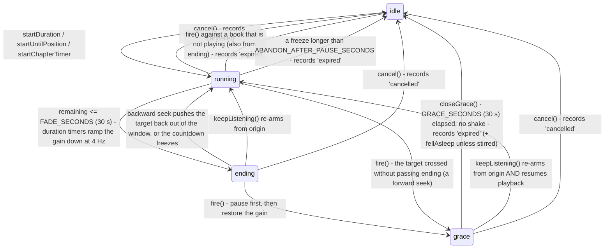

On iOS a running timer also drives a Live Activity on the lock screen and in the
Dynamic Island. `src/widgets/widget-sync.ios.ts` syncs it from this store, and
[Native integrations](native-integrations.md#widgets-and-the-live-activity-ios)
describes it with the widgets.

## The timer (`sleep-timer.ts`)

`useSleepTimer` is a second Zustand store, deliberately framework-free. It reads
`usePlayer` through `getState()`. While a timer is armed, it also subscribes to
`usePlayer` (`playbackWatch`). Every player write re-runs two reconcilers, and both
end a timer whose book changed:

- `syncPlaybackFreeze` freezes or thaws a duration countdown while playback is
  paused (see [Freezing the countdown while paused](#freezing-the-countdown-while-paused-syncplaybackfreeze)).
- `syncGrace` closes a grace whose deadline has passed and notes a listener
  stirring.

Three functions arm a timer:

- `startDuration(minutes)`
- `startUntilPosition(position, label)`
- `startChapterTimer(opts?)`

All three funnel through one private `arm()`. It restores the volume, clears the
ending and grace flags, and restarts the 1 s tick. The tick counts down and fires.
Apart from the listener's own actions, three things move the machine: the tick, that
subscription and the 250 ms fade ticker.

The sleep sheet arms and reads the store in two places:

- The "Or stop after N chapters" rows (`sleep-sheet-model.ts` `stopAfterRows`)
  list real chapters only, never the synthetic `virtualChapterInterval` ones. They
  arm through `startUntilPosition(endPosition, stopAfterLabel(row))`. The first row
  ("This chapter") uses the chapter's own label (`chapterSleepLabel`), and the
  others use `afterChapters`.
- The "End of chapter" tile shows the countdown of `chapterTimerTarget`. The store
  exports it so the tile and the timer it starts compute one target.

`cancelIfBookChanged` also ends a timer in any armed phase, as `expired`, once its
book is no longer the loaded one.

Every edge back to `idle` goes through `endTimer(reason)`. It notifies the
`onSleepTimerEnded(fn)` registry synchronously, once per ending, with the store
already back at `idle`. That lets the auto sleep controller below tell a dismissal
from a timer that ran out. This is the only event the store emits. A timer armed
with nothing loaded (`bookKey === null`) notifies nothing.

One `expired` ending carries more. When the grace closes after a fire that paused a
playing book, and the listener **didn't stir** in the window, the outcome carries
`fellAsleep` (see [Fell asleep](#fell-asleep-drift-controllerts)).

The sections that follow are the pieces worth knowing before touching the store.

### The phase and its two selectors

The phase (`idle | running | ending | grace`) is **stored**, not derived. Three
booleans could spell out twice as many combinations as are legal, and the UI kept
re-deriving the phase from them by hand.

Two selectors answer the phase for the UI. The readouts also read `origin`, `label`
and `remaining` for their words.

- `selectSleepPhase` reads the stored phase.
- `selectSleepExtendable` is `phase === 'ending' || phase === 'grace'`. It answers
  "can a shake or a *Keep listening* tap do anything right now?"

Nothing branches on `graceUntil`; it only ever answers "until when?".

`selectSleepExtendable` also **gates the accelerometer listener**, so the sensor
runs only in those two short windows rather than for the whole timer. That gate is
why the phase must be *true*. A frozen countdown leaves `ending` (see below).
Otherwise a book paused with 20 seconds left would keep the sensor subscribed
indefinitely, and the grace card would keep saying "Fading out in 20 s" about a
paused book at full volume.

### Only a duration timer fades

The phase is called `ending`, not `fading`. For **both** kinds of timer it means
"about to stop, a shake still saves it", but only one kind touches the gain.
`fadesAudio(origin)` is the single gate:

- `{kind:'duration'}` fades. Its stopping point is arbitrary, and an abrupt cut
  mid-sentence is jarring.
- `{kind:'chapter'}` plays its last 30 seconds at **full volume**. This kind
  includes the end-of-book target and every `startUntilPosition` timer. Those last
  seconds are the words the listener stayed awake for, and the chapter ending is its
  own signal.

On the chapter path the fade ticker never starts, so there are **no gain writes at
all**. A unit test asserts the gain is never below 1 for a whole chapter-timer run,
including through its pause and grace.

### The fade ticker (`syncFade`)

The 1 s countdown tick is far too coarse to ramp against, so `FADE_TICK_MS`
(250 ms) drives `syncFade` instead. `syncFade` is the one reconciler that owns both
the fade ticker and the engine gain. It holds the rule *the ramp runs iff
`phase === 'ending'` and the origin fades and it is not frozen*. Every site that
writes `phase` or `frozenAt` calls it afterwards. As a result it ramps only while a
**duration** timer is `ending`.

`fadeGain(remaining)` is the exported, unit-tested curve,
`(remaining / FADE_SECONDS)²`. It is squared because perceived loudness is roughly
the square root of linear gain. A linear ramp stays loud and then drops away
sharply at the end.

The gain is **never written into the store**. It changes four times a second and
nothing renders it, so storing it would re-render every subscriber at 4 Hz.

### Entering and leaving `ending` (`syncEndingPhase`)

`syncEndingPhase` works in both directions:

- It enters the `ending` phase when the remaining time drops into the window.
- It leaves the phase, restoring full volume, when the remaining time climbs back
  out. A backward seek on an end-of-chapter timer does that. Back when that timer
  still faded, without this half the rest of the chapter would have been stranded
  at a fraction of its volume.

A **frozen** (paused duration) countdown is never in the phase either. The same rule
covers it, not a second one. `ending` means "about to stop", and a countdown that is
not counting is not about to stop. Otherwise the phase change is unconditional; only
the ramp is gated on `fadesAudio`.

`countdownHeld(state)` defines "not counting". It is true for:

- a duration timer with `frozenAt` set;
- a **chapter** timer while the transport isn't live. A chapter timer never sets
  `frozenAt`, because its "countdown" is the book's position.

`syncChapterHold()` runs from the play-state watch. When the listener pauses a
chapter timer by hand inside its last 30 seconds, it moves the timer back to
`running` (not extendable, no accelerometer, no grace card). On resume it moves the
timer back into `ending` if it is still inside the window. Firing is unchanged.

### Firing and the grace window

`fire()` pauses first, then restores the gain. The two are chained in a `finally`,
so a rejected pause can't leave a manual resume silently muted. `fire()` does not
go to `idle`. It opens the `GRACE_SECONDS` (30 s) window and keeps ticking.

Before pausing, `fire()` records `fired`: when it fired, where it stopped the book,
and the listener's last touch (`lastInteraction`). It reads the last touch *before*
the pause, because the pause is itself a transport edge the interaction watch would
record.

`syncGrace` reconciles the grace window. It runs from the play-state watch (every
player write) and from the tick, and it does two things:

- **It closes the window once its deadline has passed.** The tick alone isn't
  enough. iOS suspends the app after the timer pauses the audio, and the thing that
  wakes it can be the listener pressing play the next morning. That play must still
  close the window as the drift-off it was.
- **It marks the fire `stirred`** when the transport goes live again after
  `PAUSE_SETTLE_MS` (2 s), or when the position moves more than `SCRUB_SECONDS`
  (5 s) from where the timer stopped it. The 2 s wait is there because the engine
  reports `playing` for a moment after the pause is asked for.

`closeGrace` is the one way a fired timer runs its course. It ends the timer as
`expired`, with `fellAsleep` unless it was stirred. A `cancel()` in the grace ends
it `cancelled`, and a book change ends it `expired`. Neither carries `fellAsleep`.

### Keep listening (`keepListening()`)

`keepListening()` is a no-op outside the `ending` phase and the grace. Inside them
it re-arms from the recorded `origin` (`{kind:'duration', minutes}` or
`{kind:'chapter'}`):

- A duration timer restarts its full length.
- A chapter timer retargets by **one** chapter, even for an "after 3 chapters"
  timer. A shake that late means "a little more", and another shake at the next
  boundary gives another.

It also records a touch (`noteInteraction`, see the last touch below). From the
grace it also calls `resumePlayback()`. That checks the live snapshot before
calling `toggle()`, because `toggle` from a *playing* state would pause a book the
listener had already resumed by hand.

### One more chapter (`nextChapterTarget`)

One constant makes "one more chapter" work. `nextChapterTarget(allowEndOfBook)`
picks the **nearest** upcoming chapter end more than `MIN_CHAPTER_SECONDS` (30 s)
away. It uses `nextChapterEnd` in `book-queue.ts`, which scans for the nearest
qualifying end rather than the first qualifying array element, because chapter
offsets are not guaranteed to ascend.

In the `ending` phase the current chapter's end *is* the boundary being stopped at.
It fails the 30 s test, so the re-arm lands on the **next** chapter. For a timer
armed at the start of playback, the current chapter usually qualifies.

`MIN_CHAPTER_SECONDS` is deliberately its **own** constant, not an alias of
`FADE_SECONDS`. The two share a value but are unrelated. While they were tied
together, retuning the fade silently changed what "one more chapter" retargets.

### Who asked decides the fallback

`startChapterTimer`'s `{ allowEndOfBook }` option carries who asked:

- **The listener's reset** means "one more chapter". `keepListening` passes
  `{ allowEndOfBook: true }`, so where there is no next chapter the timer targets
  the end of the book.
- **The automatic nightly arm** passes nothing (the default is `false`). It refuses
  both the end-of-book fallback *and* a chapter that ends exactly where the book
  does, and falls back to a 15-minute duration timer instead.

The automatic arm needs its own rule because of folders of MP3s. A folder with no
chapter metadata has `queue.chapters === []`, because `buildBookQueue` synthesizes
virtual chapters only for a single-file book. The shared fallback armed a target
ten hours out. It never fired, so the timer never returned to `idle`. The
controller's "a timer already stands" guard then blocked every later arm and stopped
its poll, which left no working sleep timer at all, all night.

Whichever fallback applies, a chapter arm always ends up with a timer that fires.

### Freezing the countdown while paused (`syncPlaybackFreeze`)

A duration timer counts **listening** time, not wall-clock time. It must not expire
while the book is paused. It used to, silently. A listener paused with a headphone
button, never looked at the screen, and came back to no timer armed. Every
open-source *audiobook* player does the same (Audiobookshelf, Absorb, Voice).
AntennaPod switched off wall clock in 2025. The subtleties are all in *how* the
store freezes the countdown:

- **The freeze must survive the JS runtime being suspended.** iOS suspends the app
  once it stops producing audio, and the browser throttles a hidden web tab. So **no
  ticks arrive at all** while paused, and any scheme that decrements a balance per
  tick silently loses an untick'd hour. The representation is therefore a **stopped
  clock**, not a running total:
  - A duration timer stays a `Date.now()` deadline (`endsAt`).
  - Pausing records **`frozenAt`**, the moment the clock stopped.
  - `preciseRemaining` reads the deadline against `frozenAt` instead of the live
    clock. That answer needs no ticks to stay correct.
  - Resuming slides `endsAt` forward by `Date.now() - frozenAt`. That is two
    timestamps, so any length of gap reconciles exactly.
- **The same shape fixes the other direction.** The countdown is a deadline rather
  than a per-tick decrement, so a *playing* context whose ticks are throttled to one
  a minute can't make the timer run long either.
- **The play state is a level, read from a subscription, not a transition.**
  `playbackWatch` subscribes to `usePlayer` while a countdown is running. It
  **ignores the `(state, prev)` payload** and re-reads `selectIsTransportLive`
  (`playing || loading`) instead. The engine's resume stream is a jumble of `ready`,
  `loading` and spurious `paused` (see [the stall watchdog](playback.md#the-stall--error-watchdog)).
  Matching individual transitions is the approach that has failed repeatedly here.
  Subscribing, rather than waiting for the tick, is what makes the suspension case
  airtight. The store write happens while the app is still awake handling the
  pause, so `frozenAt` is always recorded. The 1 s tick and every `arm()` call the
  same reconcile as a backstop, so a missed notification costs at most one second.
- **A thaw has three outcomes, by how long the freeze lasted.** Freezing introduces
  the inverse failure. A timer frozen with 3 minutes left and then forgotten would
  fire 3 minutes into tomorrow's session. Nothing ever cancels a frozen timer, so
  the length of the freeze is the only evidence there is. On the transition back to
  playing:
  - **Under `RESET_AFTER_PAUSE_SECONDS` (20 min)**, the frozen countdown continues
    untouched. 20 minutes clears the longest ordinary in-session interruption and is
    far short of "later that day". Audiobookshelf re-arms unconditionally above 3
    seconds, which throws away a 25-minute countdown because someone answered the
    door.
  - **Between that and `ABANDON_AFTER_PAUSE_SECONDS` (2 h)**, the store treats it as
    a new sitting and re-arms the timer at its **full original** `origin.minutes`.
  - **Beyond 2 h**, the timer is **ended** (`endTimer('expired')`), not resurrected.
    Re-arming at any length there was the "armed at 22:30, paused at 22:40, resumed
    at 08:00, book fades out at 08:30" bug. The listener did nothing, it happened
    hours outside the auto sleep window, and nothing re-checked why the timer
    existed. The reason is `expired` rather than `cancelled`, so auto sleep is free
    to arm a fresh one on tonight's terms.

  There is deliberately **no setting** for any of it. The frozen span is also
  **clamped at zero**. It is two readings of a clock the device owns, so a backward
  jump (an NTP correction, a manual change) would otherwise slide `endsAt` *earlier*
  and fire the timer early once the clock came back.
- **Chapter timers and the grace window are exempt** (both have `endsAt === null`).
  A position target does not advance while paused and stays valid however long the
  pause was. So it waits by construction, never sets `frozenAt`, and must not be
  re-armed. The post-pause grace is genuinely wall-clock, because it exists to
  expire *while* the audio is stopped.
- **A pause mid-fade hands the volume back and leaves the `ending` phase.** Freezing
  stops the fade ticker and writes gain 1 immediately. The listener may press play
  on the next breath, and near-silent audio with no visible cause is the worst
  outcome this feature has.

  With the ramp suspended and the volume back, the phase is no longer true either,
  so the freeze drops to `running` (see [`syncEndingPhase`](#entering-and-leaving-ending-syncendingphase)).
  That drop:
  - takes the accelerometer back off;
  - takes the grace card off the screen, and turns the sleep pill's spoken label
    back from *Keep listening* to the running timer;
  - stops a stray shake from doing anything. Outside the `ending` and grace windows
    `keepListening()` is a no-op. Inside them, a shake would have silently reset the
    timer without resuming.

  The ramp is not lost. The thaw re-enters the phase if the remaining time still
  warrants it, and `syncFade()` picks up at the gain the frozen countdown implies,
  so it neither restarts nor jumps. A frozen timer also never `fire()`s (it would be
  pausing an already-paused book) and never writes a gain at all.

### Writing the gain: `setVolume` is required, degraded per engine

The fade reaches the engine through `usePlayer.setOutputVolume(gain)`, which clamps
once and calls `service.setVolume(…)`. The interface method is **required**, and
`types.ts` says so with the reasoning. An optional marker would push a `?.` onto
every caller to model something no caller can act on. Instead each engine handles
its own "no volume here" case internally and still resolves:

- **`service.native.ts` feature-detects the native function**
  (`typeof AudiosiloPlayer.setVolume !== 'function'`) and also wraps the call in a
  `try`. The JS bundle can be **newer than the native binary it runs on**: an
  installed dev build, or a shipped App Store or Play build from before `setVolume`
  existed. Calling a function the native module doesn't define *throws*, which would
  turn every sleep-timer fade into a playback-breaking rejection on those installs.
  Older binaries degrade to "no fade" and resolve.
- **`service.web.ts`** sets the element's `volume`. It swallows the failure on
  **iOS Safari**, which refuses per-element volume outright (system volume is the
  only control there). The fade is inaudible on iPhone and iPad web, and it must
  never become a thrown error.
- **`playBook` resets the gain to 1** when starting a book (`svc.setVolume(1)`,
  with the store's cached `outputVolume` written alongside it). The timer restores
  the volume on every path it owns. This reset is the backstop for the one it
  doesn't, because near-silent audio with no visible cause is the worst outcome this
  feature can produce.

  The reset runs **immediately after `nowPlaying` is swapped** to the new book, at
  every site that swaps it. The fade ticker stands down by comparing the *playing*
  book against the timer's own. A restore written while `nowPlaying` still held the
  old book could be overwritten by the 4 Hz ticker during the resume lookup's
  network round trip, and the new book could start attenuated.

### Shake to extend (`use-shake-to-extend.ts`)

A shake **extends** the timer; it does not cancel it. The hook replaces an earlier
`use-shake-to-cancel.ts`, which is gone. `useShakeToExtend` subscribes the
accelerometer only while `selectSleepExtendable` holds **and** the `shakeToExtend`
setting is on (default on). So the sensor is off for the other 29 minutes of a
30-minute timer.

The hook is mounted **exactly once, at the app root**, by the headless
`ShakeToExtendListener` (`src/components/player/shake-to-extend-listener.tsx`). The
root's `RootListeners` (`src/components/shell/root-services-impl.tsx`) renders that
listener, alongside `startAutoSleep()`. It is deliberately **not** mounted from
`player-view.tsx`. The feature's main case is a nightly timer on a locked phone with
no player screen open, where a hook mounted in the player modal would never be
listening. Mounting it in both places would double-fire a single shake.

- **It imports `expo-sensors/build/Accelerometer` directly**, never the
  `expo-sensors` barrel. The barrel does `import * as Pedometer`, and `Pedometer.ts`
  resolves its native module at load time. On builds that don't link it, that throws
  "Cannot find native module 'ExponentPedometer'" and crashes the player for a
  sensor the app never uses.
- **Detection requires a burst**, not a single sample. It samples every 100 ms,
  needs a number of samples whose total acceleration exceeds a threshold inside a
  1 s window, and then debounces for 2 s. A single-sample threshold both false-fires
  on a pocket bump and misses a genuine shake landing between samples.
- **The burst detector is `createShakeDetector(tuning, onShake)`**, kept apart from
  the sensor so tests drive it with plain numbers. The `shakeSensitivity` setting
  picks the tuning (`shakeTuning`):
  - `medium` is the detector's original tuning;
  - `high` is a lower bar;
  - `low` needs a harder shake held longer, which a mattress jolt doesn't make.

  The bar is deliberately low. A false positive only grants more listening time,
  while a false negative stops the book on someone who was awake.
- **The two settings** (`shakeToExtend`, `shakeSensitivity`) are hydrated
  defensively (`shakeToExtend !== false`, `toShakeSensitivity`). One
  `ShakeSensitivityControl` shows them both in the sleep sheet's settings card and
  in Settings > Sleep timer. On web the row stays but says it is not available.
- **Shake is native only.** The whole subscription is wrapped in a `try`, so a build
  without the sensor degrades to a no-op. **Keep listening** is the equivalent, on
  the grace card (`grace-card.tsx`) and in the sheet's notice. It is mandatory on
  web (no accelerometer) and offered on native too.

### The grace card (`grace-card.tsx`)

`GraceCard` shows while the phase is `ending` or `grace`. It holds:

- a ring that empties over the window;
- a status line: "Fading out in N s" for a duration timer, "Stopping in N s" for a
  chapter timer (which doesn't fade), or "Paused by the sleep timer";
- how to keep going, mentioning the shake only where it is on and the platform has
  a sensor;
- **Keep listening**.

It is not a dialog. It never takes focus and blocks nothing outside its box. It is
announced once per phase rather than every second: through a polite live region on
Android and the web, and through `announceForAccessibility` on iOS, which has no
live regions.

Where it sits:

- **In the full player**, it takes the status line's slot (`inline`, in the flow),
  so it can never cover the transport or the actions at any width.
  `useGraceCardOpen` tells the status line to make way.
- **Everywhere else**, ONE floating card (`FloatingGraceCard`) sits just above the
  measured bottom chrome. `ShellPlayerOverlays` mounts it while the full player
  isn't on top. The bottom chrome is the tab bar and mini player on a phone, and the
  docked bar on tablet and desktop. The card publishes its own top edge as the
  `grace` chrome piece, so toasts lift above it instead of landing on it.

### Fell asleep (`drift-controller.ts`)

This covers what happens after a sleep timer stopped a book nobody was awake for.
`startDriftWatch()` is framework-free. It starts once with the root's services
(`startRootServices`, `src/components/shell/root-services-impl.tsx`), like
`startAutoSleep`:

- **Native** starts it with the first commit. A book already playing was seen by an
  earlier run, so it isn't offered again.
- **The web** starts it once the first screen has painted, as
  `startDriftWatch({ late: true })`. A book that began playing before the watch
  existed is still treated as a new play, and is offered at the engine's next
  report.

The watch works in four steps:

1. **The bookmark.** On an outcome with `fellAsleep`, the watch puts a bookmark at
   the stop position on the playing book's own server, through `resolveClient`. It
   is named `player.sleepTimer.fellAsleepNote` ("Fell asleep"), translated when it
   is made, because the server stores it as text. Where the server has
   `annotations`, it is labelled `fell_asleep` (`FELL_ASLEEP_LABEL`); elsewhere
   `addBookmark` drops the label. It is best effort. Offline, signed out or refused,
   the bookmark isn't made, and it never throws into the timer's ending path.
   [The Fell asleep marker](annotations.md#the-fell-asleep-marker) explains how the
   app tells it apart.
2. **The record.** The device keeps the last touch before the fire and the stop
   position (`drift.ts`, AsyncStorage key `audiosilo.driftOffs`). Records are keyed
   by `contentKey(connectionId, libraryId, path)`, last `DRIFT_TTL_MS` (36 h) and
   cover at most 20 books. Every read-modify-write is serialised, so a save and a
   take can't drop each other's change.
3. **The prompt.** The prompt waits for the play edge of that book. That is a
   `usePlayer.subscribe` transition into playing, or a different book playing. It
   is not the instant a book is swapped in. At that instant the snapshot still says
   `playing` for the OLD book, and taking the record there would spend the offer on
   the old position.

   On the play edge, `takeDrift` reads and forgets the record and `driftOffer`
   decides. It offers only for a gap of 1-60 content minutes between the touch and
   the stop, and only when the book starts within 5 minutes of where it stopped.
   The offer is a toast: "You drifted off around 23:41. Jump back 4 minutes?". Its
   action `seekBook`s to the touch, only into the book it was offered for.

   Two cases change the timing:
   - If the listener pressing play is the very write that closes the grace (iOS
     slept through it), the play edge has already gone by. The controller prompts
     on the spot instead of saving.
   - A prompt that would land while the app is in the background (a headphone or
     CarPlay play) waits, once, for the app to come to the front. The controller
     judges it then: the same book must be loaded and still near where it stopped.
4. **The Journal.** The Diary reads the same records (`useDriftRecords`, read only)
   to put the offer under the session the timer ended. It spends the record with
   `takeDrift` when its Jump back is used (see
   [The Journal](journal.md#drift-offs-matchdrifts-and-driftstrip)).

**The last touch** is `last-interaction.ts`. It is memory-only, per book key, and
keeps 20. `startInteractionWatch`, started by the drift watch, records what the
store shows:

- the transport starting or stopping;
- the position **jumping** rather than flowing (`isJump`, the undo chip's rule,
  with a finer `JUMP_SECONDS` threshold of 4 s).

That covers the lock screen and CarPlay with no change to the store. Playing on into
the next file is not a touch, because the engine's file advance is neither a pause
nor a jump.

`noteInteraction()` records the touches the store can't see: arming a timer in the
sheet, a shake, Keep listening, and a bookmark from any surface. The automatic
nightly arm is not a touch.

A misread edge only makes the listener look awake somewhat later, which shortens the
jump back. It never invents one.

### Auto sleep timer (`auto-sleep.ts` + `auto-sleep-controller.ts`)

The nightly auto-arm is split into a pure decision function and a framework-free
controller. All the policy is unit-tested, and none of it lives in a component.

#### The decision (`decideAutoSleep`)

`decideAutoSleep(input)` takes four inputs:

- the rule that applies (`AutoSleepConfig`: `enabled`, `from`, `until`, `type`).
  The controller passes `listenerSettings().autoSleep` from
  `src/playback/listener-settings.ts`. That is the four `autoSleep*` settings, or a
  kids profile's bedtime rule while one is active (see
  [Kids mode](kids-mode.md#bedtime-and-speed-srcplaybacklistener-settingsts)).
- `now`;
- the `bookKey`;
- the per-book memory.

It returns `{arm:'none'} | {arm:'chapter'} | {arm:'duration', minutes}`. It bails
when the feature is off, when the memory says this book is blocked
(`canAutoSleepArm`), and when the clock is outside the window. A persisted
`autoSleepType` that isn't `chapter` or a positive number arms nothing rather than a
nonsense timer.

"A timer is already standing" is deliberately **not** an input. That is a live
reading of the timer store, which the controller enforces (below). Restating it here
would make a second, always-false copy of a rule enforced elsewhere.

An `{arm:'chapter'}` decision arms through `startChapterTimer()` with **no**
options. That means `allowEndOfBook: false` and the automatic fallback rules above.
A chapterless book gets a duration timer that fires, rather than a target hours away
that would block every later arm for the session.

#### Never in a car

The controller arms nothing while CarPlay or Android Auto is connected. It reads
`isCarConnected` from `src/car/car-connection.ts`, which the car sync keeps (see
[Native integrations](native-integrations.md#the-car-snapshot-srccar)). Its poll goes
on, so a book still playing inside the window once the car has gone is armed then.

#### The window test

The window test is `withinAutoSleepWindow` in `src/lib/hhmm.ts`, next to
`parseHhMm` and `formatHhMm`. The window is half-open, `[from, until)`, over local
wall-clock "HH:MM", and wraps past midnight (the default is 22:00-06:00).
`from === until` reads as **never**, and a malformed bound is `false`, so a corrupt
value can't arm a timer unexpectedly.

The test lives in `lib`, not in the settings store that persists the strings. That
way `@/lib/format`, which some twenty modules import, doesn't drag zustand and the
persisted settings into their graphs.

#### How the timer ended

The timer says how it ended through `onSleepTimerEnded(fn)` (see
[The timer](#the-timer-sleep-timerts)):

- `cancel()` reports `cancelled`.
- The grace closing, a fire against a book that was not playing, and
  `cancelIfBookChanged` all report `expired`.

A book change is an expiry, not a cancellation. Nobody dismissed that timer, and
blocking the book for the night because the listener dipped into another one would
recreate the failure this design fixes.

Never infer the reason from the leftover fields. The version that read
`graceUntil !== null` as "it fired" filed a cancellation made *during* the grace
window as an expiry, which is precisely the case that must not re-arm.

#### The anti-nag memory

The anti-nag memory (`AutoSleepMemory`) is ONE bounded, insertion-ordered set of
book keys: the books the listener has **cancelled** a timer on.

- The pure `recordAutoSleepOutcome` folds outcomes into it. A `cancelled` outcome
  adds the book, and an `expired` one changes nothing.
- `canAutoSleepArm` reads it.
- It caps at `MAX_REMEMBERED_BOOKS` (50), evicting the oldest.

A block is final for the session. Nothing later unblocks it, including the
listener's own manual timer running out on the same book.

The other half is "a timer is standing for this book right now, so nothing may arm a
second one". That is **not remembered at all**. The timer store answers it live as
`phase !== 'idle'`, and answers it better. A remembered copy was only as good as the
bookkeeping that maintained it, and could go stale in a way the live reading cannot.

#### Re-arming can't loop

Firing pauses playback, so the only route back to an armed timer is a fresh
transition into `playing`, made by the listener's own hand. The one case with no
such edge is a listener who resumed by hand *during* the grace window. There the
poll (60 s) picks it up once the grace closes. That poll is also the floor on how
often anything can be armed.

#### The controller (`startAutoSleep`)

`startAutoSleep()` (`src/playback/auto-sleep-controller.ts`) starts once with the
root's services (`startRootServices`, `src/components/shell/root-services-impl.tsx`).
Native starts it with the first commit, and the web once the first screen has
painted. It returns its teardown.

It is a module with subscriptions rather than a component that renders `null`,
because it uses no context, router, props or rendering. It holds the session memory
in **module state**, so "never again for this book" lasts as long as the JS context
rather than as long as a mounted component. It must run whether or not the player
modal is open. The timer has to arm for a book started from the mini player, the
library, or a lock-screen play.

It listens to four things:

- **The setting and the profiles store.** Together they decide whether any rule is
  on (`autoSleepOn()`), which attaches and detaches everything else.
  `autoSleepTimer` defaults to off, and a kids profile's bedtime is always on.
  Without this gate, the player subscription would run on every progress write for a
  feature nobody switched on.
- **The player**, for the transition edge into `playing`: one look per resume, not
  one per progress tick.
- **`onSleepTimerEnded`**, installed for the whole session, because a cancellation
  counts even if auto sleep is enabled later.

The 60 s poll (`ticker` from `src/lib/ticker.ts`) runs only while a book plays with
the feature on, no timer standing and the book unblocked. Each gate is a test where
re-asking cannot change the answer.
