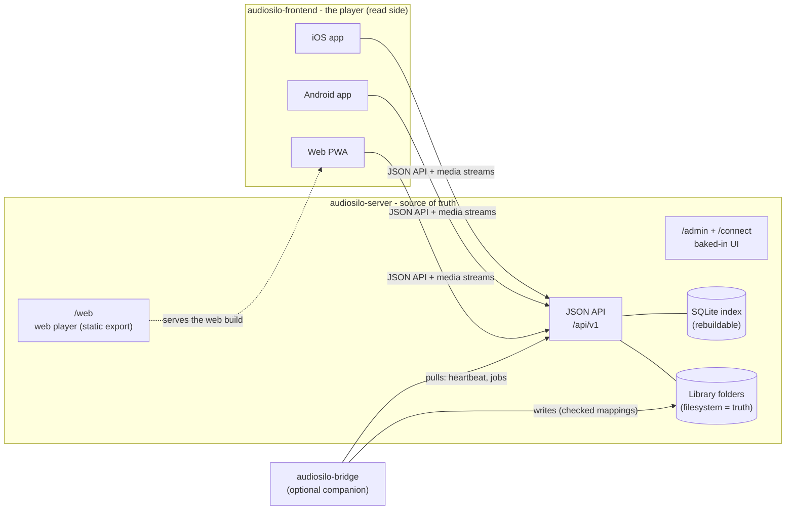

AudioSilo is a self-hosted audiobook platform built around a **server and player**.
The server owns the data and the HTTP and JSON contract. The player is a thin,
fully-typed read side over that contract.

| Repo | Role | Stack |
|---|---|---|
| `audiosilo-server` | The **server**, the source of truth for content and the API. It serves the JSON API, the admin console and the connect page, and the web player at `/web`. Safe to expose to the internet. | Go 1.26, SQLite (pure-Go modernc by default; native C in the Docker image and the Linux release binaries), FTS5 |
| `audiosilo-frontend` | The **player**, one codebase shipping to a web PWA, iOS and Android. The read side of the product. Its web export is served *by* the server at `/web`. | Expo SDK 58, React Native 0.88 (new architecture), React 19.3, Expo Router, Uniwind (Tailwind v4) |

The optional **[Bridge](bridge/index.md)** (`audiosilo-bridge`)
pairs with a server, writes to its libraries and runs the heavy jobs, so the
server stays read-only. It always calls the server, never the reverse. Its first
real job generates a book's [characters and recaps](bridge/generating.md) into the
book's folder, with its AI agents in a separate
[agent container](bridge/agent-container.md).

The code repos and this docs site live side by side in a single workspace folder
(`~/dev/audiosilo`). The folder's root is itself the small `audiosilo-workspace`
meta repo. It holds the cross-repo glue: the integration contract, the code-health
checklist and the release runbooks. See [the workspace guide](contributing/workspace.md)
for how to check everything out and work across the repos.

## Architecture

Three structural facts to internalize before reading anything else:

- **The server is the only writer of the API contract.** The frontend mirrors
  its JSON shapes **by hand**. There is no codegen, so a wire change is always
  a multi-repo change. See
  [Cross-repo contract](architecture/cross-repo-contract.md).
- **The filesystem is the source of truth; the database is a rebuildable index.**
  Content is addressed by `(library_id, rel_path)`, never by a database id. See
  [Invariants](architecture/invariants.md).
- **The server's content API is read-only.** Files change on disk, copied in by
  hand or written by the [Bridge](bridge/index.md) through its checked mappings,
  and a scan updates the index.

## The data flows

**Streaming.** The player fetches a book's chapters with
`GET /libraries/{id}/chapters?path=`, which answers `{chapters, files, duration}`.
It then streams individual **audio files**, never a folder or book path, with HTTP
Range requests (`GET /libraries/{id}/stream?path=`). Media auth rides as a `?token=`
query param, because browsers can't set headers on `` or `<audio>`. For a codec
that browsers can't decode (`direct_playable: false`), the web player streams the
server's on-the-fly MP3 instead (`?transcode=1&t=`, ffmpeg, gated by the
`transcode` capability). It re-requests the MP3 on every seek.

**Progress sync.** The player saves the listener's place while playing, keyed by
path. It saves every 15 seconds with the app in front and the book streaming, every
60 seconds with the app in the background or the book downloaded, and at once on a
pause, seek, rate change or stop
([the pace](frontend/playback.md#the-periodic-saves-pace)). How it saves depends on
the server:

- **Listening sync (Sync v2).** On a server with the `listening_sync` capability,
  and while the player doesn't know the flag yet, the player records listening as
  events: a span of playing, a finish, an unfinish. It keeps them in a durable outbox
  per connection (`src/playback/listening-outbox.ts`) and posts them to
  `POST /me/listening/sync`. The server (`catalog.SyncListening` in
  `internal/catalog/listening_sync.go`) derives progress, listening sessions and
  history from them. When two devices diverge, it keeps the further place and offers
  the other as `other_place`. See
  [seam 19 of the cross-repo contract](architecture/cross-repo-contract.md#19-listening-sync-sync-v2).
- **The legacy save.** A shipped older player, or a player on a server without the
  flag, saves with `PUT /libraries/{id}/progress?path=`. The server reconciles it
  last-write-wins by `updated_at` (`catalog.SaveProgress`), and the client keeps an
  offline replay queue (`src/playback/progress-sync.ts`).

Realtime WebSocket sync is **planned**. The `websocket` capability flag is already
reserved for it.

**Pairing.** An admin mints an invite code. The code rides a URL **fragment**
(`/connect#code=…`), so it never reaches server logs. The connect page redeems it
with `POST /auth/redeem`, which returns a pairing token that keeps the invite's
remaining uses and expiry. The page then offers two carriers: an HTTPS `web_url`
(for the QR code and Universal Links) and an `audiosilo://connect?...` custom-scheme
deep link. The app or web player exchanges the pairing token for a device-scoped
session (`POST /auth/exchange`), claiming one invite use per device. So each device
being set up can scan the same QR code.

**File placement.** Files reach a library folder outside the server's API:
copied in by hand, or written by the [Bridge](bridge/index.md). A
non-destructive reindex (`POST /admin/libraries/{id}/scan`) picks them up. See
[Organizing your library](/users/getting-started/organizing-your-library) for the
folder conventions. A server-side `POST /uploads` endpoint is **planned**, not
shipped.

## Design priorities

The server's priorities, in order. When they conflict, the earlier one wins.

1. **Safe to expose to the internet.** Secure defaults, no default passwords,
   hashed secrets, app-layer hardening, configurable TLS. Inexperienced users will
   port-forward this.
2. **Fast regardless of library size.** FTS5 search and keyset pagination, and
   never OFFSET on large tables.
3. **No-wait first connection.** The filesystem view (`/fs`) needs no indexing. A
   fresh server is browsable and playable immediately, while the index catches up
   in the background.
4. **Portable.** The filesystem is the source of truth; the database is a
   rebuildable index and cache. Delete the DB and nothing of value is lost.

## How these docs are organized

- **[Architecture](architecture/invariants.md)** - start here. The
  [invariants](architecture/invariants.md) every change must preserve, the
  [cross-repo contract](architecture/cross-repo-contract.md) (every seam between
  the repos), and the [release pipeline](architecture/release-pipeline.md).
- **[Server](server/overview.md)** - package layout, [data model](server/data-model.md),
  [auth and security](server/auth-and-security.md), the [scanner](server/scanner.md),
  [media serving](server/media.md), the [built-in web UI](server/web-ui.md) (the
  admin console and the connect page),
  [configuration](server/configuration.md), and the [HTTP API](server/api/index.md).
- **[Player app](frontend/overview.md)** - the Expo codebase:
  [playback](frontend/playback.md), [the end of a book](frontend/end-of-book.md),
  [the sleep timer](frontend/sleep-timer.md), [player UI](frontend/player-ui.md),
  [offline downloads](frontend/offline.md), [state and data](frontend/state-and-data.md),
  [i18n](frontend/i18n.md), [testing](frontend/testing.md).
- **[The Bridge](bridge/index.md)** - `audiosilo-bridge`, the optional companion
  that writes to a server's libraries and runs its heavy jobs:
  [pairing and jobs](bridge/pairing-and-jobs.md), [mappings](bridge/mappings.md),
  [generating characters and recaps](bridge/generating.md) and
  [development](bridge/development.md).
- **[Metadata database](meta/overview.md)** - `audiosilo-meta`, the
  community audiobook metadata database behind meta.audiosilo.app that the server
  and player enrich books from: the [data model](meta/data-model.md), the
  [`metaserve` HTTP API](meta/api.md), and [contributing data](meta/contributing-data.md).
- **[Contributing](contributing/workspace.md)** - the
  [workspace setup](contributing/workspace.md), [per-repo gates and CI](contributing/gates-and-ci.md),
  [how to land a cross-repo change](contributing/cross-repo-changes.md),
  [cutting a release](contributing/releasing.md), and
  [writing these docs](contributing/documentation.md).

If you just want to *run* AudioSilo rather than hack on it, the
[user guide](/users/getting-started/first-run) covers installation and everyday use.

:::info[The normative contract lives in the workspace]
`~/dev/audiosilo/CROSS-REPO.md` (checked into the workspace root, alongside
`CLAUDE.md` and `CODE-HEALTH.md`) is the **normative** integration contract
between the repos. These docs are a readable digest of the same material. When a
seam changes, update CROSS-REPO.md first, and these pages follow.
:::

## Where to start

- To add or change an API endpoint, read the
  [Cross-repo contract](architecture/cross-repo-contract.md), then
  [Landing a cross-repo change](contributing/cross-repo-changes.md).
- To understand why the code is shaped this way, read
  [Invariants](architecture/invariants.md).
- For something that won't play, a wrong Content-Type, a scope leak or a scanner
  issue, go to the [server docs](server/overview.md).
- For UI that looks wrong, navigation, timeline math or offline, go to the
  [frontend docs](frontend/overview.md).
- Pairing, media auth, a new wire field or transcode touch **both repos**. Read the
  [Cross-repo contract](architecture/cross-repo-contract.md) before starting.
