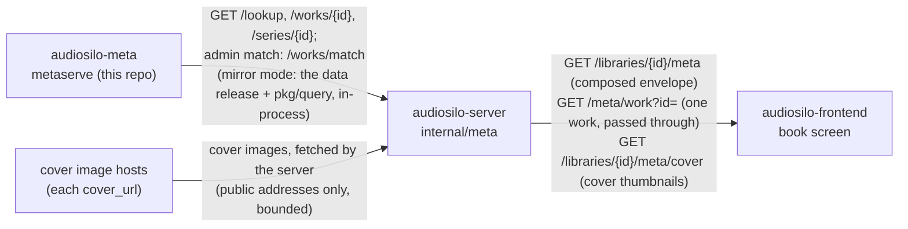

## What audiosilo-meta is

`audiosilo-meta` is the community audiobook metadata database behind
[meta.audiosilo.app](https://meta.audiosilo.app). Its defining idea is that **the
GitHub repository is the database.** There is no application database and there
are no server-side accounts. The metadata lives as plain JSON files under `data/`,
one file per entity:

- contributors edit it by pull request or issue form;
- Go tooling validates it in CI;
- the release workflow compiles it into a single SQLite artifact, which
  consumers download and serve read-only.

It exists because no other open database is both **audiobook-specific** and
**community-editable**. Open Library, Wikidata and BookBrainz are open but carry
almost no narrator, recording or chapter structure. Audnexus is a read-only cache
over Audible's own catalogue. So narrators, specific recordings and chapters are
**first-class data** here, the fields every other database lacks.

Module path: `github.com/kodestar/audiosilo-meta`. The code is **AGPL-3.0**. The
data is split across two licence layers (below).

```
  contributor
      │  pull request  /  issue form
      ▼
  data/*.json  ──►  CI validation  ──►  meta.sqlite  ──►  metaserve (API + site)
  (the database)    (metacheck +        (release          read-only, hot-swaps
                     metafmt, Go)        artifact)         new releases
```

## The two licence layers

Data lives in two layers. The JSON Schema enforces the boundary, not convention
(see `LICENSING.md` in the repo). The `license` field of a core record accepts
only `CC0-1.0`, and a sidecar's accepts only `CC-BY-SA-4.0`
(`common.schema.json` `$defs/license` vs `$defs/license_content`).

| Layer | Entities | Licence |
|---|---|---|
| **Factual core** | works, recordings, people, series | **CC0-1.0** public-domain dedication |
| **Expressive layer** | per-work characters + recaps sidecars | **CC BY-SA 4.0** |

Publisher blurbs and cover art are referenced, never copied. Descriptions are
community-written and covers are URLs. Every entity also carries a `sources[]`
provenance array, so any source can be audited or retracted wholesale. Full detail
is in [the data model](data-model.md).

### What may be imported

Imports are bounded, curated tranches, never a wholesale mirror of another
catalogue. The one named exception is [LibriVox](https://librivox.org). Its
recordings are in the public domain, so they may be mirrored in full under the
`librivox` source type, facts only. The backfill that seeded the mirror landed
in reviewed tranches and is finished. A daily lane of the
[series-completion bot](./sync-bot.md#the-librivox-lane) keeps it current from
LibriVox's own catalogue, under an invariant of its own
([LibriVox: the public-domain mirror](contributing-data.md#librivox-the-public-domain-mirror)).
The API serves those recordings like any other. It adds a `source=librivox`
filter, `lookup?librivox_id=` and a feed in LibriVox's own shape, so an app that
reads LibriVox can switch its base URL
([the LibriVox layer](api.md#the-librivox-layer)).

A maintainer may also import the public product listings of two stores that the
identifier-derived links don't reach, Audiobook Guild and GraphicAudio, for books
the maintainer names. These are facts only, under the `store-listing` source
type. The store page is kept on the recording's `links` and served as a purchase
link
([Store listings: Audiobook Guild and GraphicAudio](contributing-data.md#store-listings-audiobook-guild-and-graphicaudio)).

## Package layout

The tooling follows the same discipline as the rest of the workspace. The CLIs
under `cmd/` are thin, all logic sits in reusable packages, and there is a clean
split between the public `pkg/*` and the private `internal/*`. `audiosilo-bridge`
consumes the public packages as ordinary dependencies, and the AudioSilo server
consumes `pkg/query` and `pkg/release` (see [Public Go packages](#public-go-packages)).

`data/` carries its own `data/go.mod`, a nested Go module with no code in it. It
makes the go command leave the whole ~1.6 GB JSON tree out of this module's
source zip, which is now about 3.4 MiB. Without it, the zip passed Go's 500 MiB
module-source limit, and `go get` of any tag after v0.8.0 failed for a `pkg/*`
consumer such as the Bridge. The nested module holds no data of its own. A pull
request that touches only it runs the Go gate (not the data-only path) and
triggers neither a data release nor `ai-verify`.

```
data/          the CC0 core, range-packed (PACK-SPEC.md): works/ (composites), people/, series/, redirects.json - the CC BY-SA works-community/ family lives in audiosilo-meta-community
schema/        JSON Schemas (one per entity) - the public contract, embedded via schema.go
cmd/           thin CLIs: metacheck, metafmt, metabuild, metaserve, metascan,
               metaimport, metaissue, metaextract (flag wiring only)
pkg/model      PUBLIC entity structs, slug rules, reserved slugs, pack addressing
pkg/pack       PUBLIC pack-file storage: bounds, splits, and the read-through Store every writer uses
pkg/canonical  PUBLIC canonical JSON (sorted keys, 2-space indent, trailing LF)
pkg/check      PUBLIC schema validation + pack-storage invariants + integrity/uniqueness/chapter/series rules
pkg/extract    PUBLIC epub split + the word-shingle near-verbatim check
pkg/scan       PUBLIC local folder scanner (tags + path/filename heuristics + ffprobe)
pkg/query      PUBLIC read side of the artifact: Open, every query, and the JSON API handler (NewHandler), the LibriVox-shaped feed included
pkg/query/querytest  PUBLIC test support: a small real fixture artifact + constants naming its facts
pkg/release    PUBLIC data-release fetcher: newest data release, verified download
pkg/release/releasetest  PUBLIC test support: one fake of GitHub's releases API + checksum/gzip helpers
internal/importer   OpenAudible / Libation / libex export -> canonical records (ASIN dedup); the LibriVox snapshot fetcher, adapter (librivox_id dedup) and work-matching rules
internal/issueform  issue-form body -> canonical records + an ok/duplicate/needs-human/invalid verdict
internal/build      the deterministic SQLite builder (FTS5, ASIN/ISBN indexes, added_at)
internal/serve      metaserve: serves pkg/query's handler (behind CORS + gzip + a per-client rate limit + default Cache-Control), the hot swap,
                    the GitHub-release poller (over pkg/release), webhook, OpenAPI, HTML pages, sitemaps
internal/httpx      the response helpers pkg/query and internal/serve share
Dockerfile     image: the site build + the metaserve binary - no baked data; the catalogue is fetched from the newest data release at boot (see below)
.github/       issue forms + CI workflows (check, release, image, intake, route, ai-verify)
```

The dependency direction mirrors the server's "transport is logic-free" rule.
`cmd/metaserve` is flag wiring only. The queries and the JSON API handler live in
`pkg/query`, and `internal/serve` adds what is metaserve's own.

## Public Go packages

These packages are a public API for programs outside this repo. Mirror-mode
AudioSilo servers (`metadata.mode: mirror`, see the server's
[configuration](../server/configuration.md#mirror-mode-metadatamode-mirror))
use them to download the data release once a day and answer the same API
in-process.

### `pkg/query`

- `Open(path, tag)` opens an artifact read-only and runs the load-time integrity
  checks. It uses a safe DSN, so a `?` or `#` in the path can't drop read-only
  mode.
- `DB.Info()` reports `SchemaVersion`, `BuiltAt`, `Tag`, `Version` and the
  catalogue's counts.
- `NewHandler(current, HandlerOptions)` serves the JSON API: `/healthz`,
  `/api/v1/...` and the `/abs` provider routes (`Routes()` lists them). It serves
  over whichever `*DB` `current` returns at request time, and answers 503 with
  `Retry-After` while `current` returns nil. It is the very handler metaserve
  serves, without CORS or gzip; the caller adds its own.
- `HandlerOptions` carries the logger, the 503s' `Retry-After`, `SiteURL` (the
  origin the watch feeds link to), the feeds' clock, and the `works/match` budget
  and concurrency. The zero value suits an in-process consumer.
- `MaxSchemaVersion` is the newest artifact schema the code understands. A test
  pins it to the builder's `SchemaVersion`.

### `pkg/query/querytest`

`Build(tb, dir)` writes a small, deterministic, real artifact, well under 1 MiB,
built by the real builder from a fixed fixture. Constants name its facts:

- an ASIN and an ISBN that look up, with their work and recording ids;
- an ASIN that doesn't;
- a numbered series and a chaptered recording;
- a retired slug and its target;
- a work carrying the community layer.

Downstream tests run against true metaserve behaviour.

### `pkg/release`

`pkg/release` is the one implementation of the
[release asset contract](#release-artifacts):

- `New(repo, token, opts...)` creates the fetcher.
- `LatestData(ctx, etag)` finds the newest data release, conditional on an ETag.
- `DownloadData(ctx, rel, dst, progress)` streams the gz through gunzip into a
  temp `.meta-*.tmp` file beside `dst`, verifies it against
  `meta.sqlite.gz.sha256`, fsyncs it and renames it into place. The download is
  bounded, stall-guarded and only from allowlisted GitHub hosts.

metaserve's poller uses it too, and adds its delta and cache paths on top.

### `pkg/release/releasetest`

The one fake of GitHub's releases API. It supports the ETag and `304`, hit
counts, failing, throttled and hung releases, a redirect route, and the
`User-Agent` of each request. It also holds the checksum and gzip helpers its
assets are built with. `pkg/release`'s tests, metaserve's refresh tests and the
AudioSilo server's mirror tests all publish their releases there, so they can't
drift apart on what a release looks like on the wire.

### Changing a public package

Because they are public, these packages follow the
[cross-repo contract](../architecture/cross-repo-contract.md#13-community-metadata-a-three-repo-seam)'s
rules. The handler's responses change additively, and so does the artifact
schema ([how its versions are gated](data-model.md#the-compiled-artifact-and-schema-versioning)).

## The CLI tool set at a glance

Each command is a thin `cmd/*` wrapper over a package. Run any of them with `go
run ./cmd/<name>`.

| Command | What it does |
|---|---|
| `metacheck` | Validates the whole `data/` tree: schema, pack placement and caps, referential integrity, uniqueness, chapter ordering, series positions. Prints one line per problem and exits 1 if any are found. |
| `metafmt` | Enforces canonical JSON for `data/**/*.json` (sorted keys, 2-space indent, single trailing LF) and the pack-storage invariants. `--write` also relocates misplaced entries, performs due pack splits, and rebinds, so placement self-heals and nobody computes it by hand. `--check` reports and exits 1. |
| `metabuild` | Compiles `data/` into the SQLite artifact (`-o meta.sqlite`). Runs the full validation first and refuses to build invalid data. Deterministic: identical data produces an identical artifact. Each record is dated by its own `added_at`, falling back to its newest `sources[].imported_at`. |
| `metaserve` | Serves the compiled artifact read-only over HTTP (and optionally the static site at `/`), hot-swapping newer GitHub releases. See [the HTTP API](api.md). |
| `metascan` | Scans a local audiobook folder into an import JSON. See [Scanning local files: metascan](contributing-data.md#scanning-local-files-metascan). |
| `metaimport` | Ingests external sources into `data/`: OpenAudible/Libation library exports, libex rows, a maintainer's store listings (`metaimport store`) and the LibriVox mirror (`metaimport librivox fetch` and `import`). See [Bulk importers: metaimport](contributing-data.md#bulk-importers-metaimport), [store listings](contributing-data.md#store-listings-audiobook-guild-and-graphicaudio) and [the LibriVox mirror](contributing-data.md#librivox-the-public-domain-mirror). |
| `metaissue` | Turns an issue-form body into canonical records and a verdict, for the intake bot. See [Intake automation](contributing-data.md#intake-automation-issue-form-to-bot-pull-request). |
| `metaextract` | Supports the source-to-sidecar extraction pipeline: `split` (epub -> chapter text + manifest) and `ngram` (near-verbatim overlap check against the source text). `split` refuses a crafted epub rather than exhausting memory. Any archive member over 64 MiB decompressed, or a spine over 256 MiB in total, rejects the whole book before anything is written. |

## Build, validate, and serve locally

Requires **Go 1.26+** (pure Go, no cgo, no external services). CI reads the Go
minor from the one-line `.go-version` file at the repo root and resolves it to
the newest patch. So a local `govulncheck` should run under the newest 1.26.x
too, or it reports standard-library advisories that CI does not. The full gate,
matching CI (`.github/workflows/check.yml`):

```sh
go build ./... && go vet ./... && go test -race ./... && golangci-lint run
go run ./cmd/metacheck --profile core       # validate the data tree
go run ./cmd/metafmt --check --profile core # canonical formatting (--write to fix)
```

`--profile core` describes this repo's `data/` tree (works, people, series,
`redirects.json`), because the CC BY-SA sidecar layer moved to
`audiosilo-meta-community`. `metacheck` and `metafmt` default to `--profile all`
(the whole database in one tree) for backward compatibility. CI and this snippet
therefore pass `--profile core` explicitly rather than relying on that default.

The `-race` suite takes about a minute on a fast machine. Almost every test that
walks the real data tree skips under the race detector. Run them locally with
`go test -count=1 ./...`. How CI shards the suite, runs the skipped real-data
tests, pins the linter set and decides the `check` verdict is in
[The Go gate in CI](contributing-data.md#the-go-gate-in-ci).

Build the artifact and serve it:

```sh
go run ./cmd/metabuild -o meta.sqlite
go run ./cmd/metaserve --db meta.sqlite --addr :8080
```

## Release artifacts

On merge to `main`, `.github/workflows/release.yml` publishes a **dated data
release** when one of these changes lands:

- data or schema;
- the builder itself (`internal/build/**`, `cmd/metabuild/**`);
- the cross-repo compose code (`pkg/check/**`, `pkg/pack/**`).

The last two make sure that a change which shapes the artifact, such as a new
index, actually reaches a published artifact.

The release is tagged `data-vYYYY.MM.DD-<core7>-<community7>`, the short SHAs of
this repo's core tree and of the composed `audiosilo-meta-community` checkout. A
community-only merge can trigger a release too, so the core SHA alone stopped
being unique.

The workflow **creates the release as a draft**. It then verifies every asset
against the size and sha256 digest the GitHub API reports for the bytes it
actually stored, and does not re-download and re-hash them locally. Only once
every asset checks out does it publish the draft. So a consumer can never select
a release whose assets are still uploading, and a verification failure deletes
the draft instead of leaving a broken release visible.

The workflow refuses a manual `workflow_dispatch` run unless it is checked out on
`main`. The push trigger is already main-only, and dispatch is the one door that
takes any ref. A release cut from a branch would become the catalogue the moment
it lands.

The asset contract:

- `meta.sqlite.gz` + `meta.sqlite.gz.sha256` - the universal anchor every
  consumer verifies against.
- `meta.sqlite.sha256` - the raw-file digest, used to verify a patched artifact.
- `meta.sqlite.patch.from-<PREV_TAG>.zst` - a **best-effort** zstd `--patch-from`
  binary delta against the previous data release (`--long=31`; a stock zstd CLI
  consumer must also pass `--long=31` at decompression time).

The repo also cuts code and image `v*` releases with no data assets. Consumers
therefore select the newest **data** release by asset presence: the non-draft,
non-prerelease release carrying `meta.sqlite.gz` with the maximum `published_at`.
GitHub's release list order is not publish-chronological, and its "latest" can be
either kind. The [`metaserve` refresh loop](api.md#serving-and-refresh) and
mirror-mode AudioSilo servers apply the same rule, through `pkg/release`.

## The published image

`ghcr.io/kodestar/audiosilo-meta` is **the site build plus the `metaserve` binary,
and no data at all**. The catalogue is not baked in. The container fetches the
newest data release at boot and hot-swaps every release after that, which keeps
image size and image build time independent of how large the catalogue grows.

The practical consequences for a deployment:

- **Give it a cache volume.** The image runs with `--poll --cache /data/cache` and
  declares `/data` as a volume. When a restart finds the current release's
  artifact already in the cache, it verifies it against the release's
  `meta.sqlite.sha256` and adopts it **without downloading**, so restarts stay
  cheap. Without a persistent volume, every restart re-downloads the catalogue.
  Budget for two artifacts at peak and one in steady state.
- **A boot with no data is a valid state, not a crash.** If GitHub is
  unreachable, the server stays up and degrades visibly. Full detail is in
  [boot and degraded start](api.md#boot-and-degraded-start).
- **Probe `/healthz` for readiness only.** It reports readiness, not liveness. A
  liveness probe on it will restart-loop a server that is correctly waiting out an
  outage. For the same reason, the image ships **no Dockerfile `HEALTHCHECK`** of
  its own. An orchestrator restarts a container it judges "unhealthy", which
  would turn the degraded boot above into the crash loop it exists to avoid. Wire
  `/healthz` as readiness or startup in the orchestrator instead.
- **Name the reverse proxy.** The API is rate limited per client. Behind a
  proxy, set `METASERVE_TRUSTED_PROXIES` to the proxy's own address or network,
  never a whole private range, or every visitor shares the proxy's one bucket. The
  shipped compose file trusts only its own network's gateway, which is right for
  a host proxy on the loopback port. A containerised proxy must add its own
  address. See [rate limit and caching](api.md#rate-limit-and-caching).

## How it connects to the rest of AudioSilo

audiosilo-meta is the **upstream** of a three-repo metadata seam:

- `metaserve` serves the community data. For a server in mirror mode, the same
  handler answers in-process over a downloaded copy of the artifact.
- The AudioSilo server composes a book's enrichment from it. For the earlier books
  of a series the listener may not own, the server re-exposes a single work
  document, unchanged.
- The player renders both.

Covers are referenced by URL, so the server also fetches the images behind those
`cover_url`s from their own hosts (in mirror mode too) and hands the player
thumbnails (`meta_covers`). A listener's device never contacts a cover host.



The seam of record is
[the cross-repo contract's community-metadata section](../architecture/cross-repo-contract.md#13-community-metadata-a-three-repo-seam).
It covers what couples, which files sit on each side, and what a `metaserve`
response-shape change ripples into. The consumer sides are documented on
[server configuration](../server/configuration.md), the server's
[HTTP API reference](../server/api/reference.md), and the frontend's
[state and data](../frontend/state-and-data.md).

One more service sits upstream of the data rather than downstream of it. The
[series-completion bot](./sync-bot.md) is a daily job that keeps the series the
catalogue already holds complete, and through its LibriVox lane keeps the
LibriVox mirror current. It is the only automation allowed to merge its own pull
requests.

`metaserve` also works as an **Audiobookshelf custom metadata provider** for that
competitor's users: `GET /abs/search`, plus `GET /abs/{lang}/search`, which ranks
one language's matches first. See
[the HTTP API](api.md#get-abssearch-audiobookshelf-provider).

## The site's watchlist is client-side only

The static site (`site/`, Astro + React islands) carries one feature that looks
like an account and deliberately isn't: the **series watchlist** behind
`/watching`. The reader's browser keeps all of it in a single `localStorage` key
(`site/src/lib/watchlist.ts`):

- which series the reader follows;
- which volumes they have marked as owned;
- which entries they have already been shown;
- which series they have dismissed.

None of it is in a database or a request body. The catalogue API is read-only and
there is nothing to attach a reader to. The rules are pure functions over a store
value, and the library-import path shares its matching code with `/import`. The
only network traffic the page generates is the same public series lookups the
series page makes.

The consequences:

- Clearing site data clears the list, hence the page's download and merge backup.
- Nothing syncs between devices by itself.
- Notifications come from the stateless
  [watch feed](api.md#apiv1watchfeedatom-apiv1watchfeedjson), whose subscription
  URL carries the series list rather than pointing at stored state.
