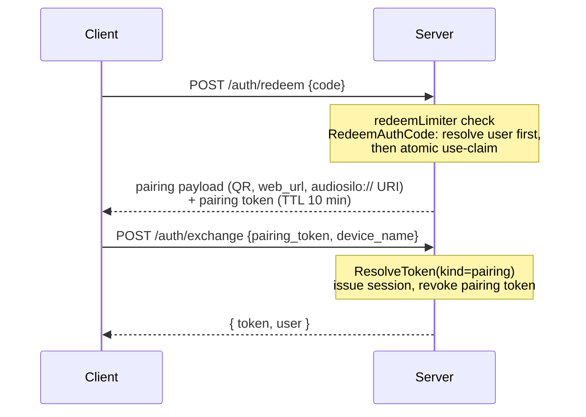

The server's first design priority is **safe to expose to the internet by
inexperienced users**. That shapes everything on this page: no default
passwords, no plaintext secrets at rest, brute-force lockouts, defense-in-depth
path checks, and a hard testing rule for anything security-critical.

## Secrets at rest

Two different hashing strategies, chosen by entropy:

- **Passwords** (low-entropy, user-chosen) use **argon2id** (`auth/hash.go`).
  Parameters: `time=2`, `memory=64 MiB` (`argonMemory = 64*1024` KiB),
  `threads=4`, 32-byte key, 16-byte random salt - tuned for interactive login
  on modest self-hosted hardware, with memory comfortably above the OWASP
  floor. Hashes are stored PHC-style
  (`$argon2id$v=19$m=65536,t=2,p=4$<salt>$<key>`); `VerifyPassword` compares
  with `subtle.ConstantTimeCompare`, reading the cost from the hash itself.
  Minimum length for a non-empty password is 8 (`auth.MinPasswordLen`). Test
  binaries may lower the cost with `auth.UseCheapHashingForTests()`, which
  panics outside a test binary (`testing.Testing()`).
- **Tokens and auth codes** (full-entropy, machine-generated) are stored only
  as **SHA-256 hashes** (`hashSecret`). A fast hash is appropriate here because
  the secrets are 256-bit random values - argon2id is reserved for passwords.
  A database leak exposes no live credential of either kind.

Timing hygiene: `auth.Authenticate` runs a dummy argon2id verification (against
`dummyHash`, whose cost parameters mirror the real ones) for unknown usernames
and for password-less accounts, so response timing doesn't leak account
existence.

:::danger[Never log or persist a plaintext secret]
The first-run banner (and the setup page URL) is the **only** place a
plaintext credential ever appears, exactly once. Handlers return freshly-minted
codes/tokens in the response body and store only the hash.
:::

## Tokens: session, pairing, and API keys

`tokens.kind` distinguishes three kinds of credential a client holds
(`auth.KindSession`, `auth.KindPairing`, `auth.KindAPI`), plus the
[cast tokens](#cast-tokens) a player hands a Chromecast receiver (`auth.KindCast`)
and the [Bridge's token](#bridge-tokens) (`auth.KindBridge`):

- **Session tokens** are the durable bearer credential (`Authorization: Bearer
  …`). Issued by `POST /auth/login` and `POST /auth/exchange` with **no
  expiry** (and, for a [household member](#household-members), by their owner:
  `sign_in_here` or `…/members/{id}/session`); revoked by `POST /auth/logout`, by
  the owner signing a device out (`DELETE /me/devices/{id}`, which with
  `?also_members=1` takes the members signed in on it too), by a member's owner
  (`DELETE /me/household/members/{id}/devices/{device_id}`), or by admin action.
- **Pairing tokens** are intermediaries minted by `POST /auth/redeem` (auth
  code → pairing) or `POST /auth/pair` (add another device from an existing
  session). `POST /auth/exchange` turns one into a device-named session token.
  A pairing token is **as redeemable as its origin** (`tokens.auth_code_id`
  links it to the code that minted it): invite-derived tokens inherit the
  invite's uses and expiry - exchange claims one use per device, so one QR can
  pair several devices - and die with the code (delete/supersede cascade,
  rotate revokes); recovery-derived tokens last `pairingTTL` = 10 minutes
  (multi-scan within it, since recovery codes are unlimited); `/auth/pair`, a
  household member's code (`POST /me/household/members/{id}/pair`) and demo tokens
  are unlinked - single-use (revoked on exchange) with the same 10-minute TTL.
  `/auth/pair` can ask for a shorter one (`ttl_seconds`, clamped to 30 seconds
  through 10 minutes by `pairTTL`); the console's Listen in player asks 120
  seconds, since its token rides a tab's URL and history.
  The daily retention job deletes the pairing tokens that can never pair again
  (`auth.PrunePairingTokens`: revoked, past their own expiry, or linked to an
  expired or used-up code), so the rows don't pile up one per QR shown; the
  code's own row is untouched.
- **API keys** (`auth.KindAPI`) are user-minted, **non-expiring** bearer
  credentials for headless integrations (dashboards, cron), created / listed /
  revoked via `POST` / `GET` / `DELETE /auth/tokens`
  (`IssueAPIToken` / `ListAPITokens` / `RevokeTokenByID`). A key authenticates
  exactly like a session token and **acts as its owner** - an admin's key also
  passes `requireAdmin` - but it is never valid for `/auth/exchange` (pairing),
  and its lifecycle is mint / list / revoke rather than sign-in / sign-out. Only
  the SHA-256 hash is stored (the secret is returned once at creation) and the
  user's label rides in `tokens.device_name`. Creating and revoking go through
  `gateSelfService`, so they share the `accountLimiter` and are refused for demo
  accounts, exactly like the password/recovery routes; listing (`GET
  /auth/tokens`) takes `nonDemoAccount` alone (from 2.4.0), so opening the
  Account page never spends the per-IP budget a household behind one NAT
  shares. **Containment:** an API-key
  caller is additionally barred (403, via `denyAPIKey` in
  `internal/api/handlers_auth.go`, also called by `handlers_cast.go` and
  `handlers_members.go`) from the credential-minting routes
  (`POST /auth/{tokens,recovery,pair,password}`, `POST /cast/token`, and every
  [household member](#household-members) route, whose create, `…/session` and
  `…/pair` make a member's session or pairing code), so a leaked key can never spawn a fresh credential - another
  key, recovery code, pairing token, or password that would outlive its own
  revocation, or even a [cast token](#cast-tokens), which would die with it (mirrors
  GitHub's "a token cannot create tokens"). It can still list/revoke keys and clear a recovery code,
  which only reduce access.

### Cast tokens

A **cast token** (capability `cast`, `internal/auth/cast.go`) is a fourth kind of
`tokens` row, `kind = 'cast'` (`auth.KindCast`), with a `cast_grants` row that says
what it may read. A player mints one (`POST /cast/token`, `auth.IssueCastToken`) for
the book it is about to play on a Chromecast, and the receiver's stream and cover
URLs carry it instead of the session token: a receiver is a device the listener
doesn't control, and its URLs can surface in its logs or a debugger. It is narrow on
every axis:

- **One book.** Its grant reaches only the `(library, path)` it was minted for, or a
  file or folder inside it on a segment boundary (`relpath.Within`: `Book` never
  reaches `Book 2`; the path is cleaned first, so `Book/../Book 2` doesn't either).
  A mint for a part path stores its book's path. And because a folder book's folder
  can hold other books (`Series` holding `Series/Book 2`), `api.castOwnBook` also
  requires the requested path to address the token's **own** book in the index
  (`catalog.BookPathAt`); a path the index places in no book is refused.
- **Media only.** `auth.ResolveRequest` never accepts a cast token;
  `auth.ResolveCastRequest` does, and the api calls it only for the `?token=` of
  `GET /libraries/{id}/cover` and `/stream` with **no** `Authorization` header. It
  is never a bearer credential, so it can't reach any other route, mint another cast
  token, or reach `/meta/cover`.
- **Tied to the sending device.** The grant's `parent_token_id` is the session that
  minted it. Validity is `lookupToken`'s one check (unknown, revoked, expired,
  disabled user) plus, for a cast token, a grant and a live parent, so **signing out
  the device that minted it** (logout, My devices, the console) ends it.
- **Short-lived.** 24 hours; a person keeps at most 20, and each mint deletes every
  dead cast token (expired, no grant, or its parent gone, signed out or expired). The
  daily retention job runs the same prune (`auth.PruneCastTokens`), so a dead token's
  row (the receiver's `last_ip`) and grant (which book was cast) never outlive it by
  more than a day.
- **Still the person's.** Deleting the account deletes it with the account's other
  tokens. Disabling the account only **suspends** it, as it does every token
  (disabling, `UpdateUser`'s `disabled`, revokes nothing; `lookupToken` checks the user on every request): it
  is refused while the account is disabled and works again if the account is enabled
  before it expires, so signing out the device that minted it is what ends it for
  good. The media handlers check the person's **current** share scope, so a revoked
  share is a `403` (and a restored one works again).

**Not the ebook** (Bridge Phase 3b). `GET /libraries/{id}/ebook` takes no URL token
of any kind, and there is no `reader` token kind: the web player fetches the EPUB
with its bearer header and posts the bytes to its reader document, and the apps
download it with the header into a local file and post it to their reader's WebView
in chunks (Phase 3b-2; the WebView reads no file and makes no request,
[the app host](../frontend/reader.md#the-app-host)). Nothing needs a URL that carries
a credential, so none exists.

Only the SHA-256 hash is stored. Any refusal is the uniform `401`. An API key may
not mint one (`denyAPIKey`, the containment rule above: a key never mints another
credential); a demo account may (it can play). A cast token is never a **device**:
`ListDevices` and the device sign-outs take only session and API-key tokens.

### Bridge tokens

The paired [Bridge](../bridge/index.md) holds a token of kind `bridge`
(`auth.KindBridge`, `internal/auth/bridge.go`), minted by exchanging a one-time
pairing code an admin made in the console (`POST /admin/bridge/pair`, then the
Bridge's public `POST /bridge/pair`; see
[Pairing and jobs](../bridge/pairing-and-jobs.md#pairing)). It is narrow too:

- **The Bridge's routes only.** Routes opt in to the token kinds they take, and only
  the Bridge's own (`/api/v1/bridge/*`, behind `requireBridge`) list `bridge`, from
  the `Authorization` header only. Every other route refuses it (`401`), media
  `?token=` included, and the Bridge's routes refuse every other kind. A route-table
  test sends a bridge token (header and `?token=`) to every other authenticated
  route.
- **Its admin's.** It belongs to the admin who made the code and works only while
  that account exists, is enabled and is still an admin: `lookupToken` refuses a
  disabled one and the resolver a demoted one, so demoting or disabling the admin
  stops the Bridge (it keeps its token and tries again every 5 minutes, so it comes
  back if the admin is made an admin again).
- **Checked again where it matters.** "A Bridge is paired" has one statement,
  `auth.BridgeLiveSQL` (a live bridge token of an enabled admin, with the partial
  index `idx_tokens_bridge`), and `auth.BridgeTokenLiveSQL` asks the same of one
  token: the heartbeat's write and every claim ask it inside their own transaction,
  so a call authenticated just before a pairing or an unpair revoked its token (a
  long poll above all) saves nothing and claims nothing (`401`).
- **401 means refused, 503 means unknown.** `requireBridge` answers `401` only for
  a missing or refused token; a failure to check it is `503`, so the Bridge never
  takes a database hiccup for a revoked token.
- **One at a time.** The exchange (one transaction: the code's hash, its expiry,
  its admin) revokes every earlier bridge token, and unpairing
  (`DELETE /admin/bridge`) revokes the current one.
- **Minted only from a session.** Making the pairing code is refused to an API key
  (`denyAPIKey`), like every route that leads to a new credential. The code is
  stored only as a hash, lasts 15 minutes, and failed exchanges count against the
  redeem limiter.

A bridge token is never a **device** either: the device lists and sign-outs leave it
out. It is never **touched** (`last_seen`, the address and the app stay as they
were): its calls, a heartbeat every 30 seconds, are not its admin's activity, which
is the newest `last_seen` of their tokens. The heartbeat says when the Bridge was
last heard. Only the SHA-256 hash is stored.

`auth.ResolveRequest` (which `ResolveToken` wraps for a single kind) validates a presented secret for the accepted kinds: it hashes
the secret, looks up the row, and rejects revoked tokens, expired tokens, and
tokens whose user is disabled. On success it bumps `tokens.last_seen` - which
is how a user's "last activity" is derived (`MAX(tokens.last_seen)`); there is
deliberately no `last_login` column.

In the same write, `ResolveRequest` records what the request says about the
device (`auth.Presence`): its address (`clientIP`, so `X-Forwarded-For` only
from a trusted proxy) into `tokens.last_ip`, and its app from the
[`X-AudioSilo-Client`](api/index.md#client-identification-x-audiosilo-client)
header (`auth.ParseClient`; strict, a malformed value is ignored) into
`tokens.client_app` / `client_version` / `client_platform`. The app columns
change only when the request names an app, and that is decided in the SQL
rather than from the row read just before, so a header-less request (covers
loading beside an API call) racing one with the header can't write back a stale
app. It returns the matched token as an `auth.Credential` (id, kind, device
name, app), which the middleware puts in the request context (`credentialFrom`)
for `denyAPIKey` (it reads the credential's kind), the listening-session
recorder and the admin devices routes. An admin can sign one device out
(`DELETE /admin/devices/{id}`, `auth.RevokeDevice`): it revokes one live
session or API-key token by id, whoever owns it, and refuses the token making
the request (`409 current_device`). A revoked token keeps its row, but the
daily retention job (`auth.ForgetRevokedAddresses`) blanks its `last_ip`, so a
device's address is kept only while it is signed in.

The middleware wrappers in `internal/api/middleware.go`:

- `requireAuth` - a **session token or an API key** from the `Authorization`
  header only (`ResolveRequest(secret, presence, KindSession, KindAPI)`); a pairing
  token is never accepted here, so a QR/pairing secret can't be used as a durable
  credential. A book's ebook (`GET /libraries/{id}/ebook`) is served under it on
  purpose, not as media (see [Cast tokens](#cast-tokens)).
- `requireMediaAuth` - additionally accepts `?token=` as a query parameter,
  used **only** for the media GETs (`/meta/cover` for a community cover; a book's
  `/cover` and `/stream` use `requireBookMediaAuth`, below) because browser
  ``/`<audio>` elements cannot set headers. `bearerToken(r, allowQuery)`
  confines the fallback deliberately: a token in a query string can leak into
  access logs and `Referer` headers, so no other route accepts it. An API key
  works here too, since it authenticates wherever a session does.
- `requireBookMediaAuth` - `requireMediaAuth` whose one token lookup also accepts a
  [cast token](#cast-tokens) (`ResolveCastRequest`, then `castOwnBook`). Only a
  book's own cover and stream use it; `/meta/cover` keeps `requireMediaAuth`.
  A cast-authenticated answer sets `Cross-Origin-Resource-Policy: cross-origin`,
  and so does every authenticated media answer once `cors_origins` is set
  (below).
- `requireAdmin` - `requireAuth` plus a role check; every `/admin/*` route uses
  it. The baked-in admin HTML is unprivileged - the API enforces the role.

## Auth codes: invite vs recovery

Auth codes are human-typable secrets (`generateAuthCode`): 10 random bytes in
Crockford's base32 alphabet (no I/L/O/U), formatted in dash-separated groups of
four. `normalizeCode` strips spacing/case and maps look-alikes (`O→0`, `I/L→1`,
`U→V`) before hashing, so fat-fingered entry still verifies.

`auth_codes.kind` splits them into two lifecycles:

| | `invite` | `recovery` |
|---|---|---|
| Minted by | Admin (`POST /admin/users/{id}/authcode`) | The user themself (`POST /auth/recovery`) |
| Defaults | 5 uses / 1-day expiry (`defaultAuthCodeMaxUses`/`defaultAuthCodeTTLDays` in `handlers_admin.go`; explicit `0` means unlimited/never) | Unlimited uses, never expires |
| Cardinality | One *active* invite per user | At most one recovery code per user |
| Listable | Yes (`ListAuthCodes`, metadata only) | No - surfaces only as `User.HasRecovery` |
| Revocation | `DELETE /admin/authcodes/{id}` | `DELETE /auth/recovery` (self) or `DELETE /admin/users/{id}/recovery` (admin, the only lever for a leaked code) |

Both redeem through the same path. The full onboarding flow:

`auth.RedeemAuthCode` has two correctness properties worth knowing before you
touch it:

- **Atomic claim.** The under-the-cap check is folded into the increment
  (`UPDATE … SET uses = uses + 1 WHERE … AND (max_uses = 0 OR uses <
  max_uses)`), so concurrent redemptions can't push `uses` past `max_uses`. The
  first-redemption `redeemed_at` stamp rides in the same write
  (`COALESCE(redeemed_at, ?)` - an earlier stamp is preserved, since recovery
  codes redeem repeatedly).
- **No burn on a rejected user.** The bound user is resolved - and a
  disabled/deleted account rejected - *before* the claim, so a rejected attempt
  never consumes a use or flips an invite to "accepted".

**Invite hygiene.** `auth.CreateInvite` mints and, in the same transaction,
deletes the user's other *still-redeemable* invites
(`supersedeActiveInvites` - not used up, not expired), so there is exactly one
active invite per user; spent/expired invites remain as history. `POST
/admin/authcodes/{id}/rotate` (`RotateAuthCode`, the console's **Rotate**)
regenerates an invite's secret **in place**: `max_uses` is preserved, the use
counter and `redeemed_at` reset, and the expiry is renewed for the invite's
*original* window - never silently downgraded to defaults. Only invite-kind
codes rotate. (`CreateAuthCode`, without the supersede step, exists solely for
the first-run bootstrap, which has nothing to supersede.) `GET /admin/invites`
(`auth.ListInvites`) lists every account's invites for the console - metadata
only, since only the code's hash is stored, and never recovery codes.

**Recovery** decouples re-authentication from invitation: a signed-out or
password-less user who saved a recovery code can re-pair on any device via the
normal connect screen, with no admin involved. `GenerateRecoveryCode`
atomically replaces any existing recovery code for the user.

:::note[Client UI retired]
The frontend player no longer mints or reads recovery codes - it nudges users to
set a password and uses the reconnect flow (see
[Frontend overview](../frontend/overview.md)) instead. The server keeps `POST
/auth/recovery` and the admin revoke route so older app builds still redeem
codes they minted earlier; both are slated for removal once those clients age
out.
:::

## Demo-account restrictions

Public demo mode (`config.demo.*`) creates throwaway `is_demo` accounts.
Three fences keep a demo session from becoming a durable login:

- `POST /auth/password`, `POST /auth/recovery`, and the `/auth/tokens`
  (API-key) routes are **refused for demo accounts** (`User.IsDemo` checked in
  the handlers / `gateSelfService`).
- These endpoints, plus demo-session creation itself, are rate-limited (see
  [the limiter table](#rate-limiting)).
- A demo account can't list the server's usernames or share a collection
  (`GET /me/share-targets` and `PUT /me/collections/{id}/shares` are `403`; see
  [the listener's own state](#the-listeners-own-state-me)), and demo accounts are
  never offered as share targets.
- A demo account can't add [household members](#household-members) (every member
  route but the list is `403`; the list answers `allowed: false`, `reason: "demo"`),
  and is never anyone's owner or member: the admin's Assign refuses both
  (`409 owner_is_demo`, `409 member_is_demo`).
- Every demo refusal carries `code: "demo_account"` (`nonDemoAccount`).
- Since Phase 2b a demo account can't use a
  [managed module](modules.md#routes-always-mounted-gated-on-the-toggle)'s user
  routes (`api.notDemo` in the module's route wrapper, `403 demo_account`), and
  `GET /server` leaves out the `bridge` block for it (only a signed-in, non-demo
  caller gets one; `API.signedIn`).
- A demo account can't share its listening with the house (`PUT /me/household`
  is `403`, `nonDemoAccount`), and demo accounts never appear in anyone's
  `GET /household/listening`, so a public demo never shows up in a household. It
  may mint a cast token, since it can play.
- A background reaper (`launcher.demoReaper`, every 15 minutes) deletes demo
  accounts idle past `demo.idle_ttl` - by the `is_demo` flag, never by username
  prefix. Deletion cascades all their state.

## Self-service password rules

`POST /auth/password` (handler `handleSetPassword`) lets a signed-in user set
or change their own password:

- Setting a **first** password requires no challenge (the primary case is a
  password-less, pairing-onboarded player user establishing a way back in).
- **Changing** an existing password requires `current_password`
  (`auth.CheckPassword`) - so a stolen session token can't plant a persistent
  credential.
- An **empty** password is rejected (clearing is admin-only via `PATCH
  /admin/users/{id}`), and the admin-must-keep-a-password guard still applies
  underneath (`SetPassword` refuses to clear an admin's password).

## Admin guards

Account-safety invariants live in `internal/auth`, not in handlers, so every
caller gets them. The admin's `PATCH /admin/users/{id}` is **one** `auth.UpdateUser`
transaction (`SetPassword` is a password-only call of it): every change in the body
is checked against the account, each as the ones before it leave it (password,
household, role, disabled, `can_add_members`), before anything is written, so a
refused field changes nothing.

- **`ErrLastAdmin`** - the last *enabled* admin cannot be demoted or disabled
  (`UpdateUser`) or deleted (`DeleteUser`); both read the account and the guard
  inside the write, so two admins removing each other at once can't both pass. The
  console can never be locked out.
- **`ErrAdminNeedsPassword`** - an account cannot become (or remain) an admin
  without a password: enforced on create, on promote and on password clear.
- **No self-delete** - enforced additionally in the delete *handler*: an admin
  may disable their own account (reversible) but never delete it
  (irreversible). `DeleteUser` cascades sessions, auth codes, progress,
  bookmarks, notes, history, listening sessions, share grants, up next, the
  account's collections (with their items and shares), its shares of other
  people's collections, ratings and the listening goal via `ON DELETE CASCADE`;
  files on disk are untouched.
- **Passwords are optional for non-admins** - stored as an empty hash, and
  `Authenticate` rejects empty-hash accounts outright, so a password-less user
  can only ever authenticate via code pairing (or, for a
  [household member](#household-members), a session their owner makes).
- **`ErrMemberNotAdmin`** - a household member is never an admin: `UpdateUser`
  refuses promoting one and assigning an admin as a member (`409 member_not_admin`);
  "Make independent" comes first, so it passes this check in the same request as the
  promotion (a member with no password also needs one in that request:
  `ErrAdminNeedsPassword`).
- **`ErrKidNoPassword`** - a kid holds no password: `UpdateUser` refuses a non-empty
  password when the request leaves the account a kid (a kid with no household change
  in the request, or an assign as a kid), as `400 kid_no_password`. Clearing one is
  fine, and so is a password beside a Make independent or an assign as a grown-up:
  this one check reads the request's household change first.
- **The Assign refusals**: the account itself (`ErrSelfManaged`, checked with the kind
  and access before the transaction), then inside it (`checkAssign`) an unknown owner
  (`404`), an owner who is a member (`ErrOwnerIsMember`) or a demo account
  (`ErrOwnerIsDemo`), a demo account as the member (`ErrMemberIsDemo`), an admin
  (`ErrMemberNotAdmin`), and someone with members of their own (`ErrHasMembers`); each
  but the unknown owner is `409` with its code.
- **`DeleteUser(ctx, id, keep)`** deletes the person's household members with
  them, in the same transaction, except the ids in `keep` (cleared to ordinary
  accounts, their open unlinked pairing tokens revoked, as
  [Moving between households](#household-members) describes); a `keep` id that isn't their member
  is `ErrInvalidKeepMembers` and nothing changes. The last-admin rule is checked
  first.

## Authorization: shares → Scope

Access control is filesystem-based. A **share** is a named set of path rules
(`share_paths`: `(library_id, path)`, where `""` = the whole library); users
are granted shares, and a user's access is the union of their granted rules (plus,
for a household member, what their owner gives them: [the member rule](#household-members)).
`catalog.GrantWholeLibrary` is sugar that ensures a `"Library: <name>"` share
with a `""` rule exists and grants it.

At request time the rules are compiled into a `catalog.Scope` per library -
`AllowAll` (admins for books; or any `""` rule; or a member on `all` whose owner is an
admin) or a list of granted `Paths`. The
scope is then enforced through **three functions, each matched to a different
query shape**:

| Function | Semantics | Enforced where |
|---|---|---|
| `Scope.Allows(p)` | `p` is equal to or under a granted rule (segment-boundary prefix match) | `authorizedPath` in `handlers_library.go` - **every** path-addressed endpoint (`item`, `chapters`, `cover`, `stream`, progress/bookmarks/notes/history/favourites writes); again on the book a progress path is keyed on (`api.progressPath`: a book outside it leaves the path as given), and on each folder `/fs` marks `pending_book` (`library.MarkPendingBooks`: a folder only visible on the way down to a grant is never marked) |
| `Scope.VisibleInBrowse(p)` | `Allows(p)` **or** `p` is an *ancestor* of a rule - so the user can navigate toward granted content | `handleBrowseFS` → passed as the `allow` filter to `library.BrowseFS` (applied before pagination so pages stay full) |
| `pathFilterSQL(col, scope)` | The same grant logic as a SQL `WHERE` fragment: `col = ?` OR the byte range `col >= 'rule/' AND col < 'rule0'` (`0` is the byte after `/`), so it is a literal, **case-sensitive** prefix with no wildcards to escape. It used `LIKE` until the player-redesign data API; `LIKE` ignores ASCII case, so a grant on `Saga` also reached a sibling `saga/...` on a case-sensitive filesystem. Over 32 paths (`jsonPathsAbove`; a `collections` [household member](#household-members) can hold a thousand) it is a single-parameter form instead (`pathsJSONFilterSQL`: a row's path and each of its ancestors looked up in one JSON list, the same rows as the `OR` form, which could not hold 1,000 arms at all; a path that isn't valid UTF-8, which JSON can't carry exactly, keeps an `OR` arm of its own). `BenchmarkMemberScopes` records its cost | `ListBooks`, `Search`, `RecentBooks`, the player's browse lists (`/authors`, `/narrators`, `/series`), `/next`'s series step and the owned-book placement on `/meta` rails; `scopesFilterSQL` extends it across libraries for the cross-library listings (`/me/progress`, `/me/history`, `/me/favourites`) |

The Go predicate (`pathAllowedBy`) is authoritative; `pathFilterSQL` must stay
behaviorally identical to it.

A requested path can resolve to a book **above** it: a part of a folder book, or
a disc folder of a book joined from its disc folders (`bookForPath`; see
[On-demand indexing](scanner.md#on-demand-indexing-indexpath)). Allowing the
requested path isn't enough then: `item`, `chapters`, `cover`, `meta` and `next` also
require `Scope.Allows(book.RelPath)`, and `Scanner.IndexPathWithin` checks it
before reading anything (`library.ErrNotAllowed`). A share granting only one
disc folder or one file of a book gets the same `403 no access to this path`
as a path outside the share, so the answer reveals nothing about the book; the
files it does grant still stream (`stream` is scoped on the file path). A non-admin without a library grant gets 403 from
`libraryScope` before any content is touched. A granted podcast library whose
scope becomes empty through private-show filtering remains readable as empty
lists, as described below.

## Podcast visibility

Podcast scope adds two checks after authentication:

1. **Client support** (`auth.SeesPodcasts`, `internal/auth/podcastgate.go`).
   `api.callerOf` uses `Credential.Client`: this request's
   valid `X-AudioSilo-Client`, otherwise the token's stored client (including
   media `?token=`). `catalog.Caller.Podcasts` is true for `AudioSilo Admin`
   with any/no version and `AudioSilo` with version `dev`. A released player
   qualifies from `auth.PodcastPlayerMinVersion`, **`"2.2.0"`** (Bridge Phase
   2d-1, the first player with podcast views): a numeric `X.Y.Z` at least that
   minimum, suffixes after `-`/`+` ignored (so `2.2.0-rc.1` counts as 2.2.0;
   `2.2` and an empty version fail). `AudioSilo/2.1.x` and older stay hidden;
   an empty minimum would hide every released player. The served `/web`
   export sends its `app.json` version same-origin, so a `/web` build from
   2.2.0 passes and an older web image does not. Missing/malformed/other apps, API tools
   without a recognized client and the Bridge fail the gate.
   `callerByID` defaults it false; internal podcast scheduling/retention
   explicitly enables it before resolving actual follower grants. Admin role grants no
   exception. `CallerScope`, `CallerScopes` and `CallerLibraries` apply it before
   any admin shortcut. It hides libraries, their content, `/me/*` state and
   household listening; cast tokens do not expose podcasts in this phase.
2. **Private shows.** After computing shares/household grants, `CallerScope`
   and `CallerScopes` remove private shows the user does not follow. A
   whole-library grant expands into the remaining indexed show paths; a scoped
   grant inside a denied show is dropped. Admin player-facing scopes follow the
   same rule. A follow must match both path and `show_id`: replacing a show at
   the same path cannot transfer a previous follower's private access.

`CallerLibraries` deliberately lists a granted library even if all its shows
are private and unfollowed. `scopedLibrary` preserves that distinction too:
listing shows, `/fs` and `/books` returns empty lists, rather than `403`, when
privacy removed every show. Requests for a hidden episode/show still fail their
path/show checks. A caller without a library grant or passing client remains
denied. The admin catalog is the separate administrative view of the disk and
can still see private show contents.

**A gated caller's whole-list replace keeps what the gate hides.** Up next and
collection items are path-keyed lists that can hold episodes. An add's
position already counts only the rows the caller sees. A whole-list replace (`PUT /me/queue`,
`PUT /me/collections/{id}/items`) from such a caller would otherwise delete the
episodes it was never shown, so `catalog.GatedScopes` passes the caller's
podcast scopes, as a podcast-seeing client would get them, as `keep`: the
stored entries those allow stay, each after the listed entry it followed, or
all after the new list in stored order when the new order would shuffle them.
They count toward the list's cap (the oldest kept rows go first). Entries
hidden for any other reason (a revoked share, an unfollowed private show) and
every replace from a podcast-seeing caller keep the ordinary delete rule.

Following a private URL uses its normalized current/previous SHA-256 hash as
proof, before private-show filtering, and requires a grant on the whole library.
Following by path cannot reveal an unfollowed private show. Follow, unfollow
and manual check use the module user wrapper (no kids, no demo accounts;
`404 module_off` when disabled); authenticated reads, including kids within
scope, are not module-gated. **The client header is compatibility negotiation,
not a substitute for authentication or grants.**

Admin storage routes require admin and non-demo authentication; they use the
administrative catalog rather than player private-show scope. Retention GET
stays core; policy writes and a new episode fetch additionally require the
module, exact online Bridge kind and writable mapping. A valid present fetch
returns success before those checks. Kids/listeners cannot set policy or
request admin downloads. Player media checks the stored/request client,
private-show scope and exact indexed path before opening or queueing an
episode; unknown/hidden paths queue nothing. Missing audio shares an on-demand
fetch, waiting at most two seconds before a status-bearing 503. Kids with read
access may trigger it or use listener Retry without gaining policy/arbitrary
job control. GET fetch status is authenticated observation only; POST Retry
requires read scope and not-demo auth, strict `{path}` and server-chosen
priority/identity. See [status and Retry](api/reference.md#podcast-fetch-status-and-retry).

New fetches need the module, online exact Bridge kind and writable mapping.
Non-admin creators are capped at five open fetch intents, including parked
jobs and prefetch; admins are exempt. Dedupe/promotion precede the cap and do
not transfer requester ownership. Demo streams cannot create new work, though
they can promote an existing shared intent; demo POST Retry is refused.
Ready files/status remain readable offline/module-off. Status exposes only
safe state/id/byte counters/retry/error, never raw job params, requester,
progress message or enclosure URL. Queue prefetch uses only that caller's
visible queue and scopes, prepares at most one candidate per current episode
and never reads another user's queue.

The two Bridge retention routes accept only the paired Bridge bearer token,
never session/API/cast tokens or query tokens. They return `no-store`
aggregates, not individual follower names, ids or positions. Missing or
unfinished progress, invalid times, zero followers or any aggregate error
cannot authorize deletion, and the Bridge rechecks a fresh aggregate and the
local hash/size immediately before deleting (full rules in
[retention](../bridge/podcasts.md#retention-policy-and-deletion-authority)).
Publication journals block
indexing/media, and an opened validated descriptor pins each served generation.
See [retention routes](api/reference.md#bridge-podcast-retention).

Private URLs are credentials: the server never persists a pending private
subscribe URL (it injects it only into the Bridge's claim response), the Bridge
keeps it only in its vault, and job displays, errors and results redact URL
text. Episode resolution uses a fresh bounded private feed read and keeps
enclosure URLs only in memory. Checkpoints omit URLs and seal strong validators
in the vault; feed/artwork/audio requests share the network guard and strip
source credentials across origins. Saved audio itself is an ordinary library
file, so filesystem access is outside the player privacy boundary.
See [Podcasts](../bridge/podcasts.md#private-urls-and-recovery) for
detection, storage and recovery.

### Podcast discovery and OPML

Phase 2c-3's routes keep the same boundaries
([reference](api/reference.md#podcast-discovery)):

- **Who.** Search, its providers and artwork, and the OPML import are module
  user routes for adult, non-demo accounts, behind the client gate with no
  admin exception (the check order is in the reference). Search needs no
  library grant: it returns only public directory data and no local state. The
  import needs a whole-library grant on its one target library (checked before
  the library's kind, so an ungranted library's kind stays hidden) and always
  acts as the caller. The OPML export is a core read for any non-demo account
  that passes the client gate, kids included, and covers only the caller's own
  current follows through their current scopes and private narrowing, with no
  admin or other-user view. A refused request has no effects.
- **Tokens.** Only the artwork route takes a `?token=` (a session or API key,
  for an ``); every other new route refuses a `token` query parameter
  (`400 invalid_request`) and needs the `Authorization` header. Cast, pairing
  and Bridge tokens are refused on all of them.
- **Outbound requests.** Directory searches go only to the fixed HTTPS origins
  (`itunes.apple.com`, `api.podcastindex.org`) on port 443, with no proxy, no
  cookies and no redirects. Artwork fetches go only to URLs a search result
  registered (a caller can name an id, never a URL), at most three redirects,
  never HTTPS to HTTP. Both check the address actually dialled
  (`internal/netguard`, shared with community covers): loopback, private,
  link-local, carrier-grade NAT and other reserved addresses are refused (an
  IPv4-mapped or NAT64 address is judged by the IPv4 address it carries), not
  just a DNS answer checked beforehand. Search never fetches a returned
  feed; the Bridge's subscribe job remains the guard for a feed that resolves
  to a private address. Search results drop feed URLs that look private or
  name a literal non-public host.
- **OPML parsing.** The import reads at most 1 MiB, refuses any DOCTYPE, DTD,
  directive or stray processing instruction, never expands or fetches an
  entity, include or linked OPML, refuses duplicated attributes, and bounds
  outlines, nesting, depth, elements and attributes. The whole document is
  validated before any row acts.
- **Secrets.** The Podcast Index key and secret come only from the
  environment and are never persisted, shown, logged or sent anywhere but the
  signed Podcast Index request (the secret itself never leaves the server: only
  the SHA-1 signature does). A private feed URL in an import is handled exactly
  as a private single follow
  ([Private URLs](../bridge/podcasts.md#private-urls-and-recovery)); row
  results show only a redacted label. The export never
  writes a private show, for anyone: there is no stored copy of its URL to
  write.
- **Memory only.** Search results, artwork, quotas and uploaded documents are
  held in bounded memory and dropped on restart or when the module is turned
  off; nothing about a search is stored, so searches do not become a household
  history.

## The listener's own state (`/me/*`)

The player redesign's Phase 1b routes (up next, collections, ratings, progress
edits, personal stats, the listening goal and the caller's own devices; see
[the reference](api/reference.md#up-next-collections-and-ratings)) and the
annotation routes (`PATCH /bookmarks/{id}`, `PATCH /notes/{id}`,
`GET /me/bookmarks`, `GET /me/notes` and the paged `GET /me/history`, capability
`annotations`) are all `requireAuth`: a session token or an API key, acting as
its owner. They follow a few rules on top of share scope:

- **Owner only.** Every `/me/*` route reads and writes the caller's own rows,
  keyed on the authenticated user, never on an id or user id from the request.
  The one deliberate exception is a collection shared with the caller, below.
- **`404`, never `403`, for someone else's id.** A collection id, device id,
  bookmark id or note id that isn't the caller's answers `404` (`device not
  found`, `bookmark not found`, `note not found`), and so does a bookmark or
  note whose path the caller's current access no longer reaches, so an old id
  can't edit a revoked share's row (`catalog.EditBookmark` / `EditNote`). It is
  the same answer as for an id that doesn't exist, so it never confirms that
  another user's row exists. A collection shared with the caller is the only case where
  the caller is told it exists but may not change it (`403 not_owner`).
- **Current access filters every list.** A stored entry whose path the caller
  can no longer open (a share taken away) is kept, but left out of each list
  and count (`UserScopes` with `scopesFilterSQL` or `Scope.Allows`), like
  favourites. Adding a book or rating one checks scope on the path and on the
  book it resolves to (`bookForPath`, as `item` does); removing one entry
  doesn't, since it only deletes the caller's own row.
- **Collections are shared read-only, through the viewer's own access.** An
  owner can share a collection with named accounts on the same server. A viewer
  sees the collection's name, description and the owner's username, and only
  the items **their own** current access allows: the owner's other items, and
  how many there are, are never revealed (`item_count` and `preview` are the
  viewer's), and sharing grants no access to any book, except to the owner's own
  household member on `collections` access, whose access is the books of the
  collections their owner shares with them ([the member rule](#household-members)). Only the owner changes
  the collection, its items or its shares; a viewer can only leave it. The
  owner's `shared_with` list is never sent to a viewer.
- **The share picker shows usernames, so demo accounts are kept out.**
  `GET /me/share-targets` lists every enabled, non-demo account other than the
  caller (id and username; a kid household member only to their own owner): the one way a non-admin can list every account's
  username (a shared collection also shows its owner's, and
  [listening in the house](#listening-in-the-house-what-other-people-see) the
  usernames of the other people who share). A demo account is refused it (`403 not available for demo
  accounts`), so a public demo can't enumerate the server's users, and can't
  share a collection either (the same `403`, checked before the collection id, so
  a demo caller learns nothing about whose collection an id is). Disabled and
  demo accounts are never share targets. These two, and `PUT /me/household`
  ([below](#listening-in-the-house-what-other-people-see)), are the only `/me/*`
  routes with a demo refusal; none has its own rate-limit class.
- **Stats never cross users.** `/me/stats` and `/me/listening` are computed for
  the caller alone (the admin Activity code with its accumulator limited to the
  caller): no other listener, username, `by_user`, `top_users`, funnel,
  drop-offs, storage, coverage, growth, peak concurrency or inactive-user
  figure is computed or sent. The top books, authors, narrators, series and
  finished books pass through the caller's **current** access, so a revoked
  share's path, title or author never echoes back; totals and per-day time are
  the caller's own listening and count everything. So do `totals.finished` and
  the goal's `finished`: they count every finish of the caller's, including books
  they can no longer open, but as a number only, with no path or title.
- **Progress edits use the caller's scope.** `PATCH /libraries/{id}/progress`
  is `catalog.EditProgress` with the caller's own scope, behind
  `authorizedPath`, so a listener edits only their own progress on books they
  can open now: a path outside it is `403` even when a progress row is already
  there (the admin edit, by contrast, can still tidy such a row).
- **Validate before resolving.** A rating `PUT` checks its body, and a
  collection item `POST` checks ownership and then its body, before resolving
  the book, so a bad request, a stranger or a viewer never triggers on-demand
  indexing.
- **Revoking your own device, including this one.** `DELETE /me/devices/{id}`
  revokes one of the caller's session or API-key tokens (another user's, a
  pairing token's, unknown or already revoked is `404`; an expired one not yet
  revoked can still be revoked). Unlike the admin route, revoking the
  **current** token is allowed: the answer says `current: true` and the token
  fails every later request. An API-key caller may revoke, since revoking only
  reduces access (the same reasoning as listing and revoking keys). The revoke
  also clears the token's sign-in key (`tokens.sign_in_key`), so a later sign-in
  from that browser is announced as a new device. Self-revokes are not written to
  the admin audit log. A player should still not offer it for its own row: its
  normal sign-out saves the final position and flushes queued progress before
  the token goes, which a revoke would refuse.
- **Who may write is settled first.** On collections, ownership is checked
  before a field is (a name, the items, the share ids, the cap), so a stranger
  gets `404` and a viewer `403 not_owner` before any field `400` (only a
  malformed body, or a whole-list body without its list key, is refused
  earlier). A list's positions and cap count only the entries the caller can
  see; hidden entries are evicted (oldest first, for good) only when they alone
  would overflow the cap.

Each of these routes has a denied test (another user's data refused or
invisible) beside its allowed one.

### Listening in the house: what other people see

`GET /household/listening` (capability `household`) is the one route that shows a
listener what **other** people are listening to, so its rules sit in
`catalog.HouseListening` rather than the handler, each with an allowed and a
denied test:

- **Opt-in on both sides.** `household_sharing` has no row until a person sets
  `PUT /me/household` (no row reads as off), and a caller who doesn't share gets
  `listening: []`: you see housemates only while you share too. Only the choice is
  mutual, not the view: each list passes its own caller's scopes and each other
  person's 24-hour window, so visibility can be one-way (a housemate whose newest book
  you can't open doesn't show for you, though you may show for them; a sharer who
  hasn't listened in 24 hours sees others without showing up for them).
- **Who can appear.** Other users only (never the caller), enabled, not demo, with
  sharing on.
- **Never a kid.** A kid [household member](#household-members) has no
  `household_sharing` row: becoming a kid deletes it, and `PUT /me/household` refuses
  a kid both at the route and inside the write. So the opt-in rule alone leaves kids
  out, as a row and as a viewer, with no kid filter of its own.
- **What of them.** One row per person: their newest session recorded on this
  server (`import_id = 0`, not backfilled, listened > 0) within 24 hours.
- **Only books the caller may open.** That newest book passes the **caller's**
  current scopes (`ScopesAllow`) or the person is dropped; an older in-scope book
  never stands in for it.
- **No device fields.** `HouseListeningRow` has no field for a device, address,
  app or token, unlike the admin-only `LiveSessions`, which must never be reused
  for anything a non-admin sees.

There is no admin route over these choices: an admin sees listening on the
Activity pages as before, and nothing shows who shares.

## Household members

Household members (capability `household_members`) let any non-demo person
(the **owner**) create accounts from the player, with no admin: a **member** is a
user with `managed_by` set to the owner, a `member_kind` (`kid` | `grownup`) and a
`member_access` (`all` | `collections`) that the owner sets (and the admin, with
Assign to someone). The routes and their
refusals are in [the reference](api/reference.md#household-members); this is the
security model.

**One level, never admin.** An owner is never a member, a member never has members
(`ErrHasMembers`), and a member is never an admin (`ErrMemberNotAdmin`), so the
admin role is never derived. A demo account is never either (`ErrOwnerIsDemo`,
`ErrMemberIsDemo`).

**The member rule** (`catalog/members.go`; decided per request, with no cache to
invalidate). A member's scope is the union of:

- their own admin grants (unchanged);
- for `all`: the owner's **current** scopes, computed with the owner's role. An admin
  owner gives every library as `AllowAll` content scope;
- for `collections`: the item paths of collections owned by `managed_by` and shared
  with the member, each kept only while the owner's current scope in that library
  allows it (`Scope.Allows`). A book is its path with `relpath.Within` semantics: a
  folder book covers its own subtree, never a sibling (`Book` never reaches `Book 2`),
  and an item whose path is empty or not canonical (`relpath.Clean(p) != p`) grants
  nothing, so none grants a whole library.

A member whose owner is themselves, or is a member (data the writes refuse), derives
nothing. A disabled owner changes nothing for their members.

**The rule rides on the request.** `auth.lookupToken` reads the account's
`managed_by`, `member_kind` and the rule (`auth.User.MemberRule`: the owner, the
access, whether the owner is an admin) in its one statement, through a primary-key
`LEFT JOIN` of the owner (`memberColumns`/`memberScan`, which `getUser` shares). The
transport passes it on as a `catalog.Caller` (`api.callerOf`) to `CallerScope`,
`CallerScopes` and `CallerLibraries`, so a non-member's scopes cost the one grants
statement they always did and a kid's refusal reads nothing. `UserScope`,
`UserScopes` and `AccessibleLibraries` (id and `isAdmin`) read the rule themselves
(`memberRuleOf`, the same conditions) for a caller known only by id, such as the
importer; `TestMembers_RuleReadsAgree` holds both readings to the same scopes for
every kind of account, bad data included. New transport code builds scopes from the
request's user with `callerOf`, never from an id. `UserShares` (the console's Access
tab) stays the direct grants only; the console's detail carries the derived access
beside it (`accessible_libraries`, and a member's `owner_libraries`). Every consumer
follows from these functions: browse, search, media, cast mint and cast media,
`/next`, the car and household listening. A book removed from a kid's collection, the
collection unshared or deleted, or a library taken from the owner, is `403` on the
next request, including through an existing cast token (the media handler checks the
person's current access).

**Long path lists.** A `collections` member's scope can hold a thousand item paths;
`pathFilterSQL` binds them as one parameter past 32 (see
[the Scope table](#authorization-shares--scope)).

**Creating accounts without an admin** (`auth/members.go`, `CreateMember`, one
transaction): the owner is checked (`MayAddMembers`: not demo, not a member, the
server's `household.members_enabled`, their `can_add_members`; then under
`household.max_members`), the name is validated, the username derived (never chosen
by the caller, so it can't claim an existing one; numbered with no cap, so there is
always a free one), and the account inserted with `role = 'user'` and an empty
password hash. The body is decoded strictly, so a `role` field is `400`. An API key
can't reach any member route (`denyAPIKey`), and create, session and pair take the
account [rate limit](#rate-limiting).

**Kids.** A kid account holds no password, API key, recovery code, invite or house
sharing, can't make a pairing code of its own (`/auth/pair`), and shares collections only with
its owner (**Visibility**, below). `POST
/auth/password`, `POST /auth/tokens`, `POST /auth/pair`, `POST /auth/recovery`, `PUT
/me/household`, `PUT /me/collections/{id}/shares` and (Phase 2b) every user route a
[managed module](modules.md#routes-always-mounted-gated-on-the-toggle) mounts answer
`403 kid_account` from one route wrapper (`api.notKid`, before the handler; wrap
any new route a kid can't use).
The writes that mint a credential or share something refuse a kid again inside their
own transaction (`auth.refuseKid` in `IssueAPIToken`, `GenerateRecoveryCode` and
`IssueOwnPairingToken`; `catalog.SetHouseholdSharing` and
`catalog.SetCollectionShares`), so a request that passed the wrapper just before the
owner's switch to kid committed can't leave the kid holding one; a password racing it
is refused inside `UpdateUser` (`ErrKidNoPassword`). Each answers `403 kid_account`,
as the wrapper does.
Switching a member to a kid (by the owner, or the admin's Assign) clears, in the same
transaction (`clearKidCredentials`): the password (and the browsers it signed in
from), API keys, open pairing tokens, the recovery code, still-redeemable invites
(`supersedeActiveInvites`, whose linked pairing tokens cascade), the
`household_sharing` row (so a kid made a grown-up again starts with house sharing off
and opts in again), and the collections shared between the kid and anyone but their
owner, both ways (so no sharer is left with a kid in a list the server would refuse
back). Its signed-in sessions stay. A kid signs in only on devices the owner sets up:
a session made on the owner's device, or the member pairing code (`POST
/me/household/members/{id}/pair`, single use, the same 10 minutes as `/auth/pair`).
The admin can't mint or rotate a kid's invite: `POST /admin/users/{id}/authcode` and
`POST /admin/authcodes/{id}/rotate` answer `409 kid_account` (`auth.refuseKid` inside
`CreateInvite` and `RotateAuthCode`, so a used-up invite kept as history can't be
revived into a kid's account), and the console offers neither on a kid's page.
Turning kids mode off in a player never widens anything: the server decides access.

**Visibility.** A kid is listed by `ShareTargets` only to their owner, and
`SetCollectionShares` refuses a kid target from anyone else with `ErrUnknownUser`
(`kidOnlyToOwnerSQL`; the same answer as an unknown id, so it can't be used to probe
who is a kid). Listening in the house leaves kids out both ways (see
[Never a kid](#listening-in-the-house-what-other-people-see)).

**Ownership.** Every `{id}` member route loads the member through `memberOf`, which
answers `ErrNotMember` (404) for anyone who isn't the caller's member, so another
person's member is indistinguishable from no such account.

**A disabled member.** The admin's disable stops every token of the member's, as for
anyone. The owner's session and pair routes then answer `409 member_disabled`
(`ErrMemberDisabled`, read inside their transaction) instead of minting a token that
could never work; the owner can still rename, sign out and delete the member.

**Sign-ins made on the owner's device.** A member session made through
`sign_in_here` or `…/session` records the owner's token in
`tokens.created_on_token_id`. A token's validity never reads it. Signing the owner's
device out leaves those sessions alone unless the owner asks `?also_members=1`, which
revokes them in the same transaction, restricted to `managed_by = caller`, and audits
each member signed out (`member.device_revoke`).

**Moving between households** (`auth.leaveOwners`). When the admin assigns a person to
an owner they don't already have (a first assign, or a move), the person is signed
out of what someone else set up for them: every session and API key whose
`created_on_token_id` is a device of anyone but the new owner (which would otherwise
carry the new owner's access to the old owner's phone), and their open unlinked
pairing tokens. Leaving a household ("Make independent", or kept by `keep_members`
when the owner is deleted) revokes the open unlinked pairing tokens only. The
person's own devices stay signed in either way.

## Path traversal: `library.SafeJoin`

Any filesystem access derived from user input goes through
`library.SafeJoin(root, relPath)`. It defends in two layers:

1. **Lexical containment** - the joined path must not escape the (symlink
   resolved) root via `..`; absolute injections are neutralized by
   `filepath.Join` semantics. This also covers not-yet-existing paths.
2. **Symlink-aware containment** - symlinks in the longest *existing* prefix of
   the target are resolved (`resolveExisting`) and containment is re-checked,
   so a symlink inside the root pointing outside it is rejected rather than
   followed.

Both `BrowseFS` and the stream/cover handlers call it; `Scanner.IndexPath` uses
it as the security gate too (while deriving the working path from the
unresolved join so `rel_path` keys stay consistent - see
[Scanner](scanner.md#on-demand-indexing-indexpath)).

## Rate limiting

Two mechanisms in `internal/api/ratelimit.go`, six buckets wired in `api.New`:

| Bucket | Mechanism | Limit | Applied to |
|---|---|---|---|
| `ipLimiter` | Token bucket per IP (`rateLimiter`) | ~50 req/s, burst 200 | The general API: every request (global `rateLimit` middleware) except static files and authenticated media. Static files are those the mux hands to a handler the web package registered (`web.IsStatic`: the console, the web player, the connect page and its assets, served from memory); one cold console page loads forty-odd chunks, so they are not counted. The health check and the setup page are counted |
| `mediaLimiter` | Token bucket per credential (`rateLimiter`) | ~200 req/s, burst 2000 | Media GETs (`/cover`, `/stream`, `/meta/cover`: the routes `requireBookMediaAuth` and `requireMediaAuth` wrap, both `mediaAuth`) once they authenticate; a book's `/ebook` is not media here (`requireAuth`, the general bucket). See below |
| `loginLimiter` | Failure lockout per IP (`limiter`) | 10 failures / 15 min | `POST /auth/login` |
| `redeemLimiter` | Failure lockout per IP | 10 failures / 15 min | `POST /auth/redeem`, and the Bridge's pairing exchange `POST /bridge/pair` (one shared counter) |
| `demoLimiter` | **Attempt** cap per IP (`Acquire`) | 5 / 15 min | `POST /demo/session` |
| `accountLimiter` | **Attempt** cap per IP (`Acquire`) | 10 / 15 min | `POST /auth/password`, `POST /auth/recovery`, `POST /auth/tokens` and `DELETE /auth/tokens/{id}` (create/revoke; listing is not counted); adding a household member, and a member's session and pairing code (`POST /me/household/members`, `.../{id}/session`, `.../{id}/pair`), charged only after the API-key, demo and member refusals |

The failure-lockout `limiter` has two usage patterns: `Allowed`/`Fail`/`Reset`
counts only *failed* attempts (right for login/redeem, where success should not
lock anyone out), while `Acquire` atomically admits-and-counts every attempt -
used for account-creating/mutating endpoints where even successful requests
must be metered and a check-then-count pair could race. Both structures sweep
stale entries so a flood of distinct IPs can't grow memory without bound. An
`accountLimiter` refusal (`acquireAccountBudget`) is a `429` with
`Retry-After`, the seconds until the lockout ends (`LockedFor`, rounded up).

**Podcast discovery and OPML** have budgets of their own, per user and in
memory (reset by a restart), outside the six buckets above
(`internal/podcast/discovery`, `handlers_podcast_discovery.go`; full tables in
the [reference](api/reference.md#podcast-discovery)):

| Budget | Limit | Refusal |
|---|---|---|
| Directory search, per user (both providers, cache hits included, admins too) | 10 / min, burst 3 | `429 discovery_rate_limited` |
| Directory fetches, server-wide | iTunes 20 / min, burst 1; Podcast Index 30 / min, burst 2; 2 at once | `429 provider_rate_limited` |
| Search artwork, per user | 120 / min, burst 20 | `429 discovery_rate_limited` |
| Artwork image fetches, server-wide | 60 / min, burst 4; 4 at once | `429 provider_rate_limited` |
| OPML import, per user | 2 / min, burst 1; 2 imports at once server-wide | `429 opml_rate_limited`, or `503 opml_busy` |
| OPML export, per user | 6 / min, burst 2 | `429 opml_rate_limited` |

Each refusal carries `Retry-After`. The per-user tables hold at most 4,096
users (`503 opml_busy` for OPML once full), and an upstream `429` cools that
provider down for its `Retry-After` (1 to 300 seconds, 60 by default).

**Media is classed by route.** A cover grid loads every cover as its own
`?token=` request, so sharing the per-IP budget turned a fast server's covers
into 429s. `requireMediaAuth` and `requireBookMediaAuth` (both `mediaAuth`) return a `mediaHandler`, which `rateLimit` skips
(read off the handler the mux picks, like `web.IsStatic`), and owns the media
policy itself: it refuses the request while the address's `ipLimiter` bucket is
empty (`Ready`, which checks without spending), charges that bucket one token
when authentication fails (no token, or a bad one), so unauthenticated media is
bounded exactly like the general API, and otherwise spends from `mediaLimiter`,
keyed by the credential (its token row id; a cast token is a `tokens` row too, so it
has a bucket of its own) rather than the address: several people
behind one address would otherwise share a budget. A request its credential's
bucket refuses has still cost a token lookup, so it is charged to the address
too. Charges use `Charge`, which always lands, even past empty (down to minus
the burst): requests that passed `Ready` together each pay, so concurrency can't
buy lookups the bucket never paid for. The general bucket stays per IP because
it runs before authentication.

Client IPs come from `realIP` middleware: `X-Forwarded-For` is honored **only**
when the direct peer is inside a configured `trusted_proxies` CIDR (the last
entry, the address the proxy itself saw), so clients can't spoof their way out
of a lockout. Behind a reverse proxy that isn't listed there, every visitor
appears as the proxy's address and shares its general bucket and its lockouts.

## Transport hardening

`secureHeaders` sets `X-Content-Type-Options: nosniff`, `X-Frame-Options:
DENY`, `Referrer-Policy: no-referrer`, and `Cross-Origin-Resource-Policy:
same-site` on every response, with two exceptions on media answers
(`mediaAuth`), both `cross-origin`:

- An answer a [cast token](#cast-tokens) authenticated. The Chromecast receiver
  is a web app on another site (`gstatic.com`) loading the book's audio and
  cover as no-cors `<audio>`/`` requests, which `same-site` would make the
  browser block. It reaches one book's media only.
- Every authenticated media answer (a book's cover and stream, `/meta/cover`,
  `/podcasts/discovery/artwork`)
  once `cors_origins` is set (from 2.4.1, server#188), for every token kind the
  route takes. An older web
  player served from another site loads covers and audio the same no-cors way,
  and such a request carries no `Origin` to check against the list. The policy
  guards against another site loading a resource with the browser's ambient
  credentials, and media has none: it authenticates only by an explicit token
  (`?token=` or `Authorization`, `bearerToken`), never a cookie. A page that can
  load the answer already holds the credential that fetches it anywhere.
  The current web player loads them in CORS mode, which ignores this header
  ([CORS](api/index.md#cors)).

A media request that fails to authenticate, every non-media route, and media on
a server with `cors_origins` empty stay `same-site`. **HSTS is set only in `autocert` TLS mode**:
pinning it with a self-signed cert would make the certificate warning
impossible to bypass, and behind a reverse proxy (`off`) the proxy owns HSTS.
That also keeps [home HTTP](configuration.md#home-http-tlshome_http) working: on a
self-signed server the port answers plain HTTP to clients whose **connection** comes
from loopback, or from a private or link-local address with a home-network Host (never
judged by `X-Forwarded-For`), and redirects every other plain HTTP client to https.
Sign-ins on the home network then travel unencrypted, the documented trade-off for apps
that can't trust a self-signed certificate; the Host check keeps internet clients that a
NAT or proxy gateway hands over from a private address on https.

CORS (`cors` middleware) is a strict allow-list from `cors_origins`; with no
configured origins, cross-origin browser requests simply get no CORS headers
(native apps and same-origin web are unaffected). Once any origin is
configured, every answer carries `Vary: Origin` (`liveConfig.corsOn`), granted
or not, so a cached cover or answer made without the grant is never reused
for a granted origin's request.

Non-streaming requests are bounded by a 30 s timeout (`requestTimeout`) that
cancels the request context and returns 503 - resilience against a stuck
writer connection, not latency policing. Streaming reads
(`/libraries/{id}/stream`, `/libraries/{id}/cover` and a book's
`/libraries/{id}/ebook`, matched exactly by `isLibraryMedia` so the community
`/libraries/{id}/meta/cover` stays bounded, a backup's download,
`GET /admin/backups/{name}`, `/web/...`) are exempt because audio and large
downloads must run long. The ebook's book lookup before its bytes is still
bounded by the timeout (a `500` past it): it may index the book on demand, which
waits for the one writer.

### Content Security Policy (summary)

Three policies, all owned by `internal/web`:

- The **admin console and the connect/setup pages** get the strict site-wide
  `contentSecurityPolicy`: same-origin everything, no `unsafe-inline` at all
  (all styling/behaviour lives in external files by construction), `data:`
  images allowed for the connect page's QR PNG and the console's covers,
  `frame-ancestors 'none'`.
- The **web player** at `/web` gets a per-document `htmlCSP`: `script-src
  'self'`, the Cast Web Sender's three scripts on `https://www.gstatic.com` by path
  (capability `cast`: the only remote sources in either policy, never the whole
  origin) and a sha256 hash of each inline
  `<script>` in that HTML document, and `style-src 'unsafe-inline'`
  (react-native-web injects runtime styles that cannot be hashed).
- The player's **ebook reader document** at `/web/reader.html` (capability
  `ebooks`) gets its own `readerCSP` (see
  [The reader document](web-ui.md#the-reader-document-readercsp)): it makes no
  request, runs only its own script, and only its own origin may frame it.

Details and the reasoning live in [Web UI](web-ui.md).

## The fragment-carried-secret convention

Secrets that must ride in a URL go in the **fragment**, which browsers never
send to the server - so they cannot appear in server or proxy logs:

- Invite links: `<base>/connect#code=…` (the connect page auto-redeems it; from
  2.4.0 the app's scanner and the web player's paste field read it too and hand the
  code to their sign-in step in memory, never in a route).
- First-run setup: `<base>/setup#token=…` (the POST then verifies the token in
  constant time).

The **pairing token** in the QR payload's `web_url` (`/web/connect?token=…`)
is a query parameter by necessity (it must survive Universal/App Link routing).
An invite-derived token lives as long as the invite it came from (same trust
class as the invite link itself), which is acceptable because the server keeps
no access log, sends `Referrer-Policy: no-referrer`, and the token dies with
the invite (revoke, rotate, supersede, expiry, use cap) - the exposure
class matches the media `?token=` fallback. Recovery-derived and `/auth/pair`
tokens stay 10-minute-bounded (Listen in player's 2-minute). Follow the fragment convention for any new
durable secret.

## The allowed + denied test rule

**Security-critical code requires both an allowed and a denied regression
test.** A change that only proves the happy path can silently widen access.
The enumerated critical list:

- `library.SafeJoin`
- `Scope.Allows` / `Scope.VisibleInBrowse` / `pathFilterSQL` (its single-parameter form too)
- the household member rule (`catalog/members.go`) and the member routes
- the rate limiters (`limiter`, `rateLimiter`) and the route classes in `rateLimit`
- `auth.ResolveRequest` / `lookupToken`
- the cast token checks: `relpath.Within` / `relpath.Clean`, the grant's `covers`,
  `auth.ResolveCastRequest`, `api.authenticate` / `castOwnBook`
- `web.htmlCSP`

Anything touching these must land with a test showing the permitted case *and*
a test showing the rejected case (traversal rejected, out-of-scope path 403'd,
locked-out IP refused, expired/revoked token rejected, …). Handler-level tests
use the `newTestEnv` harness; pure logic tests sit next to the code - see
[Server overview](overview.md#test-landscape) and
[Gates & CI](../contributing/gates-and-ci.md).
