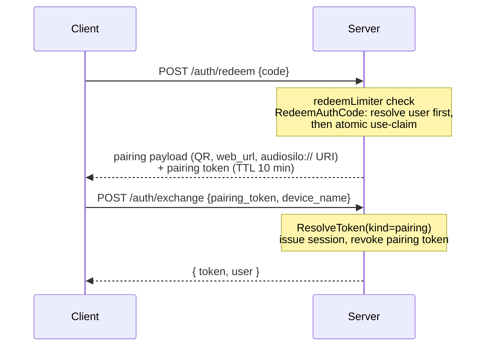

The server's first design priority is that **inexperienced users can safely
expose it to the internet**. That shapes everything on this page:

- no default passwords;
- no plaintext secrets at rest;
- brute-force lockouts;
- defense-in-depth path checks;
- a hard testing rule for anything security-critical.

## Secrets at rest

The server picks one of two hashing strategies by the secret's entropy.

**Passwords** are low-entropy and chosen by people, so they use **argon2id**
(`auth/hash.go`):

| Parameter | Value |
|---|---|
| `time` | 2 |
| `memory` | 64 MiB (`argonMemory = 64*1024` KiB) |
| `threads` | 4 |
| Key | 32 bytes |
| Salt | 16 random bytes |

These are tuned for interactive login on modest self-hosted hardware, with
memory well above the OWASP floor.

- Hashes are stored PHC-style (`$argon2id$v=19$m=65536,t=2,p=4$<salt>$<key>`).
  `VerifyPassword` reads the cost from the hash itself and compares with
  `subtle.ConstantTimeCompare`.
- The minimum length for a non-empty password is 8 (`auth.MinPasswordLen`).
- Test binaries may lower the cost with `auth.UseCheapHashingForTests()`. It
  panics outside a test binary (`testing.Testing()`).
- Every hash and verify goes through `argonKey`. Once hashing has been quiet for
  a second, `argonKey` hands the 64 MiB work block back to the OS
  (`memoryReleaser`, which calls `debug.FreeOSMemory` on its own goroutine, never
  the request's). A burst of sign-ins costs one release. Without this, a server
  that hashed a password or two at start and then idled kept that memory. In a
  container with an empty library, after the first-run admin and one sign-in,
  the release took its anonymous memory from 143 MiB to 13 MiB.

**Tokens and auth codes** are full-entropy and machine-generated. The server
stores them only as **SHA-256 hashes** (`hashSecret`). A fast hash is right here
because the secrets are 256-bit random values; argon2id is reserved for
passwords. A database leak exposes no live credential of either kind.

**Timing.** For an unknown username or a password-less account,
`auth.Authenticate` still runs a dummy argon2id verification against
`dummyHash`, whose cost parameters mirror the real ones. Response timing
therefore doesn't reveal whether an account exists.

:::danger[Never log or persist a plaintext secret]
The first-run banner (and the setup page URL) is the **only** place a
plaintext credential ever appears, exactly once. Handlers return freshly-minted
codes/tokens in the response body and store only the hash.
:::

## Tokens: session, pairing, and API keys

`tokens.kind` tells the credentials apart. A client holds one of three kinds:

| Kind | Constant | Section |
|---|---|---|
| Session | `auth.KindSession` | [Session tokens](#session-tokens) |
| Pairing | `auth.KindPairing` | [Pairing tokens](#pairing-tokens) |
| API key | `auth.KindAPI` | [API keys](#api-keys) |

Three more kinds have narrow jobs:

| Kind | Constant | Held by |
|---|---|---|
| [Cast token](#cast-tokens) | `auth.KindCast` | a Chromecast receiver, handed one by a player |
| [Bridge token](#bridge-tokens) | `auth.KindBridge` | the paired Bridge |
| [Calendar feed token](#calendar-feed-tokens) | `auth.KindFeed` | a listener's calendar app |

### Session tokens

A session token is the durable bearer credential (`Authorization: Bearer …`).
It has **no expiry**.

These issue one:

- `POST /auth/login` and `POST /auth/exchange`;
- for a [household member](#household-members), their owner, through
  `sign_in_here` or `…/members/{id}/session`.

These revoke one:

- `POST /auth/logout`;
- the owner signing a device out (`DELETE /me/devices/{id}`). With
  `?also_members=1` this also signs out the members signed in on that device;
- a member's owner (`DELETE /me/household/members/{id}/devices/{device_id}`);
- a change or reset of the account's password;
- an admin, for one device or for
  [all of them](#password-changes-end-sessions).

### Pairing tokens

A pairing token is an intermediate credential. `POST /auth/redeem` mints one
from an auth code, and `POST /auth/pair` mints one from an existing session to
add another device. `POST /auth/exchange` turns a pairing token into a
device-named session token.

A pairing token is **as redeemable as its origin**. `tokens.auth_code_id` links
it to the code that minted it.

| Origin | Lifetime and uses |
|---|---|
| An invite | Inherits the invite's uses and expiry. Each exchange claims one use per device, so one QR can pair several devices. It dies with the code: a delete or supersede cascades, and a rotate revokes it. |
| A recovery code | Lasts `pairingTTL` = 10 minutes. It can be scanned several times within that window, since recovery codes are unlimited. |
| `/auth/pair`, a household member's code (`POST /me/household/members/{id}/pair`), demo tokens | Unlinked. Single-use (revoked on exchange), with the same 10-minute TTL. |

`/auth/pair` can ask for a shorter lifetime with `ttl_seconds`, which `pairTTL`
clamps to between 30 seconds and 10 minutes. The console's Listen in player
asks for 120 seconds, because its token rides in a tab's URL and history.

The daily retention job deletes the pairing tokens that can never pair again
(`auth.PrunePairingTokens`). Those are tokens that are revoked, past their own
expiry, or linked to an expired or used-up code. This keeps the table from
growing by one row per QR shown. The code's own row is untouched.

### API keys

API keys (`auth.KindAPI`) are **non-expiring** bearer credentials that a user
mints for headless integrations such as dashboards and cron jobs.

| Action | Route | Function |
|---|---|---|
| Create | `POST /auth/tokens` | `IssueAPIToken` |
| List | `GET /auth/tokens` | `ListAPITokens` |
| Revoke | `DELETE /auth/tokens/{id}` | `RevokeTokenByID` |

- A key authenticates exactly like a session token and **acts as its owner**.
  An admin's key also passes `requireAdmin`.
- A key is never valid for `/auth/exchange` (pairing). Its lifecycle is mint,
  list and revoke, not sign-in and sign-out.
- Only the SHA-256 hash is stored. The server returns the secret once, at
  creation. The user's label is kept in `tokens.device_name`.
- Creating and revoking go through `gateSelfService`. They share the
  `accountLimiter` and are refused for demo accounts, exactly like the password
  and recovery routes.
- Listing (`GET /auth/tokens`) takes `nonDemoAccount` alone (from 2.4.0).
  Opening the Account page therefore never spends the `accountLimiter` budget
  that a household behind one NAT shares.

**Containment.** An API-key caller is barred (`403`, through `denyAPIKey`) from
every route that mints a credential:

- `POST /auth/tokens`, `POST /auth/recovery`, `POST /auth/pair` and
  `POST /auth/password`;
- `POST /cast/token`;
- the calendar link's `POST` and `DELETE /me/upcoming/calendar`;
- every [household member](#household-members) route. Create, `…/session` and
  `…/pair` make a member's session or pairing code.

`denyAPIKey` lives in `internal/api/handlers_auth.go`; `handlers_cast.go`,
`handlers_members.go` and `handlers_upcoming_calendar.go` call it too. A leaked
key therefore can never spawn a fresh credential. That covers another key, a
recovery code, a pairing token or a password, any of which would outlive the
key's own revocation, and even a [cast token](#cast-tokens), which would die
with it. This mirrors GitHub's rule that "a token cannot create tokens". A key
can still list and revoke keys and clear a recovery code, because those only
reduce access.

### The per-request lookup and its cache

Every authenticated request looks its token up by hash. `lookupToken` refuses a
token that is unknown, revoked or expired, or whose user is disabled.

`Service.tokens` (`auth/tokencache.go`, a `store.GenMap` of at most 4,096
entries) then holds a valid session, API key or Bridge token's lookup. The entry
stays valid while the database's
[content generation](overview.md#internalstore)
(`store.DB.ContentGeneration`) stays where it was when the row was read.

- Every change that could end a token is a content write, which moves the
  generation. That covers a sign-out or revoke, a disabled or deleted account,
  and a changed role or membership. The very next request reads the row again
  and refuses a revoked token.
- The token's own last-seen touch is a user-state write that leaves the
  generation alone. So the touch drops that token's cached row itself
  (`auth.Service.resolve`).
- Expiry needs no write, so the cache checks it on every hit.
- A cached row is read again once it is a minute old (`maxCachedTokenAge`). The
  generation counts writes through this process's handle only, and
  `reset-admin` run beside a running server writes from another process (see
  [Commands](configuration.md#cli-flags-cmdaudiosilo)). Such a write is seen
  within a minute, at one more read a minute for a token in use.
- The cache never holds a cast token (its grant and parent) or a pairing token
  (its one use), and holds nothing for a refusal.

A write through this process that bypassed the generation would leave a
revoked token honoured until the row's minute was up.

### Cast tokens

A **cast token** (capability `cast`, `internal/auth/cast.go`) is a `tokens` row
with `kind = 'cast'` (`auth.KindCast`). A `cast_grants` row says what it may read.

A player mints one (`POST /cast/token`, `auth.IssueCastToken`) for the book it is
about to play on a Chromecast. The receiver's stream and cover URLs then carry
the cast token instead of the session token. The reason is that a receiver is a
device the listener doesn't control, and its URLs can surface in its logs or a
debugger. The token is narrow in every way:

- **One book.** Its grant reaches only the `(library, path)` it was minted for,
  or a file or folder inside it on a segment boundary (`relpath.Within`). `Book`
  never reaches `Book 2`. The path is cleaned first, so `Book/../Book 2` doesn't
  either. A mint for a part path stores its book's path.
  A folder book's folder can hold other books (`Series` holding
  `Series/Book 2`). So `api.castOwnBook` also requires the requested path to
  address the token's **own** book in the index (`catalog.BookPathAt`). It
  refuses a path that the index places in no book.
- **Media only.** `auth.ResolveRequest` never accepts a cast token.
  `auth.ResolveCastRequest` does, and the api calls it only for the `?token=` of
  `GET /libraries/{id}/cover` and `/stream` when the request has **no**
  `Authorization` header. A cast token is never a bearer credential. It can't
  reach any other route, mint another cast token, or reach `/meta/cover`.
- **Tied to the sending device.** The grant's `parent_token_id` is the session
  that minted it. A cast token is valid when it passes `lookupToken`'s one check
  (unknown, revoked, expired, disabled user) and also has a grant and a live
  parent. So **signing out the device that minted it** ends it, whether by
  logout, My devices or the console.
- **Short-lived.** It lasts 24 hours, and a person keeps at most 20. Each mint
  deletes every dead cast token: expired, with no grant, or with its parent
  gone, signed out or expired. The daily retention job runs the same prune
  (`auth.PruneCastTokens`). A dead token's row (which holds the receiver's
  `last_ip`) and its grant (which book was cast) therefore never outlive it by
  more than a day.
- **Still the person's.** Deleting the account deletes the cast token with the
  account's other tokens. Disabling the account (`UpdateUser`'s `disabled`)
  revokes nothing; it only **suspends** this token, as it does every token,
  because `lookupToken` checks the user on every request. The cast token is
  refused while the account is disabled, and works again if the account is
  enabled before the token expires. Signing out the device that minted it is
  what ends it for good.
- **Checked against current access.** The media handlers check the person's
  **current** share scope. A revoked share is a `403`, and a restored one works
  again.

Other properties:

- Only the SHA-256 hash is stored.
- Any refusal is the uniform `401`.
- An API key may not mint a cast token (`denyAPIKey`, under the containment rule
  in [API keys](#api-keys)). A demo account may, since it can play.
- A cast token is never a **device**. `ListDevices` and the device sign-outs take
  only session and API-key tokens.

**Not the ebook.** `GET /libraries/{id}/ebook` takes no URL token of any kind,
and there is no `reader` token kind. Nothing needs a URL that carries a
credential, so none exists:

- The web player fetches the EPUB with its bearer header and posts the bytes to
  its reader document.
- The apps download it with the header into a local file and post it to their
  reader's WebView in chunks. The WebView reads no file and makes no request
  (see [The app host](../frontend/reader.md#the-app-host)).

### Bridge tokens

The paired [Bridge](../bridge/index.md) holds a token of kind `bridge`
(`auth.KindBridge`, `internal/auth/bridge.go`). An admin makes a one-time pairing
code in the console (`POST /admin/bridge/pair`), and the Bridge exchanges it at
the public `POST /bridge/pair` (see
[Pairing and jobs](../bridge/pairing-and-jobs.md#pairing)). The token is narrow
too:

- **The Bridge's routes only.** Routes opt in to the token kinds they take. Only
  the Bridge's own routes (`/api/v1/bridge/*`, behind `requireBridge`) list
  `bridge`, and they read it from the `Authorization` header only. Every other
  route refuses a bridge token (`401`), media `?token=` included. The Bridge's
  routes refuse every other kind. A route-table test sends a bridge token, in the
  header and as `?token=`, to every other authenticated route.
- **Its admin's.** The token belongs to the admin who made the code. It works only
  while that account exists, is enabled and is still an admin. `lookupToken`
  refuses a disabled admin and the resolver a demoted one, so demoting or
  disabling the admin stops the Bridge. The Bridge keeps its token and tries
  again every 5 minutes, so it comes back if the account is made an admin again.
- **Checked again where it matters.** One statement, `auth.BridgeLiveSQL`, says
  "a Bridge is paired": a live bridge token of an enabled admin, using the partial
  index `idx_tokens_bridge`. `auth.BridgeTokenLiveSQL` asks the same of one token.
  - The heartbeat's write asks it inside its own transaction.
  - Every claim asks it first on the reader pool (`bridge.claimDue`), so an idle
    claim writes nothing. A claim that goes on to write asks again inside its
    durable write transaction (see
    [Claims and leases](../bridge/pairing-and-jobs.md#claims-and-leases)).

  So a call that authenticated just before a pairing or an unpair revoked its
  token saves nothing and claims nothing (`401`). A long poll is the usual case.
- **401 means refused, 503 means unknown.** `requireBridge` answers `401` only for
  a missing or refused token. A failure to check the token is `503`, so the
  Bridge never takes a database hiccup for a revoked token.
- **One at a time.** The exchange runs in one transaction that checks the code's
  hash, its expiry and its admin, and revokes every earlier bridge token.
  Unpairing (`DELETE /admin/bridge`) revokes the current one.
- **Minted only from a session.** An API key may not make the pairing code
  (`denyAPIKey`), as with every route that leads to a new credential. The code is
  stored only as a hash and lasts 15 minutes. Failed exchanges count against the
  redeem limiter.

A bridge token is never a **device**: the device lists and sign-outs leave it
out. It is also never **touched**, so its `last_seen`, address and app stay as
they were. Its calls, including a heartbeat every 30 seconds, are not its
admin's activity, which is the newest `last_seen` of the admin's tokens. The
heartbeat records when the Bridge was last heard. Only the SHA-256 hash is
stored.

### Calendar feed tokens

A listener's calendar link (capability `upcoming_calendar`,
`internal/auth/feed.go`) is a `tokens` row of kind `feed` (`auth.KindFeed`). It is
the secret in `GET /me/upcoming/releases.ics?token=<secret>`. A calendar app polls
that URL with nothing else, so the secret has to ride in the URL, and the person
has to see it to paste it. The token is built so that a leaked link reads that
person's upcoming release list and nothing else:

- **One route, one kind.** `GET /me/upcoming/releases.ics` is the only route
  that lists `KindFeed`, and it lists no other kind. It uses `requireFeedAuth`:
  `mediaAuth` with `feedKinds`, taking `?token=` or the header, under the media
  rate limit per credential.
  - A session, API key, cast, bridge or pairing token is `401` on this route.
  - A feed token is `401` on every other route, media `?token=` included.

  Two tests hold that. `TestFeedTokenRefusedOnEveryOtherRoute` sends a feed token,
  in the header and as `?token=`, to every route in the table.
  `TestFeedKindNamedOnce` checks that the api package names `auth.KindFeed` only
  in `feedKinds`, uses `feedKinds` only in `requireFeedAuth`, and wraps one route
  in it.
- **Minted only from a session.** `POST /me/upcoming/calendar` calls
  `auth.IssueFeedToken(user, session)`. It makes the secret with `generateToken`,
  stores the SHA-256 hash, sets no expiry and names the device "Calendar feed".
  The route refuses:
  - an API key (`denyAPIKey`, plain `403`);
  - a kid (`403 kid_account`, by `notKid` and again by `refuseKid` inside the
    write);
  - a demo account (`403 demo_account`).

  The new row copies the `created_on_token_id` of the session it was made from.
  That is the owner's device the sign-in was made on, or none for a sign-in on
  the person's own device. So a member signed in on their owner's device makes
  the link "on" that device.
- **One per user.** A mint deletes the earlier row in the same durable
  transaction. Migration `0060`'s partial unique index `idx_tokens_feed_user`
  (`tokens(user_id) WHERE kind = 'feed' AND revoked = 0`) refuses a second live
  row, whatever writes it. `created_at` is set in milliseconds and is always
  later than the link it replaced, even for two resets in one millisecond. A
  client compares it with the `created_at` from `GET /me/upcoming/calendar` to
  tell whether its copy is the live link.
- **Deleted when it ends, never flagged.** These delete the row:
  - a reset;
  - Turn off (`DELETE /me/upcoming/calendar`, `auth.RevokeFeedToken`);
  - the switch to a kid (`clearKidCredentials`), by the owner's member edit or
    the admin's assign alike;
  - a move into another owner's household, when the link was made on someone
    else's device (`leaveOwners`, together with the sign-in made there). A link
    made on the person's own device stays, as that sign-in does.

  Deleting the account cascades. While an account is disabled, `lookupToken`
  refuses its token. A password change or reset and the admin's Sign out
  everywhere end sessions but leave the link alone (see
  [Password changes end sessions](#password-changes-end-sessions)). The feed is
  the person's to end, and the console has no control for it.
- **Behind the token, the person's own rules.** The route still applies `notKid`
  (`403` for a leftover token of a person who is now a kid) and the two `404`s.
  It reads the list with the owner's scopes at request time, so a share taken
  away applies at once.

A feed token is never **touched** (`auth.neverTouched`), like a bridge token: a
calendar's polls are not the person's activity, and no `last_ip` is kept. It is
never a **device**, because the device lists and sign-outs take only session and
API-key kinds. The token cache holds it like a session, since every way it ends
is a content write.

### Resolving a request

`auth.ResolveRequest` validates a presented secret for the kinds a route
accepts. `ResolveToken` wraps it for a single kind. It hashes the secret, looks
up the row, and rejects a token that is revoked or expired or whose user is
disabled.

On success it bumps `tokens.last_seen`. A user's "last activity" is derived from
that (`MAX(tokens.last_seen)`); there is deliberately no `last_login` column.

In the same write, `ResolveRequest` records what the request says about the
device (`auth.Presence`):

- its address, into `tokens.last_ip`. The address comes from `clientIP`, which
  honours `X-Forwarded-For` only from a trusted proxy;
- its app, into `tokens.client_app`, `client_version` and `client_platform`. The
  app comes from the
  [`X-AudioSilo-Client`](api/index.md#client-identification-x-audiosilo-client)
  header, parsed strictly by `auth.ParseClient`, which ignores a malformed value.

The app columns change only when the request names an app. The SQL decides
this, not the row read just before. So a request without the header (covers
loading beside an API call) that races one with the header can't write back a
stale app.

`ResolveRequest` returns the matched token as an `auth.Credential` (id, kind,
device name, app). The middleware puts it in the request context
(`credentialFrom`) for three readers:

- `denyAPIKey`, which reads the credential's kind;
- the listening-session recorder;
- the admin devices routes.

An admin can sign one device out (`DELETE /admin/devices/{id}`,
`auth.RevokeDevice`). It revokes one live session or API-key token by id,
whoever owns it, and refuses the token making the request
(`409 current_device`). A revoked token keeps its row, but the daily retention
job (`auth.ForgetRevokedAddresses`) blanks its `last_ip`. The server therefore
keeps a device's address only while the device is signed in.

### Middleware wrappers

The wrappers live in `internal/api/middleware.go`:

| Wrapper | Accepts | Used on |
|---|---|---|
| `requireAuth` | A **session token or an API key**, from the `Authorization` header only (`ResolveRequest(secret, presence, KindSession, KindAPI)`) | Routes that take a session or an API key, including a book's ebook (`GET /libraries/{id}/ebook`) |
| `requireMediaAuth` | The same, plus `?token=` as a query parameter | **Only** the media GETs `/meta/cover` (a community cover) and `/me/upcoming/cover` (an upcoming release's cover) |
| `requireBookMediaAuth` | `requireMediaAuth`, whose one token lookup also accepts a [cast token](#cast-tokens) (`ResolveCastRequest`, then `castOwnBook`) | Only a book's own `/cover` and `/stream` |
| `requireFeedAuth` | The same sequence, accepting **only** a [calendar feed token](#calendar-feed-tokens), in the header or as `?token=` | Only `GET /me/upcoming/releases.ics` |
| `requireAdmin` | `requireAuth` plus a role check | Every `/admin/*` route |

Notes on each:

- `requireAuth` never accepts a pairing token, so a QR or pairing secret can't be
  used as a durable credential. The ebook is served under `requireAuth` on
  purpose, not as media (see [Cast tokens](#cast-tokens)).
- `requireMediaAuth` takes `?token=` because browser `` and `<audio>`
  elements cannot set headers. `bearerToken(r, allowQuery)` confines this
  fallback on purpose: a token in a query string can leak into access logs and
  `Referer` headers, so no other route accepts it. An API key works here too,
  since it authenticates wherever a session does.
- `/meta/cover` keeps `requireMediaAuth`; it never takes a cast token. A
  cast-authenticated answer sets `Cross-Origin-Resource-Policy: cross-origin`.
  So does every authenticated media answer once `cors_origins` is set (see
  [Transport hardening](#transport-hardening)).
- `requireAdmin`: the baked-in admin HTML is unprivileged. The API enforces the
  role.

## Auth codes: invite vs recovery

Auth codes are secrets a person can type (`generateAuthCode`). Each is 10
random bytes in Crockford's base32 alphabet (no I, L, O or U), formatted in
dash-separated groups of four. Before hashing, `normalizeCode` strips spacing and
case and maps look-alikes (`O` to `0`, `I` and `L` to `1`, `U` to `V`), so a
mistyped entry still verifies.

`auth_codes.kind` splits them into two lifecycles:

| | `invite` | `recovery` |
|---|---|---|
| Minted by | Admin (`POST /admin/users/{id}/authcode`) | The user themself (`POST /auth/recovery`) |
| Defaults | 5 uses, 1-day expiry (`defaultAuthCodeMaxUses` and `defaultAuthCodeTTLDays` in `handlers_admin.go`). An explicit `0` means unlimited uses or no expiry. The console's invite dialog asks for 7 days unless changed. | Unlimited uses, never expires |
| Cardinality | One *active* invite per user | At most one recovery code per user |
| Listable | Yes (`ListAuthCodes`, metadata only) | No. It shows only as `User.HasRecovery` |
| Revocation | `DELETE /admin/authcodes/{id}` | `DELETE /auth/recovery` (self) or `DELETE /admin/users/{id}/recovery` (admin). A password change or reset, or Sign out everywhere, also removes a leaked code (see [Password changes end sessions](#password-changes-end-sessions)). |

Both kinds redeem through the same path. The full onboarding flow:

`auth.RedeemAuthCode` has two correctness properties worth knowing before you
touch it:

- **Atomic claim.** The under-the-cap check is folded into the increment
  (`UPDATE … SET uses = uses + 1 WHERE … AND (max_uses = 0 OR uses <
  max_uses)`), so concurrent redemptions can't push `uses` past `max_uses`. The
  same write stamps `redeemed_at` on the first redemption
  (`COALESCE(redeemed_at, ?)`). It keeps an earlier stamp, since recovery codes
  redeem repeatedly.
- **No burn on a rejected user.** The function resolves the bound user, and
  rejects a disabled or deleted account, *before* the claim. A rejected attempt
  therefore never consumes a use or flips an invite to "accepted".

**Invite hygiene.**

- `auth.CreateInvite` mints an invite and, in the same transaction, deletes the
  user's other *still-redeemable* invites (`supersedeActiveInvites`: not used up,
  not expired). There is exactly one active invite per user. Spent and expired
  invites remain as history.
- `POST /admin/authcodes/{id}/rotate` (`RotateAuthCode`, the console's
  **Rotate**) regenerates an invite's secret **in place**. It keeps `max_uses`,
  resets the use counter and `redeemed_at`, and renews the expiry for the
  invite's *original* window. It never quietly falls back to the defaults. Only
  invite-kind codes rotate.
- `CreateAuthCode` has no supersede step. It exists only for the first-run
  bootstrap, which has nothing to supersede.
- `GET /admin/invites` (`auth.ListInvites`) lists every account's invites for
  the console. It returns metadata only, since only the code's hash is stored,
  and never lists recovery codes.

**Recovery** separates re-authentication from invitation. A signed-out or
password-less user who saved a recovery code can re-pair on any device through
the normal connect screen, with no admin involved. `GenerateRecoveryCode`
atomically replaces any existing recovery code for the user.

:::note[Client UI retired]
The player no longer mints or reads recovery codes. It asks users to set a
password and uses the reconnect flow instead (see
[Frontend overview](../frontend/overview.md)). The server keeps `POST
/auth/recovery` and the admin revoke route so older app builds can still redeem
codes they minted earlier. Both are due for removal once those clients age out.
:::

## Demo-account restrictions

Public demo mode (`config.demo.*`) creates throwaway `is_demo` accounts. These
rules keep a demo session from becoming a durable login or reaching other
people:

- **No credentials.** `POST /auth/password`, `POST /auth/recovery` and the
  `/auth/tokens` (API-key) routes are **refused for demo accounts**. The handlers
  and `gateSelfService` check `User.IsDemo`.
- **Rate limits.** These endpoints, and demo-session creation itself, are
  rate-limited (see [Rate limiting](#rate-limiting)).
- **No usernames, no sharing.** A demo account can't list the server's usernames
  or share a collection: `GET /me/share-targets` and
  `PUT /me/collections/{id}/shares` are `403` (see
  [The listener's own state](#the-listeners-own-state-me)). Demo accounts are
  never offered as share targets.
- **No household.** A demo account can't add
  [household members](#household-members). Every member route but the list is
  `403`, and the list answers `allowed: false`, `reason: "demo"`. A demo account
  is never anyone's owner or member: the admin's Assign refuses both
  (`409 owner_is_demo`, `409 member_is_demo`).
- **No managed modules.** A demo account can't use a
  [managed module](modules.md#routes-always-mounted-gated-on-the-toggle)'s user
  routes (`api.notDemo` in the module's route wrapper, `403 demo_account`).
- **No Bridge block.** `GET /server` leaves out the `bridge` block for a demo
  account. Only a signed-in, non-demo caller gets one (`API.signedIn`).
- **No house listening.** A demo account can't share its listening with the
  house (`PUT /me/household` is `403`, `nonDemoAccount`). Demo accounts never
  appear in anyone's `GET /household/listening`, so a public demo never shows up
  in a household.
- **Casting is allowed.** A demo account may mint a cast token, since it can
  play.

Every demo refusal carries `code: "demo_account"` (`nonDemoAccount`).

A background reaper (`launcher.demoReaper`, every 15 minutes) deletes demo
accounts idle past `demo.idle_ttl`. It selects them by the `is_demo` flag, never
by username prefix. Deletion cascades all their state.

## Self-service password rules

`POST /auth/password` (handler `handleSetPassword`) lets a signed-in user set
or change their own password:

- Setting a **first** password requires no challenge. The main case is a
  password-less player user, onboarded by pairing, who wants a way back in.
- **Changing** an existing password requires `current_password`
  (`auth.CheckPassword`), so a stolen session token can't plant a persistent
  credential. A wrong one is `401` with `code: "current_password_incorrect"`,
  which a client tells apart from a session that ended: the console keeps its
  session and asks again.
- An **empty** password is rejected. Only an admin can clear a password, through
  `PATCH /admin/users/{id}`. The guard that an admin must keep a password still
  applies underneath: `SetPassword` refuses to clear an admin's password.
- A change ends the caller's other sessions (see
  [Password changes end sessions](#password-changes-end-sessions)).
- An admin's change counts as choosing their own password
  (`auth.NoteOwnPassword`), as does `PATCH /admin/users/{id}` on the admin's own
  account. For the first-run admin it ends the start's sign-in hint and turns
  `GET /admin/setup`'s `printed_password` false (see
  [Configuration](configuration.md#cli-flags-cmdaudiosilo)).

## Password changes end sessions

Replacing or clearing a password the account had ends the person's sessions.
Whoever knew the old password is signed out wherever they used it.

- This covers the self-service `POST /auth/password` and the admin's
  `PATCH /admin/users/{id}` alike. Both go through `auth.UpdateUser`;
  `SetPassword` calls it with the password and the caller's token.
- Clearing counts as a reset. A **first** password ends nothing.
- Inside `UpdateUser`'s durable transaction, `endSessions` revokes every
  `session` token of that person except `UserChanges.KeepToken`, the token making
  the request. So when you change your own password, or an admin resets their
  own, the device it was done on stays signed in. An admin who resets someone
  else's password ends all of that person's sessions.

The change also removes the ways back in that a session can make without the
password, and that the person can neither see nor revoke:

- their **open pairing codes**: unlinked `pairing` tokens from `POST /auth/pair`,
  and a member's from their owner's `POST /me/household/members/{id}/pair`. Each
  would make a session after the change.
- their **recovery code**, with its linked pairing tokens by cascade. So
  `has_recovery` turns `false`.
- their **household members**, where the person signed them in:
  - a member's session made on any of the person's devices except the kept one
    (`created_on_token_id`, the same rule as the device revoke's
    `also_members`), including a device signed out earlier;
  - every member's open pairing code.

  A member's own paired device stays signed in.

What stays:

- **API keys**, which are listed and revoked on their own, in the device lists
  and `/auth/tokens`;
- the [calendar feed token](#calendar-feed-tokens), which is the person's to end;
- [Bridge tokens](#bridge-tokens), which are the Bridge's;
- invites, which are the admin's, listed and revoked in the console.

A [cast token](#cast-tokens) needs no write. Its parent session is checked on
every request, so it ends with the session that minted it.

The write moves the content generation, so the token cache refuses an ended
token on the very next request (`reset-admin`, from another process, within a
minute), media `?token=` included. A shipped app takes
its existing 401 path: it shows as signed out, and the person pairs again.

**The sign-in race.** A password sign-in could verify the old hash while the
change commits, and then make a session the change never saw. To prevent this,
`IssueSession` takes `Authenticate`'s answer, which carries the hash it verified
(unexported). In its writer transaction it writes the session only while that
hash is still the account's and the account is enabled. Otherwise it answers
`ErrInvalidCreds` (`401`).

**Sign out everywhere.** The admin's `POST /admin/users/{id}/sign-out`
(`auth.SignOutEverywhere`) is the console's button on a person's Devices tab.

- It runs the same `endSessions` without a password change. When the account is
  the admin's own, it keeps the admin's current session.
- It forgets the person's browsers (`forgetBrowsers`), so each browser's next
  password sign-in is announced as a new device. A new password forgets the
  browsers too, as it always has.
- It answers `{"signed_out": n}`, the number of the person's own sessions it
  ended. Members' sessions aren't counted.
- The audit log records it as `user.sign_out_everywhere`.

## Admin guards

Account-safety invariants live in `internal/auth`, not in handlers, so every
caller gets them.

The admin's `PATCH /admin/users/{id}` is **one** `auth.UpdateUser` transaction.
(`SetPassword` is a password-only call of it.) Before anything is written,
`UpdateUser` checks every change in the body against the account, each one as
the changes before it leave the account. The order is password, household, role,
disabled, `can_add_members`. A refused field therefore changes nothing.

- **`ErrLastAdmin`.** The last *enabled* admin cannot be demoted or disabled
  (`UpdateUser`) or deleted (`DeleteUser`). Both read the account and the guard
  inside the write, so two admins removing each other at once can't both pass.
  The console can never be locked out.
- **`ErrAdminNeedsPassword`.** An account cannot become, or remain, an admin
  without a password. This is enforced on create, on promote and on password
  clear.
- **No self-delete.** The delete *handler* enforces this as well. An admin may
  disable their own account, which is reversible, but never delete it, which is
  not.
- **What a delete removes.** `DeleteUser` cascades through `ON DELETE CASCADE`:
  sessions, auth codes, progress, bookmarks, notes, history, listening sessions,
  share grants, up next, the account's collections (with their items and
  shares), its shares of other people's collections, ratings and the listening
  goal. Files on disk are untouched.
- **Passwords are optional for non-admins.** A missing password is stored as an
  empty hash, and `Authenticate` rejects empty-hash accounts outright. A
  password-less user can only authenticate through code pairing, or, for a
  [household member](#household-members), through a session their owner makes.
- **`ErrMemberNotAdmin`.** A household member is never an admin. `UpdateUser`
  refuses promoting a member and assigning an admin as a member
  (`409 member_not_admin`). "Make independent" is checked first, so it passes
  this check in the same request as the promotion. A member with no password
  also needs one in that request (`ErrAdminNeedsPassword`).
- **`ErrKidNoPassword`.** A kid holds no password. `UpdateUser` refuses a
  non-empty password, as `400 kid_no_password`, when the request leaves the
  account a kid: a kid with no household change in the request, or an assign as
  a kid. Clearing a password is fine. So is a password beside a Make independent
  or an assign as a grown-up, because this one check reads the request's
  household change first.
- **The Assign refusals.** `ErrSelfManaged` refuses the account itself as its
  owner; it is checked with the kind and access before the transaction. Inside
  the transaction, `checkAssign` refuses:
  - an unknown owner (`404`);
  - an owner who is a member (`ErrOwnerIsMember`) or a demo account
    (`ErrOwnerIsDemo`);
  - a demo account as the member (`ErrMemberIsDemo`);
  - an admin as the member (`ErrMemberNotAdmin`);
  - someone with members of their own (`ErrHasMembers`).

  Each refusal except the unknown owner is `409` with its code.
- **`DeleteUser(ctx, id, keep)`.** It deletes the person's household members
  with them, in the same transaction, except the ids in `keep`. Those are
  cleared to ordinary accounts and their open unlinked pairing tokens are
  revoked, as [Moving between households](#moving-between-households) describes. A
  `keep` id that isn't the person's member is `ErrInvalidKeepMembers`, and
  nothing changes. The last-admin rule is checked first.

## Authorization: shares and Scope {/* #authorization-shares--scope */}

Access control is filesystem-based.

- A **share** is a named set of path rules (`share_paths`:
  `(library_id, path)`, where `""` means the whole library).
- Users are granted shares. A user's access is the union of their granted rules.
  A household member also gets what their owner gives them (see
  [the member rule](#the-member-rule)).
- `catalog.GrantWholeLibrary` is a convenience. It makes sure a whole-library
  share with a `""` rule exists, and grants it. The share is named
  `"Library: <name>"`, or `"Library: <name> (<id>)"` when that name is taken.
  It never widens what an existing share's holders see: when no existing share
  qualifies, it makes a new one (see
  [which shares qualify](api/reference.md#post-apiv1adminlibrary-access)).

At request time the server compiles the rules into one `catalog.Scope` per
library. A scope is either `AllowAll` or a list of granted `Paths`. It is
`AllowAll` for:

- an admin, for books;
- any `""` rule;
- a member on `all` whose owner is an admin.

**Three functions enforce the scope, each matched to a different query shape:**

| Function | Semantics | Enforced where |
|---|---|---|
| `Scope.Allows(p)` | `p` is equal to or under a granted rule (segment-boundary prefix match) | `authorizedPath` in `handlers_library.go`, on **every** path-addressed endpoint. Two more places, listed below the table |
| `Scope.VisibleInBrowse(p)` | `Allows(p)` **or** `p` is an *ancestor* of a rule, so the user can navigate toward granted content | `handleBrowseFS` passes it as the `allow` filter to `library.BrowseFS`, applied before pagination so pages stay full |
| `pathFilterSQL(col, scope)` | The same grant logic as a SQL `WHERE` fragment. Details below the table | `ListBooks`, `Search`, `RecentBooks`, the player's browse lists (`/authors`, `/narrators`, `/series`), `/next`'s series step and the owned-book placement on `/meta` rails. `scopesFilterSQL` extends it across libraries for the cross-library listings (`/me/progress`, `/me/history`, `/me/favourites`) |

**`Scope.Allows` in detail.** The path-addressed endpoints are `item`,
`chapters`, `cover`, `stream`, and the progress, bookmarks, notes, history and
favourites writes. `Allows` is also checked:

- on the book a progress path is keyed on (`api.progressPath`). A book outside
  the scope leaves the path as given.
- on each folder that `/fs` marks `pending_book` (`library.MarkPendingBooks`). A
  folder visible only on the way down to a grant is never marked.

**`pathFilterSQL` in detail.**

- The fragment is `col = ?` OR the byte range `col >= 'rule/' AND col < 'rule0'`
  (`0` is the byte after `/`). It is a literal, **case-sensitive** prefix with no
  wildcards to escape.
- It used `LIKE` until the player-redesign data API. `LIKE` ignores ASCII case,
  so a grant on `Saga` also reached a sibling `saga/...` on a case-sensitive
  filesystem.
- Over 32 paths (`jsonPathsAbove`) it uses a single-parameter form instead
  (`pathsJSONFilterSQL`). A `collections`
  [household member](#household-members) can hold a thousand paths. This form
  looks up a row's path and each of its ancestors in one JSON list. It matches
  the same rows as the `OR` form, which could not hold 1,000 arms at all. A path
  that isn't valid UTF-8, which JSON can't carry exactly, keeps an `OR` arm of
  its own.
- `BenchmarkMemberScopes` records its cost.

The Go predicate (`pathAllowedBy`) is authoritative. `pathFilterSQL` must stay
behaviorally identical to it.

**Taking access away is durable.** These writes commit with
`synchronous = FULL` (`store.DB.ExecDurable` or a durable transaction; see
[SQLite choices](data-model.md#sqlite-choices)), so a power cut right after a
revoke can't bring the access back:

- `DeleteShare`;
- `RemoveSharePath`;
- `RevokeShare` (the user's `user_share_access` row);
- making a share read-only (`UpdateShare`);
- the share deletes of `DeleteLibrary`;
- removing a viewer from a collection.

**A book above the requested path.** A requested path can resolve to a book
above it: a part of a folder book, or a disc folder of a book joined from its
disc folders (`bookForPath`; see
[On-demand indexing](scanner.md#on-demand-indexing-indexpath)). Allowing the
requested path isn't enough then.

- `item`, `chapters`, `cover`, `meta` and `next` also require
  `Scope.Allows(book.RelPath)`.
- `Scanner.IndexPathWithin` checks it before reading anything
  (`library.ErrNotAllowed`).
- A share that grants only one disc folder or one file of a book gets the same
  `403 no access to this path` as a path outside the share, so the answer reveals
  nothing about the book. The files it does grant still stream, because `stream`
  is scoped on the file path.

A non-admin without a library grant gets `403` from `libraryScope` before any
content is touched. A granted podcast library whose scope becomes empty through
private-show filtering stays readable as empty lists (see
[Podcast visibility](#podcast-visibility)).

## Podcast visibility

Podcast scope adds two checks after authentication:

1. **Client support** (`auth.SeesPodcasts`, `internal/auth/podcastgate.go`).
   See [The client gate](#the-client-gate).
2. **Private shows.** After computing share and household grants, `CallerScope`
   and `CallerScopes` remove the private shows the user does not follow.
   - A whole-library grant expands into the remaining indexed show paths.
   - A scoped grant inside a denied show is dropped.
   - An admin's player-facing scopes follow the same rule.
   - A follow must match both the path and the `show_id`. Replacing a show at
     the same path cannot pass a previous follower's private access on.

### The client gate

`api.callerOf` uses `Credential.Client`. That is this request's valid
`X-AudioSilo-Client` header, or otherwise the token's stored client (media
`?token=` included). `catalog.Caller.Podcasts` is true for:

- `AudioSilo Admin`, with any version or none;
- `AudioSilo` with version `dev`;
- a released player from `auth.PodcastPlayerMinVersion`, **`"2.2.0"`**, the
  first player with podcast views. The version must be a numeric `X.Y.Z` at
  least that minimum. Suffixes after `-` or `+` are ignored, so `2.2.0-rc.1`
  counts as 2.2.0. `2.2` and an empty version fail.

`AudioSilo/2.1.x` and older players stay hidden. An empty minimum would hide
every released player. The served `/web` export sends its `app.json` version
same-origin, so a `/web` build from 2.2.0 passes and an older web image does
not.

These fail the gate:

- a missing or malformed client, or another app;
- API tools without a recognized client;
- the Bridge;
- a watch app (`audiosilo-watch/<ver> (watchos|wearos)`), because watch v1 has
  no podcasts.

`callerByID` defaults the flag to false. Internal podcast scheduling and
retention set it explicitly before resolving the actual follower grants.

The admin role grants no exception: `CallerScope`, `CallerScopes` and
`CallerLibraries` apply the gate before any admin shortcut. The gate hides
libraries, their content, `/me/*` state and household listening. Cast tokens do
not expose podcasts.

**The client header is compatibility negotiation, not a substitute for
authentication or grants.**

### Empty libraries and hidden episodes

`CallerLibraries` deliberately lists a granted library even when all its shows
are private and unfollowed. `scopedLibrary` keeps that distinction too: when
privacy removed every show, listing shows, `/fs` and `/books` return empty
lists rather than `403`.

- Requests for a hidden episode or show still fail their path and show checks.
- A caller without a library grant, or without a passing client, is still
  denied.
- The admin catalog is the separate administrative view of the disk, and can
  still see private show contents.

**A gated caller's whole-list replace keeps what the gate hides.** Up next and
collection items are path-keyed lists that can hold episodes. An add's position
already counts only the rows the caller sees. A whole-list replace
(`PUT /me/queue`, `PUT /me/collections/{id}/items`) from a gated caller would
otherwise delete the episodes it was never shown. So `catalog.GatedScopes`
passes the caller's podcast scopes, as a podcast-seeing client would get them,
as `keep`:

- The stored entries those scopes allow stay. Each stays after the listed entry
  it followed. When the new order would shuffle them, they all go after the new
  list, in stored order.
- They count toward the list's cap, and the oldest kept rows go first.
- Entries hidden for any other reason (a revoked share, an unfollowed private
  show) keep the ordinary delete rule. So does every replace from a
  podcast-seeing caller.

### Following and fetching

**Following.** Following a private URL uses the URL's normalized current or
previous SHA-256 hash as proof, before private-show filtering, and requires a
grant on the whole library. Following by path cannot reveal an unfollowed
private show. Follow, unfollow and manual check use the module user wrapper: no
kids, no demo accounts, and `404 module_off` when the module is disabled.
Authenticated reads, including kids within their scope, are not module-gated.

**Admin storage routes** require admin, non-demo authentication. They use the
administrative catalog, not the player's private-show scope.

- The retention `GET` stays core.
- Policy writes and a new episode fetch also require the module, the exact
  Bridge kind online, and a writable mapping. A valid fetch of a file that is
  already present returns success before those checks.
- Kids and listeners cannot set policy or request admin downloads.

**Player media.** Before opening or queueing an episode, the player media
routes check the stored or request client, the private-show scope and the exact
indexed path. An unknown or hidden path queues nothing.

- Missing audio shares one on-demand fetch. The request waits at most two
  seconds, then answers a `503` that carries the status.
- Kids with read access may trigger the fetch or use the listener Retry. That
  gives them no policy control and no control over arbitrary jobs.
- `GET` fetch status is authenticated observation only.
- `POST` Retry requires read scope and non-demo auth, takes a strict `{path}`,
  and leaves the priority and identity to the server. See
  [status and Retry](api/reference.md#podcast-fetch-status-and-retry).

**New fetches** need the module, the exact Bridge kind online and a writable
mapping.

- A non-admin creator is capped at five open fetch intents, parked jobs and
  prefetch included. Admins are exempt.
- Dedupe and promotion come before the cap, and do not transfer requester
  ownership.
- A demo stream cannot create new work, but it can promote an existing shared
  intent. A demo `POST` Retry is refused.
- Ready files and their status stay readable offline and with the module off.
- Status exposes only safe fields: state, id, byte counters, retry and error.
  It never exposes raw job params, the requester, the progress message or the
  enclosure URL.
- Queue prefetch uses only the caller's own visible queue and scopes, prepares
  at most one candidate per current episode, and never reads another user's
  queue.

### Retention and private URLs

**The two Bridge retention routes** accept only the paired Bridge's bearer
token. They refuse session, API and cast tokens, and query tokens.

- They return `no-store` aggregates, never individual follower names, ids or
  positions.
- Missing or unfinished progress, invalid times, zero followers or any aggregate
  error cannot authorize deletion.
- The Bridge rechecks a fresh aggregate, and the local hash and size,
  immediately before deleting (full rules in
  [retention](../bridge/podcasts.md#retention-policy-and-deletion-authority)).
- Publication journals block indexing and media, and an opened, validated
  descriptor pins each served generation.

See [retention routes](api/reference.md#bridge-podcast-retention).

**Private URLs are credentials.**

- The server never persists a pending private subscribe URL. It injects it only
  into the Bridge's claim response.
- The Bridge keeps it only in its vault.
- Job displays, errors and results redact URL text.
- Episode resolution uses a fresh, bounded read of the private feed, and keeps
  enclosure URLs only in memory.
- Checkpoints omit URLs and seal strong validators in the vault.
- Feed, artwork and audio requests share the network guard and strip source
  credentials across origins.

Saved audio is an ordinary library file, so filesystem access is outside the
player's privacy boundary. See
[Podcasts](../bridge/podcasts.md#private-urls-and-recovery) for detection,
storage and recovery.

### Podcast discovery and OPML

The discovery and OPML routes keep the same boundaries (see
[Podcast discovery](api/reference.md#podcast-discovery) in the API reference).

**Who.**

- Search, its providers and artwork, and the OPML import are module user routes
  for adult, non-demo accounts. They sit behind the client gate with no admin
  exception. The check order is in the reference.
- Search needs no library grant. It returns only public directory data and no
  local state.
- The import needs a whole-library grant on its one target library. The grant is
  checked before the library's kind, so an ungranted library's kind stays
  hidden. The import always acts as the caller.
- The OPML export is a core read for any non-demo account that passes the client
  gate, kids included. It covers only the caller's own current follows, through
  their current scopes and private narrowing. There is no admin or other-user
  view.
- A refused request has no effects.

**Tokens.** Only the artwork route takes a `?token=` (a session or API key, for
an ``). Every other discovery or OPML route refuses a `token` query
parameter (`400 invalid_request`) and needs the `Authorization` header. Cast,
pairing and Bridge tokens are refused on all of them.

**Outbound requests.**

- Directory searches go only to the fixed HTTPS origins `itunes.apple.com` and
  `api.podcastindex.org`, on port 443, with no proxy, no cookies and no
  redirects.
- Artwork fetches go only to URLs that a search result registered. A caller can
  name an id, never a URL. A fetch follows at most three redirects, and never
  from HTTPS to HTTP.
- Both check the address actually dialled, not only a DNS answer checked
  beforehand (`internal/netguard`, shared with community covers). They refuse
  loopback, private, link-local, carrier-grade NAT and other reserved addresses.
  An IPv4-mapped or NAT64 address is judged by the IPv4 address it carries.
- Search never fetches a returned feed. The Bridge's subscribe job remains the
  guard for a feed that resolves to a private address. Search results drop feed
  URLs that look private or name a literal non-public host.

**OPML parsing.** The import:

- reads at most 1 MiB;
- refuses any DOCTYPE, DTD, directive or stray processing instruction;
- never expands or fetches an entity, an include or a linked OPML;
- refuses duplicated attributes;
- bounds outlines, nesting, depth, elements and attributes.

It validates the whole document before any row acts.

**Secrets.**

- The Podcast Index key and secret come only from the environment. The server
  never persists, shows or logs them, and sends them nowhere but the signed
  Podcast Index request. The secret itself never leaves the server; only the
  SHA-1 signature does.
- A private feed URL in an import is handled exactly as a private single follow
  (see [Private URLs](../bridge/podcasts.md#private-urls-and-recovery)). Row
  results show only a redacted label.
- The export never writes a private show, for anyone. There is no stored copy of
  its URL to write.

**Memory only.** Search results, artwork, quotas and uploaded documents are held
in bounded memory. They are dropped on restart or when the module is turned off.
Nothing about a search is stored, so searches do not become a household history.

## The listener's own state (`/me/*`)

These routes are all `requireAuth`, so they take a session token or an API key,
acting as its owner:

- up next, collections, ratings, progress edits, personal stats, the listening
  goal and the caller's own devices (see
  [Up next, collections and ratings](api/reference.md#up-next-collections-and-ratings)
  in the API reference);
- the annotation routes (capability `annotations`): `PATCH /bookmarks/{id}`,
  `PATCH /notes/{id}`, `GET /me/bookmarks`, `GET /me/notes` and the paged
  `GET /me/history`.

They follow these rules on top of share scope.

**Owner only.** Every `/me/*` route reads and writes the caller's own rows,
keyed on the authenticated user, never on an id or user id from the request. The
one deliberate exception is a collection shared with the caller (see
[Collections are shared read-only](#collections-are-shared-read-only)).

**`404`, never `403`, for someone else's id.** A collection id, device id,
bookmark id or note id that isn't the caller's answers `404` (`device not
found`, `bookmark not found`, `note not found`).

- So does a bookmark or note whose path the caller's current access no longer
  reaches, so an old id can't edit a revoked share's row (`catalog.EditBookmark`
  and `EditNote`).
- This is the same answer as for an id that doesn't exist, so it never confirms
  that another user's row exists.
- A collection shared with the caller is the only case where the caller is told
  that a row exists but may not change it (`403 not_owner`).

**Current access filters every list.** A stored entry whose path the caller can
no longer open (a share taken away) is kept, but left out of each list and count
(`UserScopes` with `scopesFilterSQL` or `Scope.Allows`), as favourites are.
Adding or rating a book checks scope on the path and on the book it resolves to
(`bookForPath`, as `item` does). Removing one entry doesn't, since it only
deletes the caller's own row.

### Collections are shared read-only

An owner can share a collection with named accounts on the same server. The
viewer sees it through their own access:

- The viewer sees the collection's name, description and the owner's username.
- The viewer sees only the items **their own** current access allows. The
  owner's other items, and how many there are, are never revealed: `item_count`
  and `preview` are the viewer's.
- Sharing grants no access to any book. The one exception is the owner's own
  household member on `collections` access, whose access is the books of the
  collections their owner shares with them (see
  [the member rule](#the-member-rule)).
- Only the owner changes the collection, its items or its shares. A viewer can
  only leave it.
- The owner's `shared_with` list is never sent to a viewer.

### The share picker

The share picker shows usernames, so demo accounts are kept out of it.

- `GET /me/share-targets` lists every enabled, non-demo account other than the
  caller, with id and username. It lists a kid household member only to that
  kid's own owner.
- It is the one way a non-admin can list every account's username. A shared
  collection also shows its owner's username, and
  [listening in the house](#listening-in-the-house-what-other-people-see) shows
  the usernames of the other people who share.
- A demo account is refused it (`403 not available for demo accounts`), so a
  public demo can't enumerate the server's users.
- A demo account can't share a collection either. It gets the same `403`,
  checked before the collection id, so a demo caller learns nothing about whose
  collection an id is.
- Disabled and demo accounts are never share targets.

These two routes and `PUT /me/household` (see
[Listening in the house](#listening-in-the-house-what-other-people-see)) are the
only `/me/*` routes with a demo refusal. None has its own rate-limit class.

### Listening sync

[`POST /me/listening/sync`](api/reference.md#post-apiv1melisteningsync)
(capability `listening_sync`) checks each event's path.

- It is `requireAuth` too, so a cast, feed or Bridge token is `401`. Kids and
  demo accounts may sync, as they may save progress.
- One batch can name several books. Every distinct `(library_id, path)` goes
  through the same scope check as `PUT .../progress` (`scopedPathIn`).
- An event is that event's `rejected` `no_access` when it is outside the
  caller's current access, on a library they hold no grant on, or on a podcast
  library their client doesn't see.
- A hidden path, or an admin's unknown library, is `not_found`.
- The rest of the batch still applies. A rejected event is never stored.
- The device name stored on the row is the token's, never one from the body.
- Event ids are deduplicated per user only.

### Stats never cross users

`/me/stats` and `/me/listening` are computed for the caller alone, with the admin
Activity code's accumulator limited to the caller. The server computes and sends
none of these: other listeners, usernames, `by_user`, `top_users`, funnel,
drop-offs, storage, coverage, growth, peak concurrency or the inactive-user
figure.

- The top books, authors, narrators, series and finished books pass through the
  caller's **current** access, so a revoked share's path, title or author never
  echoes back.
- Totals and per-day time are the caller's own listening and count everything.
- So do `totals.finished` and the goal's `finished`. They count every finish of
  the caller's, including books they can no longer open, but only as a number,
  with no path or title.

### Writes

- **Progress edits use the caller's scope.** `PATCH /libraries/{id}/progress` is
  `catalog.EditProgress` with the caller's own scope, behind `authorizedPath`. A
  listener edits only their own progress on books they can open now. A path
  outside the scope is `403` even when a progress row already exists. The admin
  edit, by contrast, can still tidy such a row.
- **Validate before resolving.** A rating `PUT` checks its body before resolving
  the book. A collection item `POST` checks ownership and then its body first.
  So a bad request, a stranger or a viewer never triggers on-demand indexing.
- **Who may write is settled first.** On collections, ownership is checked
  before any field (a name, the items, the share ids, the cap). A stranger gets
  `404` and a viewer `403 not_owner` before any field `400`. Only a malformed
  body, or a whole-list body without its list key, is refused earlier.
- **Caps count what the caller sees.** A list's positions and cap count only the
  entries the caller can see. Hidden entries are evicted, oldest first and for
  good, only when they alone would overflow the cap.

### Revoking your own device

`DELETE /me/devices/{id}` revokes one of the caller's session or API-key tokens.

- Another user's token, a pairing token, an unknown id or an already revoked
  token is `404`. An expired token that is not yet revoked can still be revoked.
- Unlike the admin route, it may revoke the **current** token. The answer then
  says `current: true`, and the token fails every later request.
- An API-key caller may revoke, since revoking only reduces access. This is the
  same reasoning as for listing and revoking keys.
- The revoke also clears the token's sign-in key (`tokens.sign_in_key`), so a
  later sign-in from that browser is announced as a new device.
- Self-revokes are not written to the admin audit log.

A player should still not offer this for its own row. Its normal sign-out saves
the final position and flushes queued progress before the token goes, and a
revoke would refuse those requests.

Each of these routes has a denied test (another user's data refused or
invisible) beside its allowed one.

### Listening in the house: what other people see

`GET /household/listening` (capability `household`) is the one route that shows a
listener what **other** people are listening to. Its rules therefore sit in
`catalog.HouseListening` rather than the handler, each with an allowed and a
denied test:

- **Opt-in on both sides.** `household_sharing` has no row until a person sets
  `PUT /me/household`, and no row reads as off. A caller who doesn't share gets
  `listening: []`, so you see housemates only while you share too.
  Only the choice is mutual, not the view. Each list passes its own caller's
  scopes and each other person's 24-hour window, so visibility can be one-way:
  - a housemate whose newest book you can't open doesn't show for you, though
    you may show for them;
  - a sharer who hasn't listened in 24 hours sees others without showing up for
    them.
- **Who can appear.** Other users only (never the caller), enabled, not demo, with
  sharing on.
- **Never a kid.** A kid [household member](#household-members) has no
  `household_sharing` row: becoming a kid deletes it, and `PUT /me/household` refuses
  a kid both at the route and inside the write. So the opt-in rule alone leaves kids
  out, as a row and as a viewer, with no kid filter of its own.
- **What of them.** One row per person: their newest session recorded on this
  server (`import_id = 0`, not backfilled, listened > 0) within 24 hours.
- **Only while sharing.** That session must have started at or after the moment
  the person last turned sharing on
  ([`household_sharing.updated_at`](data-model.md#lists-ratings-and-goals)).
  Listening done while sharing was off never shows, even when sharing is turned
  back on within the 24 hours. No session spans the moment sharing is turned on,
  because the first save after it starts a new one (see
  [session grouping](data-model.md#listening-sessions-how-they-are-derived)).
- **Only books the caller may open.** That newest book passes the **caller's**
  current scopes (`ScopesAllow`) or the person is dropped; an older in-scope book
  never stands in for it.
- **No device fields.** `HouseListeningRow` has no field for a device, address,
  app or token, unlike the admin-only `LiveSessions`, which must never be reused
  for anything a non-admin sees.

There is no admin route over these choices. An admin sees listening on the
Activity pages as before, and nothing shows who shares.

## Household members

Household members (capability `household_members`) let any non-demo person, the
**owner**, create accounts from the player with no admin. A **member** is a user
with:

- `managed_by` set to the owner;
- a `member_kind`: `kid` or `grownup`;
- a `member_access`: `all` or `collections`.

The owner sets these, and so can the admin, with Assign to someone. The routes
and their refusals are in
[Household members](api/reference.md#household-members) in the API reference.
This section is the security model.

**One level, never admin.** An owner is never a member, a member never has members
(`ErrHasMembers`), and a member is never an admin (`ErrMemberNotAdmin`), so the
admin role is never derived. A demo account is never either (`ErrOwnerIsDemo`,
`ErrMemberIsDemo`).

### The member rule

The member rule lives in `catalog/members.go`. The server decides it per
request, so there is no cache to invalidate. A member's scope is the union of:

- their own admin grants, unchanged;
- for `all`: the owner's **current** scopes, computed with the owner's role. An
  admin owner gives every library as `AllowAll` content scope;
- for `collections`: the item paths of collections owned by `managed_by` and
  shared with the member. Each path is kept only while the owner's current scope
  in that library allows it (`Scope.Allows`).

For `collections`, a book is its path with `relpath.Within` semantics. A folder
book covers its own subtree, never a sibling (`Book` never reaches `Book 2`). An
item whose path is empty or not canonical (`relpath.Clean(p) != p`) grants
nothing, so no item grants a whole library.

A member whose owner is themselves, or is a member, derives nothing. The writes
refuse such data. A disabled owner changes nothing for their members.

**The rule rides on the request.** `auth.lookupToken` reads the account's
`managed_by`, `member_kind` and the rule in its one statement, through a
primary-key `LEFT JOIN` of the owner (`memberColumns` and `memberScan`, which
`getUser` shares). The rule (`auth.User.MemberRule`) holds the owner, the access,
and whether the owner is an admin.

- The transport passes it on as a `catalog.Caller` (`api.callerOf`) to
  `CallerScope`, `CallerScopes` and `CallerLibraries`. A non-member's scopes
  therefore cost the one grants statement they always did, and a kid's refusal
  reads nothing.
- `UserScope`, `UserScopes` and `AccessibleLibraries` (id and `isAdmin`) read the
  rule themselves (`memberRuleOf`, with the same conditions), for a caller known
  only by id, such as the importer.
- `TestMembers_RuleReadsAgree` holds both readings to the same scopes for every
  kind of account, bad data included.
- New transport code builds scopes from the request's user with `callerOf`,
  never from an id.
- `UserShares` (the console's Access tab) stays the direct grants only. The
  console's detail carries the derived access beside it
  (`accessible_libraries`, and a member's `owner_libraries`).

Every consumer follows from these functions: browse, search, media, cast mint
and cast media, `/next`, the car and household listening. These are `403` on the
next request:

- a book removed from a kid's collection;
- a book in a collection that was unshared or deleted;
- a library taken from the owner.

That includes requests through an existing cast token, because the media handler
checks the person's current access.

**Long path lists.** A `collections` member's scope can hold a thousand item
paths. `pathFilterSQL` binds them as one parameter past 32 (see
[the Scope table](#authorization-shares--scope)).

### Creating accounts without an admin

`CreateMember` (`auth/members.go`) runs in one transaction:

1. It checks the owner (`MayAddMembers`): not demo, not a member, the server's
   `household.members_enabled` on, and the owner's `can_add_members` on. It then
   checks the owner is under `household.max_members`.
2. It validates the name.
3. It derives the username. The caller never chooses it, so it can't claim an
   existing one. Usernames are numbered with no cap, so there is always a free
   one.
4. It inserts the account with `role = 'user'` and an empty password hash.

The body is decoded strictly, so a `role` field is `400`. An API key can't reach
any member route (`denyAPIKey`). Create, session and pair take the account
[rate limit](#rate-limiting).

### Kids

A kid account holds no password, API key, recovery code, invite or house
sharing. It can't make a pairing code of its own (`/auth/pair`), and it shares
collections only with its owner (see [Visibility](#visibility)).

**The route wrapper.** One route wrapper, `api.notKid`, answers
`403 kid_account` before the handler on:

- `POST /auth/password`, `POST /auth/tokens`, `POST /auth/pair` and
  `POST /auth/recovery`;
- `PUT /me/household` and `PUT /me/collections/{id}/shares`;
- every user route a
  [managed module](modules.md#routes-always-mounted-gated-on-the-toggle) mounts.

Wrap any new route a kid can't use.

**The check inside the write.** The writes that mint a credential or share
something refuse a kid again inside their own transaction:

- `auth.refuseKid` in `IssueAPIToken`, `GenerateRecoveryCode` and
  `IssueOwnPairingToken`;
- `catalog.SetHouseholdSharing` and `catalog.SetCollectionShares`.

A request that passed the wrapper just before the owner's switch to kid
committed therefore can't leave the kid holding a credential or a share. A
password racing the switch is refused inside `UpdateUser` (`ErrKidNoPassword`).
Each answers `403 kid_account`, as the wrapper does.

**Switching a member to a kid.** Whether the owner or the admin's Assign does
it, `clearKidCredentials` clears these in the same transaction:

- the password, and the browsers it signed in from;
- API keys;
- open pairing tokens;
- the recovery code;
- still-redeemable invites (`supersedeActiveInvites`, whose linked pairing
  tokens cascade);
- the `household_sharing` row, so a kid made a grown-up again starts with house
  sharing off and opts in again;
- the collections shared between the kid and anyone but their owner, in both
  directions, so no sharer is left with a kid in a list the server would refuse
  back.

The kid's signed-in sessions stay.

**Signing a kid in.** A kid signs in only on devices the owner sets up:

- a session made on the owner's device; or
- the member pairing code (`POST /me/household/members/{id}/pair`), single use,
  with the same 10 minutes as `/auth/pair`.

**No invites.** The admin can't mint or rotate a kid's invite.
`POST /admin/users/{id}/authcode` and `POST /admin/authcodes/{id}/rotate` answer
`409 kid_account` (`auth.refuseKid` inside `CreateInvite` and `RotateAuthCode`).
So a used-up invite kept as history can't be revived into a kid's account. The
console offers neither action on a kid's page.

Turning kids mode off in a player never widens anything, because the server
decides access.

### Visibility, ownership and sign-ins

#### Visibility

`ShareTargets` lists a kid only to their owner. `SetCollectionShares` refuses a
kid target from anyone else with `ErrUnknownUser` (`kidOnlyToOwnerSQL`). That is
the same answer as for an unknown id, so it can't be used to probe who is a kid.
Listening in the house leaves kids out both ways (see
[Never a kid](#listening-in-the-house-what-other-people-see)).

#### Ownership

Every `{id}` member route loads the member through `memberOf`. It answers
`ErrNotMember` (404) for anyone who isn't the caller's member, so another
person's member is indistinguishable from no such account.

#### A disabled member

The admin's disable stops every token of the member's, as it does for anyone.
The owner's session and pair routes then answer `409 member_disabled`
(`ErrMemberDisabled`, read inside their transaction) instead of minting a token
that could never work. The owner can still rename, sign out and delete the
member.

#### Sign-ins made on the owner's device

A member session made through `sign_in_here` or `…/session` records the owner's
token in `tokens.created_on_token_id`. A token's validity never reads it.

Signing the owner's device out leaves those sessions alone unless the owner asks
`?also_members=1`. That revokes them in the same transaction, restricted to
`managed_by = caller`, and audits each member signed out
(`member.device_revoke`).

#### Moving between households

`auth.leaveOwners` handles a move. When the admin assigns a person to an owner
they don't already have (a first assign, or a move), the person is signed out of
what someone else set up for them:

- every session and API key whose `created_on_token_id` is a device of anyone
  but the new owner. Otherwise it would carry the new owner's access to the old
  owner's phone;
- their open unlinked pairing tokens.

Leaving a household revokes only the open unlinked pairing tokens. That covers
"Make independent", and being kept by `keep_members` when the owner is deleted.
The person's own devices stay signed in either way.

## Path traversal: `library.SafeJoin`

Any filesystem access derived from user input goes through
`library.SafeJoin(root, relPath)`. It defends in two layers:

1. **Lexical containment.** The joined path must not escape the root (with its
   symlinks resolved) through `..`. `filepath.Join` semantics neutralize an
   injected absolute path. This layer also covers paths that don't exist yet.
2. **Symlink-aware containment.** `resolveExisting` resolves the symlinks in the
   longest *existing* prefix of the target, and containment is checked again. A
   symlink inside the root that points outside it is therefore rejected, not
   followed.

How the second layer resolves paths:

- The root itself is still resolved (`filepath.EvalSymlinks`) on every call.
- When the root resolved, the target is checked only by the names below it
  (`resolveBelow`). That takes one `Lstat` per name, and stops at the first name
  that isn't there or at the first link. From a link, `resolveExisting` resolves
  the rest.
- It avoids a second `filepath.EvalSymlinks` over the whole target. That would
  `Lstat` every name from `/` down again, the root's own included. On a network
  share or a FUSE pool (Unraid's `/mnt/user`) each `Lstat` is a round trip, on
  every cover and stream request.

`BrowseFS` and the stream and cover handlers call `SafeJoin`. `Scanner.IndexPath`
uses it as the security gate too. It derives the working path from the
unresolved join, so `rel_path` keys stay consistent (see
[Scanner](scanner.md#on-demand-indexing-indexpath)).

## Rate limiting

`internal/api/ratelimit.go` has two mechanisms, and `api.New` wires seven
buckets. The three token buckets take their rates from `rate_limit.*`, read at
start (`RateLimitConfig.Effective`). An unset value is the default in the table
(see [Configuration](configuration.md#rate-limits-rate_limit)). The lockouts and
caps are fixed.

| Bucket | Mechanism | Limit | Applied to |
|---|---|---|---|
| `ipLimiter` | Token bucket per IP (`rateLimiter`) | `rate_limit.address`, ~50 req/s, burst 200 | Everything the two credential buckets don't take. The full list is below the table |
| `tokenLimiter` | Token bucket per credential (`rateLimiter`) | `rate_limit.token`, ~50,000 req/s, burst 100,000 | Authenticated API routes outside `/api/v1/auth/` (`requireAuth`, and so `requireAdmin`), once they authenticate, a book's `/ebook` included. Keyed by the credential's `tokens` row id (a session or an API key). See [Signed-in requests are limited per credential](#signed-in-requests-are-limited-per-credential) |
| `mediaLimiter` | Token bucket per credential (`rateLimiter`) | `rate_limit.media`, ~200 req/s, burst 2000 | Media GETs (`/cover`, `/stream`, `/meta/cover`), once they authenticate. These are the routes `requireBookMediaAuth` and `requireMediaAuth` wrap, both `mediaAuth`. See [Signed-in requests are limited per credential](#signed-in-requests-are-limited-per-credential) |
| `loginLimiter` | Failure lockout per IP (`limiter`) | 10 failures / 15 min | `POST /auth/login` |
| `redeemLimiter` | Failure lockout per IP | 10 failures / 15 min | `POST /auth/redeem`, `POST /auth/exchange`, and the Bridge's pairing exchange `POST /bridge/pair` (one shared counter) |
| `demoLimiter` | **Attempt** cap per IP (`Acquire`) | 5 / 15 min | `POST /demo/session` |
| `accountLimiter` | **Attempt** cap per IP (`Acquire`) | 10 / 15 min | `POST /auth/password`, `POST /auth/recovery`, `POST /auth/tokens` and `DELETE /auth/tokens/{id}` (create and revoke; listing is not counted). Also adding a household member, and a member's session and pairing code (`POST /me/household/members`, `.../{id}/session`, `.../{id}/pair`), charged only after the API-key, demo and member refusals |

**What `ipLimiter` covers.**

- public routes: `GET /server`, the health check, the setup page, sign-in,
  redeem and demo sessions;
- every `/api/v1/auth/*` route, whether or not it carries a token (sign-in,
  pairing, password, API keys);
- the Bridge's `/api/v1/bridge/*`, which takes its own token kind, not
  `requireAuth`;
- a request whose token is missing or refused;
- a demo account's API requests. Its media stays on `mediaLimiter`.

Static files are not counted. These are the files the mux hands to a handler
that the web package registered (`web.IsStatic`): the console, the web player,
and the connect page and its assets, all served from memory. One cold console
page loads forty-odd chunks.

**Two lockout patterns.** The failure-lockout `limiter` is used in two ways:

- `Allowed`, `Fail` and `Reset` count only *failed* attempts. That suits login
  and redeem, where success should not lock anyone out.
- `Acquire` atomically admits and counts every attempt. It is used on endpoints
  that create or change accounts, where even successful requests must be
  metered and a separate check and count could race.

Both structures sweep stale entries, so a flood of distinct IPs can't grow
memory without bound.

**`Retry-After`.** A refusal from any of the four lockouts and caps
(`allowAttempt`, `acquireAccountBudget`, the demo cap) is a `429` with
`Retry-After`. Its value is the seconds until the lockout ends (`LockedFor`,
rounded up by `setRetryAfter`, at least 1). Before 2.5.0 only the account
limiter sent one.

From 2.5.0 the token buckets' `429` (`rateLimited`) sends one too: the wait for
the next token (`rateLimiter.Wait`). For a request limited per credential (media
or the authenticated API), it is the longer of the credential's and the
address's waits. A refusal charges the address too, and the next request meets
the address's bucket first.

**Podcast discovery and OPML** have budgets of their own, outside the seven
buckets. They are per user and held in memory, so a restart resets them
(`internal/podcast/discovery`, `handlers_podcast_discovery.go`). The full tables
are in [Podcast discovery](api/reference.md#podcast-discovery) in the API
reference.

| Budget | Limit | Refusal |
|---|---|---|
| Directory search, per user (both providers, cache hits included, admins too) | 10 / min, burst 3 | `429 discovery_rate_limited` |
| Directory fetches, server-wide | iTunes 20 / min, burst 1; Podcast Index 30 / min, burst 2; 2 at once | `429 provider_rate_limited` |
| Search artwork, per user (cache hits included) | 120 / min, burst 40 (two results pages) | `429 discovery_rate_limited` |
| Artwork image fetches, server-wide | 120 / min, burst 40; 4 at once, up to 40 more waiting for a slot (each up to the 5 s fetch budget) | `429 provider_rate_limited`, or `503 discovery_busy` when 44 are fetching or waiting, or no slot came free in time |
| OPML import, per user | 2 / min, burst 1; 2 imports at once server-wide | `429 opml_rate_limited`, or `503 opml_busy` |
| OPML export, per user | 6 / min, burst 2 | `429 opml_rate_limited` |

Each refusal carries `Retry-After`. The per-user tables hold at most 4,096
users (`503 opml_busy` for OPML once full), and an upstream `429` cools that
provider down for its `Retry-After` (1 to 300 seconds, 60 by default).

### Signed-in requests are limited per credential

The server limits signed-in requests per credential, not per address, for two
reasons:

- The people behind one address don't share a budget. That covers a household
  behind NAT, and every visitor behind a reverse proxy.
- A web player that loads a whole library a page at a time isn't throttled,
  even though each cover is a `?token=` request of its own.

`rateLimit` meters by address only what runs before anyone is identified. The
authenticated routes meter themselves. `rateLimit` recognises them from the
handler the mux picks, as it does for `web.IsStatic`:

- `mediaAuth` (behind `requireMediaAuth` and `requireBookMediaAuth`) returns a
  `mediaHandler`;
- `requireAuth` returns an `authHandler`;
- `tokenKeyed` is an `authHandler` whose pattern is outside `/api/v1/auth/`.

For these routes, `rateLimit` only refuses an address whose `ipLimiter` bucket
is already empty. It uses `Ready`, which checks without spending, and does this
before the timeout layer starts its goroutine and buffer. The route's own check
then:

1. refuses the request while the address's bucket is empty (`Ready` again);
2. authenticates. When that fails (no token, or a bad one), it charges the
   address's bucket one token, so unauthenticated requests are bounded exactly
   like the public routes;
3. otherwise spends from the credential's bucket (`tokenLimiter` or
   `mediaLimiter`, keyed by the token row id). A cast token is a `tokens` row
   too, so it has a media bucket of its own. When the credential's bucket
   refuses, the route charges the address too, since the lookup was already
   done.

**Demo accounts.** A demo account spends its API requests from its address's
bucket instead (`allowCredential`). Anyone can mint a demo session, so a
per-token budget would be no limit at all.

**Routes already charged to the address.** `rateLimit` charges the
`/api/v1/auth/*` routes to their address and marks them `addressCharged` in the
context. Their route check only authenticates and never charges twice. These
routes stay per address even with a token because they mint or check secrets:
`POST /auth/pair` a pairing secret, `/auth/password` a password, `/auth/tokens`
a key. A credential must not take them out of their address's budget.

**Charging past empty.** Charges use `Charge`, which always lands, even past
empty (down to minus the burst). Requests that passed `Ready` together each
pay, so concurrency can't buy lookups the bucket never paid for. `Ready`
reserves nothing. A flood that sends more than burst+1 bad tokens at a time
therefore gets that many lookups every (burst+1)/rate seconds before it pays. A
token-bucket reserve with a refund would close that gap, but would also send
`429` to households, so the gap is accepted.

**Sweeping.** A bucket idle for two full refills is swept. Its idle TTL is
floored at a minute and capped at a day, so a slow `rate_limit.*` still bounds
the map.

### Client addresses

Client IPs come from the `realIP` middleware. It honours `X-Forwarded-For`
**only** when the direct peer is inside a configured `trusted_proxies` CIDR, and
then takes the last entry, the address the proxy itself saw. Clients therefore
can't spoof their way out of a lockout.

Behind a reverse proxy that isn't listed in `trusted_proxies`, every visitor
appears as the proxy's address and shares its address bucket and its lockouts.
Signed-in requests still have their own credential buckets, but a wrong token
from anyone behind the proxy charges the shared one.

## Transport hardening

### Security headers

`secureHeaders` sets these on every response:

- `X-Content-Type-Options: nosniff`
- `X-Frame-Options: DENY`
- `Referrer-Policy: no-referrer`
- `Cross-Origin-Resource-Policy: same-site`

Two kinds of media answer (`mediaAuth`) are exceptions and get
`Cross-Origin-Resource-Policy: cross-origin`:

- **An answer a [cast token](#cast-tokens) authenticated.** The Chromecast
  receiver is a web app on another site (`gstatic.com`). It loads the book's
  audio and cover as no-cors `<audio>` and `` requests, which `same-site`
  would make the browser block. A cast token reaches one book's media only.
- **Every authenticated media answer once `cors_origins` is set** (from 2.4.1),
  for every token kind the route takes. That covers a book's cover and stream,
  `/meta/cover` and `/podcasts/discovery/artwork`. The reasons:
  - An older web player served from another site loads covers and audio the
    same no-cors way, and such a request carries no `Origin` to check against
    the list.
  - The policy guards against another site loading a resource with the
    browser's ambient credentials, and media has none. It authenticates only by
    an explicit token (`?token=` or `Authorization`, `bearerToken`), never a
    cookie. A page that can load the answer already holds the credential that
    fetches it anywhere.
  - The current web player loads media in CORS mode, which ignores this header
    (see [CORS](api/index.md#cors)).

These stay `same-site`: a media request that fails to authenticate, every
non-media route, and media on a server with `cors_origins` empty.

### HSTS and home HTTP

**HSTS is set only in `autocert` TLS mode.** With a self-signed certificate,
HSTS would make the certificate warning impossible to bypass. Behind a reverse
proxy (`off`), the proxy owns HSTS.

That also keeps [home HTTP](configuration.md#home-http-tlshome_http) working. On
a self-signed server, the port answers plain HTTP to clients whose
**connection** comes from loopback, or from a private or link-local address with
a home-network Host. The server never judges this by `X-Forwarded-For`. It
redirects every other plain HTTP client to https.

Sign-ins on the home network then travel unencrypted. That is the documented
trade-off for apps that can't trust a self-signed certificate. The Host check
keeps on https any internet client that a NAT or proxy gateway hands over from
a private address.

### CORS

The `cors` middleware is a strict allow-list from `cors_origins`. With no
configured origins, cross-origin browser requests get no CORS headers. The apps
and the same-origin web player are unaffected. Once any origin is configured,
every answer carries `Vary: Origin` (`liveConfig.corsOn`), granted or not. A
cached cover or answer made without the grant is therefore never reused for a
granted origin's request.

### Request timeout

A 30 s timeout (`requestTimeout`) bounds non-streaming requests. It cancels the
request context and returns `503`. Its purpose is to survive a stuck writer
connection, not to police latency.

These streaming reads are exempt, because audio and large downloads must run
long:

- `/libraries/{id}/stream`, `/libraries/{id}/cover` and a book's
  `/libraries/{id}/ebook`. `isLibraryMedia` matches these exactly, so the
  community `/libraries/{id}/meta/cover` stays bounded;
- a backup's download, `GET /admin/backups/{name}`;
- `/web/...`.

The timeout still bounds the ebook's book lookup before its bytes, and answers
`500` past it. The lookup may index the book on demand, which waits for the one
writer.

### Content Security Policy (summary)

`internal/web` owns three policies:

- **The admin console and the connect and setup pages** get the strict
  site-wide `contentSecurityPolicy`:
  - same-origin everything;
  - no `unsafe-inline` at all, because all styling and behaviour live in
    external files by construction;
  - `data:` images, for the connect page's QR PNG and the console's covers;
  - `frame-ancestors 'none'`.
- **The web player** at `/web` gets a per-document `htmlCSP`:
  - `script-src 'self'`;
  - the Cast Web Sender's three scripts on `https://www.gstatic.com`, by path
    (capability `cast`). These are the only remote sources in either policy,
    and never the whole origin;
  - a sha256 hash of each inline `<script>` in that HTML document;
  - `style-src 'unsafe-inline'`, because react-native-web injects runtime
    styles that cannot be hashed.
- **The player's ebook reader document** at `/web/reader.html` (capability
  `ebooks`) gets its own `readerCSP` (see
  [The reader document](web-ui.md#the-reader-document-readercsp)). The document
  makes no request, runs only its own script, and only its own origin may frame
  it.

The details and the reasoning are in [Web UI](web-ui.md).

## The fragment-carried-secret convention

Secrets that must ride in a URL go in the **fragment**. Browsers never send the
fragment to the server, so the secret cannot appear in server or proxy logs.

- **Invite links:** `<base>/connect#code=…`. The connect page redeems it
  automatically. From 2.4.0 the app's scanner and the web player's paste field
  read it too, and hand the code to their sign-in step in memory, never in a
  route.
- **First-run setup:** `<base>/setup#token=…`. The POST then verifies the token
  in constant time.

**The exception: the pairing token.** The pairing token in the QR payload's
`web_url` (`/web/connect?token=…`) has to be a query parameter, because it must
survive Universal Link and App Link routing.

- An invite-derived token lives as long as the invite it came from, so it is in
  the same trust class as the invite link itself. That is acceptable because the
  server keeps no access log, sends `Referrer-Policy: no-referrer`, and ends the
  token with the invite (revoke, rotate, supersede, expiry, use cap). The
  exposure is the same as for the media `?token=` fallback.
- Recovery-derived and `/auth/pair` tokens stay bounded to 10 minutes, and Listen
  in player's to 2 minutes.

Follow the fragment convention for any new durable secret.

## The allowed + denied test rule

**Security-critical code requires both an allowed and a denied regression
test.** A change that only proves the happy path can silently widen access.
The enumerated critical list:

- `library.SafeJoin`
- `Scope.Allows` / `Scope.VisibleInBrowse` / `pathFilterSQL` (its single-parameter form too)
- the household member rule (`catalog/members.go`) and the member routes
- the rate limiters (`limiter`, `rateLimiter`), the route classes in `rateLimit` and the
  per-credential limiting in `requireAuth`/`mediaAuth` (`allowCredential`)
- `auth.ResolveRequest` / `lookupToken`
- the cast token checks: `relpath.Within` / `relpath.Clean`, the grant's `covers`,
  `auth.ResolveCastRequest`, `api.authenticate` / `castOwnBook`
- `web.htmlCSP`

Anything touching these must land with a test showing the permitted case *and*
a test showing the rejected case. Examples of rejected cases: traversal
rejected, an out-of-scope path answered `403`, a locked-out IP refused, an
expired or revoked token rejected. Handler-level tests use the `newTestEnv`
harness. Pure logic tests sit next to the code. See
[Server overview](overview.md#test-landscape) and
[Gates & CI](../contributing/gates-and-ci.md).
