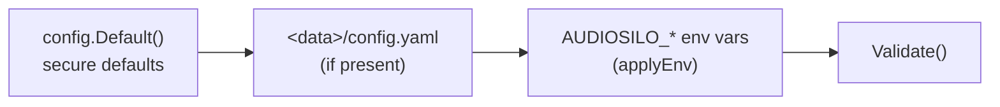

Configuration is loaded by `internal/config` and layered in a fixed order.
Later layers override earlier ones, and the result is validated before use:



Most keys can also be changed while the server runs, from the admin console's
**Server > Settings** (`PATCH /admin/settings`), which writes them back to
`config.yaml`. A key set by an environment variable is **locked** there
instead. See
[Changing settings at runtime](#changing-settings-at-runtime).

## The config file

- **Location**: `<data-dir>/config.yaml` (`config.Path`). The data directory
  itself comes from the `--data` flag. There is **no environment variable for
  the data dir**.
- **First run**: when the file does not exist, `config.Load` returns secure
  defaults with `firstRun=true`, and `pkg/launcher` persists them via
  `Config.Save`. The file is written `0600`,
  the data dir created `0700`.
- **Annotated template**: `config.example.yaml` in the repo root mirrors this
  reference.

:::note
First-run **admin bootstrap** is keyed off the database (does an admin
exist?), not off whether the config file exists. A `config.yaml` supplied in
advance does not suppress the credentials banner or the setup page.

The console's first-run setup flow is keyed off the database too, through the
`server_state` key `setup_state`. No row means a fresh server whose flow is not
finished. An upgraded server is marked finished (see
[Data model](data-model.md#server-state)).

A library declared in `config.yaml` or the environment doesn't finish the flow.
The flow lists it as already added (`GET /admin/setup`'s `config_libraries`),
and its naming step can still switch that library's `metadata_source`. That
choice survives restarts, because the config sync updates only a declared
library's root and default view.
:::

## CLI flags (`cmd/audiosilo`)

| Flag | Default | Meaning |
|---|---|---|
| `--data` | `./data` | Data directory: config, SQLite database, generated certs, downloaded tools, the Matroska remux cache (`cache/remux/`), the watch rendition cache (`cache/renditions/watch/`) |
| `--ffprobe` | `ffprobe` | Path to ffprobe (durations, chapters, codec detection). With FFmpeg 7.1 or 8.1 the scanner reads most files in-process by that release's rules and runs ffprobe only for the rest. With any other release ffprobe reads every file (see [The in-process probe](scanner.md#the-in-process-probe)). **`""` disables it.** The in-process probe still runs, by FFmpeg 8.1's rules, so most files keep their duration, codec and chapters. A file the probe is unsure of gets none: its `codec` is empty, so `direct_playable` defaults to true (see [With no ffprobe](scanner.md#with-no-ffprobe)) |
| `--ffmpeg` | `ffmpeg` | Path to ffmpeg for on-the-fly transcoding, the MP3-in-Matroska remux and the watch renditions. **`""` disables it.** Then `?transcode=1` returns 503 and the `transcode` capability reports false. An `.mka` is served as stored (no remux, `direct_playable: false`). The `renditions` capability is false, and `rendition=` answers `404 rendition_unavailable` |
| `--setup` | `false` | First-run **setup page**. Instead of auto-creating the admin and printing credentials once, the server mints a one-time token and enables the guarded `/setup` page, where the admin's username and password are chosen in the browser (see [Built-in web UI](web-ui.md#first-run-setup-page-setup)). Either way, the admin console's [first-run setup flow](web-ui.md#the-first-run-setup-flow) then adds the books folder and the rest on the first `/admin` visit |

**Commands** (`command` in `cmd/audiosilo/main.go`) come after the flags. Any
other positional argument prints a usage error and exits `2`, as the flag
package does for a bad flag.

- `audiosilo version` prints `audiosilo <version>` and exits `0` before anything
  touches the data directory. An argument after it is a usage error.
- `audiosilo [--data <dir>] reset-admin [username]` (`launcher.ResetAdmin`) sets
  a new random password on an admin of the server in `--data` and prints it
  once. It is the way back in when the first-run password is lost. A flag after
  the command is a usage error, since the flag package stops at the command.

`reset-admin` picks the only admin, or the one named. It exits `2` (a
`launcher.UsageError`, listing the admins) for an unknown name, an account that
isn't an admin, or several admins with no name. It exits `1` and changes nothing
when:

- there is no `audiosilo.db` in the data directory;
- the file isn't an AudioSilo database (`store.Inspect`), which it never
  migrates;
- a restore is waiting for the next start (`backup.RestorePending`), which would
  replace the new password;
- the database has migrations pending (an older release left it: the server
  upgrades it, and backs it up, at its next start);
- there is no admin yet, or the admin is disabled.

The password is set through `auth.SetPassword`, the console's rule: every
session, open pairing code and remembered browser of the account ends. It also
revokes the auth code the first start printed beside the password
(`auth.RevokeInitialAdminCode`: that admin's unlimited, never-expiring invite
labelled `auth.InitialAdminCodeLabel`). It ends the start's sign-in hint and,
for the first-run admin, turns `GET /admin/setup`'s `printed_password` false
(`auth.NoteResetPassword`): the password in the log is gone. If the revoke
fails, the command still prints the new password, since the old one is gone,
then exits `1` with the error and asks for the code to be revoked in the console
(People > Invites).

It runs beside a running server. That server checks the new password at once,
since a sign-in reads the database. A session it has already checked can last up
to a minute from its token cache (see
[Tokens](auth-and-security.md#tokens-session-pairing-and-api-keys)); a restart
ends them at once.

**The sign-in hint.** The first-run banner's `ensureAdmin` writes the
`server_state` row `first_admin` (see [Data model](data-model.md#server-state)).
While that admin has not signed in, every later start prints a framed reminder
(`launcher.signInHint`): the console's address, the username, and the
`reset-admin` command for this install. Inside a container
(`fsaccess.InContainer`) the command is prefixed with
`docker exec -u <uid>:<gid> <container>`, the server's own ids, so it never
makes a root-owned file in the data folder. The binary is named by its path when
that name on `$PATH` is not this binary (the LinuxServer.io image's
`/app/audiosilo/audiosilo`). Words are quoted for the system's shell (single
quotes, or double quotes on Windows). An admin's password sign-in, an admin
setting their own password (`POST /auth/password`, or `PATCH /admin/users/{id}`
on their own account) or `reset-admin` ends it. A server with no row, an
upgraded or `--setup` one, never prints it.

A bare tool name (no path separator) is resolved **next to the server
executable first**, then on `$PATH`. An explicit path is used as it is. If a
tool is enabled but not found locally, the launcher downloads it (see
[ffmpeg/ffprobe resolution & auto-download](#ffmpegffprobe-resolution--auto-download)).

## YAML reference

### Name, update check and listening history

| Key | Type / default | Meaning |
|---|---|---|
| `name` | string, `""` | The server's display name, at most 64 characters with no control characters. It is `GET /server`'s `name`, the pairing payload's `server_name` (the player's sign-in screen shows it), and the name in the admin console's top bar and System and About pages. Empty means `"AudioSilo"` (`Config.DisplayName`). No environment variable |
| `update_check` | bool, `true` | Let the server ask GitHub Releases once a day whether a newer version exists (`internal/updates`; see [Update check](#update-check)). `false` means no request is ever made |
| `activity.session_days` | int, `400` | How many days raw listening sessions (device, app, time of day, playback mode) are kept, 30-3650. After that the daily retention job (`pkg/launcher` `retention`, which reads the live setting at each run) sums them into `listening_daily` and drops that detail. The default keeps a year of detail for Activity's longest range. Activity reads the daily totals for days past it |
| `server_id` | string, minted | The stable per-install identity (see [`GET /server`](api/reference.md#get-apiv1server)). Minted on first start and never changed. It is not a setting |

### Server & network

| Key | Type / default | Meaning |
|---|---|---|
| `bind` | string, `"0.0.0.0:8080"` | `host:port` to listen on. Must parse with `net.SplitHostPort` |
| `public_url` | string, `""` | Externally reachable base URL, used in QR pairing payloads, invite links and the first-run banner's setup URL. When empty, the server derives it per request from the scheme and the `Host` header. It is also the **away** address the apps use outside the home network (see [Home address](#home-address-lan_url)) |
| `lan_url` | string, `""` | The server's **home** address on the household network, e.g. `http://192.168.1.20:8080` (see [Home address](#home-address-lan_url)). When empty, the server derives it per request when the request's `Host` is a home-network host |
| `trusted_proxies` | []string (CIDRs), `[]` | Networks whose `X-Forwarded-For` is trusted when deriving the client IP (which keys the per-address [rate limit](#rate-limits-rate_limit) and the lockouts). Set when running behind a reverse proxy. Each entry must be a valid CIDR |
| `cors_origins` | []string, `[]` | Browser origins granted CORS (methods `GET, POST, PUT, PATCH, DELETE, OPTIONS`). Empty means no cross-origin headers at all; native apps and same-origin web still work. `"*"` disables the check entirely. Needed for a hot-reload frontend dev server, e.g. `http://localhost:8081`. Once set, every authenticated media answer (covers, streams) is `Cross-Origin-Resource-Policy: cross-origin`, so a player on another site shows covers and plays audio (see [Transport hardening](auth-and-security.md#transport-hardening)) |
| `max_upload_bytes` | int64, `2147483648` (2 GiB) | Reserved for the planned `POST /uploads` and **not yet enforced**. JSON request bodies use a fixed 1 MiB cap regardless |

#### Home address (`lan_url`)

`lan_url` is the server's address on the home network: an absolute `http(s)`
address with no query or fragment. Its variable is `AUDIOSILO_LAN_URL`, and the
console sets it at **Settings > General > Home address** (`general.lan_url`)
without a restart.

Together with `public_url` (the **away** address) it makes the `addresses`
capability. The apps learn both addresses when they pair, and from
[`GET /addresses`](api/reference.md#get-apiv1addresses) afterwards. They switch to
the home address whenever they can reach it, and use `public_url` when away. For the
wire shape and where it appears, see
[Home and away addresses](api/reference.md#home-and-away-addresses).

`config.Addresses(scheme, host)` is the pure core, wrapped per request by `api.addresses(r)`:

- `away` is `public_url` without a trailing `/`.
- `home` is `lan_url`. When that is empty, it is `scheme://Host` of **this request**
  when `isHomeNetworkHost(Host)` holds. A home-network host is one of these:
  - a private IP (RFC 1918, IPv6 ULA `fc00::/7`) or a link-local one;
  - a name ending in `.local`, `.lan`, `.home.arpa` or `.internal`;
  - a single-label name.

  A bare IPv6 host is written in brackets in the address. Two kinds of host never
  count:
  - loopback (`127.0.0.0/8`, `::1`, `localhost`), because no other device can reach it;
  - carrier-grade NAT space (`100.64.0.0/10`, which Go's `IsPrivate` leaves out),
    because it is the ISP's network, not the household's.

  The scheme follows the same rule as the pairing `base_url`: `https` on a TLS
  connection, else `http`. The exception is a server that serves
  [home HTTP](#home-http-tlshome_http) (`config.ServesHomeHTTP`). There a derived home
  is always `http://`, even for a request that came over https, and it keeps the
  request's port. When the `Host` has no port, `:443` is added, since that port is
  the one answering http, never 80.

  A configured `lan_url` is used as it is. `X-Forwarded-*` is not trusted. A request
  that came through a reverse proxy (it carries `Forwarded` or any `X-Forwarded-*`
  header) never derives a home address, because its `Host` is the proxy's upstream,
  not an address a device can use.
- A `home` equal to the `away` is dropped.

:::caution[Reverse proxies and the derived home address]
Behind a reverse proxy the server derives no home address at all, because the request's
`Host` is the proxy's upstream (a container name such as `audiosilo:8080`, a bridge IP,
plain `http` behind TLS). Set `lan_url` to give the apps a home address; a configured
`lan_url` applies to proxied requests as usual.
:::

### TLS (`tls.*`)

| Key | Type / default | Meaning |
|---|---|---|
| `tls.mode` | `off` \| `selfsigned` \| `autocert`, default `selfsigned` | `off` = plain HTTP (use behind a TLS-terminating proxy); `selfsigned` = generate & persist a self-signed cert (LAN default); `autocert` = Let's Encrypt via ACME |
| `tls.hosts` | []string, `[]` | autocert: hostnames to obtain certificates for. **Required when mode is `autocert`** |
| `tls.cache_dir` | string, `<data>/certs` | autocert: certificate cache directory (re-defaulted to `<data>/certs` whenever empty) |
| `tls.home_http` | bool, `true` | selfsigned only: the bind port also answers plain HTTP to home-network clients, see [Home HTTP](#home-http-tlshome_http). Ignored in the other modes |
| `tls.cert_file` / `tls.key_file` | string, `""` | selfsigned: explicit paths for the persisted cert and key. Empty means `<data>/selfsigned-cert.pem` and `<data>/selfsigned-key.pem` |

How the modes differ beyond the certificate:

- HSTS (`Strict-Transport-Security`) is sent **only** in `autocert` mode. It is
  never sent for `selfsigned`, because pinning HSTS would make the certificate
  warning impossible to bypass. With `off`, the proxy owns HSTS.
- In `autocert` mode the server logs a warning when `bind` is not on port 443,
  since ACME validation fails otherwise.

#### Home HTTP (`tls.home_http`)

The native apps can't trust a self-signed certificate, because an app has no
"proceed anyway". So in `selfsigned` mode with `tls.home_http` on, the bind port
serves both protocols. `tls.home_http` is on by default. Its variable is
`AUDIOSILO_TLS_HOME_HTTP`, its console setting is `network.tls_home_http`, and a
change needs a restart. In `internal/server`:

- `splitListener` accepts each connection and reads its first byte in its own
  goroutine, under the 10 s header timeout, so a silent client never blocks the
  accept loop. A first byte of `0x16` (a TLS handshake record) makes the connection
  a `*tls.Conn`. Anything else stays plain. A connection that sends nothing in time
  is closed, and so is one still being read when the server shuts down. One
  `http.Server` serves both kinds with the usual timeouts (ALPN offers `h2` and
  `http/1.1`, as `ServeTLS` would).
- `homeHTTPGate` serves a plain HTTP request only when the **connection's own**
  remote address (`r.RemoteAddr`) qualifies. It never reads `X-Forwarded-For`,
  which the client writes. The request is served when either:
  - the remote address is loopback; or
  - the remote address is `config.HomeNetworkIP` (private RFC 1918 or IPv6 ULA,
    or link-local; not CGNAT `100.64.0.0/10`) **and** the request's Host is a
    home-network host (`config.HomeNetworkHost`: a private IP, a `.local`,
    `.lan`, `.home.arpa` or `.internal` name, or a single-label name).

  Any other plain request gets a `308` to the same URL on https, with the same
  Host and port (`:80` for a Host without one). When its Host can't make that URL,
  it gets a `400`. TLS requests pass untouched.

Home HTTP is off, whatever `home_http` says, when `tls.cert_file` is set. A
certificate the admin supplied may be one the devices trust (a private CA,
mkcert), so they keep https.

The server logs at start that plain HTTP is served to home-network clients. The derived
home address becomes `http://` (see [Home address](#home-address-lan_url)), so a device
paired over the https QR still learns an address it can use. No HSTS is sent on
self-signed, and no CSP carries `upgrade-insecure-requests`, so the console and the web
player also work over http on the LAN. Over http they lack the secure-context
features, such as the service worker and the clipboard API.

:::note[Gateways and the source address]
Some setups hand the server connections from a private address, such as
`172.17.0.1`, whoever made them: Docker Desktop (Mac and Windows), rootless
Docker, Docker's userland proxy (for example for IPv6 connections to a published
port), and routers that rewrite a forwarded port's source. There, the Host check
is what keeps an internet client on https, because such a client names the server
by its public name or address. A client outside that sends a forged home-network
Host only chooses cleartext for itself.
:::

### Rate limits (`rate_limit.*`)

The API's request rate limits, each a token bucket refilled at `rate` requests a
second that holds at most `burst` (`config.RateLimitConfig`, read once at start
by `api.New`; how the buckets are applied is in
[Auth & security](auth-and-security.md#rate-limiting)). A request past its
bucket is answered `429 rate limit exceeded`.

| Key | Type / default | Meaning |
|---|---|---|
| `rate_limit.address.rate` / `.burst` | float / int, `50` / `200` | Per client address: what runs before a credential is proved (a missing or refused token pays here), every `/api/v1/auth/*` route (sign-in, pairing, password, API keys), the Bridge's requests and a demo account's API requests (its covers and audio stay per credential, below) |
| `rate_limit.token.rate` / `.burst` | float / int, `50000` / `100000` | Per signed-in device or API key (its `tokens` row): every other authenticated API request, admin routes included, so people behind one address each have their own |
| `rate_limit.media.rate` / `.burst` | float / int, `200` / `2000` | Per signed-in device, API key or cast token: covers and audio (`/cover`, `/stream`, `/meta/cover`) |

**Only what you set is kept.** A rate or burst left out, or `0`, is the
release's default (`RateLimitConfig.Effective`, the `config.Default*RateLimit`
values above). The fields are `omitempty`, so an unset value is never written
into `config.yaml`, and a later release's defaults reach an existing install.
Set one only to change it. Each has a variable (see
[Environment variables](#environment-variables)), and none has a console setting.

The token bucket's default is high on purpose. It is there to stop a runaway
client, not to pace a web player loading a whole library page by page.

The lockouts on wrong passwords, invite codes and Bridge pairing codes, and the
attempt caps on demo sessions and account changes, are separate and not
configurable.

```yaml
# Set only what you want to change; these are the defaults, so uncommenting
# them as they are would pin today's values against a later release's.
# rate_limit:
#   address:
#     rate: 50       # [AUDIOSILO_RATE_LIMIT_ADDRESS_RATE]
#     burst: 200     # [AUDIOSILO_RATE_LIMIT_ADDRESS_BURST]
#   token:
#     rate: 50000    # [AUDIOSILO_RATE_LIMIT_TOKEN_RATE]
#     burst: 100000  # [AUDIOSILO_RATE_LIMIT_TOKEN_BURST]
#   media:
#     rate: 200      # [AUDIOSILO_RATE_LIMIT_MEDIA_RATE]
#     burst: 2000    # [AUDIOSILO_RATE_LIMIT_MEDIA_BURST]
```

### Web player & app links

| Key | Type / default | Meaning |
|---|---|---|
| `web_dir` | string, `""` | Directory of the prebuilt web player served at `/web`. When it is empty and no player is embedded, `/web` is not mounted and the `web_player` capability reports false. The Docker image bakes a pinned build at `/app/web` |
| `app_links.apple_app_ids` | []string, `[]` | `"<TEAMID>.<bundleId>"` entries for `/.well-known/apple-app-site-association` |
| `app_links.android_package` | string, `""` | Android package name for `/.well-known/assetlinks.json` |
| `app_links.android_sha256` | []string, `[]` | Signing-cert SHA-256 fingerprints (colon-separated uppercase hex) |

The well-known endpoints answer 404 until the relevant identifiers are set (see
[Built-in web UI](web-ui.md)). `app_links` is **YAML-only** (no env override).

### Libraries

| Key | Type / default | Meaning |
|---|---|---|
| `libraries[].name` | string, required | Display name; must be unique across the list |
| `libraries[].root` | string, required | Local filesystem root of the library. Roots are always local paths, so mount network shares first |

At every startup the server **upserts config-declared libraries by name** into
the database (`syncLibraries`, roots made absolute) and scans them in the
background. An admin can also create libraries at runtime through the admin API.
Those live only in the database.

The server never writes a library to `config.yaml`, so a declared library's name
and folder can't be changed at runtime:

- `PATCH /admin/libraries/{id}` answers `409 config_library` for either field,
  and the console locks both. The library's other settings stay editable. To
  change the name or folder, edit `config.yaml` (or the app embedding the server)
  and restart.
- `DELETE /admin/libraries/{id}` is refused the same way, with
  `409 config_library`. The next start would add the library back empty, with
  everyone's progress in it gone. Remove it from the config and restart instead.

There is deliberately **no layout key**. The [scanner](scanner.md) detects the
folder shape per folder, and an admin can override it per folder to correct it.

A library's **scan schedule** and **ignore rules** have no config key either.
They are per-library settings stored in the database and edited in the admin
console (or with `PATCH /admin/libraries/{id}`). The startup sync only updates a
config-declared library's `root` and default view, so those settings survive
restarts. See [Scheduled scans](scanner.md#scheduled-scans) and
[Ignore rules](scanner.md#ignore-rules).

Podcast libraries are configured outside this file too:

- Library `kind` is a database and API setting, fixed at create: `books` by
  default, `podcasts` explicitly through the admin API or the console. It has no
  YAML library key. Podcast roots cannot overlap any other library.
- Per-show retention is also a database and API preference, not YAML. An admin
  changes it through the [storage API](api/reference.md#podcast-storage-admin).
- The Bridge owns the feed and audio network limits, the allowlists and the
  per-episode size cap, in its
  [configuration](../bridge/configuration.md#podcasts).

### Library scans (`scan.*`)

| Key | Type / default | Meaning |
|---|---|---|
| `scan.concurrency` | int, `0` | How many audio files a scan reads at once, `0` to `64`. Reading a file means its tags and the in-process probe, then ffprobe for a file the probe leaves to it. `0` means one per CPU, up to 8 (`library.DefaultScanReaders`). CPUs are counted by `GOMAXPROCS`, so in a container that is its CPU limit, not the host's cores. Discovery lists folders and looks files up 8 at once, or fewer when this is set below 8 (see [A rescan that finds nothing changed](scanner.md#a-rescan-that-finds-nothing-changed)). Lower it for a library on a slow disk or a busy share. Raise it for a fast disk on a machine with cores to spare. Read once at start (`Scanner.SetConcurrency`), with **no console setting**. `AUDIOSILO_SCAN_CONCURRENCY` sets it too |

The index comes out the same however many files a scan reads at once (see
[Reading several files at once](scanner.md#reading-several-files-at-once)).
The cap of 8 for the default is deliberate: past about eight, each ffprobe
run costs more CPU as they contend. On a 20-core machine, 20 at once finished
the same scan sooner than 8 (8.0 s against 13.4 s) but took about a third more
CPU (141 against 104 CPU-seconds). Those figures are for ffprobe on every file.
With the in-process probe, a first scan spends far less time reading each file,
and the single writer and the tag reads are most of what is left.

```yaml
scan:
  concurrency: 0 # [AUDIOSILO_SCAN_CONCURRENCY]
```

### Database (`database.*`)

| Key | Type / default | Meaning |
|---|---|---|
| `database.mmap` | `auto` (default, or empty) \| `on` \| `off`, any case | Whether the database's **reader** connections map the file into memory (SQLite `mmap_size`, 256 MiB, `store.WithReaderMmap`). The single writer never maps. `auto` maps only when the database file is on Linux on Unraid's shfs (a `/mnt/user` share). `on` always maps, and `off` never does. Any other value is a config error naming the allowed ones, so the server doesn't start. Read once at start, with **no console setting**. `AUDIOSILO_DB_MMAP` sets it too |

`auto` decides from the database file's filesystem (`store.onMappableFUSE`).
Only Linux is checked; every other platform says no. Two checks must pass:

1. `statfs` must say FUSE (`0x65735546`).
2. The `/proc/self/mountinfo` line for the file's device must name `fuse.shfs`.
   The line is found by the `major:minor` of the file's `st_dev`, so a symlinked
   data folder, a bind mount or a stacked mount needs no path matching.

Any failure along the way, or no line for the device, means no mapping. Inside a
container both checks see the bind mount's real filesystem. An Unraid appdata
path under `/mnt/user` is shfs. One under `/mnt/cache` is the pool's btrfs or
xfs, and so is a `/mnt/user` exclusive share, which Unraid hands straight to its
pool.

**Why only there.** On shfs every page read (`pread`) is a round trip through
the FUSE daemon, and mapping lets a reader take pages straight from the kernel's
file cache. Measured on an Intel N305 Unraid box, the authors list went from
78.8 to 8.9 ms, the Health summary from 157 to 60 ms and a 200-book page from
9.1 to 4.3 ms, with the database's integrity intact under a concurrent scan. On
a local disk it gained little (search and a deep page were about 10% slower),
so `auto` leaves it off there.

It stays off on every other FUSE filesystem and on network shares too:

- mergerfs (with `cache.files=off`) runs `direct_io`. There a mapping fails or,
  on some kernels, can show readers stale pages after the writer's direct writes.
- On sshfs, rclone, s3fs, ntfs-3g, NFS or SMB a read can fail. An I/O error under
  a mapping is a `SIGBUS`, which stops the server, where a plain read would fail
  one request.

`on` takes those risks on purpose. The 256 MiB is a cap on address space, not
memory. The mapped pages are the kernel's reclaimable file cache.

The start logs the outcome once, as `database readers: mmap` with `on`, `mode`,
`mmap_size` (what SQLite took for a reader) and `asked`. It reports the limit
SQLite took, not a mapping made. A reader whose `mmap()` fails later falls back
to plain reads without a log line.

Truncating the open database file in place would also raise `SIGBUS`, so nothing
does it. Backups use `VACUUM INTO`, and a restore swaps the file before it opens
(see
[Restore at the next start](backups-and-notifications.md#restore-at-the-next-start)).

```yaml
database:
  mmap: auto # [AUDIOSILO_DB_MMAP] auto | on | off
```

#### The SQLite engine (`AUDIOSILO_SQLITE`)

On a build with the native C SQLite engine, `AUDIOSILO_SQLITE=modernc`
(exactly, lowercase) runs that process on the pure-Go engine instead. Use it to
compare the two on one binary, or as a fallback. The database file is the same
either way.

The build decides which engine a binary carries, not a config key (see
[SQLite choices](data-model.md#sqlite-choices) for which builds are native). A
value naming any engine other than the one that runs (`native` on a pure-Go
build, or a typo) changes nothing and logs a warning at start. The variable is
read once at start. The start logs the engine and its SQLite release, for example
`msg="database: sqlite" engine=native version=3.53.4`.

### Demo mode (`demo.*`)

| Key | Type / default | Meaning |
|---|---|---|
| `demo.enabled` | bool, `false` | Let unauthenticated visitors mint throwaway accounts via `POST /api/v1/demo/session`. The site root then redirects to `/web/demo` when a player is mounted |
| `demo.library` | string, `""` | Name of the library demo users are granted. **Required when demo is enabled.** The server also logs a warning at boot when the library is missing |
| `demo.max_users` | int (optional), unset | Cap on concurrent live demo accounts. **Unset means the safe default of 200** (`config.DefaultDemoMaxUsers`). **An explicit `0` means unlimited.** That is an opt-in risk, because rotating IPs bypasses the per-IP creation limits |
| `demo.idle_ttl` | duration string, `"24h"` | Reap demo accounts idle longer than this. The background reaper sweeps every 15 min. Must parse as a positive `time.Duration`. Empty falls back to 24h |

### Household members (`household.*`)

Whether people may add household members from the player (see
[Household members](api/reference.md#household-members)), and how many each.
Both are read per request through the API's live config, so a change applies at once.

| Key | Type / default | Meaning |
|---|---|---|
| `household.members_enabled` | bool, `true` | Any account but a demo account or a household member may add members (`POST /me/household/members`). Off refuses new ones only (`403 feature_off`). Existing members keep working, and their owners can still manage them. The per-person switch is the admin's `can_add_members` on each account (`PATCH /admin/users/{id}`), not a key here |
| `household.max_members` | int, `6` | Members per person, `1` to `50` (`config.MinMaxMembers`, `MaxMaxMembers`). At the cap, adding is `409 member_limit`. Outside the range `Validate` refuses the config, a value from the environment included, so the server doesn't start |

A `config.yaml` written before the section keeps the defaults. The admin's
settings envelope carries the cap's default and range beside the two settings,
as read-only facts (`household.max_members_default`, `_min`, `_max`). The
console uses them to name the range and to refuse a value outside it before
saving (see [`GET /admin/settings`](api/reference.md#get-apiv1adminsettings)).

### Community metadata (`metadata.*`)

The server can enrich a book with a description, production details and its
series. It resolves the book's ASIN or ISBN, else the book's recorded community
match, against the community metadata API
([meta.audiosilo.app](https://meta.audiosilo.app)) and serves the result at
`GET /libraries/{id}/meta`. Players draw it as an "About this book" block plus
the recaps, characters and series tabs. The same config also gates
`GET /meta/work?id=…`, which passes a single work document through so a player
can catch a listener up on the earlier books of a series.

The lookup is server-side by design. That gives one cached seam, and one config
key that turns off all outbound calls. By default each question goes to the
service at `base_url`. With `metadata.mode: mirror` the server keeps a local copy
of the service's database and answers the same questions itself (see
[Mirror mode](#mirror-mode-metadatamode-mirror)).

| Key | Type / default | Meaning |
|---|---|---|
| `metadata.enabled` | bool, `true` | Turn the metadata lookup on. When `false`, the server makes **no outbound metadata calls**, and `GET /libraries/{id}/meta` and `GET /meta/work` both return 404. The `metadata` capability reports false, so players hide the enriched-book material entirely. The key seeds the initial state only. An admin can switch it at runtime (see below) |
| `metadata.base_url` | string, `"https://meta.audiosilo.app"` | Base URL of the metadata service (the site is served at `/` and the API at `/api/v1`). **Must be an absolute `http`/`https` URL when metadata is enabled.** Mirror mode still needs it, because it is the fallback and the site links (`web_url`, the attribution's `source_url`) name it |
| `metadata.mode` | string, `"remote"` | Where the lookups are answered. `remote` asks `base_url` for each book. `mirror` keeps a local copy of the service's database in `<data>/meta-mirror/` and answers from it (see [Mirror mode](#mirror-mode-metadatamode-mirror)). Any case, stored lower case. Empty (a `config.yaml` written before the key existed) reads as `remote`. Any other value is a config error naming the allowed ones. **Read at start** (a restart setting) |
| `metadata.region` | string, `""` | The Audible marketplace a community match prefers when a recording sells in several. One of `us`, `uk`, `ca`, `au`, `de`, `fr`, `es`, `it`, `jp`, `in`, `br` (the community metadata's region vocabulary), any case, stored lower case. `""` means no preference, so the US store's ASIN comes first. The region orders each match candidate's `asins` (the preferred store's, then `us`, then the rest). It breaks a runtime tie between recordings in favour of the one selling there, and it is what a [bulk match](api/reference.md#bulk-community-matching) repick looks for. It says nothing about a library's language, because a match sends only the book's own. Applies live. Until it is chosen here, in the environment or by an admin's save (`metadata.region_chosen` on `GET /admin/settings`), the console offers the store nearest the admin's browser |
| `metadata.report_unknown` | bool, `false` | The opt-in daily report of unknown Audible ASINs (see [The unknown-ASIN report](#the-unknown-asin-report-metadatareport_unknown)). Runs only while `metadata.enabled` is on too, and never on a demo server. Applies live. In the console it is **Server > Settings > Community metadata**, *Help complete the community database* (setting id `metadata.report_unknown`), greyed out while the lookup is off. `AUDIOSILO_METADATA_REPORT_UNKNOWN` wins at every start and locks it |

**What applies live.** An admin can switch `metadata.enabled` on or off from the
console's **Server > Settings > Community metadata** (or via
[`PATCH /admin/settings`](api/reference.md#patch-apiv1adminsettings)) with no
restart, and the server writes the change back to `config.yaml`. When
`AUDIOSILO_METADATA_ENABLED` is set, it wins at every start and the console shows
the switch as locked. `metadata.region` applies live too.

**What waits for a restart.** `metadata.base_url` is also editable in the
console, but it is a **restart** setting. The server builds the metadata service
(`meta.Service`) once at start from the boot value. Whether it built one (from a
valid absolute `http(s)` URL) decides whether the feature is *available* at all.
The switch can turn the lookup on only when a service exists. Otherwise it is
refused with `400 invalid_setting` and `field: "metadata.enabled"`.
`metadata.mode` is a restart setting like `base_url`.

**Turning it off** is the one-key privacy switch. With the lookup disabled, the
server never contacts the metadata service, nor, in mirror mode, GitHub for a new
copy. Every player connected to it stops showing the section, because players
gate on the `metadata` capability.

The same switch gates the [community chapter checks](community-chapters.md):

- While it is on, the background pass checks matched books. It sends only their
  ASIN or ISBN, then the community's work and recording ids. In mirror mode the
  local copy answers once it is ready, so nothing leaves the server. The pass
  finds pauses with the configured ffmpeg when there is one.
- While it is off, nothing is checked, and
  `POST /admin/libraries/{id}/book/community-chapters` is `404 metadata_off`.
  Chapters already in use stay until an admin switches a book back.

Enrichment is strictly additive and cached. A slow or unreachable service means
no section, never a broken page.

#### The unknown-ASIN report (`metadata.report_unknown`)

Off by default. While it and `metadata.enabled` are on, a daily job
(`internal/coverage`) sends the metadata service the Audible ASINs of this
server's books that the community database doesn't know, so the community's
[reported-ASIN lane](../meta/sync-bot.md#the-reported-asin-lane) can import
them. A run:

- **Candidates**: books libraries only, upper-cased and format-checked
  (`catalog.UnknownASINCandidates`). A candidate is either:
  - a book's `asin`, except one a community match gave it, which is known by
    definition; or
  - a tag ASIN, only for a book with no ASIN or ISBN of its own, no admin edit
    of its ASIN (a cleared one too), and a tag no other book carries.
- **Lookup first**: up to 500 candidates a run go through the ordinary lookup
  (`meta.Service.KnownASIN`). A candidate qualifies when it was never looked up,
  or was looked up 30+ days ago. Only a 404 counts as unknown. Any other failure
  stops the lookups until the next day. The run is then `failed`, but the
  unknown ASINs already confirmed are still reported. In mirror mode the run
  waits until the local copy is ready. The copy answers the lookups, and only
  the report goes to `base_url`.
- **The report**: the unknown ASINs not sent in the last 30 days, shuffled, 200
  to a `POST <base_url>/api/v1/intake/unknown-asins` with the body exactly
  `{"asins":[...]}`. A run sends at most 5 of these, and none within 23 hours of
  the last. The only headers it sets are `Content-Type: application/json` and a
  fixed `User-Agent: AudioSilo`, beside the HTTP client's own `Host`,
  `Content-Length` and `Accept-Encoding`. It sends no `X-AudioSilo-Client`,
  server id, auth or version. Redirects are never followed.
- **HTTPS only**: the server reports to a `base_url` with plain `http` only when
  its host is loopback (`127.0.0.0/8`, `::1`, `localhost`). Any other is
  `not_offered` with no call.
- **Answers**:
  - A 202 with `accepted` marks that chunk sent.
  - A 404, 405, 3xx or a 2xx without `accepted` is `not_offered`, and the
    service is left alone for 7 days. These come from an older metaserve, or one
    with intake off (see
    [the intake queue](../meta/api.md#unknown-asin-intake-queue-optional)).
  - A 429, a 5xx or anything else marks nothing. The run is `failed` and is
    tried the next day.
- **Schedule**: the first run comes an hour after the start (or a day after the
  last run), then daily, give or take an hour. Switching the report (or
  metadata) on runs it at once, unless one ran in the last 23 hours. The run
  state is kept in `server_state`, so a restart never runs it again early.

The console words the run from `GET /admin/settings`'s read-only
`metadata.report_status` (see the
[API reference](api/reference.md#get-apiv1adminsettings)). What it stores is in
[Data model](data-model.md#unknown-asin-reports): ASINs only, never a book or
path.

While the report is on, Health lists the books whose own ASIN it found unknown
as the `unknown_asin` kind (see [Issues](scanner.md#issues)). Those books still
count as matched. The kind is left out while the report is off, since the
lookups that find them stop.

#### Mirror mode (`metadata.mode: mirror`)

In mirror mode the server keeps a local copy of the metadata service's own
database and answers its metadata questions in-process, so no book is looked up
over the internet. The copy is audiosilo-meta's data release artifact: the
SQLite `meta.sqlite`, with the CC0 core and the CC BY-SA community layer in one
file. Metaserve's own code answers it. The server imports two of
audiosilo-meta's public packages:

- [`pkg/query`](../meta/overview.md#public-go-packages): `query.Open` and
  `query.NewHandler`, the same JSON API handler meta.audiosilo.app runs;
- [`pkg/release`](../meta/overview.md#public-go-packages): the release fetcher.

Remote mode stays the default. Players see no difference: no wire change and no
capability change.

**Parity by construction.** `meta.Service.SetMirror` swaps the metadata client's
transport for `fallbackTransport` (`internal/meta/mirror.go`). The client still
builds the same `/api/v1/...` requests it sends in remote mode. While a copy is
ready, the transport serves each one through the local handler, in memory with
no listener. So every response shape, a retired slug's 301, and every match
score are metaserve's, byte for byte. Nothing above the client (composition, the
rails, matching, both cache levels) knows which one answered. That covers the
admin console's match search and bulk matching too, and the
[community chapter checks](community-chapters.md). Cover images are not part of
this. They still come from their own hosts (the Audible CDN, Open Library,
publishers) in both modes.

**The fallback ladder.** The remote service at `base_url` stays the safety net:

| The local copy... | The request |
|---|---|
| isn't ready (not downloaded yet, or not opened yet after a start) | goes to `base_url`, exactly as in remote mode |
| answers `5xx` (a query this code can't run, e.g. on an artifact schema newer than it knows; a local answer over 15 s, over 32 MiB, or a panic counts the same) | goes to `base_url` unchanged |
| answers `404` | the copy's answer is authoritative, with one exception. A "no match" never replaces a stored **positive** answer in `meta_cache` (a book's enrichment or a work). The stored answer is served, stale, and held in memory for 2 minutes, and its row is left alone, so a lagging or broken copy can't blank a companion that worked. The exception holds only for a "no match" the copy itself answered. A "no match" from `base_url` (no copy ready yet, or a request the copy failed and sent on) is authoritative and replaces the row as in remote mode |
| and `base_url` both fail | the persistent cache serves the last known answer, as in a remote-mode outage |

A `base_url` with a path (metaserve behind a proxy at `/meta`, say) works too.
The copy is asked at its own root, and a retired slug's redirect gets the path
back. `meta_cache` rows keep `source` = `base_url` in both modes, so switching modes
keeps the cache warm. A request the copy couldn't answer is logged at most once
every ten minutes ("the local copy couldn't answer; asked the online service
instead").

**The copy.** `internal/metamirror` keeps it in `<data>/meta-mirror/` (`0700`).
Once a swap settles, the folder holds:

- exactly one `meta-<tag>.sqlite`;
- `state.json` (`tag`, `published_at`, `built_at`, `schema_version`, `sha256`,
  `size_bytes`, `etag`, `checked_at`, `downloaded_at`, `last_error`), written
  `0600` under a temporary name, then renamed.

A download in progress is a temporary `.meta-*.tmp` file in the same folder. The
folder is derived data. It is **not** in
[database backups](backups-and-notifications.md#backups-internalbackup), which
hold the database only.

**Schedule.** The mirror asks for the release list at most once a day, measured
from the `checked_at` recorded on disk, so a restart does not download again.

- A server with no copy checks 30 seconds after start.
- A failed check is retried after an hour.
- **Check now** in the console
  ([`POST /admin/meta/mirror/check`](api/reference.md#post-apiv1adminmetamirrorcheck))
  wakes it at once. It is a no-op while a check is running.
- Nothing is checked or downloaded while `metadata.enabled` is off. Turning it
  off cancels a check already running, download included. Nothing is recorded,
  so the check is due again when metadata is back on.
- Turning metadata back on wakes the mirror at once (`Mirror.Wake`), which runs
  a check only if one is due.

The list request goes to
`https://api.github.com/repos/KodeStar/audiosilo-meta/releases` with
`User-Agent: AudioSilo/<version>` and no token. It is conditional: it sends
`If-None-Match` with the stored ETag only while a copy is held, and drops it after
a failed download, so a `304` can't hide a release that failed. The mirror takes
the newest data release, by
[audiosilo-meta's selection rule](../meta/overview.md#release-artifacts). A tag
that couldn't name a file is refused.

**Download and swap.**

1. Before downloading, the disk guard needs free space on the folder's volume.
   It needs at least the larger of 4.5 times the gz asset's declared size and the
   current copy's size, plus 512 MiB. Otherwise the check fails with
   `not enough disk space: need X, have Y`. When the free space can't be read, it
   downloads anyway.
2. `release.DownloadData` downloads into `meta-<tag>.sqlite`. It verifies the
   download and fetches from GitHub hosts only (see
   [`pkg/release`](../meta/overview.md#public-go-packages)). A download is
   abandoned after 60 seconds without a byte.
3. The mirror opens the new file with `query.Open`, which runs metaserve's
   integrity checks. A file that doesn't open is deleted.
4. The new copy is swapped in atomically. The replaced copy stays open for 60
   seconds for the queries that started on it, then is closed and deleted.

**Any failure keeps the current copy.**

**At start**, the mirror deletes leftover temporary files, a half-written state
file and any copy other than the current one. It forgets a copy that is
missing, changed size or doesn't open, and downloads a new one at the next
check. The copy is opened in the background, so a start isn't held up by it.
Until it is open (the status says `opening`), lookups go to `base_url`. A
finished download is `opening` too, for the seconds before it is swapped in,
while the current copy keeps answering.

**Sizes and cost** (measured October 2026, schema 7, about 281,000 works):

- The gz asset is 444 MB, and the copy about 1.8 GB on disk (1,755,340,800 bytes).
- The gz is streamed and never kept, so a first download peaks at about the
  copy's size.
- An update holds the old copy and the new one (about 3.5 GB) until the swap,
  and the disk guard wants about 2.5 GB free before it starts.
- Data releases come several times a day, so in practice every daily check
  downloads a new copy (about 444 MB a day).
- Download, verification and opening took about 20 s on a fast connection.
- Once the copy is ready, an uncached book lookup took 5-40 ms, against
  170-350 ms from meta.audiosilo.app.

**Artifact schema.** A copy newer than this server's code knows still opens and
answers. The console flags it (`schema_newer`) and says to update the server.
Any query that breaks on it is a 5xx that falls back to `base_url` (the
[cross-repo contract](../architecture/cross-repo-contract.md#13-community-metadata-a-three-repo-seam)
explains why that works).

**Switching back.** A server started in remote mode (with a metadata service)
deletes `<data>/meta-mirror/` if it exists, and logs that it did. A server with
no metadata service (an empty or invalid `base_url`) builds no mirror in either
mode. If the folder can't be prepared, the server logs it and lookups go to
`base_url`. A metadata problem never stops the server.

**A rate-limited answer is waited out.** The service limits how often one client
asks. A `429` from it (`internal/meta/client.go`, `getJSON`) is not an outage.
The client waits for its `Retry-After` and asks again, up to 3 times
(`rateLimitRetries`), so a bulk match's burst slows down instead of failing
books. `Retry-After` may be seconds or a date. The client waits 1 s when it gives
none, and at most 10 s (`maxRetryAfter`). A wait the caller's deadline would cut
short isn't started, and a `429` still there after the retries is an upstream
failure like any other.

A [match run](api/reference.md#what-a-run-asks-of-the-community-service) also
waits out a `503` this way, because metaserve answers one past a match's budget.
A match run paces itself to about 60 requests a second. Neither has a setting.
Anywhere else a `503` is an outage at once, because an admin or a listener is
waiting on the answer.

#### The persistent cache

Answers are cached twice: in memory (24 h for a match, 1 h for "no match", 2 min
for a service error; about 2,048 entries) and, behind that, in the server's own
database, in the `meta_cache` table (migration `0024`; see
[Data model](data-model.md#community-metadata-cache)). The second level is what
makes the cache survive a restart and an outage:

- **What it holds:**
  - A book's enrichment, keyed by its ASIN or ISBN, or by its recorded community
    match's work and recording ids for a book its identifiers don't match: a
    match, a "no match", or an envelope missing a series rail. An envelope
    missing a rail is kept for 2 minutes only, and never over a stored answer,
    which stays the outage fallback.
  - Works fetched by id (`/meta/work`, and the previous books `/meta` adds),
    matches only.

  It never holds a service error, and never a row for a work id that `/meta/work`
  or `previous` found unknown. That id is the caller's choice, so storing misses
  would let any user grow the table. A `404` from the service for a work already
  stored replaces its row, so a dropped work isn't served again in a later
  outage. In mirror mode a `404` the local copy gave never does (see [Mirror mode](#mirror-mode-metadatamode-mirror)).
- **How it is read:** after a memory miss. A row still within its TTL is served
  and warms memory for the rest of that TTL. A match past its TTL is not served
  while the service answers, but when the service fails it is served anyway
  (however old) and held in memory for 2 minutes, so the service is asked again
  soon.
- **Rows from elsewhere are ignored:** each row records the payload format and
  the `metadata.base_url` it came from, so pointing the server at another
  metadata service never serves the old service's answers.
- **Writes are bounded:** a row write waits at most 250 ms for the database's
  single writer, which a scan can hold. A write cut short costs only the row,
  never the response.
- **Placement reads it too:** placing a caller's books on the rails reads each
  book's known work id from memory, else from its stored row, fresh or stale, so
  which entry a book lands on doesn't change with a restart.
- **Retention:** the daily retention job keeps the newest 20,000 rows (a few KiB
  of JSON each), of which works fetched by id keep at most their newest 2,000, so
  browsing many works never pushes the books' enrichments out.
- **No config key:** only the metadata service reads and writes the cache, so
  it follows `metadata.enabled`. With the lookup off, nothing is read from it or
  written to it. Rows already there are kept (retention only trims the table to
  its newest rows) and stay unused until the lookup is switched back on.
- **Privacy:** it holds community data only, the metadata service's public
  answers keyed by ASIN, ISBN or work id. No user, progress, path or library
  information is stored in it. Which books a user owns is worked out per request
  and never cached. Like every table, it is part of a database backup.

### Upcoming releases (`upcoming.*`)

[Upcoming releases](api/reference.md#upcoming-releases) is a daily job. Once a
day the server reads the community metadata for the series it holds. For each
listener it works out the preorders, recent releases and missing volumes in the
series they have ([`GET /me/upcoming`](api/reference.md#get-apiv1meupcoming),
capability `upcoming`). It tells the admin about a new release in one of those
series with the `book_released`
[notification](backups-and-notifications.md#events). No Bridge is needed.

| Key | Type / default | Meaning |
|---|---|---|
| `upcoming.enabled` | bool, `true` | The job's switch. It runs only while `metadata.enabled` is on too, so the default follows the metadata lookup. Applies live. In the console it is **Server > Settings > Community metadata**, *Check for upcoming releases* (setting id `metadata.upcoming`). `AUDIOSILO_UPCOMING_ENABLED` wins at every start and locks it |
| `upcoming.window_days` | int, `90` | How many days back a release still counts as new (`released` rather than `missing`), 1-365 (the community feed's limit). Anything else is a config error naming the key. Read at start, from the config file or `AUDIOSILO_UPCOMING_WINDOW_DAYS` only. Never offered in the console |

The job sends what the metadata lookup already sends (a book's ASIN or ISBN, then
community work and series ids), never who is listening. With metadata off it
makes no call at all, and in [mirror mode](#mirror-mode-metadatamode-mirror) the
local copy answers. The first run, and the first read of each series, is a silent
baseline: releases already out are listed, never announced. Everything the job
stores is derived and rebuilt by the next run (see
[Data model](data-model.md#upcoming-releases)).

### Backups (`backups.*`)

Copies of the database (`internal/backup`; see
[Backups, audit log and notifications](backups-and-notifications.md#backups-internalbackup)).

| Key | Type / default | Meaning |
|---|---|---|
| `backups.schedule` | string, `"daily:03:00"` | When scheduled backups run, in the server's local time zone: `""` (none), `daily:HH:MM` or `weekly:DAY:HH:MM` (`DAY` is `mon`, `tue`, `wed`, `thu`, `fri`, `sat` or `sun`; hour and minute two digits each) |
| `backups.keep` | int, `7` | How many **scheduled** backups to keep, 1-365; the oldest past it is deleted after each scheduled backup. Manual and before-restore backups are never deleted by it |
| `backups.dir` | path, `""` | The backups folder; empty means `<data>/backups`. Must be an absolute path. Read at start, and never set from the console: a backup holds every account's password hash, and retention deletes files in it |

Point `backups.dir` at another disk (a NAS mount, a second drive) so a backup
outlives the disk the server runs from. The folder is created `0700` and each
backup is written `0600`.

### Managed modules (`modules.*`)

Optional features that ship off (see [Managed modules](modules.md)). Each module
has one toggle, read per request through the API's live config, so turning one on
or off applies at once with no restart. The toggle starts or stops the module's
background work, when it has any, and gates the module's routes and Bridge jobs.

| Key | Type / default | Meaning |
|---|---|---|
| `modules.podcasts.enabled` | bool, `false` | The follow, unfollow and check actions, new episode fetches, retention writes, and the scheduling of feeds, downloads and retention. The capability flag also needs an online Bridge offering `podcast`. Reads and valid present-pin reuse stay core. The toggle applies at once, starts or stops the scheduler, and holds queued podcast jobs while off. See [Podcasts](../bridge/podcasts.md) |
| `modules.contributions.enabled` | bool, `false` | The Contributions module: sending corrections and generated characters and recaps to the community database through the Bridge. Its flag needs the Bridge's `contribute` feature too. It has no routes or background work of its own. While it is off, the Bridge jobs it owns (`sidecars.contribute`, `meta.correct`, and a `sidecars.generate` with `contribute: "issue"`) are refused `404 module_off`, and queued ones are held (see [Managed modules](modules.md)) |
| `modules.audible.enabled` | bool, `false` | The Audible module. It covers the console's Audible routes and pages, and the scheduler that queues each account's `audible.poll` every `poll_hours` (6, or hourly while a released preorder is awaited). It also covers the `audible.import` backups and the policy pass after each poll. Its flag needs the Bridge's `audible` feature too. While it is off, the console's Audible routes answer `404 module_off` (all but `DELETE /admin/audible/accounts/{account}`), and queued polls and backups are held. The Bridge's own Audible routes work either way. Variable: `AUDIOSILO_MODULES_AUDIBLE_ENABLED`. See [Audible](../bridge/audible.md) |

A module's own settings, when it has any, go under its key
(`modules.<id>.<name>`). A `config.yaml` written before the section keeps every
module off.

### Podcast discovery (`podcasts.discovery.*`)

[Podcast directory search](api/reference.md#podcast-discovery) is separate from
`metadata.*`. The audiobook metadata settings (lookup, mirror, marketplace
region) never affect it.

| Key | Type / default | Meaning |
|---|---|---|
| `podcasts.discovery.enabled` | bool, `true` | Builds the discovery service at start. When off, the discovery routes answer `404 discovery_off` and `podcast_discovery` is `false`. Read at start only, with **no console setting**. The Podcasts module (`modules.podcasts.enabled`) stays the live switch, so search is still off until that module is on. OPML import and export and feed fetching do not depend on it |

The default directory is Apple's iTunes Search API, which needs no key. Podcast
Index search also needs its key pair, which comes **only from the environment**
and is read once at start:

| Variable | Meaning |
|---|---|
| `AUDIOSILO_PODCAST_INDEX_KEY` | the Podcast Index API key |
| `AUDIOSILO_PODCAST_INDEX_SECRET` | the Podcast Index API secret |

Set both, each 1 to 256 printable ASCII characters without spaces (kept byte
for byte).

- With neither set, Podcast Index is not configured (`available: false`).
- With one missing or malformed, Podcast Index is off and the server logs one
  warning naming the variable and the reason, never the value. The server and
  iTunes search start normally.

There is no startup probe and no bundled key. The pair never appears in
`config.yaml`, Settings, the audit log, the support bundle, logs, jobs or caches.
Rotating or removing it needs a restart. This is a deliberate exception to keeping
third-party credentials on the Bridge, because the server makes these searches
itself and the Bridge has no Podcast Index setting.

```yaml
podcasts:
  discovery:
    enabled: true # [AUDIOSILO_PODCAST_DISCOVERY_ENABLED]
```

:::warning[Test builds only]
A binary built with the `podcastdiscoverytest` tag honours
`AUDIOSILO_TEST_PODCAST_DISCOVERY_ORIGIN=http://127.0.0.1:<port>`, sending
every directory search and that origin's artwork to a local fixture server
instead of the real directories. It exists for the test harness. Never deploy
a tagged binary; an ordinary build ignores the variable.
:::

### The Bridge (no keys)

The server has **no setting for the [Bridge](../bridge/index.md)**, and no
environment variable. The pairing, the Bridge's token, its last heartbeat and its
jobs live in the database (`bridge_status`, `bridge_jobs` and a `tokens` row; see
[Data model](data-model.md#the-bridge)). An admin manages them from the console's
**Server > Settings > Bridge**. Existing settings touch the Bridge in three places:

- **The address the pairing dialog gives the Bridge** (`server_url` from
  [`POST /admin/bridge/pair`](api/reference.md#post-apiv1adminbridgepair)) is the
  server's [home address](#home-address-lan_url) when it has one. For a
  self-signed server that is plain `http` on the local network, because the Bridge
  can't verify the certificate. Without a home address it is `public_url`, else
  the address the console was opened on. When the Bridge runs in a container
  beside the server, it usually reaches the server by another address (a compose
  service name), which it is given on its own side.
- **`libraries[].root`** is where the Bridge looks for each library unless it is
  told otherwise. Mounting the libraries at the same path in both containers
  therefore needs no mapping on the Bridge.
- **`metadata.enabled`** gates generating characters and recaps
  ([`sidecars.generate`](../bridge/generating.md)). Generated content reaches the
  players through `/meta`, which is `404` while metadata is off, so the console and
  the player offer the action only with it on.

The Bridge's own settings are in
[Bridge configuration](../bridge/configuration.md).

## Environment variables

`applyEnv` overrides a fixed set of keys from `AUDIOSILO_*` variables, driven
by the settings table in `internal/config/settings.go` (`fields`: each entry's
`env`). This is the complete list (anything not here, e.g. `name`,
`app_links`, `libraries`, `tls.cert_file`, has no env override):

| Variable | Overrides | Format |
|---|---|---|
| `AUDIOSILO_BIND` | `bind` | `host:port` |
| `AUDIOSILO_PUBLIC_URL` | `public_url` | URL |
| `AUDIOSILO_LAN_URL` | `lan_url` | URL |
| `AUDIOSILO_WEB_DIR` | `web_dir` | path |
| `AUDIOSILO_TLS_MODE` | `tls.mode` | `off` / `selfsigned` / `autocert` |
| `AUDIOSILO_TLS_HOSTS` | `tls.hosts` | comma-separated list |
| `AUDIOSILO_TLS_HOME_HTTP` | `tls.home_http` | `strconv.ParseBool` (`false`/`0`/… turns it off) |
| `AUDIOSILO_TRUSTED_PROXIES` | `trusted_proxies` | comma-separated CIDRs |
| `AUDIOSILO_CORS_ORIGINS` | `cors_origins` | comma-separated origins |
| `AUDIOSILO_MAX_UPLOAD_BYTES` | `max_upload_bytes` | integer |
| `AUDIOSILO_DEMO_ENABLED` | `demo.enabled` | `strconv.ParseBool` (`true`/`1`/…) |
| `AUDIOSILO_DEMO_LIBRARY` | `demo.library` | string |
| `AUDIOSILO_DEMO_MAX_USERS` | `demo.max_users` | integer (`0` = unlimited) |
| `AUDIOSILO_DEMO_IDLE_TTL` | `demo.idle_ttl` | Go duration, e.g. `24h` |
| `AUDIOSILO_HOUSEHOLD_MEMBERS_ENABLED` | `household.members_enabled` | `strconv.ParseBool` (`false`/`0`/… turns it off) |
| `AUDIOSILO_HOUSEHOLD_MAX_MEMBERS` | `household.max_members` | integer, 1-50 |
| `AUDIOSILO_METADATA_ENABLED` | `metadata.enabled` | `strconv.ParseBool` (`true`/`1`/…) |
| `AUDIOSILO_METADATA_BASE_URL` | `metadata.base_url` | URL |
| `AUDIOSILO_METADATA_REGION` | `metadata.region` | marketplace code (`uk`) |
| `AUDIOSILO_METADATA_MODE` | `metadata.mode` | `remote` or `mirror` (any case) |
| `AUDIOSILO_METADATA_REPORT_UNKNOWN` | `metadata.report_unknown` | `strconv.ParseBool` (`true`/`1`/…) |
| `AUDIOSILO_UPCOMING_ENABLED` | `upcoming.enabled` | `strconv.ParseBool` (`false`/`0`/… turns it off) |
| `AUDIOSILO_UPCOMING_WINDOW_DAYS` | `upcoming.window_days` | integer, 1-365; read at start |
| `AUDIOSILO_UPDATE_CHECK` | `update_check` | `strconv.ParseBool` (`false`/`0`/… turns it off) |
| `AUDIOSILO_SESSION_DAYS` | `activity.session_days` | integer, 30-3650 |
| `AUDIOSILO_BACKUP_SCHEDULE` | `backups.schedule` | `""`, `daily:HH:MM` or `weekly:DAY:HH:MM` |
| `AUDIOSILO_BACKUP_KEEP` | `backups.keep` | integer, 1-365 |
| `AUDIOSILO_BACKUP_DIR` | `backups.dir` | absolute path; the Docker entrypoint also gives the folder to `PUID`/`PGID` (see [Under Docker](#under-docker)) |
| `AUDIOSILO_MODULES_PODCASTS_ENABLED` | `modules.podcasts.enabled` | `strconv.ParseBool` (`true`/`1`/…); locks the console toggle when set |
| `AUDIOSILO_MODULES_CONTRIBUTIONS_ENABLED` | `modules.contributions.enabled` | `strconv.ParseBool` (`true`/`1`/…); each module's toggle is `AUDIOSILO_MODULES_<ID>_ENABLED` |
| `AUDIOSILO_PODCAST_DISCOVERY_ENABLED` | `podcasts.discovery.enabled` | `strconv.ParseBool` (`false`/`0`/… turns it off); read at start |
| `AUDIOSILO_SCAN_CONCURRENCY` | `scan.concurrency` | integer, 0-64 (`0` = one per CPU, up to 8); read at start |
| `AUDIOSILO_DB_MMAP` | `database.mmap` | `auto`, `on` or `off` (any case); any other value stops the start; read at start |
| `AUDIOSILO_RATE_LIMIT_ADDRESS_RATE` | `rate_limit.address.rate` | number (requests a second); read at start |
| `AUDIOSILO_RATE_LIMIT_ADDRESS_BURST` | `rate_limit.address.burst` | integer; read at start |
| `AUDIOSILO_RATE_LIMIT_TOKEN_RATE` | `rate_limit.token.rate` | number (requests a second); read at start |
| `AUDIOSILO_RATE_LIMIT_TOKEN_BURST` | `rate_limit.token.burst` | integer; read at start |
| `AUDIOSILO_RATE_LIMIT_MEDIA_RATE` | `rate_limit.media.rate` | number (requests a second); read at start |
| `AUDIOSILO_RATE_LIMIT_MEDIA_BURST` | `rate_limit.media.burst` | integer; read at start |

`AUDIOSILO_PODCAST_INDEX_KEY` and `AUDIOSILO_PODCAST_INDEX_SECRET` override
no key, so they are not in this table (see
[Podcast discovery](#podcast-discovery-podcastsdiscovery)). `AUDIOSILO_SQLITE`
overrides no key either (see
[The SQLite engine](#the-sqlite-engine-audiosilo_sqlite)).

List values are split on commas with whitespace trimmed and empties dropped
(`splitList`). Numeric and boolean variables that fail to parse are **silently
ignored**, and the underlying key keeps its previous value. Only `Validate`
catches downstream inconsistencies.

**The environment wins, and stays out of the file.** `Load` remembers which
keys a variable set (`Config.fromEnv`) and the file's own values before the
environment was applied (`Config.file`). Two things follow:

- The admin console shows such a setting as locked ("Set by
  `AUDIOSILO_TLS_MODE`"), and `PATCH /admin/settings` refuses to change it
  (`409 setting_locked`).
- `Config.Save` writes `config.yaml`'s own value for those keys, never the
  environment's. A value supplied by a variable therefore never ends up in the
  file, and removing the variable later brings the file's value back.

## Changing settings at runtime

The admin console's **Server > Settings** (over
[`GET`/`PATCH /admin/settings`](api/reference.md#admin-settings)) edits most of
the keys above. The settings table in `internal/config/settings.go` is the one
place that says, for each key:

- its console id (`<section>.<name>`, which is also where it sits in the envelope);
- its variable;
- whether a change waits for a restart;
- whether the console may change it at all.

| Setting id | Key | Variable | Takes effect |
|---|---|---|---|
| `general.name` | `name` | - | at once |
| `general.public_url` | `public_url` | `AUDIOSILO_PUBLIC_URL` | at once |
| `general.lan_url` | `lan_url` | `AUDIOSILO_LAN_URL` | at once |
| `general.update_check` | `update_check` | `AUDIOSILO_UPDATE_CHECK` | at once |
| `general.session_days` | `activity.session_days` | `AUDIOSILO_SESSION_DAYS` | at the next daily retention run |
| `network.bind` | `bind` | `AUDIOSILO_BIND` | restart |
| `network.tls_mode` | `tls.mode` | `AUDIOSILO_TLS_MODE` | restart |
| `network.tls_home_http` | `tls.home_http` | `AUDIOSILO_TLS_HOME_HTTP` | restart |
| `network.tls_hosts` | `tls.hosts` | `AUDIOSILO_TLS_HOSTS` | restart |
| `network.trusted_proxies` | `trusted_proxies` | `AUDIOSILO_TRUSTED_PROXIES` | at once |
| `network.cors_origins` | `cors_origins` | `AUDIOSILO_CORS_ORIGINS` | at once |
| `players.web_dir` | `web_dir` | `AUDIOSILO_WEB_DIR` | restart; **read-only** in the console |
| `players.apple_app_ids` | `app_links.apple_app_ids` | - | at once |
| `players.android_package` | `app_links.android_package` | - | at once |
| `players.android_sha256` | `app_links.android_sha256` | - | at once |
| `metadata.enabled` | `metadata.enabled` | `AUDIOSILO_METADATA_ENABLED` | at once |
| `metadata.base_url` | `metadata.base_url` | `AUDIOSILO_METADATA_BASE_URL` | restart |
| `metadata.region` | `metadata.region` | `AUDIOSILO_METADATA_REGION` | at once |
| `metadata.mode` | `metadata.mode` | `AUDIOSILO_METADATA_MODE` | restart |
| `metadata.upcoming` | `upcoming.enabled` | `AUDIOSILO_UPCOMING_ENABLED` | at once |
| `metadata.report_unknown` | `metadata.report_unknown` | `AUDIOSILO_METADATA_REPORT_UNKNOWN` | at once |
| `demo.enabled` | `demo.enabled` | `AUDIOSILO_DEMO_ENABLED` | restart |
| `demo.library` | `demo.library` | `AUDIOSILO_DEMO_LIBRARY` | at once |
| `demo.max_users` | `demo.max_users` | `AUDIOSILO_DEMO_MAX_USERS` | at once |
| `demo.idle_ttl` | `demo.idle_ttl` | `AUDIOSILO_DEMO_IDLE_TTL` | restart |
| `household.members_enabled` | `household.members_enabled` | `AUDIOSILO_HOUSEHOLD_MEMBERS_ENABLED` | at once |
| `household.max_members` | `household.max_members` | `AUDIOSILO_HOUSEHOLD_MAX_MEMBERS` | at once |
| `backups.schedule` | `backups.schedule` | `AUDIOSILO_BACKUP_SCHEDULE` | at once |
| `backups.keep` | `backups.keep` | `AUDIOSILO_BACKUP_KEEP` | at once (pruning at the next scheduled backup) |
| `backups.dir` | `backups.dir` | `AUDIOSILO_BACKUP_DIR` | restart; **read-only** in the console |
| `modules.podcasts` | `modules.podcasts.enabled` | `AUDIOSILO_MODULES_PODCASTS_ENABLED` | at once. Starts or stops the scheduling of feeds, downloads and retention, and gates writes. Reads and present-pin reuse stay core |
| `modules.contributions` | `modules.contributions.enabled` | `AUDIOSILO_MODULES_CONTRIBUTIONS_ENABLED` | at once (the Bridge jobs it owns are refused or held while it is off) |

`podcasts.discovery.enabled`, `upcoming.window_days`, `scan.concurrency`,
`database.mmap` and the six `rate_limit.*` values have no setting id. Each is read
at start from the file or its variable and never offered in the console.

Also not in the console:

- `max_upload_bytes` (it has a variable but no setting);
- `tls.cache_dir`, `tls.cert_file` and `tls.key_file`;
- `server_id`;
- `libraries`. Libraries are managed on the console's Libraries page and live in
  the database.

The ffmpeg and ffprobe paths are CLI flags. The console's Transcoding topic only
shows what was found.

**Locked settings.** A setting is locked when an `AUDIOSILO_*` variable set it
(see [Environment variables](#environment-variables)). `Config.Locked` maps
each locked setting id to the variable's name. The console disables locked
fields and shows why they can't be changed.

**Live versus restart.** `api.API` keeps two configs:

- `boot`, the config the server started with, which never changes;
- `live`, an `atomic.Pointer[liveConfig]` that a settings save replaces whole.

A `liveConfig` holds two configs in turn. `saved` is what `config.yaml` now holds,
and the envelope shows it. The embedded working config is `saved.Effective(boot)`:
the saved settings with **every restart setting copied back from `boot`**.
Handlers read the working config through `a.config()`, so a saved restart setting
has no effect until the next start.

Everything else applies to the next request:

- CORS and the trusted-proxy check (`liveConfig` parses both once per save, not
  per request);
- `public_url` in pairing and invite links;
- `lan_url` in the home and away addresses;
- the display name;
- the well-known app-link files;
- the metadata switch (`metadataOn`);
- the demo library and cap;
- the backup schedule and retention (the handler calls
  `backup.Service.SetSettings`);
- each [managed module's](modules.md#background-work) toggle. The handler calls
  `syncModules` after the swap, which starts or stops the module's background
  work.

Turning `update_check` on or off also calls `updates.Checker.SetEnabled`.

Some things are set up once at start, from the config the server started with,
and only then:

- the listener and TLS in `internal/server`;
- the `/web` mount and the site-root demo redirect in `Handler()`;
- the metadata service built in `api.New`;
- the metadata mirror the launcher builds in mirror mode;
- the demo reaper's TTL.

A saved restart setting whose value differs from `boot` is listed in the
envelope's `restart_pending` (`Config.RestartPending`) until the server starts
with it.

**A save.** `Config.WithSettings(patch, checks)` works in these steps:

1. It clones the saved config.
2. It refuses a setting that is unknown, read-only or locked.
3. It refuses JSON `null` for a setting that can't be unset. Only a pointer
   field, `demo.max_users`, takes `null`. Any other setting answers "enter a
   value".
4. It decodes each value into its field and runs that field's normalizer.
5. It `Validate`s the whole config.
6. It also `Validate`s the config **as `config.yaml` will hold it**
   (`Config.asSaved`, what `Save` writes: the file's own values for keys an
   `AUDIOSILO_*` variable sets). It refuses a change that turns a valid file
   invalid, naming the variable.

Without step 6, a change could save a file that only works while the variable
stays set, and the server would stop starting once the variable is removed. An
example is `demo.enabled` switched on from the console, with the library only in
`AUDIOSILO_DEMO_LIBRARY`. A file that already leans on the environment doesn't
block unrelated changes.

`config.Checks` carries what the config can't tell by itself:

- whether a metadata service exists, because metadata can't be switched on
  without one;
- whether a library has the `demo.library` name. The handler looks it up in the
  catalog.

A refusal is a `*config.SettingError` naming the setting and the reason, and
nothing is applied (all or nothing). After a successful check, the handler writes
`config.yaml` with `Config.Save` and swaps `live`, all under `settingsMu`.

The normalizers, per setting:

| Setting | Accepted, and how it is stored |
|---|---|
| `name` | trimmed; at most 64 characters, no control characters |
| `public_url`, `lan_url`, `metadata.base_url` | an absolute `http`/`https` address with no query, fragment or user info; trailing `/` dropped; `""` allowed (but `Validate` refuses an empty `base_url` while metadata is on) |
| `metadata.region` | trimmed and lowercased; one of the marketplace codes above, or `""` |
| `metadata.mode` | trimmed and lowercased, `""` stored as `remote`; `remote` or `mirror` |
| `bind` | `host:port`, port 1-65535 |
| `tls.hosts` | lowercased host names, no scheme, port or path; `Validate` requires at least one for `autocert` |
| `trusted_proxies` | CIDR ranges; a bare address becomes its one-address range (`10.0.0.2` → `10.0.0.2/32`, IPv6 `/128`) |
| `cors_origins` | `*`, or `scheme://host[:port]` with nothing after it, lowercased |
| `app_links.apple_app_ids` | `TEAMID.bundle.id` (a 10-character uppercase team ID) |
| `app_links.android_package` | a Java-style package name (`com.example.app`) or `""` |
| `app_links.android_sha256` | 32 colon-joined hex pairs, uppercased |
| `demo.library` | trimmed; must be the name of an existing library |
| `demo.max_users` | `null` (the default, 200) or 0 (no limit) to 100000 |
| `demo.idle_ttl` | `""` (24h) or a positive Go duration |
| `household.max_members` | an integer from 1 to 50 (checked by `Validate`) |
| `backups.schedule` | `""`, `daily:HH:MM` or `weekly:DAY:HH:MM` (`backup.ParseSchedule`), stored in canonical form |
| `backups.keep` | an integer from 1 to 365 (checked by `Validate`) |

Every list is trimmed, with empty entries and repeats dropped, and holds at
most 50 entries.

`Config.Save` writes the saved config, but keeps `config.yaml`'s own value for
every key the environment set (as above), so a console save never writes an
environment variable's value into the file.

## Update check

`internal/updates` asks GitHub Releases whether a newer server exists, for the
console's Server > About and Health > System. `pkg/launcher` starts one
`updates.Checker` (`Run`) with the configured `update_check`:

- While on, it checks a minute after the server starts, then whenever the last
  request is a day old (it wakes hourly to see). Turning the setting on wakes
  it, so it checks at once if the last request is more than a day old.
- Each request is a plain `GET` of
  `https://api.github.com/repos/KodeStar/audiosilo-server/releases/latest` with
  `Accept: application/vnd.github+json` and `User-Agent: AudioSilo/<version>`,
  conditional on the last answer's `ETag` (`If-None-Match`; a `304` doesn't
  count against GitHub's unauthenticated limit of 60 an hour per IP). Nothing
  else is sent: no server id, no library or user data.
- A manual check (`POST /admin/update/check`) within a minute of the last
  request answers with that request's result instead of asking again.
- Drafts, prereleases and a release whose page isn't on `github.com` are
  ignored (`bad_response`). A local build (`version` `"dev"`) or an `:edge`
  image (`"dev-<short sha>"`) isn't comparable, so it never reports an update.
- While off, no request is made at all, and a manual check is refused
  (`409 update_check_off`).

## Validation & secure defaults

`Config.Validate` runs after all layers. It rejects:

- an empty data dir; a `bind` that isn't `host:port`;
- an unknown `tls.mode`; `autocert` without `tls.hosts`;
- any `trusted_proxies` entry that isn't a valid CIDR;
- a library with an empty name or root, or a duplicate library name;
- demo mode without `demo.library`; a `demo.idle_ttl` that doesn't parse or
  isn't positive (rejected loudly rather than silently replaced by 24h);
- metadata enabled with an empty or non-absolute-`http(s)` `metadata.base_url`;
  a `metadata.region` that isn't one of the marketplace codes; a `metadata.mode`
  other than `remote` or `mirror`;
- a `backups.schedule` that isn't one of the forms above, a `backups.keep`
  outside 1-365, or a `backups.dir` that isn't an absolute path;
- a `scan.concurrency` outside 0-64;
- a `database.mmap` other than `auto`, `on` or `off` (any case);
- a `rate_limit.*.rate` that is negative, infinite or not a number, or a
  negative `rate_limit.*.burst` (`0` is unset: the default).

Secure-by-default choices baked into `Default()` and first-run:

- TLS on (`selfsigned`) out of the box;
- no default passwords (credentials are minted and printed once, or set via the
  guarded setup page);
- config written `0600`;
- no trusted proxies and no CORS grants until configured.

See [Auth & security](auth-and-security.md) for the app-layer hardening these
feed into.

## `pkg/launcher` is not an embedding API {/* #launcher-options-for-embedders */}

`pkg/launcher.Run(ctx, opts)` is the run loop behind the headless `audiosilo`
command. Its `Options` are only what the command's flags set:

- `DataDir` (`--data`);
- `FFprobePath` and `FFmpegPath` (`--ffprobe` and `--ffmpeg`; `""` turns the
  tool off);
- `Log`;
- `Setup` (`--setup`: the token-guarded `/setup` page for the admin account
  instead of the printed credentials banner).

It takes no configuration overrides and pins no setting: `config.yaml` and the
`AUDIOSILO_*` variables are the only configuration. (The bind, TLS, public URL,
library and URL-callback overrides were for the archived desktop manager and are
gone.)

The startup banners' base URL is `public_url` when set; otherwise it is derived
from `tls.mode` (scheme) and `bind`. A wildcard bind (`0.0.0.0`/`::`) becomes
`localhost`, which is both reachable on the host and a secure context for the
admin PWA.

## ffmpeg/ffprobe resolution & auto-download

The binaries are **not bundled**, because they are large and usually already
present. `pkg/launcher.resolveTools` resolves each enabled tool in order:

1. an **explicit path** from the flag or `Options`;
2. a copy **next to the server executable** (bare names only; `.exe` appended
   on Windows), so a tool dropped beside the binary is found without
   touching `PATH`;
3. **`$PATH`** (`exec.LookPath`).

Only when an enabled tool is found nowhere locally does the launcher fall
back to `internal/toolfetch.Ensure`. It downloads a static build into
**`<data>/tools/`** and reuses it forever. One archive download yields both
tools.

- **Sources are pinned and HTTPS-only**:
  - Linux and Windows: BtbN's `FFmpeg-Builds` GitHub release assets (amd64 and
    arm64; `tar.xz` or `zip`).
  - macOS: evermeet.cx per-tool zips. These are x86_64 builds. They run under
    Rosetta 2 on Apple Silicon, which an arm64 server can exec without trouble.
- **Self-check**: every downloaded binary must successfully run `-version`
  (15 s timeout) before it is adopted. A failing binary is deleted.
- **The Linux and Windows download is a release branch**: BtbN's
  `ffmpeg-n8.1-latest-<platform>-lgpl-8.1` asset (`btbnBranch`, `btbnAsset`),
  rebuilt at each 8.1 point release. Its `-version` reads `n8.1...`, so the
  scanner's [in-process probe](scanner.md#the-in-process-probe) runs with it.
  - Before 2.5.1 the download was FFmpeg master (`ffmpeg-master-latest-*`), whose
    `N-...` version is no release, so the probe stayed off.
  - `btbnBranch` moves only to a branch that `metadata`'s `knownRules` has.
  - evermeet's macOS download is the latest release when it was fetched, and it
    is kept. So the probe runs with it only while that is 7.1 or 8.1.
  - A local ffprobe of a known release, found first, avoids both.
  - If the pinned 8.1 asset is gone (a 404) in the foreground download, with no
    tools cached, the launcher falls back to BtbN's master build. The tools work,
    the probe stays off, and a warning says so.
- **A cached master build is replaced in the background** (`replaceMaster`).
  This happens when the cached ffprobe's version starts `N-`, which is an older
  server's download:
  1. That pair serves this run.
  2. The launcher fetches the 8.1 build in a goroutine into `<data>/tools/next`
     and self-checks it. The start never waits for this.
  3. The next start's `promoteStaged` moves it into `<data>/tools/`, ffprobe
     first. An incomplete or failing one is removed. A rename that fails keeps
     `next/`, so the following start finishes it.

  A failed fetch touches `<data>/tools/.release-fetch-failed`, an empty file
  whose modification time is the failure's. The fetch is retried no sooner than
  `releaseRetry` (24 hours) after that time. A shutdown mid-fetch leaves the
  marker as it was, and a success removes it. A download unpacks into a
  `.download-*` folder inside the one it fills (never the system temp folder),
  and a start removes one an exit left behind.
- **The start-up log** says which way the probe went
  (`pkg/launcher.resolveTools`, `metadata.ProbeRelease`). It logs one of:
  - "in-process probe on", with the rules' release;
  - "in-process probe off: ffprobe is not a release it knows, so ffprobe reads
    every file";
  - with no ffprobe, that the probe is on by 8.1's rules with no ffprobe for the
    rest.

  The probe's per-file fallback reason is logged at debug (`metadata.SetLogger`).
- **Hardening**: extraction only takes files named `ffmpeg` or `ffprobe`
  (basename-only, so no zip-slip), capped at 300 MiB per binary
  (decompression-bomb guard). Pinning per-asset SHA-256 is noted in the
  package as a future hardening step.
- **Graceful degradation**: offline, an unsupported platform, or a failed
  check means running without the tool. Without ffprobe, durations, chapters and
  codecs come only from the in-process probe. Without ffmpeg, transcoding is off.
  The launcher logs a warning and retries on the next start. Nothing is fatal.

## What ends up in the data directory

| Path | What it is |
|---|---|
| `<data>/config.yaml` | This configuration (written on first run) |
| `<data>/audiosilo.db` | The SQLite index. It is rebuildable, because the filesystem is the source of truth (see [Data model](data-model.md)) |
| `<data>/certs/` | autocert certificate cache |
| `<data>/selfsigned-cert.pem`, `<data>/selfsigned-key.pem` | Persisted self-signed certificate (mode `selfsigned`, default paths) |
| `<data>/tools/` | Auto-downloaded ffmpeg/ffprobe, when no local copy was found |
| `<data>/cache/remux/` | MP3 copies of `.mka` files holding MP3, made while ffmpeg is configured (`0700`, a size-capped LRU: see [Remuxing Matroska](media.md#remuxing-matroska-medianewremuxer)). Rebuildable: safe to delete, and needs no backup |
| `<data>/cache/renditions/watch/` | Watch renditions: small AAC copies (`.m4a`) of the audio files a watch asked for, made while ffmpeg is configured (`0700`, an LRU capped at 10 GiB: see [Watch renditions](media.md#watch-renditions-medianewrenditioncache)). Rebuildable: safe to delete, and needs no backup |
| `<data>/meta-mirror/` | [Mirror mode](#mirror-mode-metadatamode-mirror)'s local copy of the community metadata (what it holds: **The copy** there) |
| `<data>/backups/` | Database backups (`audiosilo-<UTC time>-<kind>.db`), unless `backups.dir` puts them elsewhere |
| `<data>/restore.json` | A restore waiting for the next start (removed when it is applied or refused) |
| `<data>/restore-result.json` | How the last restore went |
| `<data>/audiosilo.db.before-restore-<time>` | Only when a restore couldn't copy the database it replaced: that database's files, renamed aside |

## Folder permissions

The server needs read and write access to its data and backups folders and read
access to its libraries. It checks them itself on every install, and the Docker
image's entrypoint checks them once more before the server starts.

### The server's own checks

The server words a refused folder in `internal/fsaccess`. Before
`config.Load` and `store.Open`, the launcher writes a probe file in the data
folder and opens `audiosilo.db`, `-wal` and `-shm` read-write. A refusal stops
the start with `the data folder isn't usable: ...`, naming the path, the user
`uid:gid`, the owner and the fix, rather than SQLite's "unable to open database
file". The fix (`fsaccess.Hint`) is `PUID` and `PGID` set to the owner only in a
container (`/.dockerenv` or `/run/.containerenv`); outside one it is running the
server as the owner. It never advises running as root. It warns `backups will fail` at start when
the backups folder exists and refuses it (`backup.Service.CheckFolder`). A
refused backup is `permission_denied` (see
[Backups](backups-and-notifications.md#status)), and a library root the server
can't list is [unavailable](scanner.md#the-unavailable-root-guard).

### Under Docker

The image's `docker-entrypoint.sh` starts as root, gives the server's user its
folders, checks them as that user, then drops to it with `su-exec PUID:PGID`
(default `1000:1000`). The server runs as root only when `PUID` is `0`.
`su-exec` sets only that group, so access a host user has through another group
doesn't reach the server.

- **Ownership.** It runs `chown -R` on the data folder (`--data`, `/data` by
  default). When `AUDIOSILO_BACKUP_DIR` is an absolute path, it gives the user
  that folder and only AudioSilo's own files in it (`audiosilo-*.db` and
  `.audiosilo-*`, regular files, `chown -h`), since a backups share may hold other
  apps' files. A path that is the container's root, however spelled, or that
  holds a `..`, is skipped. The data folder's `chown -R` crosses into a share
  mounted under it, so a backups share belongs at a path of its own, never
  `/data/backups`.
- **Checks.** As the server's user, it writes a `mktemp` file in the data and
  backups folders and reads one entry of every other mounted folder (the
  audiobooks, by the rule of the setup's mount hints). For a folder that fails
  it prints the folder, the user, the folder's owner and the fix (`PUID` and
  `PGID` set to the owner, or giving the user access), and carries on. Every
  check and every step on the backups folder is bounded by `timeout 5`. A check
  cut off says the folder didn't answer, with no owner advice.
- **Under `--user`** (compose `user:`) it skips the chown, runs the same checks,
  and its fix names `user:` instead of `PUID` and `PGID`.

`scripts/test-entrypoint.sh` tests the entrypoint in Docker. CI doesn't run it.
