The schema lives in `internal/store/migrations/` as numbered SQL files
(`0001_init.sql` … `0073_podcast_episode_indexed.sql`). They are embedded into
the binary, and `store.Open` applies them at startup. This page documents the
**resulting current schema** and notes which migration added what.

## The two halves: rebuildable index vs durable state

The schema is deliberately split in two. The split is the most important thing
to understand before you change the schema.

- The **rebuildable index** is a cache of what the scanner found on disk:
  `books`, `book_files`, `chapters`, `book_more_series`, `book_labels` and
  `books_fts`. It can be dropped and rebuilt from a rescan at any time.
  `books.id` is an internal artifact of this half. It must **never** appear in
  the API contract or in durable user state.
- **Durable state** is keyed by **`(library_id, rel_path)`**, with **no foreign
  key to `books`**. It is made of:
  - per-user tables: `progress`, `bookmarks`, `notes`, `listening_history`,
    `listening_sessions`, `listening_daily`, `favourites`, `up_next`,
    `collection_items` and `ratings`;
  - per-library config: `folder_overrides`, `book_enrichment`,
    `issue_ignores`, `book_overrides`, `chapter_overrides`, `chapter_choices`,
    `book_covers` and `book_matches`.

  The rest of a listener's own state hangs off the account rather than a path:
  `collections`, `collection_shares`, `listening_goals` and
  `household_sharing` (see [Lists, ratings and goals](#lists-ratings-and-goals)).
  `cast_grants` is also path-keyed with no FK to `books`, but it belongs to a
  short-lived credential rather than to state (see
  [Accounts & credentials](#accounts--credentials)).

A third, small group sits beside the index. **`scan_runs`** is the history of
the scans that built it, and **`community_chapters`** holds each book's last
community chapter check. They are records of the index, not durable user state.
`scan_runs` goes with its library and is trimmed to the newest runs.
`community_chapters` is rebuilt by checking again. It is path-keyed with no FK
to `books`, so an index rebuild keeps it and a move carries it.

A few tables belong to neither half:

- The server's own records: the admin audit log, the notification destinations
  and the event feed (`0019`). They hang off no library or book and are
  trimmed by age (see [Audit and notifications](#audit-and-notifications)).
- The community metadata cache (`meta_cache`, `0024`): answers from the metadata
  service, keyed by identifier and rebuildable by asking again (see
  [Community metadata cache](#community-metadata-cache)).
- `server_state` (`0040`): small server-wide facts the server keeps for
  itself. They name no book and aren't rebuildable (see
  [Server state](#server-state)).

Why no FK across the seam? There are three reasons:

1. **Rebuild survival.** If durable state referenced `books.id`, deleting and
   re-indexing a library (or the prune step of a normal scan) would cascade
   away every user's progress. Path keys survive because the scanner re-creates
   the same `rel_path`s.
2. **Re-tagging survival.** Fixing a book's tags changes its indexed metadata
   but not its path, so state keyed by path is untouched. The same holds for an
   admin's metadata edits. They are path-keyed rows, not columns of the index.
3. **Pre-index writes.** A client can start playing a book the background scan
   hasn't reached yet, because the filesystem view needs no index. Progress
   saved at that moment has no `books` row to reference.

Move-tracking covers the remaining gap, a file that *moves* on disk. The
scanner fingerprints files (`books.content_hash`) and calls
`catalog.MoveDurableState` to carry all fifteen path-keyed book tables from the
old path to the new one (see [Scanner](scanner.md#move-detection)). That is
every table above except `folder_overrides`, which is keyed by folder, not
book. When an admin joins a folder's disc folders into one book,
`catalog.JoinDurableState` hands the disc books' state to the joined book the
same way (see [Joined books](scanner.md#joined-books-disc-sets)).

```mermaid
erDiagram
    users ||--o{ tokens : "ON DELETE CASCADE"
    users ||--o{ auth_codes : "ON DELETE CASCADE"
    users ||--o{ user_share_access : ""
    shares ||--o{ share_paths : ""
    shares ||--o{ user_share_access : ""
    libraries ||--o{ share_paths : ""
    libraries ||--o{ books : "rebuildable index"
    books ||--o{ book_files : ""
    books ||--o{ chapters : ""
    books ||--o{ book_more_series : "ON DELETE CASCADE"
    books ||--o{ book_labels : "ON DELETE CASCADE"
    books ||--|| books_fts : "rowid = books.id"
    libraries ||--o{ progress : "path-keyed, NO FK to books"
    libraries ||--o{ bookmarks : ""
    libraries ||--o{ notes : ""
    libraries ||--o{ listening_history : ""
    libraries ||--o{ listening_sessions : ""
    libraries ||--o{ listening_daily : ""
    libraries ||--o{ favourites : ""
    libraries ||--o{ up_next : ""
    libraries ||--o{ collection_items : ""
    libraries ||--o{ ratings : ""
    users ||--o{ collections : "ON DELETE CASCADE"
    collections ||--o{ collection_items : "ON DELETE CASCADE"
    collections ||--o{ collection_shares : "ON DELETE CASCADE"
    users ||--o{ collection_shares : "ON DELETE CASCADE"
    users ||--o| listening_goals : "ON DELETE CASCADE"
    libraries ||--o{ folder_overrides : "durable config"
    libraries ||--o{ book_enrichment : "durable config"
    libraries ||--o{ book_overrides : "durable config"
    libraries ||--o{ chapter_overrides : "durable config"
    libraries ||--o{ book_covers : "durable config"
    libraries ||--o{ book_matches : "durable config"
    libraries ||--o{ issue_ignores : "durable config"
    libraries ||--o{ scan_runs : "scan history"
    libraries ||--o{ community_chapters : "path-keyed, NO FK to books"
    libraries ||--o{ chapter_choices : "path-keyed, NO FK to books"
    users ||--o{ progress : ""
    users ||--o{ reading_progress : "path-keyed, NO FK to books"
    libraries ||--o{ reading_progress : ""
```

:::warning
When you add a new per-user or per-library-config table, follow the pattern:

- Key it on `(user_id, library_id, rel_path)` or `(library_id, path)`.
- Give it an FK only to `users` or `libraries` (with `ON DELETE CASCADE`),
  never to `books`.
- Add a line where moves carry it along. A per-user table goes in
  `carryListeningState` (`catalog/listening.go`, the one list, shared by moves
  and joins). A book's own config goes in `moveBookState`, and also in
  `joinBookState` (`catalog/join.go`) if a joined book should inherit it from
  its discs.
:::

## Tables

### Accounts & credentials

**`users`** *(0001; `is_demo` added in 0005; the household member columns in 0044)*.
Its columns:

- `id`, `username` (UNIQUE), `role` (`'admin'` or `'user'`), `disabled`,
  `is_demo`, `created_at`, `updated_at`.
- `password_hash`: an argon2id PHC string. An **empty string means a
  password-less account**. It is never a hash of `""`.
- `is_demo` flags throwaway demo-mode accounts, so the background reaper
  deletes by flag rather than by username prefix. A prefix could catch a real
  account named `demo_*`.

There is deliberately **no `last_login` column**. Last activity is derived from
`MAX(tokens.last_seen)`.

The [household member](api/reference.md#household-members) columns *(0044)*:

- `managed_by`: the owner who added this member. FK to `users`
  `ON DELETE SET NULL`, with the partial index `idx_users_managed_by`.
- `member_kind`: `'kid'` or `'grownup'` (a column CHECK).
- `member_access`: `'all'` or `'collections'` (a column CHECK).
- `can_add_members`: `INTEGER NOT NULL DEFAULT 1`, the admin's per-person
  switch.
- `display_name`: `TEXT NOT NULL DEFAULT ''`. The name the owner typed for a
  member. It is kept when they stop being one (Make independent,
  `keep_members`). It is `''` for anyone never given one, including a member
  the admin assigned, until the owner renames them.

The first three are **all set or all NULL**. SQLite can't add a table CHECK
with `ALTER TABLE`, so `auth` (`members.go`) writes and clears them together,
and `memberScan` reads a row that says otherwise as no member. `SET NULL` is
only a backstop. `auth.DeleteUser` clears all three member columns of each
member an admin keeps and deletes the others explicitly. It does both in the
same transaction and before it deletes the owner's row, so no row still points
at the owner when it goes. These columns are durable, because they belong to
the account, not the index.

**`tokens`** *(0001; `auth_code_id` added in 0014; `client_app`,
`client_version`, `client_platform` and `last_ip` in 0018; `created_on_token_id`
in 0044)* holds opaque bearer tokens. Its columns:

- `user_id` (FK CASCADE).
- `token_hash` (UNIQUE). Only the SHA-256 hash is stored.
- `kind`: one of the kinds listed below.
- `device_name`, `created_at`.
- `last_seen`: bumped by authenticated requests, at most once a minute unless
  the request's address or `X-AudioSilo-Client` changed
  (`auth.touchInterval`). A progress save is then not also a token write.
- `expires_at` (NULL means no expiry) and `revoked`.
- `auth_code_id`: FK CASCADE to `auth_codes`, NULL for sessions and unlinked
  pairing tokens. A pairing token minted by redeeming a code is linked to it,
  inherits its uses and expiry at exchange, and dies with it.
- `client_app`, `client_version`, `client_platform`, `last_ip` and
  `created_on_token_id`, described after the kinds.

`kind` is `'session'`, `'pairing'`, `'api'`, `'cast'`, `'bridge'` or `'feed'`:

- `'api'`: a user-minted personal API key. Its label rides in `device_name`.
- `'cast'` *(0043)*: a cast token, with its `cast_grants` row (below).
- `'bridge'` *(0047)*: the paired [Bridge](#the-bridge)'s token, named
  `AudioSilo Bridge`. At most one is live. The partial index
  `idx_tokens_bridge` on `user_id` over live bridge tokens finds it, and its
  calls never touch it.
- `'feed'`: a listener's
  [calendar feed token](auth-and-security.md#calendar-feed-tokens), named
  `Calendar feed`. At most one per user is live, enforced by the partial
  unique index `idx_tokens_feed_user` *(0060)* on `user_id` over live feed
  tokens.

`client_app`, `client_version` and `client_platform` are the newest valid
[`X-AudioSilo-Client`](api/index.md#client-identification-x-audiosilo-client)
header the token sent. They stay `''` until one does, which is how a client
released before the header reads as an unknown app. A request without the
header leaves them alone. `last_ip` is the address of the token's newest
request. `auth.ResolveRequest` overwrites all four on every authenticated
request and never keeps a history.

The daily retention job blanks `last_ip` on revoked tokens
(`auth.ForgetRevokedAddresses`), so an address is kept only while the device is
signed in. The same job deletes pairing tokens that can never pair again
(`auth.PrunePairingTokens`): revoked, expired, or linked to an expired or
used-up code.

`created_on_token_id` *(0044; FK to `tokens` `ON DELETE SET NULL`, partial index
`idx_tokens_created_on`)* is set on a household member's session made on their
owner's device (`sign_in_here`, `…/members/{id}/session`). It records the
owner's token the session was made on. It is never part of a token's validity.
It decides:

- which members [`GET /me/devices`](api/reference.md#get-apiv1medevices) lists
  under `member_sign_ins`;
- which tokens `DELETE /me/devices/{id}?also_members=1` revokes;
- when the admin moves the person into another owner's household, which
  sessions and API keys were made on someone else's device. Those are revoked
  with the move (`auth.leaveOwners`).

The admin console lists live session and API-key tokens as **devices**, never
pairing, cast, bridge or feed tokens (`auth.ListDevices`). It can revoke one
(`auth.RevokeDevice`).

**`cast_grants`** *(0043)* holds what a **cast token** may read. A cast token
is a `tokens` row of kind `'cast'` with `expires_at` 24 hours on
(`POST /cast/token`, capability `cast`; see
[Auth & security](auth-and-security.md#cast-tokens)). Its grant row holds:

- `token_id`: PK, FK CASCADE to `tokens`.
- `library_id` and `rel_path`: the **book's** own path, with a part path
  resolved first. There is no FK to the index.
- `parent_token_id`: the session that minted it. FK CASCADE to `tokens`,
  indexed.

A cast token without a grant is never valid, and neither is one whose parent
is gone, signed out or expired. [Cast tokens](auth-and-security.md#cast-tokens)
covers how dead ones are pruned and how many a person keeps. The partial index
`idx_tokens_cast_expiry` is on `tokens(expires_at) WHERE kind = 'cast'`. A
grant is not moved with its book, because it lives only 24 hours.

**`auth_codes`** *(0001; `kind` + `redeemed_at` added in 0010)* holds
redeemable codes:

- `code_hash` (UNIQUE): the SHA-256 of the normalized code.
- `user_id` (FK CASCADE), `label`, `expires_at`, `created_at`.
- `max_uses`: 0 means unlimited.
- `uses`: counts devices that completed exchange. Redeeming alone consumes
  nothing.
- `redeemed_at`: the first-exchange stamp, informational.
- `kind`:
  - `'invite'`: an admin-minted onboarding secret, bounded (default 5 uses,
    1 day).
  - `'recovery'`: a user-owned durable credential (unlimited uses, never
    expires).

Both kinds redeem through the same path. See
[Auth & security](auth-and-security.md#auth-codes-invite-vs-recovery) for the
lifecycle (supersede-on-mint, rotate, atomic claim).

### Libraries & shares

**`libraries`** *(0001; `layout` **dropped** in 0007; `sort_order` added in
0011; `scan_schedule` and `ignore_patterns` in 0017; `metadata_source` in
0032; `kind` in 0052)*. Its columns are `id`, `name` (UNIQUE), `root` (an
absolute local path), `default_view`, `sort_order`, `scan_schedule`,
`ignore_patterns`, `metadata_source`, `kind` and `created_at`.

- `kind` is `books` (the default) or `podcasts`. It is immutable after
  creation and always sent in library JSON. A podcast root must not equal,
  contain or sit inside another library root. Creation and root changes check
  both kinds.
- `scan_schedule` is `""` (no scheduled scans), `every:<N>h` or `daily:HH:MM`
  (see [Scheduled scans](scanner.md#scheduled-scans)).
- `ignore_patterns` holds the library's [ignore rules](scanner.md#ignore-rules),
  one pattern per line (`""` means none).
- `metadata_source` is `'tags'` (the default, `catalog.MetadataFromTags`) or
  `'path'` (`catalog.MetadataFromPath`). It sets how the library's books
  resolve their scanned values (see
  [Metadata overrides and effective values](#metadata-overrides-and-effective-values)).
- `sort_order` drives library listing order. It is **also** the tiebreaker
  when the server de-duplicates copies of the same book that appear in more
  than one library (search and recently-added). All else equal, the copy in
  the earlier-ordered library wins.

`scan_schedule`, `ignore_patterns` and `metadata_source` are admin settings.
They are on `GET /admin/libraries` but not on the player's library JSON
(`catalog.Library` tags them `json:"-"`). They live in the database rather than
in the library folder, which the server never writes to.

There is no layout column. The scanner auto-detects library shape per folder,
and `folder_overrides` is the correction mechanism.

**`shares`** / **`share_paths`** / **`user_share_access`** *(0003, replacing
the dropped `user_library_access`)* implement filesystem-based access control.
A share is a named set of path rules. `share_paths(share_id, library_id, path)`
grants a subtree per rule, and `path = ""` means the whole library.
`user_share_access` grants shares to users. `shares.read_only` is persisted and
editable but **not yet enforced**. All share access is already read-only, so the
flag only gates a future write or upload path. How rules become an enforced
`Scope` is covered in
[Auth & security](auth-and-security.md#authorization-shares--scope).

### The rebuildable index

**`books`** holds one row per book, `UNIQUE (library_id, rel_path)`. The table
dates from 0001. Later migrations added these columns:

| Migration | Columns added |
|---|---|
| 0004 | `added_at` |
| 0008 | `codec` |
| 0016 | `published`, `description`, `has_cover`, `scanned` |
| 0017 | `scan_error`, `scan_error_file`, `scan_error_detail`, `suspect_parts` |
| 0022 | `split_parent` |
| 0023 | `cover_art`, `cover_color` |
| 0035 | `chapters_source`, `chapters_fit`, `scanned_chapters`, `chapters_hash` |
| 0037 | `released`, `released_checked` |
| 0041 | `series_key` |
| 0045 | `series_index_end` |
| 0046 | `abs_sig`, `abs_indexed_at`, `abs_file` |
| 0048 | `attachments_sig`, `attachments_indexed_at` |
| 0049 | `subtitle`, `publisher`, `language`, `abridged`, `genres`, `tags`, `genres_checked` |
| 0055 | `file_order`, `file_order_indexed_at` |
| 0056 | `ebook_path`, `ebook_sig` |
| 0058 | `ebook_size`, `ebook_sha256`, `ebook_hashed_sig` |
| 0067 | `tag_asin`, `tag_isbn`, `tag_language`, `hints_checked` |

#### Identity and metadata columns

- `is_folder`: a folder book or a single-file book.
- `title`, `author`, `series`, `series_index`, `narrator`: identity metadata.
- `series_index_end`: the end of a main series position that is a range, `0`
  for none. An omnibus of books 1-3 has `series_index` 1 and
  `series_index_end` 3. The `series_index` override holds the text `"1-3"`,
  and `refreshEffective` writes its start and end.
- `duration`.
- `asin` and `isbn`: optional external ids. They are present so enrichment and
  metadata services can attach data without reshaping the schema.
- `published` (`YYYY[-MM[-DD]]`) and `description`. An admin edit, an accepted
  community match or an Audiobookshelf `metadata.json` supplies these. The
  audio's tags never do.
- `subtitle`, `publisher` and `language`: text, `''` for none. They come from
  the same three sources, never the tags.
- `abridged`: `1` or `0`, `NULL` while unknown. An ABS file or a match only
  ever says `1`, so `0` comes from an edit.
- `genres` and `tags`: the book's labels as a canonical JSON list, `''` for
  none. Genres come from the files' genre tag, an ABS file or an edit. Tags
  come from an ABS file or an edit only. See
  [Labels](#labels-genres-and-tags).
- `genres_checked`: `1` once a scan has read the genre tag. A book indexed
  before 0049 starts at `0`. The next scan reads its primary file once without
  re-indexing it (`catalog.SetGenres`), as it does for `released_checked`.
- `more_series`: the effective list of the other series the book is in beyond
  `series`, as JSON `[{"name","position"}]` plus `"position_end"` for a range,
  `'[]'` for none. Only an edit, a community match or an Audiobookshelf
  `metadata.json` supplies it, as an override like any other field. An admin
  edit that sets or reverts `series` to one of these series swaps the two. It
  writes the list and `series_index` as overrides, except that a value the
  scan already gives is reverted to instead. The console sends the values
  itself, so its swap writes them as edits. The full-text index's series
  column holds every series name.
- `series_key`: the main series' key (`catalog.seriesKey`), `''` for no
  series. The key is `match.SeriesKey`, which ignores case, accents,
  punctuation and spacing, or the name itself when it has no letter or digit.
  Go writes it in `refreshEffective` beside `series` and never computes it in
  SQL, so one index seek finds every spelling of a series. The index is
  `idx_books_series_key` on `(library_id, series_key, series, series_index)`,
  which replaced 0001's `idx_books_series`. `series` sits before
  `series_index` so that a series' spellings are adjacent for Health's
  `series_spellings`.
- `released`: the date the file's tags give, `YYYY[-MM[-DD]]` via
  `metadata.ReleaseDate`. It is usually the recording's date, so it is a
  separate scanned column and never `published`. Only the admin list's
  release-date sort reads it, as the fallback for a book with no `published`.
- `released_checked`: `1` once a scan has read `released`. A book indexed
  before 0037 starts at `0`, and the next scan fills `released` with one read
  of its first file, without re-indexing it.

#### File and source columns

- `cover_path`: a library-relative sidecar image. `""` means fall back to
  embedded art.
- `has_cover`: whether the book has a sidecar image or embedded art. It is
  `NULL` until a scan has checked, and always true when `cover_path` is set
  (`UpsertBook` enforces that).
- `format`, `size`, `mtime`, `indexed_at`.
- `codec`: ffprobe `codec_name`, `""` when unknown. It drives the
  `direct_playable` API flag.
- `content_hash`, `added_at` and `scanned`, described further down.
- `abs_file`: what an Audiobookshelf `metadata.json` in a folder book's folder
  says, as JSON mapping each field to its value, normalized like an edit
  (`''` for nothing). `abs_sig` is the file's size and mtime (`''` for no
  file). `abs_indexed_at` is the `indexed_at` it was read for, `NULL` until a
  scan has read it. See
  [Metadata overrides and effective values](#metadata-overrides-and-effective-values).
- `attachments_sig`: the signature of the Bridge's `.audiosilo/` files for the
  book, `name:size:mtime_ns` per known file, joined (`''` for none).
  `Book.generated` is read from it: a characters, recaps or description file.
  `attachments_indexed_at` is the `indexed_at` the files were read for, `NULL`
  until read. See [The .audiosilo folder](../bridge/attachments.md#storage).
- `file_order`: a folder book's file order key (`catalog.FileOrderKey`), the
  FNV-64a of its file paths in play order, bit-cast to a signed integer. It is
  `NULL` for a single-file book. `file_order_indexed_at` is the `indexed_at`
  it was recorded with. A `NULL`, or another index's value after an older
  server re-indexed the row, reads as not recorded. The next scan that finds
  the book unchanged then fills it from `book_files` without a re-index. A
  book whose files are in another order is re-indexed, which records it. See
  [the stored order key](scanner.md#book-detection-booksindir).
- `ebook_path`: the book's ebook, library-relative, `''` for none. It is the
  one readable `.epub` beside the audio by `library.BookEbook`'s rule.
  `ebook_sig` is the size, mtime and name of the file the rule names, readable
  or not (`''` for none). Both are derived like `cover_path`. For an unchanged
  book, the scan's backfill (`catalog.SetEbooks`) fills them without a
  re-index. See [A book's ebook](scanner.md#a-books-ebook).
- `ebook_size`: that file's size in bytes, recorded with `ebook_path`. It is
  the wire's `ebook.size`. `/item` stats the recorded ebook. When its signature
  has changed since the index read it, `/item` checks it by the scan's rule
  and records the new `ebook_sig` and `ebook_size` (compare-and-set). An EPUB
  replaced in place then shows its new size before the next scan.
- `ebook_sha256`: the lowercase sha256 of the ebook of a book with a
  read-along map, `''` otherwise. Only those ebooks are hashed.
  `ebook_hashed_sig` is the `ebook_sig` the digest was computed for, so a
  digest whose file has changed since is known to be stale. See
  [Read-along](../bridge/readalong.md#on-the-server).

#### Health columns

The console's Health page reads these:

- `scan_error`: the first problem reading the book's files on its last
  indexing: `unreadable`, `empty_file`, `probe_failed`, or `""` for none.
  `scan_error_file` is the library-relative file, and `scan_error_detail` is
  the OS's or ffprobe's message (see [Read problems](scanner.md#read-problems)).
- `suspect_parts`: how many separate books a folder book's parts look like.
  `0` means one book, `>= 2` means the folder may hold several, and `NULL`
  means not checked yet (see
  [Folders that may hold several books](scanner.md#folders-that-may-hold-several-books)).
- `split_parent`: for one disc of a book split across disc folders (a CD rip
  read as one book per disc), the folder holding the discs. It is `''`
  otherwise. Three things read it: the `split_discs` Health issue, the
  duplicate groups (which leave such discs out) and the admin's `split_discs`
  mark on `GET /fs`. The partial index `idx_books_split_parent` on
  `(library_id, split_parent, rel_path)` (`WHERE split_parent <> ''`) finds a
  folder's discs in order. An unchanged book whose value is out of date gets
  it without a re-index (see [Joined books](scanner.md#joined-books-disc-sets)).

Every re-index rewrites them, like the rest of the row.

#### Cover art columns

Two more columns describe the cover art for the player. Both are derived and
never user state.

- `cover_art`: the cover's art identity, from index data alone. It is `c` plus
  the custom cover's `updated_at`, else `f` plus the book's `mtime`, `size` and
  `cover_path` (`catalog.coverArtSQL`; the migration backfills every row with
  the same expression).
  - Every writer of those inputs recomputes it: `UpsertBook`, `SetCover`,
    `DeleteCover`, and a move or join carrying a custom cover.
  - A book's first thumbnail of file art replaces it with the image's own
    version (its file's size and mtime), so it follows a sidecar overwritten
    in place.
  - The scan writes that file version itself (`catalog.FileArtVersion`), so
    unchanged art keeps its identity across a re-index, and a replaced file
    gets a new one at the next scan.
  - It is never sent. The API sends its 10-character hash as the book's
    `cover_version` (`catalog.CoverVersion`).
- `cover_color`: the palette read from a thumbnail, tagged with the
  `cover_version` it was read for. The value is one of:
  - `version bg` or `version bg accent on_accent` (lowercase `#rrggbb`,
    space-separated);
  - `version` alone, for art that was read and found to have no colour (none,
    or none that decodes);
  - `''`, when nothing was read.

  It is decoded onto the book only while the tag is the current
  `cover_version`, so new art needs nothing cleared.
  `catalog.RecordCoverColors` writes it compare-and-set on `cover_art`, from
  `GET /libraries/{id}/cover?size=`, the console's `POST /admin/covers`, or the
  [background colour pass](media.md#the-background-colour-pass).

A rebuilt index starts with `cover_art` from index data and no colours. The
background pass then fills them in.

#### Move fingerprint and first appearance

Two columns deserve emphasis:

- `content_hash` is a **cheap move-detection fingerprint**: the SHA-256 of
  (size, first 64 KiB, last 64 KiB). It is not an identity and not a full hash.
- `added_at` records when the book *first appeared on disk*: the file birth
  time, falling back to mtime, and the earliest file for folder books. A full
  re-index reshuffles the auto-increment `id`, but `added_at` is a stable
  chronological key. `UpsertBook` deliberately never updates it on re-index.
  The index `idx_books_added` supports the "recently added" sort.

#### Effective values and the `scanned` snapshot

The metadata columns (`title` … `isbn`, `published`, `description`) hold the
**effective** values. These are what readers should show, not necessarily what
the scan found. What the scan found is kept beside them in **`scanned`**, a flat
JSON object mapping each field to its value (blank fields left out). It also
holds an `@indexed_at` stamp (`catalog.scannedStampKey`) with the `indexed_at`
of the upsert that wrote it. The snapshot is the revert target and what the
admin console shows next to an edited value. Compared with the path, it also
shows where a value came from.

The stamp guards against a **rollback**. A server older than migration 0016,
run against this database, re-indexes rows with their scanned values in the
columns and leaves `scanned` blank or stale. When the snapshot is blank or its
stamp isn't the row's `indexed_at`, `loadLayers` reads the scanned values off
the row itself (as migration 0016 did) instead of blanking the fields.
`refreshEffective` then records that snapshot, stamped, and backfills the
chapters' `scanned_title` from their titles. See
[Metadata overrides and effective values](#metadata-overrides-and-effective-values).

A scan also writes an `@rev` key (`catalog.scannedRevKey`). It is the revision
of the name-reading rules the snapshot used: the path baseline
(`metadata.DeriveFromPath`) plus the tags over it. Today it is `4`
(`catalog.scannedRev`).

| Revision | What changed | What the next scan does with an older snapshot |
|---|---|---|
| 2 (2.6.0) | An album tag that only names the book's series stopped being its title. | Checks a snapshot of revision 1 or none once, as [the scanner](scanner.md#an-album-that-is-only-the-series) describes. |
| 3 (2.6.0) | A leaf named `Author; Series; Book NN[; Title]` came to state its series and position. | Reads a snapshot older than 3 with such a leaf once, and stamps an unflagged revision 1 or 2 snapshot, as [the scanner](scanner.md#a-leaf-that-states-its-series) describes. |
| 4 (2.7.0) | The tag reading of 2.4.0 and 2.5.0: a series tag carrying its position, generic titles in every script, the MP4 narrator item, and a narrator tag over composer. | Reads once a snapshot older than 4 that may read otherwise (an MP4, a narrator, a splittable series tag, a non-ASCII letter in its title or path), and stamps the rest, as [the scanner](scanner.md#books-already-indexed) describes. |

A snapshot with no revision (any server before revision 1) was read when the
lone folder above a book (`Charles Dickens/Great Expectations`) was its series
rather than its author. For a book one folder deep, `Catalog.Signatures` sorts
such a snapshot out in SQL (`pathCheckExpr`):

- **Settled by the snapshot alone.** If a series other than the folder came
  from a tag, only a blank author (missing, or the `""` migration 0016 wrote)
  changes, to the folder. If the folder is both series and author, the series
  was the path's.
- **Needs the tags.** The folder as series with another author, or with none,
  can't be told apart from a series tag naming the folder (`Discworld/Mort`).
  Neither can a blank or stale snapshot, because the row is an older server's
  reading, whatever revision the stale snapshot names.

The next scan reads the first file of each book of the second kind once. It
skips that read while ffprobe fails where it read the file before, so a series
only ffprobe reads is never recorded as none. `Catalog.SetPathReading` then
rewrites both kinds' snapshots and re-resolves them, in batches, without
re-indexing. It skips a snapshot re-indexed in the meantime and keeps the
chapter titles of an older server's row. Until then, `bookLayers.pathBaseline`
tells a snapshot's path values from its tags' by the baseline it was read
with, so a library that prefers its folders still drops the lone folder as a
series.

#### Files, chapters and series rows

**`book_files`** *(0001; `codec` in 0016)* holds the ordered parts of a folder
book: `book_id` (FK CASCADE), `rel_path`, `seq`, `duration`, `format`, `codec`
and `size`. `codec` is each part's own codec, so a mixed-codec folder shows
honestly. It is admin-only; the player reads the book-level codec.

**`chapters`** *(0001; `file_index` + `book_offset` in 0002; `file_path` in
0003; `scanned_title` in 0016)* holds normalized playable units. They have the
same shape for a chaptered single-file m4b and for a folder of mp3 parts:

- `book_id` (FK CASCADE), `idx`.
- `title`: the effective title, an admin's rename when there is one.
- `scanned_title`: what the scan found.
- `file_index`: the ordinal of the containing file.
- **`file_path`**: the library-relative audio file to stream. Playback is
  purely path-based.
- `start` and `end`: offsets *within that file*.
- **`book_offset`**: the chapter's start on the whole-book timeline.

See [Scanner](scanner.md#chapter-normalization) for how these are built.

The `chapters` rows do not always hold the scan's own chapters. While a book
plays a community recording's chapter list instead of its own, or the chapters
a Bridge found in its narration, the rows hold those chapters.
`books.chapters_source` says which: `''` for the scan's own, `'community'` or
`'generated'`. `chapters_fit` names the fit in the rows, so an unchanged one is
not rewritten. Podcast episodes use `'id3_chap'` for their validated CHAP
attachment, without the book source-choice pipeline (see
[Podcasts](#podcasts)). `books.scanned_chapters` always holds the scan's own
chapters as JSON with their scanned titles. `UpsertBook` writes it, as it
writes `scanned`.

`refreshEffective` (`applyChapterSource`) picks the source in the same
transaction:

1. The community's chapters go over the scan's when a current check fitted
   and either an admin chose them (`chapter_choices`, below) or, with no
   choice, the book has no chapters of its own.
2. Otherwise, with no choice, a stored `chapters.json` that fits the book's
   files goes over them
   ([Generated chapters](community-chapters.md#generated-chapters)).

Chapter renames apply after, either way.

**`community_chapters`** *(0035)* holds a book's last community chapter check:

- PK `(library_id, path)`, with an FK to `libraries` `ON DELETE CASCADE` only
  and no FK to `books`.
- `basis`: what the check saw (identifiers, duration, a hash of the scan's
  chapters and the book-relative file paths). A book whose basis differs is
  due again, and its check is stale.
- `status`: `fill`, `titles`, `refine`, `restructure`, `same`,
  `length_mismatch`, `structure_mismatch`, `crosses_files`, `no_match` or
  `unavailable`.
- `work_id`, `recording_id`.
- `list_hash`: the community list's hash. The same list for the same audio
  only renews `checked_at`.
- `detail`: JSON, what the fit found.
- `chapters`: JSON, the fitted chapters, `[]` unless fitted.
- `checked_at`.

It is rebuilt by checking again, but it is kept through an index rebuild and
moved with the book (`moveBookState`). See
[Community chapters](community-chapters.md).

**`chapter_choices`** *(0035)* holds an admin's choice of a book's chapter
source. PK `(library_id, path)`, no FK to `books`. `source` is `files` or
`community`, and no row means automatic. The other columns are `updated_by`
(`ON DELETE SET NULL`) and `updated_at`. It is durable admin state like
`book_overrides`. It is kept apart from that table because it is not a
metadata value (no part of `edited` / `edited_fields`). It moves with the
book's other edits and is never copied onto a joined book.

**`book_more_series`** *(0041)* holds a book's other series by key: one row per
series in `more_series` that isn't its main one.

- Columns: `book_id` (FK to `books` `ON DELETE CASCADE`), `library_id`,
  `series_key`, `position`, and `position_end` (0045: a range's end, `0` for
  none).
- Primary key `(book_id, series_key)`, `WITHOUT ROWID`. The index
  `(series_key, library_id, position, position_end)` covers the next book's
  read of a member's place.

`refreshEffective` (`keyOtherSeries`) rewrites it from the effective values, as
it does `books.series_key`. A series filter with memberships, the series order
and the next book then find a book through its list by an index seek, and the
rails' `SeriesBooks` finds it without reading every list.

**`book_labels`** *(0049)* holds a book's genres and tags by key, one row per
label.

- Columns: `book_id` (FK to `books` `ON DELETE CASCADE`), `library_id`, `kind`
  (the label's field, `'genres'` or `'tags'`), `label_key` (`catalog.labelKey`:
  lowercased, spacing collapsed) and `name` (the book's own spelling).
- Primary key `(book_id, kind, label_key)`, `WITHOUT ROWID`, with an index on
  `(kind, label_key, library_id)`.

`refreshEffective` (`writeLabels`, beside `keyOtherSeries`) rewrites it from
the effective `genres` and `tags`. It is never computed in SQL. An index seek
then finds a label in any case for the player's `/books?genre=&tag=`, for the
admin list's `genre` and `tag` filters (`catalog.labelFilters`, kept to the
library by `library_id`) and for the facet counts.

**`book_attachments`** *(0048; `description` in 0050; `chapters` in 0051;
`readalong` in 0058)* holds the Bridge's generated files for a book, checked.
A row exists only for a book with any.

- `book_id`: primary key, FK to `books` `ON DELETE CASCADE`.
- `characters`, `recaps`, `description` and `provenance`: JSON as checked
  against audiosilo-meta's formats, `''` for a file that isn't there or can't
  be used.
- `chapters`: the checked `chapters.json`, the chapters a Bridge found in the
  narration. It is a chapter source of its own.
- `readalong`: the checked **head** of the read-along map `readalong.json`
  (format, ebook, audio, generator, `generated_at`, coverage). It never holds
  the sections, which are streamed from the file.
- `updated_at`.

The table is derived from the book's `.audiosilo/` files like `abs_file`, so it
is rebuildable and never carried by a move. `/meta` lays the generated content
into its answer per request, except `chapters`, which `refreshEffective` reads.
See [The .audiosilo folder](../bridge/attachments.md).

**`books_fts`** *(0001)*: see [FTS design](#fts-design-books_fts) below.

### Durable per-user state (path-keyed, no FK to books)

The older tables here were all re-created in **0003**, when identity moved to
the path. That was before 1.0, so the tables were rebuilt rather than migrated
in place.

#### `progress`

PK `(user_id, library_id, rel_path)`. Columns:

- `position`, `duration`, `finished`, `playback_speed`, `device_id`,
  `updated_at`.
- `version`: monotonic. It breaks `updated_at` ties.
- `started_at` and `finished_at` *(0018)*.
- `device_name`, `finish_changed_at` and the offer columns *(0061, listening
  sync)*.
- `span_at` and `span_version` *(0062)*.
- `change_seq` *(0066)*.

**Start and finish times.** The first save stamps `started_at`, and later saves
keep it. `finished_at` is stamped when `finished` turns on and cleared when it
turns off (a restart). Both take the save's own `updated_at`, after the
plausibility check that substitutes server time for a missing, unparseable or
future one. A finish replayed from an offline queue is therefore dated when it
happened. An edit (`catalog.EditProgress`, an admin's or the listener's own)
uses server time. Both are normalized to RFC 3339 UTC to the second. Migration
0018 backfilled `finished_at` on finished rows with their `updated_at`, and
older rows have no `started_at`. The admin reads them
(`catalog.ListUserProgress`), and the player's progress JSON carries them on a
server with `progress_edit`. Both edit them through `catalog.EditProgress`.

**Reconciliation** is last-write-wins in `catalog.SaveProgress`. Its comparison
and write are one writer transaction, so an older save can't overwrite a newer
one that landed in between. Any future realtime layer must reuse that merge.
The index `idx_progress_path` *(0016)* on `(library_id, rel_path)` serves the
per-path lookups that the primary key can't, because the key leads with
`user_id`. Those lookups are the admin book page's listeners and
`MoveDurableState`.

**Listening sync columns** *(0061)*:

- `device_name`: the saving token's name, `''` when unknown.
- `finish_changed_at`: when `finished` last changed, by any writer, in
  fixed-width UTC milliseconds.
  - A `PUT` sets it at its `updated_at`, capped at now.
  - An edit sets it at now.
  - An import's apply or undo sets it.
  - A sync `finish` or `unfinish` sets it at its corrected time.
  - A move or join keeps the newer.

  A sync `finish` or `unfinish` that is not newer than it is `older`.
- The persisted offer: `other_position`, `other_device_id`,
  `other_device_name`, `other_at` and `other_version`, all `NULL` for none. The
  offer is the place a diverged sync event did not keep, answered as
  `other_place`. `other_version` is the version that sees it. That is the row's
  new version when the event's place was kept. Otherwise it is the row's next
  version, since the row's own device had acknowledged the current one before
  the offer existed. An applied event with a `base_version` at or after it
  clears the offer.

A move or join carries `device_name` and `finish_changed_at` and drops the
offer.

**Span columns** *(0062)*. `span_at` and `span_version` (both `NULL` for none)
are the clock-corrected end of the span the row's place came from, and the
row's version at that time. The same device's next span in a later sync post
compares with them, not with `updated_at`, so the span chain lasts across posts
(see [How a batch is applied](api/reference.md#how-a-batch-is-applied)). Every
other writer clears them. With a stale version, the old rule applies.

**Change order** *(0066)*. `change_seq` is the order this server wrote progress
rows in. It is drawn from the one-row, server-wide
**`progress_change_counter`** (`id` 1, `seq`). The counter only goes up and is
never reused, so a deleted row can't hand its number to the next write.

- Two triggers bump it on every insert and on every `UPDATE OF` `position`,
  `duration`, `finished`, `version`, `device_id` or `updated_at`. The triggers'
  own update sets only `change_seq`, so it never fires them again.
- Two triggers on `audible_titles` move the person's row on a title's book to
  the next number, so the feed offers that place again. They fire when the
  title is inserted with a match, matched again, synced again (`no_sync`,
  `rejected` or `ignored` cleared, or back from `gone`), or when its
  `runtime_s` changes.

Existing rows are numbered in `updated_at` order. The index
`idx_progress_user_change` is on `(user_id, change_seq)`. `change_seq` pages
[`GET /bridge/progress`](api/reference.md#get-apiv1bridgeprogress), so a row
written late with an earlier `updated_at` is still fed to Audible. It is free in
the user-state rule, and so is the counter's `seq`. A `device_id` of
`audible:<account>` is an Audible account's place, written only by the Bridge's
listening route.

#### `listening_events`

*(0061)* The listening-event log behind
[`POST /me/listening/sync`](api/reference.md#post-apiv1melisteningsync). It
holds every synced `listen`, `finish` and `unfinish` that wasn't rejected, and
every legacy `PUT .../progress` (kind `put`, id `put-<16 hex>`). Rejected events
are never stored. Columns:

- `user_id` and `library_id` (FK CASCADE).
- `event_id`: the client's id. `UNIQUE (user_id, event_id)`, so a replay is
  answered `duplicate` and counted once.
- `rel_path`: the progress key, with no FK to `books`.
- `kind`, `device_id`, and `token_id` (no FK).
- `from_pos` and `to_pos`: whole-book seconds after the file remap.
- `speed`, `duration`.
- `started_at` and `ended_at`: the clock-corrected device times, in fixed-width
  UTC milliseconds. A finish, unfinish or put has both at its time.
- `clock_shift`: the batch's correction, in seconds.
- `start`, `base_version` (`NULL` means not sent), `status`, `reason` and
  `received_at`.

The server derives progress, sessions and history from these events in the same
transaction. Only the sync reads the log itself, for its dedupe. A move or join
re-keys a book's events with their positions shifted onto the new timeline
(`carryListeningState`). Two indexes: `idx_listening_events_path` on
`(library_id, rel_path)` for moves, and `idx_listening_events_ended` on
`ended_at` for retention.

**Retention** is 120 days (`catalog.SyncRetention`). `PruneListeningEvents`
runs from `pkg/launcher.retention` at startup and daily, in batches of 5000.
The window is longer than the 90 days a sync accepts, so a replay of a pruned
id can't apply twice.

#### `bookmarks` and `notes`

Id-PK rows keyed by `(user_id, library_id, rel_path)`, plus `position` and
text:

- a bookmark's `note`, at most `catalog.MaxBookmarkNote` characters;
- a note's `body`, at most `catalog.MaxNoteBody`, and its `updated_at`.

`catalog` checks these limits on every write, rather than the schema, and an
edit checks only the fields it sets. `created_at` and `updated_at` are server
time in a fixed-width UTC millisecond form (`2026-10-07T09:00:00.000Z`,
`c.stamp`), because the lists across books order by them as text.

`bookmarks.label` *(0030)* is a machine key the player maps to its own text,
`''` for none. `catalog.checkBookmark` checks only its
[shape](api/reference.md#get-apiv1librariesidbookmarks--post-apiv1librariesidbookmarks),
never the player's set of keys. It lives on the row, so a move, a backup and a
user delete take it along.

Indexes:

- `idx_bookmarks_user_path` and `idx_notes_user_path` *(0003)* on
  `(user_id, library_id, rel_path)` serve one book's lists.
- `idx_bookmarks_user_created` and `idx_notes_user_created` *(0031)* on
  `(user_id, created_at)` serve the caller's lists across books
  (`GET /me/bookmarks`, `/me/notes`). These lists are newest first and
  keyset-paged on `(created_at, id)`. The `id` tiebreaker is the rowid that
  every index entry already ends with.

#### `listening_history`

Listening spans (`from_pos`, `to_pos`, `started_at`, `ended_at`) that players
post when playback stops. It is the player's own History list. The client's
times are stored in the same fixed-width UTC millisecond form (`historySpan`).
A side that doesn't parse takes the other's time, and neither is the server's
now, so a span is never refused.

- `idx_history_user_path` *(0003)* on
  `(user_id, library_id, rel_path, started_at)` serves one book's history.
- `idx_history_user_ended` *(0031)* on `(user_id, ended_at)` serves the paged
  `GET /me/history` across books.

On a server with `listening_sync`, the server also writes rows from synced
listen spans, and a syncing player posts none itself. A span extends the book's
newest row that ended just before it, where it ended. Otherwise it adds a row
(see [How a batch is applied](api/reference.md#how-a-batch-is-applied)).
`idx_history_user_path_ended` *(0061)* on
`(user_id, library_id, rel_path, ended_at)` finds that row.

#### `listening_sessions`

*(0018)* One row per listening session, derived on the server from progress
saves and synced listen spans (see
[Listening sessions](#listening-sessions-how-they-are-derived)). Columns:

- `user_id` and `library_id` (FK CASCADE), `rel_path`.
- `token_id`: the device, with **no FK**. A session outlives its token's
  sign-out, so `device_name`, `client_app`, `client_version` and
  `client_platform` are copied onto the row.
- `started_at` and `last_at`: the first and newest save. They are UTC,
  fixed-width RFC 3339 with milliseconds (`catalog.sessionTime`), so they
  compare as strings.
- `start_pos`, `end_pos`, `duration`, `speed`.
- `listened`: wall-clock seconds.
- `codec`: the book's codec at the session's start.
- `transcoded`, `finished`.
- `backfilled` *(0021)*: made from `listening_history` spans at the upgrade.
  It is also set on imported sessions.
- `import_id` *(0034)*.

Indexes:

- `last_at`, `(user_id, id)`, `(library_id, rel_path)` and
  `(token_id, library_id, rel_path, last_at)`;
- `(user_id, last_at)` *(0029)*;
- `started_at` and `(user_id, started_at)` *(0034)* for the session lists.
  These order by start, because an imported session is old but has a new id
  (see [Listening imports](#listening-imports)).

#### `listening_daily`

*(0018)* Raw sessions past the retention, summed per server-local `day`
(`YYYY-MM-DD`), `user_id`, `library_id` and `rel_path`. The sums are
`listened` and `sessions`, with `estimated` *(0021)* and `import_id` *(0034)*.
Device, app, time of day and playback mode are dropped. There is no primary
key. A book moving onto a path that already has rows just adds rows, and every
reader sums.

#### `reading_progress`

*(0057)* A reader's place in a book's ebook. PK
`(user_id, library_id, rel_path)` on the **book's** own path, never the
`.epub`'s and never a track's. Columns:

- `cfi`: an EPUB CFI.
- `progression`: 0-1, the value the conflict rule compares.
- `version`: bumped on every applied write.
- `device_id`.
- `device_name`: the saving token's device name, never the request's (`''`
  when unknown).
- `updated_at`: the client's time in fixed-width UTC milliseconds, so a move's
  merge compares two rows as text.

`catalog.SaveReadingProgress` saves it under Sync v2's rule
(`catalog.ResolvePlace`; see
[`PUT /reading-progress`](api/reference.md#the-conflict-rule-sync-v2)). It is
separate from `progress` on purpose, and neither moves the other. It is in
`carryListeningState`, so a move or a join carries it. The newer `updated_at`
wins, under a version above both. Index `idx_reading_progress_path` on
`(library_id, rel_path)`.

#### `favourites`

*(0009)* PK `(user_id, library_id, rel_path)`. A favourite may address **any**
path: a navigation folder (author or series), a book folder, or a single-file
book.

### Lists, ratings and goals

These tables hold the listener's own state behind the Up next, collections and
ratings API (see
[Up next, collections and ratings](api/reference.md#up-next-collections-and-ratings)).

- Each path column holds a **book's** own `rel_path`, with no FK to `books`.
  An add resolves a part or disc path to its book first.
- Every table hangs off `users` (directly, or through `collections`) and,
  where it holds a path, off `libraries`, all `ON DELETE CASCADE`. Deleting an
  account or a library therefore purges its rows.
- A row whose path is outside its user's current access is kept and only left
  out of the responses, as with favourites.

The tables:

- **`up_next`** *(0025)*: the listener's queue. PK
  `(user_id, library_id, rel_path)`, `position` (its order) and `added_at`. At
  most 500 rows per user. The API enforces the limit: an add counts the rows
  its user can see, and evicts the oldest hidden rows when only they would
  overflow it.
- **`collections`** *(0026)*: `id` (`INTEGER PRIMARY KEY AUTOINCREMENT`, so an
  id is never reused), `user_id` (the owner), `name`, `description` (`''`
  default), `created_at` and `updated_at`. A rename, a new description or any
  change to the items moves `updated_at`. At most 100 per owner.
- **`collection_items`** *(0026)*: PK `(collection_id, library_id, rel_path)`,
  `position` and `added_at`. FK to `collections` (and `libraries`) with
  `ON DELETE CASCADE`. At most 1,000 per collection, counted and made room for
  as in `up_next`. Indexed on `(collection_id, position)` for reading a
  collection in order.
- **`collection_shares`** *(0026)*: PK `(collection_id, user_id)` and
  `created_at`. It records who the owner shares a collection with, read-only.
  FKs to `collections` and `users`, both `ON DELETE CASCADE`. Deleting the
  viewer's account removes the share, and deleting the owner's removes the
  collection with its items and shares. At most 50 per collection.
- **`ratings`** *(0027)*: PK `(user_id, library_id, rel_path)`; `rating`
  (`INTEGER CHECK (rating BETWEEN 1 AND 5)`), `note` (`''` default, up to 500
  characters), `created_at`, `updated_at`.
- **`listening_goals`** *(0028)*: `user_id` (`INTEGER PRIMARY KEY`, one goal
  per account), `books_per_year` and `updated_at`.

The timestamps of `up_next`, `collections`, `collection_items`, `ratings` and
`listening_goals` (`added_at`, `created_at`, `updated_at`) are fixed-width UTC
with milliseconds (`2026-10-01T09:01:00.000Z`), so they compare as strings. The
`position` column of `up_next` and `collection_items` orders the rows but need
not be dense. A remove leaves a gap, and an add shifts only the rows from its
place on, so a one-book change never rewrites the whole list.

Moves and joins carry the three path-keyed tables through
`carryListeningState` (the one list). The destination path may already have
rows: a book can move onto a path a removed book left rows on, or several discs
can join into one book. In that case `up_next` and `collection_items` keep the
destination's row and its position and drop the moved one. Of two `ratings`,
the newer `updated_at` wins the whole row, and a tie keeps the destination's.
`collections`, `collection_shares` and `listening_goals` hold no path, so
nothing moves them. All six are part of a database backup (`VACUUM INTO`), like
every table.

**`household_sharing`** *(0042)* records whether a person shares what they are
listening to with the other people on the server (`/me/household`, capability
`household`). Columns:

- `user_id`: `INTEGER PRIMARY KEY`, FK to `users` `ON DELETE CASCADE`.
- `share_listening`: `0` or `1`.
- `updated_at`: fixed-width millisecond UTC. It is when `share_listening` last
  changed, not when it was last saved, because saving the same choice again
  keeps it. While sharing is on, it is when sharing was turned on.

No row reads as off. The table names no book, so a book move never touches it,
and a backup carries it like every table. What it lets others see is read from
`listening_sessions` (see
[Auth & security](auth-and-security.md#listening-in-the-house-what-other-people-see)).

### Listening from before sessions

Sessions start at migration 0018. Players have posted `listening_history` spans
since June 2026, one per stretch of playback, with real wall-clock times, and
`progress` holds where each book was left. Migration 0021 turns that into
Activity history, once, at the upgrade:

- **Spans to sessions.** Each person's spans that ended before their first
  recorded session become `listening_sessions` rows with `backfilled = 1`.
  They are joined into sittings like live sessions, using SQLite window
  functions: a gap of more than 10 minutes (`SessionGap`) starts a new one. A
  span's listening is its wall-clock length, at most twice the position it
  moved, so a player left "playing" without moving adds nothing. Device, app
  and playback mode were never recorded. Activity counts these sessions in
  time, books, people, days and hours, but not in `clients` or `playback`, and
  the console shows them as "Listening history". The existing sessions are
  renumbered above them. Session ids page the lists newest first, and nothing
  refers to one.
- **The rest, estimated.** This covers each book a person first saved before
  0018. `progress.started_at` is only stamped on a row's first save, so it is
  `NULL` for exactly those books. The saved position at the person's speed,
  less every session recorded for the book, becomes one `listening_daily` row
  with `estimated = 1` when it is 5 minutes or more. It is dated by the book's
  first session, or else its last save (UTC). Only the position counts, never
  the whole book for one marked finished, which may have been marked, not
  played. Demo accounts get none. Estimates count in a period's totals and top
  lists, never in a day or an hour, and `Activity.estimated` says how much of
  the period they are.

Listening older than the spans, and books played offline, exist only as
estimates. Nothing can recover which day or device they were.

### Listening sessions: how they are derived

Players already save progress periodically while playing, and on pause, seek
and stop (`PUT /libraries/{id}/progress`). The player saves every 15 s with the
app in front and the book streaming, and every 60 s with the app in the
background or the book downloaded (see
[The periodic save's pace](../frontend/playback.md#the-periodic-saves-pace)).
`handlePutProgress` passes each save to `catalog.RecordHeartbeat` with the
token that made it. A session therefore knows its device and app, and this
works for every client already shipped. The client-posted `listening_history`
spans can't serve this purpose. They arrive only when playback stops, are
dropped while the player is offline, and carry no device.

The rules for saves:

- **Server time only** (for a save). Every time here is when the server
  received the save. The save's own `updated_at` is not used, because a device
  clock can be wrong. A synced span uses its corrected device times instead
  (see [Synced listen spans](#synced-listen-spans)).
- **Grouping.** A save extends the session the same token last saved on the
  same book when it comes within 10 minutes (`catalog.SessionGap`). After a
  longer gap, the save still continues the session when both of these hold:
  - The position advanced by about the time that passed, at the playback
    speed: at least 90% of it and at most 110% plus a minute
    (`continuousPlayback`). A jump such as "mark finished" hours later is
    therefore not read as listening.
  - The last save is within 12 hours (`resumeWindow`).

  Otherwise the save starts a new session. The long-gap rule exists because
  Android pauses the player's JS timers while the screen is off. The player
  keeps playing without saving, and its next save arrives late. While the
  person shares
  [Listening in the house](auth-and-security.md#listening-in-the-house-what-other-people-see),
  a session started before they last turned sharing on
  (`household_sharing.updated_at`) is never continued either, so no session
  holds listening from both sides of that moment.
- **Listened time.** Between two saves, it is the position advance divided by
  the playback speed, capped by the server time that passed
  (`listenedBetween`). A seek forward is not listening, and a seek back adds
  nothing. The same cap applies to any save, including a replay from an
  offline queue.
- **Only sessions with listening count.** The first save of a session only
  opens it, so the time before it isn't counted (about 15 s, up to 60 s at the
  player's slower pace). A session with no listening recorded (`listened = 0`:
  a single save, such as a "mark finished") is left out of the live list, the
  history and every total (`listenedSQL`). A session therefore appears from its
  second save.
- **State.** A session is `playing` with a save in the last 60 s
  (`livePlaying`), then `paused` until 10 minutes, then `ended` and off the
  live list. A player in the background or on a downloaded book saves every
  60 s, right on that window. Its session can read as `paused` for a moment
  before the next save lands, in the console and in Listening in the house,
  until the window is widened. A session continued after a long gap reads as
  `ended` during the gap and comes back with the late save.
- **Transcoded.** `catalog.StreamMarks` remembers in memory which files each
  token streamed with `?transcode=1` in the last 10 minutes. A save on a book
  whose file, or a file inside its folder, is marked flags the session. The
  marks start empty after a restart.
- **Best effort.** Recording runs beside the progress write, whether or not
  the save won last-write-wins. A failure is logged, and the save still
  succeeds.

#### Synced listen spans

On a server with capability `listening_sync`, a player sends no `PUT` for its
listening. It posts spans to
[`POST /me/listening/sync`](api/reference.md#post-apiv1melisteningsync), and
`recordSpan` folds each stored `listen` into the same sessions. `recordSpan`
shares `RecordHeartbeat`'s insert and extend code, with these differences:

- The times are the span's own, corrected by the batch's clock shift, not the
  server's. Offline listening lands when it happened, and a device with a wrong
  clock still lands at the true time.
- Among the token's sessions on the book begun by the span's start, the one
  with the latest last record is extended (`latestSession`). It is not the
  newest id, since a span synced late opens a session dated in the past.
- A session opens at the span's start and `from_pos`.
- Listened time is `listenedBetween` of the span's own wall time and how far
  it moved, so a seek ahead or an inflated span is not listening.
- Only a span ending within 60 s of now is live or can be marked transcoded.
- A span older than the session's last record (one synced late) never moves
  the session's place, length or speed back. Only a span at or after it does.

While it plays online, the player cuts its span at the same pace as it saves
(every 15 s, or every 60 s in the background or on a download), so the live
list behaves as it does with saves. A span's recording is part of its batch's
transaction, not best effort.

A sync `finish` (applied, or `not_applied` `older`) marks the token's session
on the book finished when that session's last span ended within `SessionGap`
before the finish (`finishSession`). It never opens a session, and a
furthest-only batch (the Bridge's Audible route) marks none. `unfinish`
records nothing.

#### Session retention

**Retention.** Raw sessions are kept for 400 days
(`catalog.SessionRetention`). That is just over a year, so the Activity stats'
longest range always reads raw rows. `launcher.sessionRetention` runs
`catalog.PruneSessions` at startup and every 24 hours:

- Sessions whose last save is older are summed into `listening_daily` and
  deleted, in batches of 2000, one transaction each. Each session counts on the
  day it started, and its listened time is shared evenly over the hours it
  spans.
- Sessions with no listening are deleted once their last save is older than
  `resumeWindow`, because they can no longer be continued.
- The same job blanks the address of signed-out tokens
  (`auth.ForgetRevokedAddresses`).

Both tables are path-keyed durable state. They move with the book
(`MoveDurableState`), and the FK cascade deletes them with their user or
library. The admin API over them is in
[Admin: activity](api/reference.md#admin-activity).

### Listening imports

Migration **0034** lets an admin copy another server's listening history into a
person's own (`internal/importer`, `catalog/imports.go`). Version 1 of the
importer reads Audiobookshelf. The routes are in
[Admin: listening imports](api/reference.md#admin-listening-imports). An import
writes ordinary listening state, marked with the import's id. Undo can then
take it back out, and a re-import can replace it, without touching anything
else.

#### Import tables and columns

- **`imports`**: one row per (source user, AudioSilo user) import.
  - `user_id` (FK CASCADE) and `source` (`abs`).
  - `source_url`: the normalised address, never a credential.
  - `source_user` and `source_id`: the ABS username and user id.
  - `status`: `fetching` | `review` | `applying` | `applied` | `failed` |
    `undone`.
  - `cutoff`: RFC 3339 UTC, `NULL` for none.
  - `created_at`, `applied_at`.
  - `summary` and `unmatched`: the review's JSON.
  - `error` and `error_code`.

  The ABS token is never stored anywhere. Index `idx_imports_user` on
  `(user_id, id)`.
- **`import_payloads`**: PK `import_id` (FK CASCADE). It holds the fetched
  history as gzipped JSON: the user's book items, sessions, progress and
  bookmarks, and nothing secret. A cutoff change and the apply therefore never
  fetch again. It is a table of its own so that reading `imports` never walks a
  large blob's overflow pages. The row is deleted once the import is applied,
  undone or deleted.
- **`import_id`** on `listening_sessions`, `listening_daily`,
  `listening_history` and `bookmarks` (`INTEGER NOT NULL DEFAULT 0`). `0` is
  everything recorded here, and any other value is the import that wrote the
  row. Partial indexes (`idx_sessions_import`, `idx_daily_import`,
  `idx_history_import`, `idx_bookmarks_import`, `WHERE import_id <> 0`) serve
  the undo's deletes. Live rows are never looked up by it. Each imported
  session also writes one `listening_history` span (its positions, from its
  start to its clamped end), so the players' History and Journal show it.
- **`bookmarks.import_note`**: the note an import wrote on the bookmark. Undo
  uses it to tell an imported bookmark the person has edited or labelled since
  from one they haven't. An edited one is kept and handed to them (`import_id`
  0). An untouched one is deleted.
- **`import_progress_prior`**: PK `(import_id, library_id, rel_path)`, FKs
  CASCADE to `imports`, `users` and `libraries`. For each progress row an
  import changed, it holds `prior` (the row before, as JSON; `NULL` when there
  was none) and `wrote` (the row the import left). It is path-keyed, so
  `carryListeningState` moves it with a book (a move or a disc join). Index
  `idx_import_prior_path` on `(library_id, rel_path)`.

#### What an apply writes

An apply runs in one transaction, after undoing the person's previous applied
import from the same source.

- **Sessions.** One `listening_sessions` row per ABS session on a matched book
  that has listening and **started before the cutoff**. Each row has:
  - `backfilled = 1`, like 0021's sessions. There is no playback mode, so they
    stay out of the `clients` and `playback` breakdowns.
  - `client_app` `Audiobookshelf`, and the ABS device name, client version
    and platform.
  - `token_id` `0` and `speed` `1`.

  A session's listening is capped at 24 hours. A session whose span is under
  its listening, or over 3 times it (left open overnight), ends at its start
  plus its listening.

  Their ids are ordinary, so they are newer than every live session's even
  though the sessions are old. The session lists therefore order by
  `started_at` (then id), newest first. Their `before` cursor is the previous
  page's last session id, continued after that session's `(started_at, id)`.
  On the wire, a session's `imported` flag says it came from an import.

  A session whose clamped last save is already older than the session
  retention is written instead as the `listening_daily` rows `PruneSessions`
  would make of it. The retention is `activity.session_days`, read when the
  apply runs, as the daily prune reads it. `catalog.daySums` uses the same
  grouping per server-local day, user, book and `import_id`, with listening
  spread over the hours its span covers. A mostly-old ABS history then doesn't
  land as sessions only to be rolled up within a day. The review summary's
  `sessions` and `listened` still count every imported ABS session.
- **Estimates.** One `listening_daily` row (`estimated = 1`, `sessions = 0`)
  per matched book with ABS progress, under 0021's rules. The row is written
  when ABS's position, at the speed its sessions show, is 5 minutes or more
  beyond all its sessions' listening. That speed is book time per second
  listened, clamped to 0.5-4, else 1. The row is dated by ABS's start of the
  book (else its first session) in server time, and kept only when that date
  is before the cutoff. A book ABS has as finished with no session that
  recorded listening (before or after the cutoff) gets none. ABS sets a
  finished book's position to its end, so a book only marked finished would
  otherwise count as the whole book listened on one day.
- **Bookmarks.** Each ABS bookmark on a matched book, unless the person has one
  there with the same text within 2 seconds. The text is cut to
  `catalog.MaxBookmarkNote`.
- **Progress.** Fill-only (`importer.mergeProgress`):
  - With no row here, ABS's progress becomes the row (unless ABS has nothing),
    with ABS's last update as `updated_at`.
  - With a row, the position and finish move on only when ABS's last update is
    newer than the row's (`SaveProgress`'s last-write-wins rule), never back.
    The moved row takes ABS's last update. `started_at` becomes the earlier of
    the two, and a finished row with no finish date takes ABS's.
  - A changed row's `version` goes up by one, and its before and after go in
    `import_progress_prior`.

The cutoff gates sessions and estimates only. Its default (`"auto"`) is the
person's first listening recorded here (`catalog.ListeningStart`): their
earliest `import_id = 0` session with listening, or the start of their earliest
non-estimated rolled-up day. A period both servers recorded is therefore
counted once.

#### Undo, retention and restarts

**Undo**, and an apply replacing the previous import, deletes the import's
sessions, daily rows, history spans and untouched bookmarks by `import_id`. It
restores each `import_progress_prior` row whose progress is still exactly as the
import wrote it (`sameProgress`: path, version, `updated_at`, position, finish
and dates). A restored row gets a version above the import's.

- A standalone undo also stamps the server's now as `updated_at` when the
  import had moved the row on, so a device that synced the imported row takes
  the restored one.
- A replace restores the row exactly (its own `updated_at`), so the new
  import's merge treats it as the review predicted. It then stamps now only on
  rows the new import leaves behind.

A row someone changed since keeps their change.

**Retention** treats imported sessions like any other. `PruneSessions` rolls
sessions past the retention into `listening_daily`, grouping imported ones apart
and keeping their `import_id`, so an undo still finds them. Sessions already
past it when the import is applied are written as those daily rows straight
away (see [What an apply writes](#what-an-apply-writes)). The rest follow at the
daily run once they age out. Every imported session keeps its
`listening_history` span either way, because history is never pruned.

**Restarts.** `catalog.InterruptImports` runs at startup. A `fetching` import
becomes `failed` (`error_code` `interrupted`), because its token died with the
process. An `applying` one goes back to `review`.

### Scan history

**`scan_runs`** *(0017)* holds one row per library scan the job queue ran:

- `id`, `library_id` (FK CASCADE).
- `trigger`: `manual` | `schedule` | `startup` | `change`.
- `started_by`: FK to `users`, `ON DELETE SET NULL`. `NULL` for a schedule or
  startup scan.
- `started_at`, and `finished_at` (`NULL` while the scan runs).
- `status`: `running` | `ok` | `partial` | `unavailable` | `failed` |
  `cancelled` | `interrupted`.
- The counts `books`, `added`, `updated`, `moved`, `removed` and `errors`.
- `log`: a JSON array of events, at most 300.

Index `idx_scan_runs_library` on `(library_id, id)`. `catalog.FinishScanRun`
keeps only the newest **100** runs of each library, and a row still open when
the server starts is marked `interrupted`. What each field means is in
[Scan history](scanner.md#scan-history-scan_runs).

### Audit and notifications

Migration `0019` added these tables. What writes and reads them is in
[Backups, audit log and notifications](backups-and-notifications.md). None has
a foreign key, so deleting an account or a library leaves them as they were.

- **`audit_events`**: one row per admin change.
  - `id`, `at`.
  - `actor_id`: no FK; `NULL` for the server itself.
  - `actor_name`: the username when it happened.
  - `via`: `session` | `api` | `system`.
  - `action`: `<area>.<verb>`.
  - `target`: a short human label.
  - `details`: a JSON object, never a secret.

  There is no IP address. Indexes `idx_audit_at` on `at` and `idx_audit_actor`
  on `(actor_id, id)`. Rows are kept 365 days, and at most the newest 100,000
  (`catalog.PruneAudit`, daily).
- **`notification_targets`**: where notifications go. Columns: `id`, `kind`
  (`webhook` | `ntfy` | `discord`), `name`, `url` and `secret` (credentials,
  never returned by the API), `enabled`, `events` (a JSON array of event
  kinds), `created_at`, `updated_at`, and the newest delivery's `last_at`,
  `last_ok` and `last_error` (a short reason). At most 20 rows.
- **`server_events`**: the event feed behind the console's bell, and the record
  deliveries are sent from. Columns: `id`, `at`, `kind`, `data` (JSON facts,
  never a secret or an IP) and `dedup_key` (an update is announced once per
  version). Indexes `idx_server_events_at`, and `idx_server_events_dedup` on
  `(kind, dedup_key)`. Rows are kept 90 days.

Backups need no table, because they are files in the backups folder.

### Server state

**`server_state`** *(0040)* holds small server-wide facts the server keeps for
itself, one row per key: `key` (primary key), `value` (the key's own JSON) and
`updated_at` (fixed-width millisecond UTC). These are not settings. Nobody types
them in `config.yaml`, and no `AUDIOSILO_*` variable sets them. The table is
durable but not part of either half. It names no book and can't be rebuilt, so
a backup carries it like every other table. `catalog/server_state.go` reads a
key with `getServerState`, where a value that can't be read counts as none, and
writes one with `putServerState`. Both take a querier or execer, so a caller can
read and write one key in a single transaction.

Its keys:

- `support_card`: the answer to the admin console's
  [support card](web-ui.md#the-support-card), `{"choice":"donated"}` or
  `{"choice":"snoozed","until":"<time>"}`. `catalog.SetSupportChoice` reads and
  writes it in one transaction, so a later snooze never downgrades a donation.
- `title_positions`: `true` once `catalog.PlaceByTitles` has given the books
  indexed before the title rule their series position from their title.
- `series_keys`: the version the stored series keys were computed with
  (`seriesKeysVersion`). The version is the key rules' number, then Go's
  Unicode version and the Unicode version of x/text's normalization tables.
  While it is missing or different, `catalog.KeySeries` keys every book at
  start, before the listener. That happened first for the books indexed before
  0041, and happens again after an upgrade that reads a name another way. A
  failure stops the start, as a failed migration does, because every series
  filter reads only the keys (see `books.series_key` and `book_more_series` in
  [The rebuildable index](#the-rebuildable-index)).
- `search_text`: the version of the search-text rule the `books_fts` rows were
  written with (`searchTextVersion`: the rule's number and the Unicode
  version). While it is missing or different, `Catalog.IndexSearchText`
  rewrites the rows the rule changes, once, at start after `KeySeries` (see
  [FTS design](#fts-design-books_fts)).
- `setup_state`: the admin console's
  [first-run setup flow](web-ui.md#the-first-run-setup-flow), for example
  `{"finished":false,"dismissed":false,"steps":{"folder":"done","naming":"skipped"}}`.
  Each step id is one in `catalog.SetupSteps`, with `done` or `skipped`, and an
  absent id is a step not yet seen. No row means a fresh server: not finished,
  and the flow opens on the first console visit. `catalog.UpdateSetupState`
  merges a change into it in one writer transaction. Migration `0053` writes it
  finished and dismissed on an upgraded server.
- `upcoming`: the [upcoming releases](api/reference.md#upcoming-releases) job's
  run status (`catalog.UpcomingRun`). It holds `last_run_at`,
  `last_success_at`, `last_error`, `failures` (failed runs since the last
  success, for the hourly retries), `next_run_at`, `series` and `items`. The
  console reads it as `metadata.upcoming_status` on `GET /admin/settings`.
- `unknown_asin_report`: the [unknown-ASIN report](#unknown-asin-reports)'s
  run status (`catalog.UnknownASINReport`). It holds:
  - `state`: `ok`, `not_offered` or `failed`, absent before the first run;
  - `last_run_at`;
  - `last_sent`: how many ASINs the last run's accepted reports held;
  - `quiet_until`: when a `not_offered` service is tried again, a week on.

  The console reads it as `metadata.report_status` on `GET /admin/settings`.

### The Bridge

Migration `0047` added these tables for the [Bridge](../bridge/index.md)
(`internal/bridge`, `auth/bridge.go`). The server stores the jobs admins ask
for and the Bridge's last report. The Bridge keeps its own record of running
them on its side.

#### `bridge_jobs`

One row per job. Columns:

- `id`, `kind`.
- `library_id`: FK to `libraries` `ON DELETE CASCADE`, `NULL` for a job about
  no library.
- `rel_path`: the book's path, `NULL` for a job about a whole library. It has
  **no FK to the index** and is path-keyed like durable user state.
- `params`, `progress` and `result`: JSON objects, `'{}'` by default.
- `error` (`''`).
- `requested_by`: FK to `users` `ON DELETE SET NULL`.
- `priority`.
- `dedupe_key`: `kind|library_id|path`.
- `state`: `queued`, then `claimed`, then `running`, then one of `done`,
  `failed`, `needs_attention` or `cancelled`.
- `attempts`: claims so far.
- `lease_until`, `cancel_requested`.
- `created_at`, `updated_at`, `claimed_at`, `finished_at`: RFC 3339 UTC, whole
  seconds, so they compare as text.

Indexes:

- The unique partial index `idx_bridge_jobs_open` on `dedupe_key` over the open
  states (`queued`, `claimed`, `running`, `needs_attention`) gives a kind,
  library and path one open job.
- Partial indexes serve the claim (`idx_bridge_jobs_queue`, priority then id,
  over `queued`) and the lease expiry (`idx_bridge_jobs_lease`, over `claimed`
  and `running`).
- `idx_bridge_jobs_book` serves a book's jobs.

A lease that runs out either requeues the job with `progress`, `result` and
`error` reset, because they were the dead attempt's report, or fails or cancels
it and keeps them. A book's jobs move with it in `MoveDurableState`, finished
ones too. An open job that would collide with an open job of its kind at the
new path is cancelled instead ("the book moved onto another job of this
kind"). The job model is in
[Pairing and jobs](../bridge/pairing-and-jobs.md#the-job-model).

#### `bridge_status`

The one paired Bridge, as a single row (`id` CHECK `= 1`). It holds:

- the pairing code waiting to be exchanged: `pair_code_hash`, its
  `pair_expires_at` and `pair_created_by`;
- who paired the Bridge and when: `paired_at`, `paired_by`;
- the last heartbeat: `heartbeat_at`, and `status`, the heartbeat's JSON as the
  Bridge sent it, after validation and cleaning.

It holds no secret except the code's hash. The token is the `tokens` row.
Pairing a new Bridge clears the status, and unpairing deletes the row.

#### Audible accounts and titles

Migration `0063` adds the Bridge's Audible accounts
([Audible](../bridge/audible.md)). The credentials stay in the Bridge's vault.
These tables hold only what the Bridge reports. Later migrations added
columns, listed after the tables.

**`audible_accounts`** *(0063; `template` and `policy_since` in 0064;
`sync_queued_at`, `last_sync_at` and `refused_at` in 0066; `refusal_ended_at`
in 0071)*:

- `account`: the Bridge's id `^[a-z0-9]{8,32}$`, primary key.
- `label`, `marketplace`.
- `user_id`: FK to `users` `ON DELETE CASCADE`.
- `library_id`: FK to `libraries` `ON DELETE SET NULL`. `NULL` is a **paused**
  account, whose library was deleted.
- `policy`: `all` | `series` | `manual`.
- `sync`, and `poll_hours` (6).
- `created_at`, `updated_at`.
- `last_poll_at`: the Bridge's last final titles call.
- `last_queued_at`: the scheduler's or Check now's last queue.
- `template`: the account's placement template, `''` for the Bridge's
  placement beside the series' other books.
- `policy_since`: when its automatic policy began to act. The policy backs up
  only a title first seen after it. A new account starts at its creation, and
  the first complete poll moves it to that poll. `policy_since` is a free
  column of the user-state rule, as the two poll times are.
- `sync_queued_at`: the scheduler's last `audible.sync` queue.
- `last_sync_at`: when one last finished having read Audible's places.
- `refused_at`: when one failed `audible_refused`. No sync is queued until a
  Bridge PUT or a complete poll clears it.
- `refusal_ended_at`: when the account's sync refusal last ended (a Bridge PUT
  or a complete poll). A refused `audible.sync` claimed before then doesn't
  mark the account refused again (`FoldAudibleSync`).

Mapping the account to another person turns `sync` off and clears
`sync_queued_at` and `last_sync_at`.

**`audible_titles`** *(0063; `import_pending` in 0064; `planned`,
`contest_library_id` and `contest_path` in 0065; `no_sync` in 0066)*:

- `account` (FK `ON DELETE CASCADE`) + `asin`.
- `title`, `authors` and `series` (JSON), `release_date`, `runtime_s`.
- `state`: `available` | `preorder` | `unavailable` | `gone`.
- `reason`.
- The match: `match_library_id`, `match_path`, and `match_how` (`asin` |
  `fuzzy` | `import`, the last set by a done backup). The match is
  **path-keyed with no FK to the index**. A move (`MoveDurableState`) and a
  join (`JoinDurableState`) carry it, in the per-user transaction after the
  places (`moveAudibleTitles`). `DeleteLibrary` clears it in the library's own
  transaction.
- `first_seen`, `updated_at`, `poll_id`.
- The backup columns `rejected`, `ignored`, `dest_path` and `import_job_id`,
  which a titles call never overwrites.
- `import_pending`: a console Back up of a preorder, queued once a poll reports
  the title available. It is a column so that it survives a restart.
- `planned`: JSON, `''` for none. Where the Bridge planned the title's backup
  at its last poll.
- `contest_library_id` and `contest_path` (NULL and `''` for none): the book a
  contested title tied for, with a partial index. Like a match's path, the
  contest is path-keyed with no FK, carried by a move or a join, and cleared
  with its library. `planned` and the two contest columns are the poll's, and
  a stored match clears them.
- `no_sync`: the console's "Don't sync this book". A poll keeps it, like
  `rejected` and `ignored`. Only the sync reads it; backups never do.

The titles are indexed by match, by title, and by account then title (the
console's orders).

Both tables are user-state writes (`store/userstate.go`). Titles and the two
poll times don't move the content generation; a mapping change does.

What each later migration did:

- `0064_audible_import`
  ([backups](../bridge/audible.md#backing-up-a-title-audibleimport)) adds no
  table. A title's backup is its `import_job_id`, the `bridge_jobs` row. It
  adds `template`, `policy_since` and `import_pending`, and backfills
  `policy_since` with `COALESCE(last_poll_at, created_at)`.
- `0065_audible_planned`
  ([planned destinations and contested titles](../bridge/audible.md#migration-0065_audible_planned))
  adds `planned`, `contest_library_id` and `contest_path`.
- `0066_audible_sync`
  ([position sync](../bridge/audible.md#position-sync-audiblesync-and-the-push-loop))
  turns every account's `sync` off. From then on the console sets it, and it is
  off for a new account. It adds `sync_queued_at`, `last_sync_at`,
  `refused_at` and `no_sync`, plus **`progress_change_counter`** and
  `change_seq` on **`progress`** with its triggers (see [`progress`](#progress)).
- `0071_audible_sync_followups` recreates the `audible_title_match_update`
  trigger. A `preorder` title then takes no part in its account's sync, like a
  `gone` one, and a preorder becoming available offers its book's place to
  Audible again. It adds `refusal_ended_at`.

### Podcasts

Migration `0052_podcasts` adds the library kind and the initial tables.
`0054_podcast_fetch` adds policies and fetch state and binds poll state to the
show id. The current tables:

| Table | Ownership and key |
|---|---|
| `podcast_shows` | Rebuildable show metadata from `feed.json`, keyed by `(library_id, show_path)`. It holds the show id; the title, author, description, link, language, type, explicit and private fields; the public feed URL with its host and hash; the podcast GUID; the cover path; the episode count and latest publication; the signature and the index time. |
| `podcast_feed_hashes` | Current and previous URL hashes, keyed `(library_id, sha256, show_path)`. Cascades with its indexed show. |
| `podcast_episodes` | A rebuildable one-to-one row for `books.id`, with cascade. It holds the library and show path; the episode id and GUID; the publication; season, episode, type and explicit; the feed duration; the file's `present`; the generation; the removed time; and the duration source. 0054 adds `sha256`, `timeline_changed`, `fetch_json` and `feed_sig`. 0073 adds `indexed_at` (described after the table). |
| `podcast_follows` | Durable `(user_id, library_id, show_path)`, the created time and the followed `show_id`. There is no FK to the show or `books`, so pruning keeps it, but a different show at the same path does not inherit private access. |
| `podcast_feed_state` | Server-owned `(library_id, show_path, show_id)` validators; the last check, success and status; the error code and text; `secret_missing`; the failure count; the next poll. Not written to disk per poll. |
| `podcast_policies` | Durable `(library_id, show_path, show_id)` policy: `mode` (`keep`, `on_demand`, `archive`), `keep` (1..1000), `days` (0..365), `updated_at`. No override means Keep 3, days 7. |
| `podcast_fetch_state` | Server-owned `(library_id, rel_path, show_id)` summary: a nullable `last_job_id`, failures, the next attempt, and a safe error code and text. Separate from poll status, with no FK to jobs or the episode index. |
| `podcast_folded` | `job_id` primary key and the fold time `at`. Makes ended-job follow and status effects idempotent. |

`podcast_episodes.indexed_at` *(0073)* is the `books.indexed_at` the podcast
index wrote the row with. A rollback scans a podcast library as books, so an
older server can rewrite a books row in place. That row then no longer matches
its stamp, and the next scan re-indexes the show. `PodcastEpisodeRows` counts
only rows whose stamps agree, and `NULL` counts as matching.

#### Ownership, cascades and private URLs

An episode's normal Book row is indexed even with no file. Durable progress
still uses `(library_id, rel_path)`, never an episode or book id.

- Follows cascade with the user or library. Feed state cascades with the
  library, not the rebuildable show.
- Private show URLs are empty in the index. Only their hashes and safe host
  remain. `bridge_jobs.feed_redacted` keeps a safe display label for a
  subscribe request, whose stored params never hold a private URL.
- A partial index serves per-user subscribe requests, and a
  `(kind, finished_at)` index serves ended-job recovery. Recovery behaviour
  (the `secret_missing` latch, `request_expired`) is in
  [Podcasts](../bridge/podcasts.md#private-urls-and-recovery).
- Policies and fetch state cascade with the library, not the rebuildable
  index. Policy preferences survive rescans, index-only rebuilds and backups.
  A new show id at the same path cannot inherit an old policy or status.
- Moving show state through catalog operations carries policies (the newer
  `updated_at` wins a target collision) and invalidates the poll and fetch
  caches. Manual folder renames remain unsupported, because feed episode paths
  include the assigned folder.

Migration 0054 rebuilds feed state with its identity triple. It backfills only
the show ids known at the time and drops unbound cache. How poll, fetch and
retain outcomes fold into these tables is in
[Podcasts](../bridge/podcasts.md#polling-and-outcomes).

Directory search, OPML import and OPML export add **no migration** and no
table. Search results, artwork, quotas and uploaded OPML documents live only in
bounded memory. An import's rows are ordinary follows and `podcast.subscribe`
jobs. The export is a query over `podcast_follows`, `podcast_shows` and the
caller's scopes (at most 10,000 rows, never truncated). The Podcast Index key
pair is never stored.

Audio and CHAP remain filesystem truth, with the generation, hash and
tombstones in `feed.json`. The show transaction derives presence, the file's
duration and codec, and chapters from the committed Fetch, audio and CHAP
data. It suppresses any episode with a publication journal. Single-file
episodes synthesize `files` from their Book row instead of storing duplicate
`book_files`. Eviction clears derived presence and chapters but leaves episode
and listener state. Progress, favourites, queues and bookmarks remain
path-keyed through generation changes.

### Community metadata cache

**`meta_cache`** *(0024)* is the persistent second level of the community
metadata cache (`internal/meta.Store`, `catalog/metacache.go`). It holds the
answers the in-memory cache holds, so a restart serves them warm, and a known
book keeps its enrichment through a metadata-service outage. Columns:

- `key`: the primary key. A book's enrichment is `a:<asin>` or `i:<isbn>`, the
  enrichment of a recorded community match is `m:<work id>/<recording id>` (each
  id path-escaped), and a work fetched by id is `w:<id>`.
- `version`: the payload's format. A row of another version is ignored.
- `source`: the metadata service's base URL the answer came from. A row from
  another URL is ignored.
- `payload`: the answer's JSON, `''` for a cached "no match".
- `expires_at` and `stored_at`: unix milliseconds.

Index `idx_meta_cache_stored` on `stored_at`.

It holds community data only, keyed by identifier or community id, never by a
book or a user.
Nothing moves it with a book or purges it with an account, and dropping it
costs one upstream lookup per book.

The launcher's daily retention keeps the newest **20,000** rows by `stored_at`
(`catalog.MetaCacheRows`). Works fetched by id (`w:` keys, a caller-chosen id)
are first trimmed to their own newest **2,000** (`catalog.MetaCacheWorkRows`),
so a walk through the metadata site's works can't push the books' enrichments
out (`catalog.PruneMetaCache`). What is written, and when a row is served, is in
[Configuration](configuration.md#community-metadata-metadata).

Both metadata modes share the table, and rows keep the `base_url` as `source`
in mirror mode too. Mirror mode's local copy of the community database is a
file in `<data>/meta-mirror/`, not a table here (see
[Mirror mode](configuration.md#mirror-mode-metadatamode-mirror)).

### Upcoming releases

*(0059)* These tables hold what the
[upcoming releases](api/reference.md#upcoming-releases) job
(`internal/upcoming`, `catalog/upcoming.go`) works out. Every table is
**derived**: the next run rebuilds it from the books and the community
metadata. Each is path-keyed with no FK to `books` and cascaded with its
library. They are written through the user-state path, because no content
cache reads them.

- **`upcoming_owned`**: each owned book's community work. It maps
  `(library_id, path)` (primary key) to `work_id` (`''` for no community
  match). `id_key` holds the identifiers the work was resolved by, which is the
  metadata cache's key, so a changed ASIN resolves again. It also has
  `checked_at`. Index on `work_id`.
- **`upcoming_series`**: maps a local series (`library_id`, folded
  `series_key`) to the community series it is, one row each. `series_id` is
  part of the key, because a local series can be several, and one `''` row
  means none was found. The other columns:
  - `name`: the local spelling the player opens the series by.
  - `books`: its book count when resolved.
  - `resolved_at`.
  - `classified_at`: when its items were first worked out. `NULL` makes the
    next run's items for it a silent baseline.
- **`meta_series`**: a community series as `series/{id}` last answered it.
  Columns: `series_id` (primary key), `name`, `members` (JSON: `work_id`,
  `position`, `title`, `authors`, `cover_url`, `release_date`, `added_at`),
  `fetched_at`, `state` (`ok`, or `gone` after a `404`) and `gone_at` (the row
  is dropped a week later).
- **`upcoming_items`**: what a local series lacks, one row per work. Primary
  key `(library_id, series_key, work_id)`. Columns:
  - `series_id`;
  - `kind`: `preorder`, `released` or `missing`;
  - `release_date`, `position`;
  - the work's `title`, `authors` and `cover_url`, so `GET /me/upcoming` reads
    no member list;
  - `first_seen_at`: the player's "new" badge;
  - `announced_at`: when `book_released` told the admin, or when the silent
    baseline marked it.

  Index on `work_id`.
- **`upcoming_announced`**: the works `book_released` announced, server-wide
  (`work_id` primary key, `announced_at`). Each is announced exactly once, so an
  item that leaves (a copy arrived) and comes back is not announced again. Rows
  are kept 400 days, longer than any release window. The table names no
  library, and losing it can at most announce a release again.

The job's run status is the `upcoming` key of [`server_state`](#server-state).
The calendar feed adds no table. Its secret is a `tokens` row of kind `feed`
(above, `0060`), and the calendar and the Upcoming covers are read from these
tables at the request.

### Unknown ASIN reports

*(0068)* This table holds what the opt-in
[unknown-ASIN report](configuration.md#the-unknown-asin-report-metadatareport_unknown)
(`internal/coverage`, `catalog/coverage.go`) has looked up and sent.
**`unknown_asin_reports`** has one row per ASIN the job looked up:

- `asin`: primary key, upper case.
- `checked_at`: when it was last looked up.
- `unknown`: `1` when that answer was "not in the community database". `0`
  means known, and a known ASIN is never sent.
- `sent_at`: when a report holding it was accepted, `NULL` for never. A later
  lookup that finds an `unknown` row known clears it.

It names no book, library or path. A row whose ASIN no book holds any more is
deleted at the start of the next run. The table is derived and disposable:
losing it only means the ASINs are looked up and sent again. It is written
through the user-state path, because no content cache reads it. `MAX(sent_at)`
keeps the report to once a day across restarts. The run status is the
`unknown_asin_report` key of [`server_state`](#server-state).

### Durable per-library config (path-keyed, no FK to books)

- **`folder_overrides`** *(0006)*: PK `(library_id, path)`,
  `mode ∈ {'book', 'collection'}` (an allow-list enforced in
  `catalog.SetFolderOverride`). It pins a folder's detection when the scanner's
  heuristic gets it wrong. `book` forces folder-is-one-book, and `collection`
  forces one book per file.
- **`book_enrichment`** *(0012)*: PK `(library_id, path)`, `asin`, `isbn`,
  `updated_at`. It stores external identifiers a Bridge attaches through
  `PUT /bridge/libraries/{id}/enrichment` (`BackfillASIN`). Rows the retired
  admin enrichment route stored, ISBNs among them, still apply. Writing it
  never blanks a stored field: a blank `asin` or `isbn` keeps the existing one.
  It survives rebuilds because it is layered onto the book row on every
  re-index (see
  [Metadata overrides and effective values](#metadata-overrides-and-effective-values)).
  An admin's own `asin` or `isbn` edit wins over it.
- **`book_overrides`** *(0016)*: PK `(library_id, path, field)`, `value`,
  `source`, `updated_by`, `updated_at`. One row per edited field.
  - `source`: `'edited'` (typed by an admin) or `'community'` (accepted from a
    community-metadata match).
  - `updated_by`: FK to `users`, `ON DELETE SET NULL`, so an edit outlives its
    author's account.
  - `field`: one of `catalog.OverrideFields` (`title`, `author`, `narrator`,
    `series`, `series_index`, `published`, `description`, `asin`, `isbn`).
    `catalog.normalizeOverride` validates and normalizes their values.

  One more field lives here that is not a metadata value: `chapter_source`
  (`files` | `community`), an admin's choice of
  [chapter source](community-chapters.md#storing-the-check-and-choosing-the-chapters).
  It never counts as an edit.
- **`chapter_overrides`** *(0016)*: PK `(library_id, path, file, start_ms)`,
  `title`, `updated_by`, `updated_at`. A chapter-title edit, keyed by the
  chapter's identity rather than its position:
  - `file` is the chapter's audio file relative to the book, `""` for a
    single-file book, so a moved book keeps its renames.
  - `start_ms` is its start in that file, in milliseconds.

  A rescan that adds or drops chapters elsewhere (a missing intro part turning
  up) leaves each rename on its own chapter. A rename whose chapter no longer
  exists (the file re-encoded with new marks) stays dormant. It never lands on
  another chapter, doesn't count as an edit, and applies again if the chapter
  comes back. The API still addresses chapters by index, and the server
  resolves the index to this identity when the edit is made.
- **`book_covers`** *(0016)*: a custom cover uploaded in the admin console
  (JPEG, PNG or WebP, at most 5 MiB, `catalog.MaxCoverBytes`). Columns:
  PK `(library_id, path)`, `mime`, `updated_by`, `updated_at`, `data`, then
  `source` *(0036)*.
  - `data` is a BLOB, so a revalidation that reads only `mime` and
    `updated_at` never reads past it.
  - `source` is `edited` for an upload, or `community` for a cover kept from a
    community match (the match dialog or a bulk run).
    [Clearing the community matches](api/reference.md#delete-apiv1admincommunity-matches)
    removes the `community` ones. The partial index
    `idx_book_covers_community` lists those without reading an image.

  The cover lives in the database, rather than in the library folder (files
  stay untouched) or in a loose data-dir file. It is therefore path-keyed
  durable state that moves with `MoveDurableState` and is part of any database
  backup.
- **`book_matches`** *(0069; `offered_asin` and `offered_isbn` in 0070)*: a
  book's recorded community match, described after this list.
- **`issue_ignores`** *(0017)*: PK `(library_id, path, kind)`, `created_by`
  (FK to `users`, `ON DELETE SET NULL`), `created_at`. An admin's "ignore this"
  on a Health issue. `kind` is one of `catalog.IssueKinds` (`scan_error`,
  `suspect`, `split_discs`, `duplicate`, `no_cover`, `unmatched`,
  `no_chapters`, `detailed_chapters`, `transcode`). It is path-keyed like the
  rest of this group, so an ignore survives a rebuild, moves with the book
  (`MoveDurableState`) and needn't point at an indexed book.

All of these FK to `libraries` with `ON DELETE CASCADE` only. Deleting a
library removes its config, and nothing else does. Pruning a vanished book
keeps its edits and cover for the day the path comes back, although a custom
cover is only served while a book is indexed at its path.

#### `book_matches`

**`book_matches`** holds a book's recorded community match: the work an accept
or an apply took, with or without an ASIN or ISBN. Columns:

- PK `(library_id, path)`.
- `work_id`, and `recording_id` (`''` for none).
- `how` (a `CHECK`). `auto` is a match run's confident item applied unasked.
  `accepted` is the match dialog or a review item the admin included, and it is
  kept when a refresh heals a merged work.
- `run_id`: the run that applied it.
- `set_by` (the admin) and `set_at`.
- `offered_asin` and `offered_isbn`: the identifiers the match offered, ticked
  or not, in the fields' stored form (`''` for none). A refresh never fills the
  offered identifier back into a book with neither, so an unticked or reverted
  ASIN stays off.

`run_id` and `set_by` have no foreign keys, because runs are pruned and the row
outlives either.

Only a community edit writes it, in the edit's transaction
(`catalog.BookEdit.Match`, a `catalog.MatchAnchor`). A bulk edit refuses one.
An empty work id unlinks the book. That clears the one book's community values,
cover and row, as
[clearing the community matches](api/reference.md#delete-apiv1admincommunity-matches)
does for a library.

A store listing the community database holds with no ASIN or ISBN is matched by
this row alone. `catalog.matchedExpr`
(`b.asin <> '' OR b.isbn <> '' OR EXISTS(book_matches ...)`) decides:

- the admin list's `matched` and its facet;
- Health's `unmatched`, and so a match run's books;
- Activity's `identified`;
- the name `/series` and `/admin/series` give a series of several spellings
  (`seriesName`);
- the suggested spelling of Health's `series_spellings`;
- a refresh run's `MatchedBooks`.

What needs an identifier tests `asin` or `isbn` itself: community chapters, the
unknown-ASIN report, upcoming releases, a repick and the Bridge's estimate.

`/meta` reads the row only when the book's identifiers find nothing: a book with
neither, or one the upstream does not know, answers from its recorded match
(see [`GET /libraries/{id}/meta`](api/reference.md#get-apiv1librariesidmeta)).
The player's book page asks `/meta` for any book, but its other surfaces and the
offline copy ask only for a book with an ASIN or ISBN, or with generated content.

The row moves with the book (`moveBookState`, as one set with its edits), is
copied from the first part on a join, is kept through a rescan or rebuild, and
is dropped by `catalog.ClearCommunityMatches`. There is no backfill. A book
matched before 0069 has no row until it is matched again. A row from before
0070 offers `''` until the book is matched again, and until then a refresh
fills as before.

### Metadata overrides and effective values

A `books` row always holds the **effective** metadata, built in layers:

1. what the scan found (`books.scanned`, `chapters.scanned_title`);
2. then what an Audiobookshelf `metadata.json` in a folder book's folder says
   (`books.abs_file`, below);
3. then any `book_enrichment` (`asin`/`isbn`, non-blank fields only);
4. then any `book_overrides` / `chapter_overrides`.

`bookLayers.resolve` (in `internal/catalog/overrides.go`) is the single
statement of that precedence, and of each field's source. `refreshEffective`
writes its values into the book's metadata columns (with `series_key` and the
book's `book_more_series` rows) and chapter titles. It then refreshes the
book's `books_fts` row and its `book_labels` from the result. The admin book
page shows the same resolution as provenance, so the two can't disagree. Every
write path calls `refreshEffective` inside its own transaction:

- `UpsertBook` (each scan or on-demand index);
- `BackfillASIN` (the Bridge's enrichment);
- `EditBook` and `EditBooks` (the admin edits; the bulk form is
  all-or-nothing).

Two consequences:

- **No read-time join.** Players, search, the `/fs` annotations, `/meta`
  lookups and the export read edited values straight off the row. The player
  wire format did not change.
- **An edit is a lock.** A rescan writes the newly scanned values and then
  re-applies the overrides in the same transaction, so an edited field is never
  visible with its scanned value, even for a moment. Reverting deletes the
  override and re-layers from the stored `scanned` value. That needs no rescan
  and no disk access.

Per field, `resolve` yields the effective value, its source, the scanned value,
whether it is locked, and who last edited it. Sources are not stored. `resolve`
works them out:

- A scanned value is `path` when it equals what `metadata.DeriveFromPath` yields
  for the book's path, or, in a path-first library, what
  `metadata.FromPathLayout` yields. A title is also `path` when it equals
  `metadata.PathTitle`, the path's title that the scanner's
  [album rule](scanner.md#an-album-that-is-only-the-series) may take. Any other
  scanned value is `tag`.
- A value the ABS file gives is `abs`.
- An ASIN or ISBN from enrichment is `community`.
- An override carries its own source (`edited` or `community`).
- `""` means no value.

The rule is the same for every row, so the rows that migration 0016 backfilled
`scanned` for (from their current values) need no special case.

#### The Audiobookshelf layer

**An Audiobookshelf `metadata.json`** (`metadata.ParseABSFile`,
`catalog/absfile.go`) is the record ABS keeps in a book's folder when its
"Store metadata with item" setting is on. It holds ABS's matches and its users'
corrections, often with the ASIN or ISBN the tags lack. ABS ranks it above the
tags by default, and so does `bookLayers.overABS`. `scannedFields` applies it
over the scanned values, after a path-first library's layout and before the
position a title gives. Every field the file names replaces the scanned one.

The parse is lenient, and a wrongly typed value costs only that value. The file
may be at most 4 MiB. The parse reads:

- `title` and `subtitle`;
- `authors` and `narrators`, joined with ", ";
- `series` as `"Name #seq"`. The first is the main series with its position,
  and the rest are `more_series`. A series without a position keeps the
  scanned position only while it is the same series, by `seriesKey`.
- `publishedDate`, else `publishedYear`, as `published`;
- the HTML `description`, as plain text;
- `publisher` and `language`;
- `abridged`. Only `true` says anything, because ABS writes `false` for every
  book nobody marked.
- `genres` and `tags`: lists of strings. A non-string item is dropped, then
  `catalog.CleanLabels` cleans the list leniently: an over-long label is left
  out, and the first 50 are kept.
- `asin` and `isbn`.

Chapters are not read, and an empty value says nothing.

Migration 0049 sets every `abs_indexed_at` to `NULL`, so the next scan reads
each file again for the new fields, without re-indexing the audio. `absFields`
stores each value as an edit of its field would (`CleanOverride`, a refused
value left out). An ASIN from the file therefore makes the book matched for
Health, `/meta`, the community chapter check and a refresh run. Only a folder
book's own folder counts (`UpsertBook` writes `NULL` for a file book). Only a
regular file that the library's ignore rules don't skip counts, so an ignore
rule `metadata.json` turns the file off for a library. Reverting an edit lands
on the file's value.

#### A library's metadata source

**A library's metadata source** (`libraries.metadata_source`) changes only the
first layer. In a `'path'` library, `bookLayers.scannedFields` reads the book's
path with `metadata.FromPathLayout`. That uses the folder LAYOUT from
`metadata.ReadPathLayout`:

- The top folder is the author.
- The folder holding the book is the series when there is an author folder
  above it.
- The leaf is the title, with its leading number split off as the position.
  The exception is a leaf named `Author; Series; Book NN[; Title]`, which gives
  its series, position or range, and title part (`metadata.LeafSeries`).
- Disc and track folders are parts.

The layout's title, author and series go over the scanned ones wherever the
layout says anything. Where it says nothing, it still replaces a scanned value
that is only the scan's own path reading. `DeriveFromPath` takes the folder
holding a book for its series even when it is a disc folder's book, so
`Frank Herbert/Dune/CD1` would get series "Dune". A real tag value stays. The
title always keeps a value.

The position goes with the series. It is the layout's own position, or else
the scanned one only while the series it numbers stays (the same series,
compared ignoring letter case). A tag title that IS the leaf's name, number and all
(`13 Reasons Why`), is kept whole with no position read from it. The exception
is a `LeafSeries` leaf, whose parts the layout reads even when the title is the
whole leaf (an untagged book's).

This is a resolve rule, not a scan rule, and `books.scanned` is the same in
either mode. When the stored source changes, `UpdateLibrary` re-resolves every
book of the library (`refreshLibrary`, `refreshEffective` per book) in the
edit's own transaction. That needs no rescan and no disk access, and takes
about 1 s per 5,000 books.

### Tag hints

`books.tag_asin`, `tag_isbn` and `tag_language` (migration 0067) are what a
book's file tags say of its identifiers and language: `asin`, `audible_asin`,
an iTunes freeform or ID3 TXXX ASIN, `isbn`, and `language` / TLAN. They are
hints for a community match only. They are never `books.asin` or `isbn` and
never on the wire. Only `GetBook` and a run's subjects read them, and a tagged
book stays `unmatched`.

`matchrun.QueryFor` sends a hint as `BookASIN` or `BookISBN` when the book has
neither of its own. A hint the community database knows is then confident when
its length fits and the book agrees with its title (see
[Bulk community matching](api/reference.md#bulk-community-matching)). It
becomes the book's ASIN only by an apply. A match run may propose another
recording of the hint's work that fits the book's length better
([`default_recording_id`](api/reference.md#get-apiv1adminlibrariesidbookmatch)).
`tag_language` also counts toward the library's derived language
(`catalog.LanguageCounts`), which a book stating none is matched in.

Why not store the hint as the book's ASIN? On the LibraForge benchmark, 272 of
1,677 tagged books (16%) carried an ASIN that was not their confirmed listing:
another store, another edition, or wrong. A stored ASIN takes the book out of
match runs, and a refresh never re-matches it by title. A wrong tag would
therefore lock the book out, and every community feature hangs off the ASIN. An
Audiobookshelf `metadata.json`'s ASIN differs. ABS wrote it after a match, so
it stays an identifier.

These are scanned values, like `released`, and every index rewrites them.

### Labels: genres and tags

`genres` and `tags` (`catalog/labels.go`) are override fields like any other,
so provenance, revert, undo and a bulk edit work on them unchanged. Their value
is a list as canonical JSON, as `more_series` is. `normalizeLabels` checks an
edit strictly:

- each label is trimmed, with its spacing collapsed;
- blanks are dropped;
- each label is kept once by `labelKey`, and the first spelling wins;
- a label has at most 64 characters, and a list at most 50 labels.

A breach is a `400`. What a file says is cleaned leniently instead
(`CleanLabels`: a bad label is left out, and the first 50 are kept), so one odd
value never costs a book the rest.

Genres in the scan come from the genre tag (`metadata.SplitGenres`). It takes
dhowden's reading, then ffprobe's, and uses ffprobe's when it gives any. The
tag is split on `;`, `,` and NUL (ID3v2.4's separator between values). Blanks
are left out, and so are the placeholders that only say "audiobook"
(`audiobook(s)`, `audio book(s)`, `speech`, `spoken word`, `other`, in any
case). `CleanLabels` trims and drops a repeat, as for every file source. No
audio tag carries tags.

A bulk edit, and the single-book PATCH, takes `add` and `remove` besides `set`
and `revert`. `labelSets` merges them into each book's own **effective** list
and writes the result as an override of the field only where the list changes.
A bulk add therefore never wipes what each book had. A book it changes nothing
on (a tag it already has) is left as it is, and its row is not rebuilt. A field
can't be set or reverted and added to or removed from at once, and one label
can't be both added and removed.

`refreshEffective` writes the lists to `books.genres` and `tags`, to
`book_labels` by key, and to the FTS `genres` and `tags` columns (one label a
line), so a search finds a book by a label. `BookFacets` counts `genres` and
`tags` from `book_labels`: the 100 most common by key, each named by the
spelling most of its books use (ties alphabetical).

### `schema_migrations`

`store.migrate` creates this table itself; it is not a migration file. Its
columns are `name` (PK) and `applied_at`, and it records which migration files
have run. After migrating, a server may find names here that it does not ship.
That means a newer AudioSilo ran on this database: a rollback. The server still
starts, but logs a warning naming them (in `store.migrate`, the
`unknown_migrations` attribute, from 2.4.0). Features the newer server added may
not work and their data can be lost, so run the newer version again or restore
a backup made before the upgrade.

## Migration policy: append-only

Migrations are **append-only**. To change the schema, add a new
`internal/store/migrations/000N_*.sql`, and never edit an applied file. The
filename must match `NNNN_*.sql`, because application order is lexical, and
`store.go` rejects misnamed files. Each migration runs in its own transaction
and is recorded in `schema_migrations`. Names already recorded are skipped.

The migration history so far:

| # | File | What it did |
|---|---|---|
| 0001 | `init` | Initial schema (users, tokens, auth_codes, libraries, books, book_files, chapters, books_fts, book-id-keyed listening state) |
| 0002 | `chapter_parts` | `chapters.file_index` + `book_offset` (multi-file normalization) |
| 0003 | `paths_and_shares` | Re-keyed all durable state to `(user, library, rel_path)`; `chapters.file_path`; replaced `user_library_access` with shares |
| 0004 | `book_added_at` | `books.added_at` (stable "recently added" key) |
| 0005 | `user_is_demo` | `users.is_demo` flag for the demo reaper |
| 0006 | `folder_overrides` | Per-folder detection overrides |
| 0007 | `drop_library_layout` | Dropped `libraries.layout` (detection is per-folder now) |
| 0008 | `book_codec` | `books.codec` (drives `direct_playable`) |
| 0009 | `favourites` | Per-user path-keyed favourites |
| 0010 | `authcode_kind` | `auth_codes.kind` (invite or recovery) + `redeemed_at` |
| 0011 | `library_sort_order` | `libraries.sort_order` (display order and dedup tiebreak) |
| 0012 | `book_enrichment` | Path-keyed ASIN/ISBN enrichment |
| 0013 | `book_list_indexes` | Composite indexes so `ListBooks` keyset pages serve `sort=title`/`sort=recent` from an index |
| 0014 | `token_auth_code` | `tokens.auth_code_id` (FK CASCADE). Pairing tokens live and die with the code that minted them |
| 0015 | `share_whole_library` | `shares.whole_library_id`, which marks the shares a whole-library grant creates (backfilled for existing `Library: <name>` shares) |
| 0016 | `book_overrides` | Metadata overrides: `book_overrides`, `chapter_overrides`, `book_covers`; `books.published`/`description`/`has_cover`/`scanned` (backfilled and stamped from each row's current values), `chapters.scanned_title`, `book_files.codec`; index `idx_progress_path` on `progress(library_id, rel_path)`. It also resets infinite `series_index` values (an `inf` tag) to 0. It reconciles `books.asin`/`isbn` from `book_enrichment` once (a non-blank enrichment field wins), since the scanner no longer re-applies enrichment at the end of every scan |
| 0017 | `health_jobs` | `scan_runs` (scan history) and `issue_ignores`; `libraries.scan_schedule` and `ignore_patterns`; `books.scan_error`, `scan_error_file`, `scan_error_detail` and `suspect_parts`. Sets `suspect_parts = 0` on every existing row that can't hold several books (single-file books, folders with fewer than two parts or any part under an hour), and leaves the rest `NULL` for the next scan to check |
| 0018 | `sessions` | `listening_sessions` and `listening_daily`; `tokens.client_app`, `client_version`, `client_platform` and `last_ip`; `progress.started_at` and `finished_at` (finished rows backfilled with their `updated_at`) |
| 0019 | `audit_notifications` | `audit_events`, `notification_targets` and `server_events` |
| 0020 | `sign_in_keys` | `tokens.sign_in_key`: the SHA-256 of the browser id a password sign-in sent (`device_id`), so `new_device` is announced once per browser |
| 0021 | `listening_backfill` | `listening_sessions.backfilled` and `listening_daily.estimated`, then fills them (see [Listening from before sessions](#listening-from-before-sessions)) |
| 0022 | `split_discs` | `books.split_parent` (`''` on every existing row; the next scan records the real value without re-indexing) and the partial index `idx_books_split_parent` |
| 0023 | `cover_color` | `books.cover_art` (backfilled from each row's custom cover, else its mtime, size and sidecar path) and `books.cover_color` (`''`; the next thumbnail of each cover fills it) |
| 0024 | `meta_cache` | `meta_cache`, the community metadata cache's persistent level, and its index `idx_meta_cache_stored` |
| 0025 | `up_next` | `up_next`, each listener's queue |
| 0026 | `collections` | `collections`, `collection_items` and `collection_shares` |
| 0027 | `ratings` | `ratings`, a listener's 1 to 5 rating and note per book |
| 0028 | `listening_goals` | `listening_goals`, a listener's books-per-year goal |
| 0029 | `user_listening_index` | `idx_sessions_user_last` on `listening_sessions(user_id, last_at)`, so one listener's stats read only their own sessions |
| 0030 | `bookmark_labels` | `bookmarks.label` (`''` on every existing row), a bookmark's machine-key label |
| 0031 | `annotation_lists` | `idx_bookmarks_user_created` and `idx_notes_user_created` on `(user_id, created_at)`, and `idx_history_user_ended` on `listening_history(user_id, ended_at)`, so the all-books lists seek one user and walk their order. It rewrites the existing rows' `bookmarks.created_at`, `notes.created_at` and `listening_history.started_at` / `ended_at` into the fixed-width UTC millisecond form (`strftime('%Y-%m-%dT%H:%M:%fZ', …)`), only for a value that reads as a date. The old `RFC3339Nano` trimmed trailing zeros, and a span's times were the client's text verbatim, so neither sorted as text |
| 0032 | `library_metadata_source` | `libraries.metadata_source` (`TEXT NOT NULL DEFAULT 'tags'`, so every existing library reads as before) |
| 0033 | `match_runs` | `match_runs` and `match_run_items`, the bulk community matching runs (Health > Not matched) and each book's best candidate, with their indexes |
| 0034 | `listening_import` | `imports`, `import_payloads` and `import_progress_prior`; `import_id` on `listening_sessions`, `listening_daily`, `listening_history` and `bookmarks` (`0` on every existing row) with partial indexes; `bookmarks.import_note`; `idx_sessions_started` and `idx_sessions_user_started`, since the session lists now order by start (see [Listening imports](#listening-imports)) |
| 0035 | `community_chapters` | `community_chapters` (each book's last community chapter check, path-keyed and rebuildable), `chapter_choices` (an admin's chapter source per book, durable and path-keyed), and `books.chapters_source` / `chapters_fit` / `scanned_chapters` / `chapters_hash` (see [Community chapters](community-chapters.md)) |
| 0036 | `cover_source` | `book_covers.source` (`TEXT NOT NULL DEFAULT 'edited'`) and the partial index `idx_book_covers_community`. It backfills `community` conservatively from the audit log (the match dialog's `book.cover_set` saves) and applied match runs (see the migration). A cover it can't place stays `edited`, which a clear keeps |
| 0037 | `released` | `books.released` (`TEXT NOT NULL DEFAULT ''`) and `books.released_checked` (`0` on every existing row, so the next scan reads each unchanged book's date tags once) |
| 0038 | `more_series` | `books.more_series` (`TEXT NOT NULL DEFAULT '[]'`), the effective list of a book's other series |
| 0039 | `more_series_index` | The partial index `idx_books_more_series` on `books(library_id) WHERE more_series <> '[]'`, so the reads of the books in more than one series (a series' members, `/series` with `memberships=1`) skip the rest |
| 0040 | `server_state` | `server_state` (`key`, `value`, `updated_at`), small server-wide facts that aren't settings. The first key is the support card's answer (see [Server state](#server-state)) |
| 0041 | `series_key` | `books.series_key` and `book_more_series`, a series stored by its key so every series filter is an index seek in any spelling. `idx_books_series_key` replaces `idx_books_series`, and `idx_books_more_series` (0039) goes, since nothing reads it any more. `catalog.KeySeries` keys the rows indexed before it at start (server_state `series_keys`), and first puts every stored `more_series` list through the list rules |
| 0042 | `household_sharing` | `household_sharing`, each person's opt-in to Listening in the house (no row means off) |
| 0043 | `cast_tokens` | `tokens.kind` `'cast'` (cast tokens for a Chromecast receiver) and `cast_grants` (each one's book and parent token), with `idx_cast_grants_parent` and the partial `idx_tokens_cast_expiry` |
| 0044 | `household_members` | Household members: `users.managed_by` (FK `ON DELETE SET NULL`), `users.member_kind` and `users.member_access` (each with a column CHECK), `users.can_add_members` (`DEFAULT 1`) and `users.display_name` (`DEFAULT ''`), with the partial `idx_users_managed_by`; `tokens.created_on_token_id` (FK `ON DELETE SET NULL`) with the partial `idx_tokens_created_on`. No data moves: every existing account reads as no member, allowed to add members |
| 0045 | `series_ranges` | `books.series_index_end` and `book_more_series.position_end` (`REAL NOT NULL DEFAULT 0`), the end of a series position that is a range (an omnibus, `1-3`). `idx_book_more_series_key` is rebuilt to cover `position_end`. No data moves: every existing row holds a single position |
| 0046 | `abs_file` | `books.abs_sig` (`TEXT NOT NULL DEFAULT ''`), `books.abs_indexed_at` (`TEXT`, `NULL` on every existing row) and `books.abs_file` (`TEXT NOT NULL DEFAULT ''`): an Audiobookshelf `metadata.json` in a folder book's folder. The next scan reads the file of each folder book that has one, without re-indexing it (`catalog.SetABSFiles`). A book without one is left as it is |
| 0047 | `bridge_jobs` | `bridge_jobs` and the one-row `bridge_status` (see [The Bridge](#the-bridge)) |
| 0048 | `book_attachments` | `books.attachments_sig` (`TEXT NOT NULL DEFAULT ''`), `books.attachments_indexed_at` (`TEXT`, `NULL` on every existing row) and `book_attachments`: the Bridge's `.audiosilo/` files. `NULL` reads as unchecked, so the next scan reads the attachments of every book that has some, without re-indexing it (`catalog.SetAttachments`) |
| 0049 | `book_labels` | `books.subtitle`, `publisher`, `language`, `genres` and `tags` (`TEXT NOT NULL DEFAULT ''`), `books.abridged` (`INTEGER`, `NULL` means unknown), `books.genres_checked` (`INTEGER NOT NULL DEFAULT 0`) and `book_labels` (see [Labels](#labels-genres-and-tags)). It recreates `books_fts` with `genres, tags` columns and copies every row over (no book has a label yet). It sets `books.abs_indexed_at` to `NULL` on every book with a `metadata.json` (`abs_sig <> ''`). The next scan then reads each of those files again, and each book's genre tag once (`catalog.SetGenres`), without re-indexing |
| 0050 | `book_attachments_description` | `book_attachments.description` (`TEXT NOT NULL DEFAULT ''`): the Bridge's checked `.audiosilo/description.json`, derived like the rest of the row. No data moves. A book read before it had no `description.json` in its signature (the name was unknown then), so a book that has one now has a changed signature, and the next scan reads it again without re-indexing |
| 0051 | `book_attachments_chapters` | `book_attachments.chapters` (`TEXT NOT NULL DEFAULT ''`): the Bridge's checked `.audiosilo/chapters.json`, derived like the rest of the row and read by `applyChapterSource` as the generated chapter source ([Generated chapters](community-chapters.md#generated-chapters)). No data moves, for the same reason as 0050: a book that has one now has a changed signature, so the next scan reads it again |
| 0052 | `podcasts` | `libraries.kind`, show, hash and episode indexes, durable follows (bound to `show_id`), server feed state including the missing-secret latch, idempotent folded-job markers, and `bridge_jobs.feed_redacted` plus subscribe and recovery indexes (see [Podcasts](#podcasts)) |
| 0053 | `setup_state` | The `server_state` row `setup_state` (see [Server state](#server-state)). It is inserted (`INSERT OR IGNORE`) finished and dismissed with no steps when the server already holds a library of any kind, or more than one account that isn't a demo account or a household member (`is_demo = 0 AND managed_by IS NULL`). An upgraded server therefore never shows the first-run flow or its Overview card. A fresh database has neither when the migration runs (the first admin is made after the migrations), so it gets no row |
| 0054 | `podcast_fetch` | Identity-bound feed state, durable `podcast_policies`, a separate `podcast_fetch_state`, and derived episode hash, timeline, Fetch and signature columns (see [Podcasts](#podcasts)) |
| 0055 | `book_file_order` | `books.file_order` (`INTEGER`, `NULL` on every existing row) and `books.file_order_indexed_at` (`TEXT`, `NULL`): a folder book's stored file order key, so a scan compares the order without loading every `book_files` row. No data moves: the next scan records the key of each unchanged folder book from its `book_files` (`catalog.SetFileOrders`), without re-indexing it |
| 0056 | `book_ebook` | `books.ebook_path` and `books.ebook_sig` (`TEXT NOT NULL DEFAULT ''`): a book's ebook, the one `.epub` the reader opens, and the signature of the file `library.BookEbook`'s rule names. No data moves: every row starts with none, and the next scan records each unchanged book's ebook without re-indexing it |
| 0057 | `reading_progress` | `reading_progress` (FK `users`/`libraries` `ON DELETE CASCADE`, no FK to `books`) and `idx_reading_progress_path`: a reader's place in a book's ebook, durable and path-keyed (see [Durable per-user state](#durable-per-user-state-path-keyed-no-fk-to-books)) |
| 0058 | `readalong` | `book_attachments.readalong` (`TEXT NOT NULL DEFAULT ''`), the checked head of a Bridge's `.audiosilo/readalong.json`. `books.ebook_sha256` and `books.ebook_hashed_sig` (`TEXT NOT NULL DEFAULT ''`): the digest of the ebook of a book with a map, and the `ebook_sig` it was computed for. Only such books are hashed, since hashing every EPUB would read whole libraries over a network share. `books.ebook_size` (`INTEGER NOT NULL DEFAULT 0`), filled from the leading size of each `ebook_sig`. A book with a map has a changed attachments signature (the name was unknown before), so the next scan reads it again, without re-indexing |
| 0059 | `upcoming` | The [upcoming releases](#upcoming-releases) tables, all derived and path-keyed with no FK to `books` (cascaded with the library): `upcoming_owned` (index `idx_upcoming_owned_work`), `upcoming_series`, `meta_series`, `upcoming_items` (index `idx_upcoming_items_work`) and `upcoming_announced` |
| 0060 | `feed_tokens` | `idx_tokens_feed_user`, a partial unique index on `tokens(user_id) WHERE kind = 'feed' AND revoked = 0`: at most one live [calendar feed token](auth-and-security.md#calendar-feed-tokens) per user. No column changes (`kind` is free text) |
| 0061 | `listening_events` | Listening sync (Sync v2): the `listening_events` log (FK `users`/`libraries` `ON DELETE CASCADE`, no FK to `books`, unique `(user_id, event_id)`, indexes `idx_listening_events_path` and `idx_listening_events_ended`), `idx_history_user_path_ended` on `listening_history`, and the `progress` columns `device_name` (`TEXT NOT NULL DEFAULT ''`), `finish_changed_at`, `other_position`, `other_device_id`, `other_device_name`, `other_at` and `other_version` (all nullable, `NULL` on every existing row). No data moves (see [Durable per-user state](#durable-per-user-state-path-keyed-no-fk-to-books)) |
| 0062 | `listening_span_chain` | Listening sync: `progress.span_at` and `span_version` (nullable, `NULL` on every existing row), so a device's span chain lasts across posts of `POST /me/listening/sync`. No data moves |
| 0067 | `tag_hints` | [Tag hints](#tag-hints): `books.tag_asin`, `tag_isbn` and `tag_language` (`TEXT NOT NULL DEFAULT ''`) and `books.hints_checked` (`INTEGER NOT NULL DEFAULT 0`, so the next scan reads each unchanged book's tags once) |
| 0068 | `unknown_asin_reports` | The [unknown-ASIN report](#unknown-asin-reports)'s `unknown_asin_reports` table (`asin` primary key, `checked_at`, `unknown`, `sent_at`; `WITHOUT ROWID`), derived and naming no book. No data moves |
| 0069 | `book_matches` | The [recorded community match](#durable-per-library-config-path-keyed-no-fk-to-books) `book_matches` (`library_id`, `path`, `work_id`, `recording_id`, `how` `auto`\|`accepted`, `run_id`, `set_by`, `set_at`; primary key `(library_id, path)`, `library_id` `ON DELETE CASCADE`). No data moves |
| 0070 | `book_match_offered` | `book_matches.offered_asin` and `offered_isbn` (`TEXT NOT NULL DEFAULT ''`): the identifiers the [recorded community match](#durable-per-library-config-path-keyed-no-fk-to-books) offered. `match_run_items.unchanged` (`TEXT NOT NULL DEFAULT ''`): the comma-separated scopes under which a refresh item had nothing to change when recorded; an apply under one leaves it out without reading the book again. No backfill: `''` behaves as before. No data moves |
| 0071 | `audible_sync_followups` | The `audible_title_match_update` trigger, recreated so a `preorder` title is left out of the sync and its release re-offers the book's place; `audible_accounts.refusal_ended_at` (see [The Bridge](#the-bridge)). No data moves |
| 0073 | `podcast_episode_indexed` | `podcast_episodes.indexed_at`, backfilled from each episode's `books.indexed_at` (see [Podcasts](#podcasts)) |

## SQLite choices

**Two SQLite engines.** The SQLite library is the build's engine
(`store/engine*.go`):

- **modernc** (the default build): `modernc.org/sqlite`, pure Go with no cgo
  (SQLite 3.54.1). The binary cross-compiles without a C toolchain, which the
  macOS and Windows release binaries rely on (see
  [Release pipeline](../architecture/release-pipeline.md)).
- **native**: a build with
  `CGO_ENABLED=1 -tags "sqlite_native sqlite_fts5 sqlite_preupdate_hook"`
  compiles in the C SQLite through `mattn/go-sqlite3` v1.14.52 (SQLite 3.53.4).
  It runs SQLite's own work (full-text search, joins, aggregates) roughly 1.5 to
  3 times faster on uncached queries.
  - A native build missing cgo or either mattn tag doesn't compile
    (`engine_native_guard.go`). Without `sqlite_preupdate_hook`, mattn's
    pre-update hook is a silent no-op, and the user-state watch with it.
  - Its queries read rows through a fast path (`engine_native_rows.go`, one C
    call a row) that relies on an unexported field of mattn's statement.
    `TestNativeFastRows` fails if a mattn upgrade drops it.

| Build | Engine |
|---|---|
| The Docker image (`ghcr.io/kodestar/audiosilo-server`) | native, a static binary linked against glibc on the Alpine base; the build arg `SQLITE_ENGINE=modernc` builds modernc instead |
| GoReleaser Linux binaries (tarballs, `.deb`/`.rpm`), and so the LinuxServer.io image, which downloads them | native, static against glibc as in the Docker image |
| GoReleaser macOS and Windows binaries | modernc |
| A plain `go build` | modernc |

On a native build, `AUDIOSILO_SQLITE=modernc` runs that process on modernc
instead (see [The SQLite engine](configuration.md#the-sqlite-engine-audiosilo_sqlite)).

One engine serves the whole process, chosen the first time it is needed. Every
open of the database goes through its driver (`driverName()`: both pools,
`VacuumFile`, `openReadOnly`), never `sql.Open("sqlite", ...)`. Two SQLite
copies on one file in one process don't see each other's POSIX locks, which
corrupts the file. The engine also wraps everything library-specific: the
pre-update and commit hooks, SQL functions (`store.RegisterFunction`, called
from an `init`) and `store.IsUniqueViolation`. The metadata mirror's
`meta.sqlite` is a separate file, which modernc opens on either engine.

SQL holding several statements takes no parameters, so run one statement per
Exec. modernc hands each statement the whole argument list, and mattn hands
the arguments out statement by statement.

**Prepared-statement cache.** Both pools open the engine's library behind a
per-connection prepared-statement cache (`store/stmtcache.go`), keyed by the
SQL text: 256 statements per connection, least recently used out. It roughly
halves a first scan on either engine.

- SQL built per call (a value formatted into the text, an `IN` list sized to
  its arguments) misses and churns the cache, so bind values as parameters.
- These bypass the cache: SQL holding several statements, a statement whose
  rows are still open, and, on the native engine, an Exec of anything but
  plain DML. A connection that runs DDL drops its cached statements.
- A hot join takes its parameters as `+?`. A hot join is one run per book or
  per row, such as the scan's joins in `catalog/communitychapters.go` and
  `catalog/overrides.go`. A bare `?` in a join makes SQLite 3.54's planner
  re-parse the statement whenever a new value is bound. The unary plus hides
  the value from the planner without changing the plan or the comparison.

**Pragmas.** Every connection gets `journal_mode(WAL)`, `synchronous(NORMAL)`,
`busy_timeout(5000)` and `foreign_keys(ON)` appended to its DSN
(`store.dsnPragmas`). `foreign_keys` defaults **off** per SQLite connection,
and the schema relies on `ON DELETE CASCADE` rules throughout. Deleting a user
removes their sessions, codes, progress, bookmarks, notes, history, listening
sessions and grants. The pragmas are therefore appended unconditionally, with
the correct `?` or `&` separator, rather than skipped when a DSN already
carries query params.

**Durable writes.** `synchronous(NORMAL)` is the trade-off SQLite documents for
WAL. A commit no longer fsyncs the WAL; only a checkpoint does. A power cut or
an OS crash can therefore roll back the last few commits, though it never
corrupts the database or tears a transaction, and a crash of the server process
alone loses nothing. Any commit can be in that window, not only a progress save
(which clients send again). `FULL` cost an fsync per commit (two per progress
save): 1 to 5 ms on an SSD and far more on an HDD array or a FUSE share, all of
it serialized on the one writer.

The few writes whose loss would bring back something a person ended go through
`store.DB.WithDurableTx`, or `ExecDurable` for a lone statement. It holds the
writer's one connection, sets `synchronous = FULL` for that commit, and puts
`NORMAL` back before another write can run. These are the writes that can end a
credential:

- a sign-out, or a device or API key revoked;
- a password set or cleared;
- an account disabled, demoted, made a kid, moved between households or
  deleted;
- an invite or recovery code revoked, rotated, replaced, cleared or used;
- a pairing token used;
- a Bridge pairing code replaced, or a Bridge paired or unpaired;
- a share deleted, a share's path rule removed, or a user's share revoked;
- a share made read-only, a library's share deletes (`DeleteLibrary`), or a
  viewer removed from a collection (see
  [Taking access away is durable](auth-and-security.md#authorization-shares--scope)).

A Bridge job claim also takes it, because its attempt number must never be
handed out twice. Such a transaction commits durably whatever else it changes
(`auth.UpdateUser` and `UpdateMember` take it for a rename too). Its fsync also
flushes the `NORMAL` commits before it. Every other write stays `NORMAL`, and
listening progress and heartbeats never take it. A new write that ends a
credential must use `WithDurableTx` or `ExecDurable`, and its test checks that
`store.DB.DurableCommits` moved.

**Writer/reader pool split.** `store.DB` owns two pools over the same file:

- a **writer** pool capped at **one connection** (`SetMaxOpenConns(1)`).
  SQLite serializes writers anyway, and a single connection avoids
  "database is locked" churn.
- a **read-only reader** pool (`query_only(ON)`, `max(NumCPU, 4)`
  connections). WAL allows concurrent readers, and routing reads separately
  means a slow or stuck write (for example, one stalled on a network volume)
  never blocks browsing. `/healthz` probes the reader pool for the same reason.

The readers alone may also map the file (`mmap_size`, `store/mmap.go`), by
default only on Unraid's shfs. [Database](configuration.md#database-database)
covers when and why, and the `database.mmap` override.

An in-memory DSN (tests) stays single-pool. An in-memory database is
per-connection, so a second pool would silently be a distinct, empty database.

Supporting telemetry: `WithTx` logs any transaction over 2 s. A background
sampler logs the writer connection's queueing every 30 s. It logs a warning
when callers queue behind a held writer and none is served yet (a stall), when
the average wait reaches 25 ms, or when a sample's waits total 1 s. Otherwise
it logs at debug, because a few milliseconds a caller is the single writer
doing its job, for example a working Bridge reporting progress.

## Keyset pagination

`catalog.ListBooks` paginates with an **opaque keyset cursor**, not OFFSET. The
cursor encodes `(sort value, id)` (base64 of `value \x00 id`). The next page is
fetched with an index-friendly row-value comparison (`(col, id) > (?, ?)`,
where `id` breaks ties). Paging stays O(page) however deep into a 50,000-book
library the caller is, where `OFFSET n` degrades linearly with `n`. The default
page size is 50, and the cap is 200. One extra row is fetched to detect whether
a next page exists.

A listener's own lists across books (`catalog.ListMyBookmarks`, `ListMyNotes`,
`ListAllHistory`, through the generic `userPage`) use the same cursor encoding,
newest first: `(created_at, id) < (?, ?)` (`ended_at` for history). The scope
filter (`scopesFilterSQL`) sits in the `WHERE` before the `LIMIT`, so a revoked
share's rows never shorten a page. `clampPageLimit` sets the page size (see
[`GET /me/bookmarks`](api/reference.md#get-apiv1mebookmarks)). The cursor is
split at its **last** NUL (`decodeCursor`), the exact inverse of
`encodeCursor`, so a sort value holding one still round-trips.

The admin console's book list (`catalog.ListAdminBooks`) uses the same
technique over multi-column orderings (`adminSorts`, for example author, then
series, series position and title, then `id`). An unknown name is
`catalog.ErrUnknownSort`. It sorts and pages on book ids alone in a subquery,
then computes the per-row columns for that page only. Several of those are
subqueries: chapter and file counts, edited, custom cover. Its cursor is base64
JSON carrying the ordering's name, its direction, one value per sort column and
the last `id`, so a cursor replayed against a different ordering is refused
rather than misread. The facet counts (`catalog.BookFacets`) take the total and
every yes/no dimension that isn't itself filtered in one pass.

:::note
Don't switch any list endpoint over a potentially-large table to OFFSET
pagination. It is design priority #2.
:::

## FTS design (`books_fts`)

`books_fts` is a **standalone** FTS5 virtual table over
`(title, author, series, narrator, genres, tags)`, the last two since 0049, one
label a line. It owns its own storage rather than using FTS5's external-content
mode. The trade-off is deliberate: standalone storage keeps the sync code to a
trivial delete-then-insert, at the cost of duplicating six small text columns.

The application keeps it in sync, not triggers, keyed by `rowid = books.id`:

- `catalog.refreshEffective` deletes then re-inserts the FTS row from the
  book's **effective** values, inside the same transaction as the write that
  called it (`UpsertBook`, `BackfillASIN`, a metadata edit). Index and FTS
  therefore can't diverge, and search finds edited titles.
- `catalog.DeleteBooksNotIn` (the scanner's prune step) deletes the FTS row
  alongside each stale book.

`catalog.Search` joins `books_fts` to `books` on `rowid`, ranked by FTS
relevance (`ORDER BY rank`). User input never reaches FTS5 syntax directly.
`buildMatchQuery` reduces it to quoted, AND-ed prefix terms
(`"foo"* AND "bar"*`), giving type-ahead behavior without exposing FTS
operators.

**Chinese and Japanese.** FTS5's `unicode61` tokenizer splits only on spaces and
punctuation, so an unspaced CJK title would be one token. Each column is stored
in `ftsText`'s form instead: Han, Hiragana and Katakana (with the prolonged
sound and iteration marks) one character a token.

- `buildMatchQuery` splits a query the same way. A CJK run becomes an
  adjacent-token phrase whose last token is a prefix.
- `ftsPhrase` writes the author and narrator filters' phrase the same way.

So `猫` finds `吾輩は猫である`, and `吾輩` still does. A trigram tokenizer was
rejected, because it can't match the one- and two-character words that CJK
search mostly is. Hangul is spaced, so it stays as it is. Rows an older server
wrote are rewritten once at start-up (`Catalog.IndexSearchText`, run after
`KeySeries`), gated by `server_state` `search_text` (the rule version and the
Unicode version), in one transaction and with no migration.

Results are scoped per-library by the caller's share rules and de-duplicated
across libraries (see [Libraries & shares](#libraries--shares) for the
`sort_order` tiebreak).

If you add a searchable column, update **both** sides of the sync
(`refreshEffective`, `DeleteBooksNotIn`) and the FTS table definition via a new
migration.
