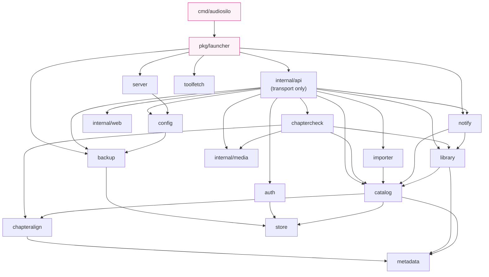

`audiosilo-server` is a self-hosted **audiobook server** written in Go. It serves a
JSON API, the admin console and the connect page baked into the binary, and the
separately built player at `/web`. It is designed to be **safe for inexperienced
users to expose to the internet**, with secure defaults, no default passwords,
app-layer hardening and configurable TLS.

Module path: `github.com/kodestar/audiosilo-server`.

## Design priorities (in order)

When two concerns conflict, the earlier one wins:

1. **Safe to expose to the internet.** Hashed secrets, rate limiting, strict CSP
   and path-traversal defenses. See [Auth & security](auth-and-security.md).
2. **Fast regardless of library size.** FTS5 full-text search and keyset
   pagination keep the cost of a page from growing with how deep a client pages
   into the catalog. See [Data model](data-model.md).
3. **No-wait first connection.** The filesystem view (`GET /libraries/{id}/fs`)
   needs no prior indexing, so a freshly connected client can browse at once
   while the scanner works in the background. See [Scanner](scanner.md).
4. **Portable.** The filesystem is the source of truth for content. The SQLite
   database is a **rebuildable** index and cache. Content is never stored only in
   the DB, and durable user state survives a full index rebuild.

Priority 4 underpins the workspace-wide invariant that **the path is the
identity**. Content is addressed by `(library_id, rel_path)`, never by a database
id (see [Architecture invariants](../architecture/invariants.md)).

## Package layout

```text
cmd/audiosilo/        entrypoint (flag wiring)
pkg/launcher/         PUBLIC run loop
pkg/match/            PUBLIC fuzzy book matcher
internal/config/      YAML + env config
internal/store/       SQLite open + migrations
internal/auth/        users, tokens, auth codes
internal/catalog/     the data layer
internal/library/     fs view + scanner
internal/metadata/    tag/ffprobe extraction
internal/media/       streaming + covers
internal/chapteralign/ fits community chapter lists onto a book's audio
internal/chaptercheck/ background community chapter checks
internal/toolfetch/   ffmpeg/ffprobe download
internal/metamirror/  metadata mirror mode's local copy
internal/coverage/    optional daily report of unknown ASINs
internal/upcoming/    daily series release and missing-volume checks
internal/diskspace/   free disk space per OS
internal/api/         HTTP transport
internal/server/      HTTP(S) server + TLS
internal/updates/     the update check (GitHub Releases)
internal/logring/     in-memory log ring for the console
internal/backup/      database backups + restore at start
internal/notify/      event feed + webhook/ntfy/Discord
internal/importer/    listening imports from Audiobookshelf
internal/web/         baked-in web UI
testdata/library/     M4B test fixtures
```

### `cmd/audiosilo`

The binary entrypoint. It only parses flags (`--data`, `--ffprobe`, `--ffmpeg`,
`--setup`) and delegates everything to `pkg/launcher.Run`. Keep it thin. Any
startup logic belongs in `pkg/launcher`.

### `pkg/launcher` (public)

The run loop loads the config, opens the store and wires the services. It then
runs the first-run bootstrap: the auto-admin banner, or the token-guarded
`/setup` page in setup mode. The console's first-run flow takes over after
either. Next it syncs the libraries the config declares, starts the first
background scan, and serves until the context is cancelled.

Before the database opens, `Run` applies a restore an admin asked for
(`backup.ApplyPendingRestore`). After that it starts the backup schedule, the
notification workers and the daily retention (sessions, audit log, event feed,
dead cast and pairing tokens).

`resolveTools` picks the ffmpeg and ffprobe binaries, in this order: an explicit
path, a copy next to the executable, `$PATH`, and only then a download through
`internal/toolfetch`.

The launcher is not an embedding API. `Options` holds only what the command's
flags set, and it overrides no configuration (see
[Configuration](configuration.md#launcher-options-for-embedders)).

### `pkg/match` (public)

A fuzzy **same-book matcher** (`Best`, `CleanTitle`, `SeqFromTitle`,
`Normalize`, `NormalizeSeries`, `Fold`) that identifies the same book across
messy, inconsistently tagged titles. The server uses it for:

- the admin catalog's author and narrator merge keys;
- the community match search's title cleaning and comparison;
- the listening import's title tier (`internal/importer`).

`Fold` is the Unicode-aware sibling of `Normalize`. It lowercases, keeps every
script's letters and digits, and drops spacing and punctuation. `Normalize`
keeps ASCII only and is unchanged. `NewIndex` prepares a candidate list once for
many `Best` calls (the listening import's per-author pools). `scan.go` holds
hand-written scanners for the package's title patterns, and `scan_test.go`
checks them against the regular expressions they replace.

`BestWith` is `Best` under opt-in `Options`, and it also returns the winning
score (`ScoreASIN`, 10, for an ASIN match). The zero `Options` gives `Best`'s
behaviour, which every server caller keeps. `ImportOptions()` turns on every
rule. It is meant for matching a store's whole catalog onto a library where both
sides are mostly right but spelled differently. Only the Bridge's Audible
matcher uses it (see
[the Bridge's matching rules](../bridge/audible.md#matching-rules)).

| Option | Rule |
|---|---|
| `SeriesMarker` | a candidate title with no position confirms the query's number when it names its place right after the series, `<series>[ Series][,:-( ]Book N` ("Iron Will: Dragon Heart Series, Book 2" is Dragon Heart 2). It only confirms, never vetoes; "Book 1-3" is no marker |
| `ExactTitle` | the same title by the same person (case, spacing, punctuation, bracketed groups and edition words aside) adds a bonus to the pair's score that clears the match threshold on its own. So it matches across differently named series, and the series and number still rank two same-titled candidates. Not when a side's title is just its series name and number, which every volume shares |
| `WordlessFallback` | a cleaned title left with no word and no digit ("The" of "The Mayor of Noobtown" in series "Mayor of Noobtown") falls back to the uncleaned one. When a candidate's title is just its series name and the query has a number, the numbers must agree (a candidate with none counts as 1) |
| `DropUnabridged` | "(Unabridged)" is removed before a genre tail is judged ("The Primal Hunter 15: A LitRPG Adventure (Unabridged)" is volume 15) |

### `internal/coverage` and `internal/upcoming`

`coverage.Runner` sends the opt-in daily report of unknown ASINs while community
metadata and `metadata.report_unknown` are on. In mirror mode it waits for the
local copy before checking which identifiers are unknown; the report itself
still goes to the service. A service that does not offer reporting is left
alone for seven days. See [Community metadata](/users/admin/server#community-metadata).

`upcoming.Runner` checks the community database for preorders, recent releases
and missing volumes in the series the server holds, while metadata and
`upcoming.enabled` are on. It runs on a daily schedule and refreshes the
affected series after library changes. Its first run records a baseline and
announces nothing; later runs announce newly released books. The API filters its stored rows to the caller's scope.
See [Upcoming releases](api/reference.md#upcoming-releases).

### `internal/config`

YAML config (`config.yaml` in the data dir) plus `AUDIOSILO_*` environment
overrides, validation, and secure defaults. Owns the `TLSMode` enum
(`off`/`selfsigned`/`autocert`), the `Demo` config, `AppLinkConfig` for the
native deep-link association files, and `WebDir`. See
[Configuration](configuration.md).

### `internal/store`

Opens SQLite through the build's engine (`engine*.go`):

- By default, `modernc.org/sqlite`. It is pure Go, so the binary is CGO-free
  and cross-compiles anywhere.
- A cgo build with `-tags "sqlite_native sqlite_fts5 sqlite_preupdate_hook"`
  uses the native C SQLite through `mattn/go-sqlite3` instead.

[SQLite choices](data-model.md#sqlite-choices) says which builds ship which
engine. The store applies the embedded, append-only migrations in
`internal/store/migrations/`. On Unraid's shfs the readers map the file
([Database](configuration.md#database-database)). See
[Data model](data-model.md) for the schema and the SQLite rationale.

`store.DB` routes reads and writes to separate pools: a single-connection
writer, and a read-only reader pool over WAL. Both pools keep each connection's
statements prepared (`stmtcache.go`). It also provides:

- `WithTx`, with slow-transaction logging;
- `ContentGeneration`, the content generation. It moves after every write has
  finished, except a user-state write. Three caches key on it: the API's
  [list answer cache](#the-list-answer-cache), the
  [token cache](auth-and-security.md#tokens-session-pairing-and-api-keys) and
  `catalog.GetLibrary`'s [library cache](#internalcatalog).

Every write must go through one of these, or the caches serve stale rows:

- `ExecContext` or `WithTx`;
- their durable forms `ExecDurable` and `WithDurableTx` (see
  [SQLite choices](data-model.md#sqlite-choices));
- their user-state forms `ExecUserState` and `WithUserStateTx`.

A user-state write (`store/userstate.go`) is listening and housekeeping data
that no content cache reads:

- a progress save, a listening session, history, bookmarks and notes, ratings,
  the queue and reading progress;
- the console's bell and the community metadata cache;
- a token's last-seen touch (the token cache drops the touched row itself);
- the Bridge's heartbeat, and its job reports' lease and progress;
- the unknown-ASIN report's lookups (`unknown_asin_reports`).

A user-state write leaves the generation where it was, unless it changed a row
outside its table's rule in `userStateTables`. For example, a progress row that
is added, removed or re-keyed moves the generation, because the Health summary's
duplicate ranking reads those keys. An `unknown_asin_reports` row added or
removed, or its `unknown` answer changed, moves it too, because Health's
`unknown_asin` kind reads them. A lookup that only renews `checked_at` or
`sent_at` does not. SQLite's pre-update hook does this check, so
a misfiled write only empties the caches.

`store.GenMap` is the small map the token cache and the library cache use. Its
entries all belong to one generation. The caller takes the generation before its
read, and a newer generation empties the map. The generation sees only this
process's writes, so the token cache also reads a row again once it is a minute
old (see [The per-request lookup and its cache](auth-and-security.md#the-per-request-lookup-and-its-cache)).

### `internal/auth`

Accounts and credentials: argon2id password hashing (`hash.go`), opaque
SHA-256-hashed bearer tokens (session, pairing, API-key and cast kinds), and redeemable auth
codes (invite and recovery kinds) with atomic redemption. It also owns the admin
safety guards (`ErrLastAdmin`, `ErrAdminNeedsPassword`) and the demo-account
reaper queries. See [Auth & security](auth-and-security.md).

### `internal/catalog`

The data layer over the store. Handlers call into this package, and it is where
catalog business logic belongs. It holds:

- libraries, books, files and chapters, FTS search and keyset-paginated listings;
- per-user listening state: progress, bookmarks, notes, history and favourites;
- filesystem-based shares and the `Scope` authorization model;
- folder-detection overrides and path-keyed enrichment;
- admin metadata overrides, layered onto the index as effective values
  (`overrides.go`, `refreshEffective`), and custom covers;
- the admin catalog queries (`adminbooks.go`, `bookdetail.go`);
- listening sessions derived from progress saves, and their retention
  (`sessions.go`);
- the admin Activity stats (`activity.go`) and progress edits
  (`progress_admin.go`);
- the admin audit log (`audit.go`);
- notification destinations and the event feed (`notify.go`);
- the rows of listening imports and their one-transaction apply and undo
  (`imports.go`);
- `MoveDurableState` (move-tracking).

`GetLibrary` answers from a library cache (`Catalog.libs`, a `store.GenMap`,
`catalog/librarycache.go`) while nothing has been written since it read the row.
It hands each caller its own copy. Every path-addressed request reads its
library twice (its scope, then the library itself), so with the cache a cover or
a stream skips both queries between writes.

### `internal/library`

Two filesystem subsystems:

- `fsview.go`: instant, index-free directory browsing through `BrowseFS`, plus
  `SafeJoin`, the path-traversal gate that every user-derived filesystem access
  must pass.
- `scanner.go`: the background scanner that builds the index. It covers
  discovery, book detection, metadata enrichment, chapter normalization, move
  detection and pruning. `scanread.go` reads several files at once while the
  scanner writes the index in order.

See [Scanner](scanner.md).

### `internal/metadata`

Metadata extraction:

- Embedded tags, read in-process through `dhowden/tag`.
- Durations, chapters and codec, when ffprobe is available. For MP3, MP4, FLAC,
  Ogg and MKA the package reads them in-process by the rules of the configured
  ffprobe's release (`fastprobe*.go`, the
  [in-process probe](scanner.md#the-in-process-probe)). ffprobe itself reads any
  file the probe is unsure of (`probe.go`).
- The release date (`ReleaseDate`, a date tag as `YYYY[-MM[-DD]]`).
- `DeriveFromPath`, the structural path heuristic that fills gaps for untagged
  files (`Author/Series/01 - Title.m4b`). A lone folder above the book is its
  author (`Author/Title.m4b`).

`layout.go` reads a path's author, series and book layout (`ReadPathLayout`, the
community match's path facts) and turns it into a path-first library's values
(`FromPathLayout`). The package also defines the normalized `metadata.Chapter`
shape (with `file_path` and `book_offset`), which makes single-file and
multi-file books look identical to clients. Every ffprobe path degrades
gracefully when the tool is absent.

### `internal/names`

Reads the people in a single Author or Narrator credit. The export, the merge
suggestions and the sort use it.

- `Split` applies the deliberately cautious co-credit rule. `;`, ` & ` and
  ` and ` always split. A comma splits only when every part is a full name, so
  "Alexandre Dumas, pere" stays one person.
- `Reversed` reads "Surname, Given", particles included ("Le Guin, Ursula K.").
- `SortKey` puts the surname first, for the admin list's `surname` sort.
  `internal/catalog` registers it, memoized, as the SQL function `name_sort`.
  No migration, index or view uses that function.

### `internal/media`

Serves audiobook bytes:

- `ServeFile`: HTTP Range support through `http.ServeContent`, with a
  byte-sniffed audio `Content-Type` so strict players such as iOS AVPlayer
  accept the stream.
- `Transcode`: an on-the-fly ffmpeg pipe to MP3 for codecs browsers can't
  decode.
- `DirectPlayable`: the codec allow-list that clients use to decide whether to
  request `?transcode=1`.
- `EmbeddedCover` extraction.

See [Media & streaming](media.md).

### `internal/covercolors`

The background cover colour pass. Its `Runner` reads the colour of every book
whose cover may have art and has no colour stored for it
(`catalog.CoverColorsDue`), one book at a time. It runs once the start, or a
burst of book changes, has been quiet for 30 s, and then hourly. It does no
image work itself. `api.colorCover`, the cover endpoints' own reading, is handed
in as its `Colorer`. See
[The background colour pass](media.md#the-background-colour-pass).

### `internal/chapteralign` and `internal/chaptercheck`

These implement [Community chapters](community-chapters.md).

- `chapteralign` is the pure fit of a community recording's chapter list onto a
  book's own files and chapters: anchors by title and time, proportional
  placement, and snapping to pauses. It does no I/O of its own.
- `chaptercheck` is its `Runner`. It makes a background pass every 10 minutes,
  and on a `Kick` after any book change (through `Catalog.OnBookChange`). It
  also checks one book on request. It fetches the list through `internal/meta`,
  finds pauses with ffmpeg (`media.DetectSilences`) and records the outcome
  through `catalog`.

### `internal/metamirror`

Mirror mode's runner (`metadata.mode: mirror`). Once a day it downloads the
community metadata database from audiosilo-meta's data releases on GitHub
(through audiosilo-meta's public `pkg/release`) into a local copy in
`<data>/meta-mirror/`. It serves metaserve's own JSON API handler (`pkg/query`)
over that copy. `internal/meta` puts it in front of the remote service
(`meta.Service.SetMirror`), and the remote service still answers whatever the
copy can't.

The launcher builds the runner only in mirror mode
(`pkg/launcher/metamirror.go`) and hands it to the API with `API.SetMetaMirror`
right after `api.New`. `Run` opens the copy in the background, then checks for
a new release on its schedule. A server started in remote mode deletes the
folder.

- `internal/mirrortest` is its test support, used by tests only: data releases
  on audiosilo-meta's public `pkg/release/releasetest` fake GitHub, and a
  counting remote service.
- `internal/diskspace` is the free-space reading that the mirror's disk guard
  shares with the library disks on Health > System.

For the behaviour, the schedule and the fallback, see
[Mirror mode](configuration.md#mirror-mode-metadatamode-mirror).

### `internal/toolfetch`

Downloads a static ffmpeg and ffprobe build on demand and caches it in
`<data>/tools` when no local copy is found. The download uses HTTPS, and the
package checks the binaries by running `-version`. Offline, it degrades
gracefully and retries on the next start. Only `pkg/launcher.resolveTools`
consults it, after every local lookup fails.

### `internal/api`

HTTP transport **only**:

- routing (`api.go` is the full route table);
- middleware: auth, CORS, security headers, real-IP and timeouts;
- rate limiting (`ratelimit.go`), per address and then per credential;
- the book lists' answer cache (`listcache.go`);
- the `handlers_*.go` files.

See the [API introduction](api/index.md) and the
[API reference](api/reference.md).

#### The list answer cache

These routes keep their encoded answer (`api/listcache.go`):

- `GET /libraries/{id}/books`, `GET /books/recent` and `GET /search`;
- a books library's browse lists, `GET /libraries/{id}/authors`, `/narrators`
  and `/series` (through `browseList`). A podcasts library's lists skip the
  cache, as its `/books` does.

The key is the path, the raw query string (so `?memberships=1` is its own
entry) and the caller's scopes.

**When it empties.** Entries are stored under the database's content generation
(`store.DB.ContentGeneration`). The generation moves after every content write
finishes, durable, failed and no-op writes included, so any content write
empties the cache. A user-state write leaves the cache warm, because no cached
answer reads what it changes. Examples are an update to a book's existing
progress, a heartbeat, a token's last-seen touch, and a Bridge job's lease or
progress report. A book's first progress save adds a row, so it is a content
write. As a result, the cache never serves an answer older than the content it
was computed from. The handler reads the generation before the request's first
read, so it never stores an answer under a generation newer than its data.

**Compression.** Each entry of at least 1 KiB keeps the answer's gzip beside its
JSON, made once when the entry is stored. A hit sends the gzip to a client that
accepts it (`writeCachedJSON`; see
[Response compression](api/index.md#response-compression)), so a hit compresses
nothing.

**Size.** The cache holds 8 MiB, counting each answer's JSON, its gzip and its
entry. One answer can take at most 1 MiB. The least recently used entry goes
first.

**What may use it.** Only an answer that is a pure function of the database, the
query and the scopes. A list book carries no per-listener field, and a handler
that adds one must stop using the cache.

**The admin console's lists** use it as well:

- the first pages of `GET /admin/books`;
- `GET /admin/books/facets`, keyed like a list but without scopes, because an
  admin sees every book;
- the Health summary `GET /admin/issues`.

The summary's key also takes the kinds it counts and the libraries that are
offline right now. The server finds those with a filesystem probe made before
the lookup, and keeps the probe's answer for up to 15 seconds. A root that goes
away therefore shows within 15 seconds, with no write. Uncached, the summary and
the facets take about 100 ms each on a 5,000-book library. From the cache they
take about a millisecond.

### `internal/server`

The HTTP(S) server itself:

- TLS modes: `off` for reverse proxies, `selfsigned`, and `autocert` (Let's
  Encrypt);
- home HTTP on the self-signed port (`splitListener` and `homeHTTPGate`; see
  [Home HTTP](configuration.md#home-http-tlshome_http));
- graceful shutdown.

`Certificates` reads the served certificates back from their files for
Health > System.

### `internal/updates`

The update check behind the console's Server > About. While `update_check` is
on, `Checker` asks GitHub Releases for the latest release once a day, and on
"Check now" at most once a minute. The request is conditional on the last
`ETag`, and `Checker` compares the versions. `pkg/launcher` starts it. See
[Update check](configuration.md#update-check).

### `internal/logring`

A `slog.Handler` that `pkg/launcher` wraps around the server's logger. Every
record still goes where it went before. Records at info and above are also
copied as plain text into a `Ring` that keeps the newest 2000. The handler
redacts attributes whose key names a secret and cuts long values.
`GET /admin/logs` queries the ring for the console's Server > Logs. Nothing is
written to disk.

### `internal/backup`

Database backups for Settings > Backups:

- `VACUUM INTO` copies into the backups folder, on a daily or weekly schedule
  and on request;
- retention of scheduled backups;
- restore. The package checks the backup and leaves a marker. At the next start,
  `ApplyPendingRestore` makes a safety copy and then applies the restore.

See [Backups, audit log and notifications](backups-and-notifications.md).

### `internal/notify`

Records server events in the feed that the console's bell reads: new books, a
failed scan, an offline library, a sign-in, a used invite, an update and a
failed backup. In the background it delivers them to webhook, ntfy and Discord
destinations, with signed webhooks, retries, no redirects and nothing secret in
a message. See
[Notifications](backups-and-notifications.md#notifications-internalnotify).

### `internal/bridge`

The server's side of the optional [Bridge](../bridge/index.md). The server never
connects to the Bridge; this package only answers it.

- `status.go` holds the Bridge's last heartbeat: validated, one row, the online
  rule, and the `features` the capability carries.
- `jobs.go` is the job queue: the kinds the server knows and their params, the
  dedupe on open jobs, claims with a 2-minute lease, reports bound to the
  claim's attempt, lease expiry, cancel, and `OnTransition`, which the API wires
  to the notifications.
- `estimate.go` costs a `sidecars.generate` run from the heartbeat's figures.

Other packages handle the Bridge's generated `.audiosilo/` files. The scanner
reads them (`library/attachments.go`), the catalog stores them
(`catalog/attachments.go`) and `meta.Answer` lays them into `/meta`
(`meta/generated.go`). Pairing and the bridge token are in `auth/bridge.go`. See
[Pairing and jobs](../bridge/pairing-and-jobs.md).

### `internal/modules`

The [managed modules](modules.md) framework:

- `Module`: an id that is also its capability flag and config key, the Bridge
  feature it needs, its routes and its background work;
- the `Registrar` that its routes mount through;
- `Deps`;
- `Validate`, which the launcher runs before starting;
- `Module.BridgeState` and `Active` (the flag);
- the `Runner` that starts and stops each module's background work.

The registry is `internal/modules/builtin` (`contributions` and `podcasts`). The
API mounts each module's routes behind its toggle (`404 module_off`), syncs the
`Runner` after every settings save, and advertises each module's flag
(`api/modules.go`). The launcher stops the `Runner` at shutdown.

### `internal/importer`

Listening imports from Audiobookshelf (admin only in v1), so someone moving to
AudioSilo keeps their history. The package holds:

- the read-only ABS client (`abs.go`). It checks `/status` before it sends the
  token, follows same-host redirects only, caps response sizes and returns fixed
  error sentences.
- the normalised payload kept on the import (`payload.go`);
- the path, ASIN, ISBN and title matcher (`match.go`), which uses
  `pkg/match.Best` for the fuzzy tier;
- the pure planner that the review and the apply share (`plan.go`);
- the `Service` that runs the background fetch, the cutoff change, the apply and
  the undo (`service.go`).

The rows belong to `catalog` (`imports.go`). The token never leaves the running
fetch's memory. `abstest/` is a fake ABS that serves recorded responses, for
tests. See [Listening imports](data-model.md#listening-imports) and the
[routes](api/reference.md#admin-listening-imports).

### `internal/web`

Serves the browser UI baked into the binary:

- the connect and setup pages: plain HTML, CSS and JS with no build step,
  embedded in the binary;
- the admin console at `/admin` (package `internal/web/adminui`): a React app
  built from `admin-ui/` into `adminui/dist` by `scripts/build-admin.sh`, then
  embedded;
- the mount that serves the **player** (the separate audiosilo-frontend export)
  at `/web` from `web_dir`.

It owns the CSP policies: the strict site-wide one, the per-document `htmlCSP`
for the player, and `readerCSP` for the player's reader document. See
[Web UI](web-ui.md).

## Dependency direction



Rules of thumb:

- Everything DB-backed goes through `internal/store`; nothing else touches SQL
  connections directly.
- `internal/media` and `internal/web` are leaf packages. They know nothing
  about the catalog or auth.
- `pkg/match` is deliberately dependency-free of the rest of the server.

## `api` is transport-only

The single most important layering rule is to **keep business logic out of
handlers**. `internal/api` decodes requests, enforces auth and scope, calls into
`auth`, `catalog`, `library` or `media`, and encodes responses. It does nothing
more. Logic placed in the non-`api` packages stays unit-testable without an HTTP
harness, and future non-HTTP surfaces can reach the same logic. For example, the
planned WebSocket layer must reuse `catalog.SaveProgress`'s last-write-wins
merge.

If you find yourself writing a loop, a merge rule, or an SQL query inside a
`handlers_*.go` file, it belongs in `catalog` (or `auth`, `library`, `media`)
instead.

## Tests {/* #test-landscape */}

Every feature ships with a test (see
[Gates & CI](../contributing/gates-and-ci.md) for the full gate):

- **Handler and integration tests** use the `newTestEnv` harness in
  `internal/api/api_test.go`. It provides a file-backed SQLite store from
  `storetest.Open(t)` (migrated once per test binary, copied per test), a
  seeded admin and auth code, and the real `testdata/library` fixtures: tiny
  generated M4B files under author and series folders.
  `newTestEnvWith` accepts a config mutator for routes registered at build time,
  such as the demo root redirect.
- **Pure-logic tests** sit next to the code: `internal/api/middleware_test.go`,
  `internal/catalog/shares_test.go` and `catalog_test.go` (with its own
  `newTestCatalog`), `internal/web/web_test.go`, and so on.
- A few scanner tests need `ffprobe` on the machine; without it they `t.Skip`
  (CI installs ffmpeg).
- The in-process probe is checked against ffprobe's answers over a fixture
  corpus; see
  [Gates and CI](../contributing/gates-and-ci.md#the-in-process-probes-fixtures).
- **Security-critical code requires both an allowed and a denied regression
  test.** The enumerated list is in
  [Auth & security](auth-and-security.md#the-allowed--denied-test-rule).

Full gate, run from the repo root before calling any change done:

```sh
scripts/build-admin.sh   # admin console: npm ci + check + build (when admin-ui/ changed)
go build ./... && go vet ./... && go test -race ./... && golangci-lint run
```
