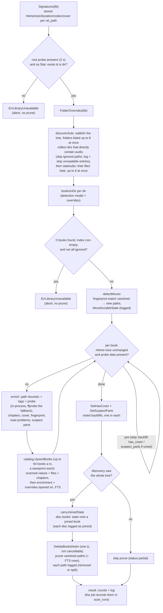

`internal/library` contains two complementary subsystems:

- **`fsview.go`**, the instant filesystem view. `BrowseFS` lists a real
  directory with **no prior indexing**, which is what lets a client browse
  on its first connection without waiting for a scan (design priority #3).
- **`scanner.go`**, the background `Scanner`. It builds and maintains the
  index (`books`, `book_files`, `chapters` and `books_fts`) that the computed
  views, search and rich metadata come from. Around it sit:
  - the scan job queue and the scheduler (`jobs.go`, `schedule.go`);
  - per-library ignore rules (`ignore.go`);
  - what a scan notices for the console's Health page (`problems.go`).

The two meet in the API layer. Browsing works at once from the raw tree, and
the API overlays index metadata on the entries as the scan (or on-demand
indexing) catches up.

## Podcast libraries

`Scanner.Scan` branches on `libraries.kind` before book detection.

A kind this server doesn't know (`catalog.KnownKind`) is never scanned as
books. Such a kind belongs to a newer server and was left by a rollback. The
scan fails with `library.ErrUnknownKind` and is recorded as a failed run. A
targeted index refuses any library that isn't `books` (`resolveBook`,
`ErrNotIndexable`).

### Scanning a podcast library

A podcast scan lists the real, non-hidden top-level show directories. It reads
each show's `feed.json` (a regular file, up to 32 MiB, version 1) and indexes
its episodes, with or without audio files.

- A `feed.json` of an unsupported version is skipped and logged.
- An invalid episode entry is skipped on its own.
- The scan never probes audio for podcast metadata.
- Loose audio outside `feed.json` is not discovered as a book.
- None of the book steps run for this branch: no tag or path precedence, no
  Audiobookshelf import, no community enrichment, no book health analysis and
  no book move detection.

**The show signature** combines the feed's size and mtime with the listings of
the show folder and its `.audiosilo` folder, including the audio, CHAP and
publication journals. So the scan notices a change to those files even when
the feed's stat is unchanged. A refresh observes regular file presence, sizes,
artwork, barriers and matching CHAP, then updates the show and episode index
atomically.

An unchanged signature skips the show only while its episodes are still
indexed:

- A show with fewer `podcast_episodes` rows than its `feed.json` listed is
  indexed again (`PodcastEpisodeRows`). This covers a rollback: an older server
  run on the same database scans the library as books and drops the episode
  rows, while the show keeps its signature.
- A row counts only while its `indexed_at` (`0073`) equals its books row's. So
  a row that the older scan rewrote in place counts as missing too.
- Each podcast scan then deletes the books rows that are not episodes
  (`PruneNonEpisodeBooks`). These are what such a books scan left, for example
  a folder book at a show path.

A targeted `POST /bridge/rescan` forces that refresh for a show path, or for an
indexed episode path that belongs to a show. It returns
`{path:<show>, episodes:N}`. It refuses `attachments` mode and `from`, and a
path with nothing indexable gives `404 not_indexable`.

### Browsing and playing episodes

`BrowsePodcasts` serves `/fs` from the index:

- shows at the root, and episode titles inside a show;
- serial shows oldest first, episodic shows newest first;
- `feed.json` and artwork are never browse entries;
- private-show scope applies before pagination, and a granted library with no
  visible shows gives an empty listing.

`/item`, `/chapters` and `/stream` never index podcast audio on demand.
Episodes without files stay indexed and have empty chapter lists. A scoped
stream request shares a Bridge fetch and waits at most two seconds for a
committed file. Otherwise it returns a 503 with the fetch status (see
[On-demand play](../bridge/podcasts.md#on-demand-play-and-shared-intents)).

An episode's file counts as present only when all of these hold:

- its Fetch is valid;
- it is regular audio of its expected size;
- `deleted_at` is empty;
- there is no `<stem>.publish.json` barrier.

An invalid Fetch leaves an episode unready, and a symlinked or malformed
journal also blocks it. The server never adopts loose audio added by hand.
A present file uses Fetch's probed duration and codec. Otherwise the episode
takes the feed's duration (or zero) and a size of zero. `OpenPodcast` also
checks the current feed, identity and size, and that the opened file is the
named one. It keeps that descriptor through serving and transcoding, and does
not hash during requests.

### Episode chapters

`<show>/.audiosilo/<stem>.chapters.json` goes through
`metadata.ParseChapterList`. It must carry `from:id3_chap` and the current
Fetch timestamp, and its single basename, size and duration must match. The
scanner uses its times directly, without the book path's generated-chapter
filling or alignment.

- Usable CHAP sets `chapters_source:id3_chap`.
- Present audio without usable CHAP gets one whole-file chapter.
- Absent audio gets empty chapters and files.
- A bad sidecar is logged safely and the scanner falls back.

The scanner synthesizes a single-file episode's files from the Book row, with
no redundant `book_files` rows. Eviction clears the derived presence, files and
chapters but keeps the episode and its durable state. A full index rebuild
reconstructs them from the feed, the committed audio and CHAP.

### What survives

Follows, per-show retention policies and listening state are durable state.
They survive show pruning and index rebuilds.

- The unavailable-root guard keeps the index when the root is unreadable, or
  empty after it held shows.
- A partial scan does not prune.
- Do not rename show folders by hand, because the feed's episode paths include
  them.

See [Podcasts](../bridge/podcasts.md#files-on-disk-feedjson-v1) for the file
contract.

## The filesystem view (`BrowseFS`)

`library.BrowseFS(root, relPath, offset, limit, allow, ignore)` lists one directory:

- The path goes through `SafeJoin` first, the traversal and symlink gate (see
  [Auth & security](auth-and-security.md#path-traversal-librarysafejoin)).
- **Dotfiles are hidden**, and **non-audio files are filtered out**. Only
  directories and `metadata.IsAudio` files remain, so anything a client can
  click is either navigable or playable. `.jpg` and `.nfo` files never reach
  the UI.
- The optional `allow` callback filters entries **before pagination**, so pages
  stay full. For non-admin callers the API passes `Scope.VisibleInBrowse` here,
  which scopes the tree to their shares.
- Entries that the library's [ignore rules](#ignore-rules) cover are left out
  too (`Ignore.Covers`, also before pagination). The browse view never shows
  what the scanner skips.
- An `.mka` beside a file of the same name in another audio format is left out
  (`library.shadowedMKA`). `folderAudio` uses the same rule to keep it out of
  the book (see
  [Recognized audio](media.md#recognized-audio-metadataaudioextensions)). A
  lone `.mka` stays. `ListDir`, the listing behind `/next`'s folder fallback,
  applies the same rule.
- Directories sort before files, and each group sorts in **natural order**
  (`naturalLess`), so `2` lists before `10`. This is the order a folder book's
  files play in (see [Book detection](#book-detection-booksindir)). The order
  used to be by lowercased name, byte by byte.
- Pagination is plain offset-based (default 200, cap 500). That is fine here
  because a single directory is small. The catalog-wide listings must use
  keyset cursors instead.
- Only files get a per-entry `stat` (for `size` and `mod_time`). Directories
  skip it. On a network mount, that saved round trip per entry is the
  difference between an author listing that returns at once and one that takes
  several seconds.

### The hybrid view

The handler (`handleBrowseFS`, then `annotateWithBooks`) overlays index data on
the listing:

- Paths that match indexed books (via `catalog.BooksByPaths`) get
  `is_book: true` plus title, author, series, series index and duration.
- Each entry carries its effective folder-detection `override`, so the admin
  console's folder detection dialog can show and change it.
- For an **admin** caller only, a folder whose indexed books are the discs of a
  [disc set](#joined-books-disc-sets) not yet joined is marked
  `split_discs: true` (`catalog.SplitFolders`, from `books.split_parent`;
  `omitempty`). That is where the console offers the join. A member's listing
  never carries the key, so the player's wire is unchanged.

### Pending books

Last, for every caller, `library.MarkPendingBooks` marks `pending_book: true`
on each folder that a scan would read as a book but the index doesn't hold yet.
The rule and the wire shape are in the
[API reference](api/reference.md#get-apiv1librariesidfs).

`pendingBook` asks `resolveBook`'s questions from directory reads alone, in
this order:

1. Is there a `collection` override?
2. `hasAudio`: one read of the folder.
3. `joinRoot`, for a disc set under a `book` override. Only then does it walk
   with `audioDirs`, capped at 200 folders.

It skips:

- a folder the caller's scope doesn't `Allow`;
- a folder with an indexed book at or below it (`catalog.FoldersHoldingBooks`).
  This takes one query for the page and two index seeks per folder, so an
  indexed library's author and series folders cost no disk read. Such a folder
  that holds audio of its own stays unflagged until a scan indexes it;
- everything, once its 2-second budget (`pendingTime`) or the request's context
  runs out.

A failed read of the folder overrides or of the index (`BooksByPaths`,
`FoldersHoldingBooks`) marks nothing. The player opens such a folder as a
book, which [indexes it on demand](#on-demand-indexing-indexpath).

## When scans run

Every full scan goes through **one job queue** (`internal/library/jobs.go`).
A scan of a library runs when:

| Trigger | `trigger` value | Where |
|---|---|---|
| Server startup (every library, once) | `startup` | `Scanner.EnqueueAll` from `launcher.Run`, after `Scanner.Start` |
| The library's scan schedule says it's due | `schedule` | the scheduler goroutine (see [Scheduled scans](#scheduled-scans)) |
| Admin "Rescan" | `manual` | `POST /admin/libraries/{id}/scan` |
| A newly created library, including the one the console's first-run flow adds and the one an old-style `POST /setup` with library fields adds | `manual` | `POST /admin/libraries`, `POST /setup` |
| Admin "rescan every library" | `manual` | `POST /admin/scan` (`Scanner.EnqueueAll`) |
| A library's root or ignore rules changed | `change` | `handleUpdateLibrary` |
| A folder override set or cleared | `change` | `handleSetFolderOverride` / `handleDeleteFolderOverride` |
| A single path, on demand | - (not queued) | `Scanner.IndexPath` from any content handler, and `POST /admin/libraries/{id}/book/rescan` (see below) |

On a library edit, only a change to the **root** or the **ignore rules**
queues a scan. A rename, a new default view or a new schedule doesn't touch
the index, so `PATCH /admin/libraries/{id}` does not rescan for those.

### The job queue

`Scanner.Enqueue(lib, trigger, startedBy)` adds a job and returns it. One
worker goroutine (`Scanner.work`, started by `Scanner.Start`) runs the queued
jobs **one at a time, first in first out**. Scans therefore never compete for
the disk or for SQLite's single writer connection, and different libraries do
not scan in parallel.

- **Coalescing.** Asking for a library that already waits returns the waiting
  job. Asking for a library that is **running** queues it to run once more
  after the current scan, because a setting changed mid-scan and the running
  scan may have read the old one. The exception is a `schedule` or `startup`
  scan: a second pass would see nothing new, so those return the running job.
- **Queued state.** A library's `ScanProgress.Queued` is read from the queue
  itself, so it is true as soon as `Enqueue` returns. A status poll made right
  after the request sees the scan even if it has to wait.
  - When the worker starts the job, the library reads as `running`, and still
    `queued` when another pass is lined up.
  - It stays `running` until the run's `scan_runs` row is written. A poll that
    sees the scan finished therefore finds its history finished too.
- **Each job runs the library as it is now.** The worker re-reads the library
  row, so it honours a rename or a new root made since the job was queued, and
  it skips a library deleted meanwhile.
- **Cap.** A scan that someone or something asked for runs under a one-hour
  timeout (`scanTimeout`). A scan that hits it is recorded as `failed`. The
  **startup** scan has no time limit (`jobContext`). It is a library's full
  index after a restart, and it runs to the end as it always has. Every scan
  ends with the server.
- **Cancel.** `Scanner.Cancel(id)` drops a queued job, or cancels the running
  one's context. A cancelled scan stops during the folder walk or at its next
  book, and **never inside the prune**:
  - It checks for a cancel just before pruning.
  - Once begun, the prune runs to the end as one transaction, on a context that
    ignores the cancel.

  So a stopped scan has removed nothing, and one that pruned records what it
  removed. The run is recorded as `cancelled`. Dropping a queued **scheduled**
  scan skips that slot (see [Scheduled scans](#scheduled-scans)).
- **Deleting a library** cancels its scans (`Scanner.CancelLibrary`). Its queued
  jobs are dropped and a running one is stopped, so they don't hold the queue.
- **Hung roots don't block the queue.** Before discovery, the scan asks the
  bounded root probe, the 2-second check behind `available` (see
  [Reporting it to the console](#reporting-it-to-the-console)). A root that
  doesn't answer stops the scan at the
  [unavailable-root guard](#the-unavailable-root-guard). An example is a
  hard-mounted NFS share whose server is gone, where a plain `stat` can block
  for minutes. The run is recorded as `unavailable`, and the next job runs.
- **One at a time, by construction.** `Scan` itself does not coalesce
  concurrent calls for the same library. The queue is what guarantees that a
  library is never scanned twice at once.
- **Memory only.** The queue is not persisted. A job still waiting when the
  server stops is lost, and the startup scans and schedules cover that.

`GET /admin/jobs` returns the running job (with its library's progress), the
queue and every scheduled library's next scan. `DELETE /admin/jobs/{id}`
cancels a job (see the [API reference](api/reference.md#get-apiv1adminjobs)).

### Scan history (`scan_runs`)

The worker records every job it runs in `scan_runs` (`catalog/scanruns.go`).
It calls `StartScanRun` before the scan and `FinishScanRun` after. Both use a
context that outlives the server's, so a run is closed even during shutdown. A
row holds:

- the trigger;
- who started it (`started_by`, `NULL` for a schedule or startup);
- the start and finish times;
- a status, counts and a log.

| Status | Meaning |
|---|---|
| `running` | the scan has not finished |
| `ok` | finished, including the prune step |
| `partial` | finished, but part of the tree couldn't be read, so pruning was skipped |
| `unavailable` | stopped at the [unavailable-root guard](#the-unavailable-root-guard); nothing pruned |
| `failed` | an error (including the one-hour cap); nothing pruned |
| `cancelled` | an admin stopped it; nothing pruned |
| `interrupted` | the server stopped mid-scan. `Scanner.Start` marks every run still open at startup this way (`InterruptScanRuns`) |

#### Counts

| Count | What it counts |
|---|---|
| `books` | books discovered on disk |
| `added`, `updated`, `moved`, `removed` | books in each state |
| `errors` | books whose files had a [read problem](#read-problems), plus index writes that failed |

- A moved or renamed book counts **once**, as `moved`. It does not also count
  as added at its new path or removed at its old one.
- A [joined book](#joined-books-disc-sets) and the discs it splits back into
  are reshapes of books the library had. Neither counts as `added`, so no
  "books added" notification follows. Neither the joined discs nor the
  split-up book count as `removed`.
- A first scan counts a book split across disc folders once in `added`, and
  once among the titles it names, not once per disc.

`ScanProgress` carries the same counters live (`added`, `updated`, `moved`,
`removed`). Its `indexed` is `added + updated`.

#### The log

The **log** is a JSON array of `catalog.RunEvent`. Each event has `at`, a
`level` (`info`, `warn` or `error`), a `kind`, and whichever of `path`, `to`,
`code`, `detail` and `count` the kind needs. The kinds are `started`,
`discovered`, `error`, `partial`, `truncated` (see [Bounds](#bounds)) and
these:

| Kind | Meaning |
|---|---|
| `unreadable` | a path that discovery couldn't read |
| `moved` | a book moved from `path` to `to` |
| `joined` | a disc book at `path` whose state was carried into the joined book at `to`. Code `length_unknown` when its listening state stayed on its own path ([Joined books](#joined-books-disc-sets)) |
| `split` | a joined book at `path` read as its discs again |
| `problem` | a read problem, with its `code` |
| `removed` | one per pruned path |

The job then adds one closing event from the run's status (`closingEvent`):
`finished`, `unavailable`, `failed`, `cancelled` or `interrupted`. The console
words each kind itself. `detail` is the tool's or the OS's own message, shown
as is.

#### Bounds

Two bounds keep the table small:

- **A log holds at most 300 events** (`maxRunEvents`). Past that, the scanner
  counts events, and one `truncated` line before the closing event says how
  many were dropped. Problems (`unreadable`, `problem`, `error`) may take at
  most half of the log (`maxProblemEvents`). So a library full of unreadable
  files can't crowd out the moves and removed paths logged after them. The
  problems are on the books too, while the removed paths are recorded nowhere
  else.
- **Only the newest 100 runs per library are kept** (`maxScanRunsPerLibrary`,
  trimmed by `FinishScanRun`).

Runs belong to their library and cascade with it.

### Scheduled scans

A library's `scan_schedule` (`library/schedule.go`, `ParseSchedule`) is one of:

| Value | Meaning |
|---|---|
| `""` | no scheduled scans (the default) |
| `every:<N>h` | N hours after the library's last scan **started**; N is one of 1, 3, 6, 12, 24 |
| `daily:HH:MM` | every day at that time, in the **server's** time zone |

When a library is saved, any other value is refused with `400`
`code: "invalid_schedule"`. A valid schedule is stored in canonical form
(`Schedule.String`), so `every:06h` is saved as `every:6h`, which is what the
console reads.

"The last scan" is the library's newest `scan_runs` row, whatever started it
(`LastScanStarts`).

- A manual rescan therefore pushes an interval schedule back.
- A server that was off when a daily scan was due runs it as soon as it is
  back.
- A library never scanned counts from when the scheduler started.
- A scheduled scan dropped without a run of its own counts as a scan start too
  (`jobQueue.skipped`). It was either cancelled while it waited or folded into
  a scan of the library already running. The scheduler then skips that slot
  instead of queuing it again a minute later.

`Scanner.NextScans` computes every scheduled library's next due time. It backs
`next_scan_at` on `GET /admin/libraries` and the `schedules` list of
`GET /admin/jobs`. The scheduler checks once a minute (`scheduleTick`) and
enqueues the due libraries with trigger `schedule`.

## Anatomy of a scan pass

### The unchanged-skip

A book is skipped when its stored mtime and size match **and** one of these
holds:

- ffprobe is disabled;
- a prior probe already stored both a duration and a codec.

The second clause is a backfill mechanism. Books indexed before the `codec`
column existed (migration `0008`) are probed again once, even though their
files haven't changed.

One more book passes the skip: a book with one audio file whose recorded
`unreadable` or `probe_failed` [read problem](#read-problems) names that file
(`soleFileProblem`; an `empty_file` problem doesn't count). Its only file was
never probed, so it has no duration or codec. `problemCleared` decides whether
to read it. While the problem is still there, the scan keeps the book like any
unchanged one, and still reads the metadata files beside it.

### Backfills for a skipped book

A skipped book can still get cheap backfills, each for rows indexed before a
given migration:

- **Embedded cover** (`has_cover` unset, a row indexed before migration
  `0016`). The scan checks the primary file for embedded art with a tag read
  (`media.EmbeddedCover`, no ffprobe) and notes the answer without re-indexing
  the book.
  - Only books that are really skipped are checked. A book re-indexed anyway
    gets its flag from the upsert.
  - A file that can't be opened right now (a flaky mount) is skipped. The flag
    stays unset for the next scan, rather than recording "no cover".
  - The noted flags are written in **one transaction** after the loop
    (`catalog.SetHasCover(ctx, libID, map[path]bool)`, which also counts a
    sibling `cover_path` as art). The first scan after the upgrade therefore
    stays cheap on a large library.
- **Several books in one folder** (a folder book indexed before migration
  `0017`). The same kind of tag-only check looks for
  [several books in one folder](#folders-that-may-hold-several-books)
  (`suspectFromTags`, written by `catalog.SetSuspectParts`).
- **Genres** (a book indexed before migration `0049`,
  `books.genres_checked = 0`). The scan reads the genre tag in the same one
  read of the primary file (tags and ffprobe) that the `0037` date backfill
  makes. `catalog.SetGenres` writes the genres into the book's scanned snapshot,
  flushed with the path readings. It re-resolves the book only when that
  changes it, since most books have no genre or only a placeholder.
- **Tag hints** (a book indexed before migration `0067`,
  `books.hints_checked = 0`). The scan reads its
  [tag hints](data-model.md#tag-hints) the same way (`catalog.SetTagHints`).
  It waits while ffprobe fails on the book, unless the book's last index
  already recorded that failure (`probe_failed`). Then it takes what the tags
  give.

#### Audiobookshelf `metadata.json`

A skipped folder book also has its **Audiobookshelf `metadata.json`** read
again when the file is new, changed or gone. ABS rewrites the file without
touching the audio, so the book's own signature can't tell.

- Discovery records each folder's file signature (`metadata.ABSSignature`,
  size and mtime) from the walk it already makes (`audioDirs`' `absFiles`, no
  extra directory read).
- `catalog.SetABSFiles` reads and writes a skipped book, in batches of 250
  beside the path backfill, when:
  - its signature differs from the stored one (`Signature.ABSSig`); or
  - it has a file not read for this index of the row (`ABSUnchecked`).
    `abs_indexed_at` is `NULL` after migration 0046, or an older server
    re-indexed the row.
- Migration 0049 sets every `abs_indexed_at` to `NULL` again. The first scan
  after it therefore reads each file once more for the fields the server now
  takes: subtitle, publisher, language, abridged, genres and tags.
- A book with no file, and none before, is left unwritten. The first scan
  after the upgrade touches only books that have one.
- A book is re-resolved unless its reading equals the one recorded for this
  very index. (An older server's re-index resolved the row without the file.)

A re-indexed book reads the file in `enrich` (`Scanner.readABS`) only when the
walk found one. An on-demand index has no walk, so it stats the file first
(`absSigAt`). The scanner reads the file only when it is a regular file, and
never through a link, including one swapped in after the walk.

- A file that can't be used (not JSON, too large, not a regular file) keeps its
  signature, so it isn't read again until it changes.
- A file that can't be read right now (gone since the walk, a flaky mount) is
  left as it was for a skipped book, and recorded as none by a re-index. The
  next scan reads it again.

Both cases log a warning. What the file means for a book's metadata is in
[Data model](data-model.md#metadata-overrides-and-effective-values).

#### Attachments

A skipped book's **`.audiosilo/` attachments** (the Bridge's generated
characters and recaps) are backfilled the same way, from the same walk (see
[The Bridge's attachments](#the-bridges-attachments)).

### Reading several files at once

A scan reads the books it has to index (new, changed, or missing probe data)
several files at a time, and writes the index in one place
(`library/scanread.go`):

- **Slots.** `readSlots` bounds how many audio files are read at once. Each
  read holds a slot: tags and the [in-process probe](#the-in-process-probe),
  then ffprobe for a file the probe leaves to it (`metadata.ExtractTimeout`).
  There are `scan.concurrency` slots, by default one per CPU up to
  `DefaultScanReaders` (8). See
  [Configuration](configuration.md#library-scans-scan).
- **Books read ahead.** Each book to index is read (`enrich`) on its own
  goroutine: its primary file first, then its other parts with the slots
  (`readFiles`). Reads run up to a window of twice as many books as slots ahead
  of the next book written.
- **One writer, in order.** The scan's own goroutine writes each book once its
  read is done, in discovery order (`writeNext`), on the one writer
  connection. The rows, their ids, the file order, the chapter offsets and the
  scan's log come out exactly as a scan reading one file at a time would write
  them.
- **Several books a transaction.** The books read wait in a batch, and
  `catalog.UpsertBooks` writes them together. A transaction's begin and commit
  cost about as much as a book's own writes: 0.6 of 1.5 ms a book on a
  synthetic library, 1.3 of 3.9 ms on a real one.
  - *When a batch is written.* A batch is written once it holds `writeBatch`
    (64) books, once the first book has waited `writeBatchAge` (250 ms), when
    the writer would otherwise wait on a read, or when the scan ends or stops.
    The writer never waits on a read while holding books. So a scan whose
    reads are slower than its writes (ffprobe on every file) still writes each
    book as its read is done.
  - *How long it holds the writer.* The same 250 ms is `UpsertBooks`' budget.
    A transaction takes another book only while it has run for less than that.
    A batch therefore holds the writer, and every other write (a listener's
    progress among them), no longer than that plus one book.
  - *A failure.* Each book is written under its own savepoint. One that fails
    is rolled back alone and logged, while the rest of the batch is written. A
    transaction that fails as a whole (its commit, say) has its books written
    again one at a time (`UpsertBook`).
- **Stopping.** A Stop, or the scan's time limit, ends the in-process probes
  and the ffprobe runs through the scan's context.
  - The scan waits for the reads under way and drops them, because a read cut
    short would record a false [read problem](#read-problems). It also drops a
    finished read that the writer had not yet taken into the batch.
  - It writes the books already in the batch, whose reads finished before the
    Stop.
  - It reads nothing more, and keeps the backfills read so far.
- **On-demand indexing** ([`IndexPath`](#on-demand-indexing-indexpath)) reads
  with one slot, a file at a time, on the request's own goroutine.
- **Backfills.** The skipped books' cheap backfills (above) still run one at a
  time on the writing goroutine, outside the slots. The re-read of a recorded
  problem's file (`problemCleared`) runs on that goroutine too, but through a
  slot and under the scan's context, as `enrich`'s reads do. A read the scan
  stopped counts as the problem still there, and the scan ends at its next
  check.

Every tag read goes through `metadata.ReadTags` (`tagreader.go`, used by
`Extract` and `media.EmbeddedCover`). There, `dhowden/tag` reads an ID3v2 tag
through a buffer up to the tag's end, not with one read system call per byte.
That difference counts on a spinning disk or a network share.

### A rescan that finds nothing changed

Most scans find most books unchanged. The scan then spends most of its time
waiting on the filesystem: a folder listing, and an `lstat` per audio file. On
a local disk each call is cheap. On a network share or a FUSE pool (Unraid's
`/mnt/user`) each one is a round trip. So discovery makes these calls several
at once and skips what an unchanged book doesn't need:

- **Folders listed ahead.** `walkDir` (`library/walk.go`) calls its function on
  the same paths, in the same order and with the same errors as
  `filepath.WalkDir`. The difference is that it lists the folders a folder
  holds together, up to `walkIO` (8) at a time, before it goes into the first
  of them.
  - Hidden and ignored folders are never listed (the walk's `descend` check).
  - A capped walk (a setup preview, a folder listing's disc-set check) still
    lists each folder as it reaches it, since it may stop at any folder.
- **Files looked at together.** `statAudio` then reads every audio file's
  `lstat`, 8 at a time, ahead of `booksOf`. The size and mtime are all the
  unchanged-skip needs. A file the walk listed but that is gone by then means
  the tree changed under the walk. The scan logs "audio files gone during
  discovery" and counts as [partial](#scan-history-scan_runs), so it doesn't
  prune a book that the next scan finds moved.
- **The width.** Both use `Scanner.walkWidth`: `walkIO`, or `scan.concurrency`
  when that is set lower. A value of 1 lists each folder as the walk reaches
  it. A higher `scan.concurrency` doesn't raise the width, because these calls
  wait on round trips, not CPUs.
- **`added_at` only for a new book, from discovery's `lstat`.** `added_at` is
  set when a book is first indexed and never updated. `enrich` stamps it only
  for a book the index doesn't hold yet (`stampAddedAt`: the earliest
  `addedAt` of the book's audio files). A re-indexed book keeps its row's
  value, so the scan sets a placeholder for it and reads none of its files'
  birth times.

  The new book's files get no second `lstat`. `statAudio` keeps what each
  file's `lstat` already told (`Book.FoundAdded`, from `statEntry.found`). How
  the birth time is read depends on the platform:

  | Platform | Birth time |
  |---|---|
  | Darwin | carried by the `lstat`, so a file costs no system call at all |
  | Linux | the stat struct has no birth time, so one `statx` per file reads it. The walk's mtime stands in where the filesystem records none |
  | Any other | the walk's mtime, with no system call |

  A file that `statx` finds gone is left to an `lstat` of its own. A no-change
  scan makes no `statx`.
- **A damaged file isn't probed again.** Without this, `problemCleared` would
  run ffprobe on a `probe_failed` book's file on every scan.
  - When ffprobe rejects a file's data (`metadata.ErrProbeRejected`: its last
    stderr line ends in ffmpeg's "Invalid data found when processing input"),
    the scanner remembers the file's absolute path with its mtime and size
    (`noteRejected`). `problemCleared` doesn't run ffprobe on the file again
    while both are as they were.
  - A time-out, an exec failure or a read error is never remembered, because
    those may pass. Any other reading of the file forgets it.
  - The memory lasts for the server process only, so a restart (perhaps with
    another ffprobe) looks again. The console's Read again
    (`POST /admin/libraries/{id}/book/rescan`, through `IndexPath`) always
    reads the file.

Together these changes took a no-change rescan of a 1,000-book library on an
emulated FUSE mount from about 1.0 s to about 0.55 s. Its filesystem calls on
library paths fell from about 20,000 to about 10,600, with no `statx` left. The
index written is the same.

### Prune: what a removed book leaves behind

When discovery saw the whole tree, `catalog.DeleteBooksNotIn` drops every book
row whose path wasn't found, with its files, chapters and FTS row, in **one
transaction**. It returns the paths, minus the ones a detected move carried
away (those are logged as moves). The scan writes the paths to its log as
`removed` events. That log line is **all** that remains in the index. There is
no "missing" flag and no ghost row kept for the book, for these reasons:

- The index is a rebuildable cache of the disk (see
  [Data model](data-model.md#the-two-halves-rebuildable-index-vs-durable-state)),
  so a book that isn't on disk isn't in it.
- Nothing worth keeping is lost. Everyone's progress, bookmarks and notes, and
  the admin's edits, cover, enrichment and ignored issues are path-keyed rows
  with no foreign key to `books`, so pruning a book doesn't touch them. If the
  files come back at the same path, the next scan indexes the book and all of
  it reappears. A book that moved is carried to its new path before the prune
  (`detectMoves`, above).
- The log answers "where did that book go?" for the 100 newest scans of each
  library, without the player APIs ever showing a book that can't be played.

The scan skips pruning entirely when it can't trust what it saw: after an
unreadable subtree (`partial`), at the unavailable-root guard, after an error,
or on a cancel (see [Scan history](#scan-history-scan_runs)).

### Enrichment and admin edits survive every upsert

There is no separate "re-apply" step after a scan. In **one transaction**,
`catalog.UpsertBook`:

1. writes the values the scan found, and records them in `books.scanned`
   (field to value);
2. replaces the files and chapters;
3. layers any path-keyed `book_enrichment` (ASIN, ISBN) and any admin metadata
   or chapter-title overrides on top;
4. refreshes the FTS row (`catalog.refreshEffective`).

So an attached ASIN survives a rebuild, and an edited field acts as a lock. The
rescan re-reads the file, but the edit is applied again before the transaction
commits. The server never writes files on disk. See
[Data model](data-model.md#metadata-overrides-and-effective-values).

## Book detection (`booksInDir`)

There is no per-library layout setting. The model matches the dominant
"folder per book" convention, which Audiobookshelf also uses:

- **A directory that directly contains audio is ONE book**, with all those
  files as its ordered tracks. That holds whether it contains a single `.m4b`
  or fifty distinctly-named `.mp3` chapters.
  - Audio is what `metadata.AudioExtensions` lists
    ([Media](media.md#recognized-audio-metadataaudioextensions)). `.mka` is
    included from 2.4.0.
  - `folderAudio` leaves out an `.mka` beside a file of the same name in
    another audio format, as that file's source or copy.
  - Do **not** split a folder's files into separate books by filename. That
    heuristic produced one phantom book per chapter file.
- The single exception is the **library root**. Loose audio files directly in
  the root have no enclosing book folder, so each is its own single-file book.
- A folder of loose single-file books is expressed with a **per-folder
  override**. `folder_overrides.mode = 'collection'` forces one book per file,
  and `'book'` forces the folder to be one book (at the root, for example).
  Overrides are durable, path-keyed config that the scanner consults before the
  heuristic. They are set with
  `PUT/DELETE /admin/libraries/{id}/folder-override?path=` (which rescans),
  from the admin console's folder detection dialog.

### File order

`folderBook` takes its parts in **natural name order** (`sortFileOrder`, from
2.4.0). The comparison is `naturalLess`, a copy of audiosilo-meta's
`scan.NaturalLess`, and `TestNaturalLessIsMetas` holds it to the original. The
copy matters because the Bridge and the community metadata number a book's
files, and so its sidecars' chapters, in that order.

- Digit runs compare by value: `2- Part` before `10- Part`, and `02` level with
  `2`.
- The rest compares byte by byte with case folded, so `01 - Prologue` plays
  before `01a - Interlude`.
- Names that are equal that way fall back to their bytes.

`audioEntries` and the discovery walk (`audioDirs`) both sort this way.
`folderBook` sums the sizes and takes the max mtime. Its `added_at` is the
**earliest** file's. `enrich` reads it later (`stampAddedAt`), and only for a
book indexed for the first time (see
[A rescan that finds nothing changed](#a-rescan-that-finds-nothing-changed)).

:::note[Behaviour change in 2.4.0]
Before 2.4.0 a folder book's files played in byte order (`os.ReadDir`'s), so
`10-` played before `2-`.

- The next scan re-indexes a book stored in byte order although no file
  changed. Its `Signature.FileOrder` (`catalog.FileOrderKey`, an FNV-64a of the
  stored file paths in order) differs from the new order's.
- Nothing remaps a listener's place, so a whole-book position on such a book
  can land elsewhere in the story. An offline copy plays the order it was
  downloaded in until it is next started online. Then it takes the new order
  and chapters (the player's `adoptStartedChapters`).
- Move detection still finds such a book by trying the file byte order first
  (`byteFirstFingerprint`, in `detectMoves` and `IndexMoved`).
- A Bridge `chapters.json` made while the book played in byte order still
  applies, with its chapters moved with their files (`movedChapters`, see
  [Generated chapters](community-chapters.md#generated-chapters)).
:::

**The stored order key** (migration `0055`). The key is kept on the row in
`books.file_order`: `catalog.FileOrderKey` bit-cast to a signed integer, or
`NULL` for a single-file book. `UpsertBook` writes it, with the upsert's
`indexed_at` in `file_order_indexed_at`.

- `catalog.Signatures` reads the key, so a scan of unchanged books reads no
  `book_files` rows.
- It falls back to the `group_concat` of a book's `book_files` only for a
  folder book whose key is not recorded (`fileOrderExpr` is `NULL`,
  `Signature.FileOrderUnset`). That is a book indexed before `0055`, or one an
  older server has re-indexed since. Such a book's `indexed_at` no longer
  matches `file_order_indexed_at`, and its files are in that server's order.
- A scan that finds such a book unchanged records the key without re-indexing
  it (`catalog.SetFileOrders`, in `flushBackfills`). An upgrade therefore costs
  one `book_files` read per folder book, once.
- A book whose stored order differs from the natural one is still re-indexed,
  as above.

`addedAt` is the file's birth (creation) time where the OS records it
(`birthtime_darwin.go`, `birthtime_linux.go`), and otherwise its mtime. That
gives "recently added" a stable chronological key that survives re-indexing. A
book none of whose files can be looked at by then (gone since discovery) is
stamped with the current time, as first seen.

Discovery (`discoverAuto`) walks the tree once (`audioDirs`, which reads each
folder's audio files in the same walk). It hands the folders to `booksOf`,
which calls `booksInDir` per folder, except for the disc folders of a joined
book (below).

### Joined books (disc sets)

A CD rip (`Book/CD1`, `Book/CD2`, with the tracks in each and none in `Book`)
reads as one book per disc under the folder-per-book rule. A `book` override on
the folder holding them joins them (`library/joined.go`), but **only** when
that folder is a **disc set** (`discSets`). A disc set is a folder that:

- is below the root and has no audio of its own;
- has every folder holding audio beneath it as a disc folder **directly** in
  it (`isDiscFolder`: `cd`, `disc` or `disk` plus a number, ignoring spaces,
  hyphens, dots and underscores);
- has at least two of them (`minDiscs`), because one disc already reads as one
  book.

Discovery and `IndexPath` decide a join in one place, `joinRoot`: the folder,
or the one holding it, with `book` and a disc set.

- **Any other folder** keeps `book`'s old meaning: its own files are the book,
  and without any it is a no-op. Overrides that the old detection dialog set on
  author or series folders must never merge a series (or its listeners'
  progress) on upgrade. Nothing is joined automatically, because re-shaping
  existing books would orphan their progress.
- **The joined book** (`joinedBook`) is a folder book at the folder's path,
  with the discs' audio as its files. Hidden files and the ignore rules apply
  as usual.
  - The disc folders come in natural order (`discOrder`): `CD2` before `CD10`,
    `CD 1` equal to `CD1`, ties by path.
  - Each disc's files keep exactly the order a book of that disc alone has
    (natural name order, `sortFileOrder`, above), since the state carry-over
    maps a disc position as offset plus position.
  - Files and chapters keep their real paths in the disc folders
    (`file_path`).
  - A part with no chapters of its own is titled with its disc first
    (`joinedPartTitle`: `CD2 - 01`).
  - The cover is the folder's own image, then the first disc's.
- **Resolving.** `IndexPath` resolves the folder, a disc folder or a file in
  one to the joined book, and so does `bookForPath` from the index (see
  [On-demand indexing](#on-demand-indexing-indexpath)).

#### Carrying state

The scan where a join takes effect runs `carryJoinedState` before the prune.
For each folder with a `book` override whose joined book reads files from its
subfolders (`isJoined`), it passes the disc books that vanished to
`catalog.JoinDurableState`. `joinParts` places them on the joined timeline.

- **Listening state moves**, through `carryListeningState`, the one list of
  per-user tables, shared with moves:
  - Progress: the furthest position per listener wins (`mergeFurthest`). A
    finished disc counts as its end, and the joined book is finished only when
    the last disc is.
  - Bookmarks, notes, history and sessions are offset by the disc's start.
  - Daily roll-ups are re-keyed.
  - A favourite lands once.
  - Queue entries, collection entries and ratings move to the joined book.
    Where the joined book already has one, the queue and collection keep that
    entry and its position, and the newer rating wins.
- **The disc books' own config is copied**, not moved:
  - `book_overrides`, `book_covers` and `book_enrichment`, field by field, with
    the earliest disc winning. ASIN and ISBN are each filled only where the
    joined book has none.
  - Chapter renames are re-keyed to the file under the joined folder.
  - Ignored Health issues stay with the discs.
  - The joined book's effective metadata is refreshed in the same transaction.
- **A disc's offset** is the length of the discs before it, from their files'
  lengths, else the disc's indexed length. It is **known** only when every
  earlier length is known (the first disc's, 0, always is). With ffprobe off or
  failing, a later disc is `Unplaced`:
  - its listening state stays on its own path (path-keyed, and there again if
    the join is undone) rather than landing in disc 1;
  - its config is still copied;
  - its `joined` event carries code `length_unknown`.
- **If carrying fails**, the scan keeps the discs from the prune and the next
  scan tries again. Nothing is lost either way.

Each disc is logged `joined`, not `removed`, and the joined book is not
counted as added (`joinsIndexed`).

**Removing the override** splits the discs out again (`Scanner.splitFrom`, the
`joinsIndexed` counterpart):

- the discs aren't counted as added;
- the joined book is logged `split` rather than `removed`;
- its state stays on the folder's path for a later re-join, because a disc's
  own position can't be told from the joined book's.

A folder book with audio of its own that goes is still `removed`.
`detectMoves` doesn't pair a joined book renamed away from its override with
its first disc (`reclassified`).

#### Marking split books

During discovery, `markSplitDiscs` sets `Book.SplitParent`
(`books.split_parent`, migration `0022`) on each folder book whose folder is a
disc set not joined. It uses the same `discSets` predicate as the join, so the
fix for the [`split_discs` issue](#issues) always joins. `IndexPath` works it
out the same way from the folder's subtree (`splitParentOf`).

`UpsertBook` stores it. An unchanged book whose value differs gets it through
`catalog.SetSplitParent` without a re-index. That happens when a sibling disc
came or went, or for a row from before `0022`.

## Ignore rules

Each library can list files and folders that the scanner skips
(`library/ignore.go`): sample clips, an `Extras` folder, a podcast feed someone
dropped in. The rules live in the database (`libraries.ignore_patterns`, one
pattern per line), **not** in a file inside the library. The server never
writes to the library folder, which may be mounted read-only.

The syntax is a small subset of `.gitignore`:

- One pattern per line. Blank lines are dropped. Lines starting with `#` are
  comments, and they are kept, so an admin's notes survive a save.
- A pattern **without** a `/` matches a file or folder **name at any depth**
  (`*.sample.mp3`, `Extras`).
- A pattern with a `/` **anywhere but at the end** is matched against the whole
  path from the library root (`Podcasts/*`). A leading `/` counts, so `/Extras`
  is only the root's `Extras`.
- A **trailing** `/` limits the pattern to folders (`Extras/`). It doesn't
  anchor it, so `Extras/` matches a folder named `Extras` anywhere.
- Wildcards are `path.Match`'s (`*`, `?`, `[...]`), and matching **ignores
  case**. An ignored folder is skipped with everything under it.
- At most **100** patterns of at most **200** bytes each.

`NormalizeIgnore` validates a list when a library is saved. It splits entries
on line breaks first, because the column stores one pattern per line. An entry
holding several lines is therefore several patterns, and each is validated.
It refuses, with `400` and `code: "invalid_pattern"` naming the line:

- too many patterns;
- a pattern that is too long;
- a pattern that matches nothing, such as `/`;
- a malformed wildcard.

`ParseIgnore` builds the matcher. It silently skips any stored line it couldn't
use, so a bad row can never stop a scan. The same rules apply in three places:

1. **The scan.** `discoverAuto` doesn't descend into an ignored folder and
   skips ignored files. `audioEntries` leaves ignored files out of a folder
   book's parts.
2. **The browse view.** `BrowseFS` hides covered entries (see
   [The filesystem view](#the-filesystem-view-browsefs)).
3. **On-demand indexing.** `IndexPath` refuses a covered path with
   `ErrNotIndexable`. `Ignore.Covers` checks the path and every folder above
   it.

Changing a library's ignore rules queues a rescan (trigger `change`). The
rescan prunes the books the new rules now skip and indexes the ones they no
longer skip. If the rules now cover **every** indexed book, the scan discovers
nothing. The [unavailable-root guard](#the-unavailable-root-guard) would read
that as an unmounted share, so it makes an exception (`ignoresAll`), and the
scan prunes the books as the admin asked.

## Metadata extraction

`Scanner.enrich` fills a discovered book in three layers, cheapest first.
Embedded data wins where it is trustworthy.

### 1. Structural path parsing

`metadata.DeriveFromPath` gives the baseline. The book's own name (the filename
minus its extension, or the folder name) yields the title and a leading series
index.

`splitSeriesIndex` parses:

- `01 - Unsouled`, `Book 3 - …` and `C02 …`;
- a decimal part, so `02.5 - Gods of Risk` gives 2.5. That needs a dot with
  digits after it, so `7. Title` keeps 7.

It does not parse a number that runs straight into a letter, a comma or an
apostrophe. `3rd Rock`, `20,000 Leagues Under the Sea` and `1's and 0's` keep
their whole name as the title.

The ancestors give the series and author:

- The nearest ancestor directory is the series, and the one above it the author
  (`Author/Series/01 - Title.m4b`).
- A lone ancestor is the author with no series (`Author/Title/`, the commonest
  layout). `ReadPathLayout` reads it the same way.
- A book at the library root has no ancestors, so the old "flat" layout needs
  no special case.
- One leaf name wins over the folders. `Author; Series; Book NN[; Title]`
  states its own series and position (`metadata.LeafSeries`; see
  [A leaf that states its series](#a-leaf-that-states-its-series)).

A lone ancestor used to be read as the series. The next scan puts right a
snapshot from then (no `@rev`, see
[Data model](data-model.md#the-rebuildable-index)) without a re-index. It uses
the snapshot alone where that tells, else one read of the first file's tags, as
the `released_checked` backfill reads them.

### 2. Embedded tags and the probe

`metadata.Extract` runs on the primary file (the first part, for folder books)
and overlays the baseline. It reads tags in-process with `dhowden/tag`, then
runs the probe.

**Tags.**

- **Title.** The album wins over the title (`metadata.bookTitle`). The
  exceptions:
  - The title tag extends the album with a real subtitle. This is the Audible
    shape, where the album holds the *series* and only the title tag carries
    the actual book title.
  - The album only names the book's series (see
    [An album that is only the series](#an-album-that-is-only-the-series)).
- **Author.** The album-artist wins over the artist.
- **Narrator.** A narrator tag wins over the composer (see
  [The narrator](#the-narrator)).
- **Series.** Raw-tag lookups read the series atoms (see
  [A series tag with a position](#a-series-tag-with-a-position)).
- **Release date.** Raw-tag lookups read MP4 `©day`, ID3 `TDRC`/`TYER` and
  Vorbis `date`. `metadata.ReleaseDate` stores the result in `books.released`,
  never in `published`.
- **Genre.** `metadata.SplitGenres` reads the genre tag into the scanned
  `genres`:
  - it splits on `;` and NUL, never on `,`, which a store's category name can
    hold;
  - it trims each genre and keeps it once in any case;
  - it drops the placeholders `audiobook(s)`, `audio book(s)`, `speech`,
    `spoken word` and `other`;
  - ffprobe's `genre` replaces dhowden's when it gives any.

**The probe** runs when ffprobe is configured. It gives the duration, the
chapters, the audio `codec` and richer container tags. The `codec` is the
`codec_name` of the first audio stream, and it feeds the `direct_playable` API
flag. The [in-process probe](#the-in-process-probe) handles most files and
ffprobe itself the rest, with the same answer either way.

#### A series tag with a position

Audible-sourced tooling writes a **series tag** that carries its own position,
such as `Discworld, book #40`. The tag can be the series atom, the MP4
`\xa9grp` grouping, `show` or `TXXX:SERIES`. `metadata.SplitSeriesTag` splits
it into the series and its position. It reads:

- `Series, Book 3`, `Series Book 3`, `Series #3`, `Series, #3.5`,
  `Series (Book 3)` and `Series, Vol. 2`;
- the markers `book`, `bk`, `vol`, `volume` and `no.`, in any case.

Only a trailing, explicitly marked number set off from the name counts. So
`Warhammer 40,000`, `Metro 2033` and `Learning C# 2` keep their whole name. A
tag naming several series (`Discworld #40; Moist von Lipwig #3`) is read by its
first series when that one carries a position. A later series-part tag still
overrides the position.

#### The narrator

The **narrator** is an explicit narrator tag when the file has one, else the
composer tag. The explicit tags are:

- the iTunes `©nrt` item of an MP4 (`.m4b`, `.m4a`, `.mp4`). Neither
  `dhowden/tag` nor ffprobe returns it, so `metadata.readMP4Narrator` reads it
  with its own bounded walk of `moov > udta > meta > ilst` (or
  `moov > meta > ilst`). The walk reads a capped number of boxes per
  container, never a box larger than its parent, and at most 4 KiB of the
  value. It reads a malformed file as having no item;
- an iTunes `----` item named `NARRATOR`;
- a Vorbis `narrator`;
- ffprobe's `narrator`.

ffprobe's composer never replaces a narrator found by the tag read
(`applyProbe`), so the narrator is the same with or without ffprobe. A book
already indexed keeps the composer it was read with until its files are read
again. That happens on a change to them, or on the console's Read the files
again (`POST /admin/libraries/{id}/book/rescan`), because the scan skips an
unchanged book.

#### Tag hints

Both tag passes read the [tag hints](data-model.md#tag-hints)
(`Metadata.setHints`). An ASIN or ISBN counts only in its proper form
(`match.ValidASIN`, `ValidISBN`). So `N/A` beside a real tag, or a repeated
tag's joined `A;A`, still reads the real one.

### 3. Generic-title guard

`chooseTitle` keeps the path-derived title when the embedded one is missing or
generic. `metadata.IsGenericTitle` flags bare numbers and labels such as
"Track 01", "Disc 2" and "CD1". The check is token-based, so a real title like
"Part of Your World" is not flagged. Letters and numbers in any script count:

- a title written in another script names something (`Пролог`, `Глава 1`,
  `第1章`);
- a number in another script (`٠١`) is still a bare number.

### Where each value came from

The scanner does not record where each value came from. The admin console's
per-field provenance works it out when the book is read (`bookLayers.resolve`),
with one rule for every row, old or new:

- `path`: a scanned value equal to what `DeriveFromPath` yields for the book's
  path, or a title equal to `metadata.PathTitle` (below);
- `abs`: a value that an Audiobookshelf `metadata.json` gave;
- `tag`: anything else.

See [Data model](data-model.md#metadata-overrides-and-effective-values).

A library whose `metadata_source` is `path` takes the folder layout over the
tags (`metadata.FromPathLayout`):

- the top folder is the author;
- the folder holding the book is the series, when there is an author folder
  above it;
- disc and track folders are parts of the book.

The server applies that too when the book is resolved, not in the scanner. The
stored snapshot is therefore the same in either mode, and switching modes
re-resolves the books without a rescan.

The scanner does record:

- each folder-book part's own codec (`book_files.codec`);
- whether the primary file carries embedded art (`books.has_cover`). The upsert
  also sets it whenever a sibling cover was found.

### ffprobe is optional

Every code path degrades without ffprobe rather than failing:

- path-derived metadata still works;
- durations fall back to chapter ends, or stay 0;
- `codec` stays empty, which the API treats as directly playable
  (`direct_playable: true`). The web player then streams the file as it is
  rather than through the transcoder. See [Media & streaming](media.md).

With ffprobe disabled (`--ffprobe ""`) or not found, the
[in-process probe](#the-in-process-probe) still runs, by FFmpeg 8.1's rules.
Most files get their duration, codec and chapters, and only a file the probe is
unsure of goes without (see [With no ffprobe](#with-no-ffprobe)).

### A leaf that states its series

Some library tools name a book's folder and file `Author; Series; Book NN[;
Title]` (`Mark Tufo/Mark Tufo; Indian Hill; Book 04; From The Ashes`).
`DeriveFromPath` reads such a leaf with `metadata.LeafSeries` and takes its
series and position over the folder holding the book:

- `Book 04` is position 4 (`Book 2.5` is 2.5);
- `Book 01-05` and `Book 10-12` are a range (`ParseSeriesRange`: the start as
  `SeriesIndex`, the end as `SeriesIndexEnd`, an omnibus);
- `Book XX` (or `??`) and `Book 00` state the series and no position;
- the marker must be a number or that placeholder (`leafVolume`), so
  `Oprah; Picks; Book Club` is no such leaf and states nothing.

How the leaf combines with the tags:

- In `DeriveFromPath` the leaf's title stays the whole name. `TitleNotSeries`
  reads the title part (see
  [An album that is only the series](#an-album-that-is-only-the-series)).
- As the path baseline, the leaf's series is used only when the tags give none
  (`readNames`). Its position is kept when the tags give a series but no
  position.
- In a tags-first library, an untagged leaf book keeps the whole leaf as its
  title.
- A [path-first library](data-model.md#metadata-overrides-and-effective-values)
  reads the leaf's parts too. Before, the whole leaf was the title.
- So does the console's
  [`match_query`](api/reference.md#get-apiv1adminlibrariesidbook), where it
  replaces a junk or swapped tag, or an untagged book's whole-leaf title
  (`Dark Road 1-5 Bruno Miller` for a leaf with no title part).

On the LibraForge benchmark's library of these leaves (about 600 books), the
reading raised auto-right matches by 39 and cut auto-wrong ones from 8 to 7.

**Books already indexed** are put right by the next scan, with no re-index
(`@rev` 3, `metadata.PathLeafSeries`). See
[Books already indexed](#books-already-indexed) below.

### An album that is only the series

Many libraries tag the series as the album and the book as the title:

- `Mark Tufo/Mark Tufo; Indian Hill; Book 04; From The Ashes`, album "Indian
  Hill";
- `Eric Vall/Without Law/Book 10`, album "Without Law", title "Without Law 10".

`bookTitle` prefers the album, so every book of the series got the same title,
and `matchrun.QueryFor` sent the series as the title, which matched book 1. Now
`readNames` passes the title through `metadata.TitleNotSeries`
(`metadata/seriestitle.go`).

It applies when the title is the album (`Metadata.AlbumTag` and `TitleTag`
record the pair that `bookTitle` chose from) and the album names a series the
book is in. Names are compared by series key, with bracketed groups such as
"(Unabridged)" left out. The series can come from:

- the series tag;
- the folder holding the book, unless the book is a disc or part folder
  (`Bastion/CD1`), whose folder is the book;
- the series part of a leaf named `Author; Series; Book NN[; Title]`
  (`metadata.LeafSeries`, see
  [A leaf that states its series](#a-leaf-that-states-its-series)).

The album stays when the leaf names the book the same way
(`Frank Herbert/Dune/Dune`). The leaf may hold that name alone, or beside only
the author, a year, a volume marker, or the series and the number 1
(`Frank Herbert - Dune`, `1965 - Dune`).

Otherwise there are two candidates:

- the title tag;
- the path's title: a `LeafSeries` leaf's title part, the book folder above a
  disc or part folder, else `DeriveFromPath`'s.

Neither candidate counts when it is:

- a volume marker (`Book 10`, `Vol. 2`);
- a part label or other generic title (`IsGenericTitle`: "Track 01");
- only bracketed text;
- the series' name itself;
- the series and the number 1 (`Arena Road 1`, `01 Monster Core`).

For a book of several files, a title tag that is the album plus a track marker
("Indian Hill 03") is a file's name and doesn't count either. Then, in order:

1. If the two agree, that is the title.
2. The path's title wins for a book of several files (whose title tag is its
   first file's) when no title tag counts, or when it sits beside a tag carrying
   the series' name ("002 - Spellmonger - Book 002 - Warmage" beside
   "Book 2 - Warmage").
3. A book at position 1 (the tags' position, else the leaf's volume) keeps the
   album. A series is often named for its first book, whose title tag may be a
   chapter's ("End Credits").
4. The title tag wins, except for a book of several files. There, the lone
   first-file tag ("Prologue" in `Indian Hill/Book 3`) counts only when it
   carries the series' name.
5. Otherwise the album stays.

The result is the stored title, so the player, search and the match's query all
see the book's own title. `metadata.PathTitle` is the path's title that
`TitleNotSeries` reads: a `LeafSeries` leaf's title part, the book folder above
a disc or part folder, else `DeriveFromPath`'s. It is `""` for a `LeafSeries`
leaf without a title part. The console's provenance labels it `path` (see
[Where each value came from](#where-each-value-came-from)).

#### Books already indexed

Books already indexed are put right without a re-index or a migration. Each
rule raised the snapshot's `@rev` (see
[Data model](data-model.md#the-rebuildable-index)):

| `@rev` | Rule |
|---|---|
| 1 to 2 | this rule |
| 2 to 3 | [a leaf that states its series](#a-leaf-that-states-its-series) |
| 3 to 4 | the tag reading of 2.4.0 and 2.5.0: a series tag carrying its position (`metadata.SplitSeriesTag`), a title in any script not generic (`IsGenericTitle`), and the MP4 `\xa9nrt` narrator item and a narrator tag over composer |

The snapshot carries the narrator too, so a backfill rewrites it.

**Flagged books.** `Catalog.Signatures` sets `Signature.NamesCheck` on:

- a snapshot of revision 1 or none whose stored title and series could be such
  a reading (`metadata.MaybeSeriesTitle`, about 2 µs a row);
- a snapshot older than revision 3 whose leaf `metadata.PathLeafSeries` reads;
- a snapshot older than revision 4 whose tag reading may differ
  (`tagReadingMayDiffer`): an MP4-family book, a narrator, a series that
  `SplitSeriesTag` splits, or a non-ASCII letter in the title or path.

The next scan reads a flagged book's first file once, with the same read as the
path backfill. `Catalog.SetPathReading` then rewrites its snapshot, and skips
only a snapshot already at the current revision.

- A book that the snapshot alone could settle for the lone-folder check waits
  for this read too. So an unreadable file never records today's revision with
  its title or the leaf's series unread.
- These reads run `readSlots` wide, in batches (`tagRead`, `tagReadsPerSlot`).
  A large revision-4 backfill (every narrated book, once) therefore costs one
  parallel tag read each.
- A read that a Stop cuts short is left for the next scan.

**Books not flagged.** That scan stamps a current revision 1 to 3 snapshot
(`Signature.RevStamp`) at today's revision (`Catalog.StampScannedRev` with
`revOlderOwn`, a compare-and-set that changes only the revision). Later scans
don't test it again. A snapshot of no revision that isn't flagged is not
stamped. It keeps no revision until its next re-index or path reading.

**Adding a rule.** A stamped book is never tested again. So a later change that
makes the reading change more books (`TitleNotSeries` more titles,
`MaybeSeriesTitle` or `LeafSeries` more flags) needs three things:

- a new revision;
- its own `NamesCheck` term;
- the revision it replaces added to `revOlderOwn`'s list, so that revision's
  snapshots are stamped too.

### The in-process probe

A first scan used to be mostly ffprobe: about 94% of a real library's read
time. Almost all of that was starting the process, some 31 ms on an Intel N305
before ffprobe read a byte. So the scanner reads ffprobe's answer itself for the
common formats (`internal/metadata/fastprobe*.go`), and runs ffprobe only for a
file it can't be sure of. In the spike, its prototype took a scan of a
1,165-book, 9,165-file slice of a real library from 197 s to 9.9 s, and 3 of
those files went to ffprobe.

**One open, one cache.** `metadata.ExtractTimeout` opens a file once. It reads
the tags (`dhowden/tag`), the iTunes narrator and the probe through one 64 KiB
block cache (at most 4 MiB kept), then closes the file before any ffprobe run.

**What it answers.** Exactly what the scan took from ffprobe:

- the format duration, as ffprobe's `"%f"` string;
- the first audio stream's `codec_name`;
- the chapters;
- the format tags that `applyProbe` reads (`probeTagKeys`). A key that
  `applyProbe` starts reading joins that list.

It reads MP3, M4B/M4A/MP4, FLAC, Ogg Vorbis, Ogg Opus, Ogg FLAC and MKA. Each
reader is a port of FFmpeg's demuxer:

- an MP4's duration is the least of `mdhd`, `stts` and the edit list;
- an MP4's chapters come from a `chpl` list or a chapter track, as FFmpeg picks;
- ID3 frames follow FFmpeg's dictionary order and overwrite rules;
- a Vorbis stream's start is handled as FFmpeg does;
- Matroska follows FFmpeg's `TagDefault` handling.

Every other format goes to ffprobe.

**Parity is the contract.** Every value equals what the configured ffprobe
gives, by the rules of its FFmpeg release (`ffRules`). The probe therefore
changes no stored duration, chapter or tag, and an upgraded server needs no
re-index. The probe runs for these releases:

- **7.1 and 8.1** (`knownRules`). They differ in MP3 gapless durations and in
  empty UTF-16 ID3 strings. The official and LinuxServer.io images are both
  Alpine 3.24, whose ffprobe is 8.1.3.
- **Any other release turns the probe off**, and ffprobe reads every file.
  Tags are still read in-process either way. (With no ffprobe at all, the probe
  runs by 8.1's rules; see [With no ffprobe](#with-no-ffprobe).) Releases that
  turn it off include:
  - Ubuntu 24.04's 6.1;
  - a master or nightly build, whose version is no release. A server before
    2.5.1 [downloaded](configuration.md#ffmpegffprobe-resolution--auto-download)
    the BtbN master builds for Linux and Windows, and 2.5.1 replaces them with
    the 8.1 branch build;
  - an ffprobe whose `-version` fails.

The server reads the release from `ffprobe -version` (10 s at most), once per
ffprobe path per process. An ffprobe upgraded in place is therefore read again
only after a restart. The release is the major.minor, so `7.1.1`,
`7.1.1-3ubuntu1` and `n8.1.3` are 7.1, 7.1 and 8.1.

**What goes to ffprobe, per file and silently.** A reader returns `unsure` for
any shape it does not model exactly. ffprobe then reads that one file, and
nothing is logged. The shapes are:

- a VBR MP3 with no Xing or VBRI header, and a concatenated MP3. ffprobe
  estimates the VBR file's duration from the bitrate, and keeping that estimate
  keeps the stored duration the same;
- a FLAC with a CUESHEET block, or a FLAC or Ogg with an ID3 prefix;
- a fragmented or compressed MP4, or one with an unknown handler or sample
  entry;
- a multi-stream Ogg;
- an MKA with no duration or a second SeekHead;
- another container named `.mp3` (WAV, FLAC, Ogg, MKV, MP4);
- a crafted table past a bound: a chapter track over 65,536 samples or with
  counts past its tables, Matroska SimpleTags over 4,096 or 8 deep, or a
  compressed ID3 frame over 16 MiB;
- an MP4 track that FFmpeg's `mov_read_trak` sanity check calls a broken
  header: chunks but no `stts`/`stsc` entries or no sample size or count, or
  samples but no chunks. FFmpeg then reads its `mdhd` duration in 1/90000, so a
  13,163 s book prints as 3,510 s, and only ffprobe gives that same answer;
- the edges where FFmpeg's own arithmetic misbehaves: an `mvhd`/`mdhd`
  timescale past `INT32_MAX`, a rescale that overflows int64, and an ID3v2.2
  `CHA` frame (FFmpeg's three-letter match reads it as `CHAP`);
- a read error, a reader's panic, no duration, or a probe limit (below).

**Limits.** A file's probe stops after 5 s or 64 MiB read, and that file goes
to ffprobe.

- The deadline is the caller's context and `min(timeout, maxProbeTime)`, under
  the time `ExtractTimeout` gives ffprobe (30 s, see
  [Read problems](#read-problems)).
- `maxProbeBytes` is far past the real library's p95 of about 0.9 MiB.
- Both limits are checked on every block read, before an ID3 frame is inflated
  or a repeated Vorbis key grows (`blockFile.check`). The walks that loop
  without reading check them every 256 ticks (`blockFile.tick`, a `probeLimit`
  panic that `fastProbe` recovers).

**Bounded reads on a hung share.** The tag read and the narrator walk before the
probe are bounded too (`readFile`), by the ffprobe run's timeout, the caller's
context and the probe's byte budget.

- A tag read out of time skips the probe and leaves the file to ffprobe, which
  can be killed and has its own timeout.
- A tag read past the byte budget leaves the tags unread, and the probe still
  runs.
- While armed, every read from the file runs on its own goroutine and is waited
  for only until the deadline (`blockFile.waitRead`). A `pread` on an NFS or SMB
  share that stopped answering therefore costs a goroutine, never a stuck scan
  reader.
- Once 16 such abandoned reads are outstanding process-wide
  (`maxAbandonedReads`), a new read fails fast without opening the file. This
  is logged once until they have all returned.
- `os.Open` and `Stat` are not bounded. The scan's root check catches a dead
  mount before discovery.

What a cut-short read does to the stored book is in
[Read problems](#read-problems).

**A file neither reads** keeps ffprobe's error as its `ProbeErr`
(`ErrProbeRejected` included), with FFmpeg's context address dropped
(`[mp3 @ 0xcbcc3c000]` is stored as `[mp3]`).

#### With no ffprobe

With `--ffprobe ""`, or no ffprobe found, the probe still runs, by FFmpeg 8.1's
rules (`noFFprobeRules`, the release the Docker images ship).

- A file the probe is unsure of gets no duration and no `ProbeErr`.
- A read out of time says so (`Metadata.ProbeTimedOut`) and is read again
  alone, as an ffprobe time-out is.
- The start-up log says the probe is on with no ffprobe.

A scan reads an unchanged book with no stored duration or codec again once per
server run (`Scanner.rereadUnprobed`, remembered in memory). So a server that
ran without ffprobe gets its books' lengths on the first scan after the
upgrade, and a file the probe is unsure of isn't re-indexed on every scan.
`metadata.ExtractTags` reads tags alone, for the one tags-only caller
(`suspectFromTags`).

**Keeping parity.** A new FFmpeg release that changes a rule would change a
value, so the probe is checked against ffprobe mechanically: a fixture corpus
with each known release's answers, a live comparison and a CI job. See
[Gates and CI](../contributing/gates-and-ci.md#the-in-process-probes-fixtures),
which also says how to add a release. `cmd/probediff <dirs>` compares the probe
with the installed ffprobe over any folders and times both. It is the tool to
point at a real library.

## Chapter normalization

The scanner normalizes chapters (`metadata.Chapter`) so that single-file and
multi-file books present identically. Every chapter carries:

- `file_path`, the library-relative audio file to stream;
- the in-file `start` and `end`;
- `book_offset`, its start on the whole-book timeline.

The two kinds of book:

- **Single-file books** (`singleFileChapters`). Embedded chapters are marked as
  living in file 0, with `book_offset = start`. If the container reports no
  format duration (some m4b files), the book's duration falls back to the last
  chapter's end.
- **Folder books** (`buildMultiFileChapters`). Each part is probed.
  - **If a part has its own embedded chapters** (a single chaptered m4b in its
    own book folder), **those are expanded** into the book's chapter list.
  - Otherwise the whole part becomes one chapter titled from its filename.
    `partTitle` strips the extension and any leading track number.

  Book offsets accumulate across parts, and the book's duration is the sum. So
  a chaptered m4b and a folder of split mp3s render identically in a player.

These are the scan's own chapters. Two other sources can replace them, outside
the scan:

- A matched book can have a community recording's chapter list fitted onto its
  audio (see [Community chapters](community-chapters.md)). `UpsertBook` always
  writes the scan's chapters, and `refreshEffective` puts the community's back
  over them in the same transaction when they should stand.
- A book with no chapters of its own can get the chapters a Bridge found in its
  narration, from its `.audiosilo/chapters.json` (below; see
  [Generated chapters](community-chapters.md#generated-chapters)).

## The Bridge's attachments

A book's hidden **`.audiosilo/`** folder holds what the
[Bridge](../bridge/index.md) generated for it:

| File | Holds |
|---|---|
| `characters.json` | characters |
| `recaps.json` | recaps |
| `description.json` | the description |
| `chapters.json` | chapters |
| `bridge.json` | provenance |
| `readalong.json` | the read-along map |

A single-file book's files carry its file stem first (`Book.characters.json`),
in a `.audiosilo/` beside it.

Any other name there is skipped (`knownAttachment`). A book the Bridge
[added from LibriVox](../bridge/librivox.md#audiosilolibrivoxjson) holds
`librivox.json`, which the server does not read: the book is indexed with no
attachments from it and no scan error.

They are not a metadata layer. Nothing in the effective row reads them except
`chapters.json`, which is a chapter source of its own, and `/meta` serves the
rest. Recording a book's attachments (`SetAttachments`, `RefreshAttachments`)
re-resolves the book when its `chapters.json` changed. The exact rule is in
[The attachments refresh](../bridge/attachments.md#the-attachments-refresh).

The scan finds them the way it finds an ABS `metadata.json`:

- **Discovery** never walks into a hidden folder, such as the Bridge's LibriVox
  staging folder (`.audiosilo-librivox-<id>/`). A folder named exactly
  `.audiosilo` (a real folder, not ignored) is the exception: it is **listed
  once** without going in (`audioDirs`' `sidecarFiles`, beside the ABS
  signatures). Its known regular files are recorded by the folder holding it.
  A folder that can't be listed marks its books *unread*. What is stored for
  them stays, and no audio lives there, so the prune is not at stake.
- **Each book's signature** (`attachments_sig`) is its own part of that
  listing: `name:size:mtime_ns` per known name present, joined.
- **A skipped (unchanged) book** has its attachments read and recorded by
  `catalog.SetAttachments`, **without** a re-index, when its signature differs
  or its attachments were never read for this index of the row
  (`attachments_indexed_at` is `NULL` or another index's). This is the
  attachments backfill, flushed with the path and ABS backfills. The write is
  recorded only while the row still holds the state the scan read when it
  began, so it never overwrites a newer reading from the Bridge's own refresh.
- **A re-indexed book** reads them in `enrich`. `IndexPath` looks up only the
  book's own names (`attachmentsSigAt`).
- `Scanner.RefreshAttachments` is the Bridge's
  [`POST /bridge/rescan {mode: "attachments"}`](api/reference.md#post-apiv1bridgerescan).
  It reads the attachments of one indexed book, never its audio.

The scanner reads each file as a regular file only, never through a link, and
at most 4 MiB (16 MiB for a read-along map). It checks each file against
audiosilo-meta's formats, and a map against its own head checks.

- A file that fails is logged, left out, and not read again until it changes.
- A file that can't be read right now keeps what is stored.

The details and the storage (`book_attachments`, migrations `0048`, `0050`,
`0051` and `0058`) are in
[The .audiosilo folder](../bridge/attachments.md#how-the-server-finds-them).
Only a read-along map's head is stored. The server streams the file through
[`/readalong`](api/reference.md#get-apiv1librariesidreadalong).

## A book's ebook

A book records the one `.epub` its reader opens (capability `ebooks`,
migration `0056`, `library/ebook.go`). The path is `books.ebook_path`, sent as
the book's [`ebook {path, size}`](api/reference.md#get-apiv1librariesidbooks)
and served by
[`GET /libraries/{id}/ebook`](api/reference.md#get-apiv1librariesidebook).

The rule is `library.BookEbook`'s, and it is the Bridge's own (its
`epubBeside`). So the reader, the generate estimate and the Bridge's `auto`
source always name the same file:

- **A folder book**: the one regular, non-hidden `.epub` directly in its
  folder. A link never counts. **Two or more is none**, because there is no way
  to tell which is the book.
- **A single-file book**: `<stem>.epub` beside it, as the disk opens that name.
  On a case-insensitive disk any case of it counts, recorded under the computed
  name. Here a link counts while it leads to a regular file inside the library.
  - The name also counts when spelled in its other Unicode form, such as an NFD
    copy from macOS beside NFC audio on a disk that tells the forms apart. The
    scan and an on-demand index match listed names by `ebookNameKey` (NFC,
    lower-cased).
  - `BookEbook` (the estimate) still looks the name up as spelled, as the
    Bridge's `os.Stat` does. So it never quotes an ebook run that the Bridge
    wouldn't make.
- **Readable**: a zip whose directory lists `META-INF/container.xml`
  (`readableEpub`). DRM is not judged, because the reader reports a locked book
  itself. Ignore rules don't apply, as they don't to the Bridge.

One rule function, `ebookCandidate`, serves every caller, and
`TestScanRecordsEbookByBookEbookRule` holds them together:

- The scan feeds it the `.epub` entries that its discovery walk already lists
  (`sidecarFiles.epubs`, no extra read of the folder).
- An on-demand index (`IndexPath`, `IndexMoved`, through `ebookOnDisk`) feeds
  it what is on disk now.
- `BookEbook` (the estimate) feeds it what is on disk now, for a folder book.
  A single-file book's name it looks up as spelled (above).

**No re-index.** `books.ebook_sig` is the signature (size, mtime and name) of
the file the rule names, recorded whether or not the file is readable.

- `catalog.SetEbooks` records a book the scan finds unchanged whose signature
  differs, with the scan's other backfills and without re-indexing its audio.
  The signature differs when an EPUB was added, replaced, renamed or removed,
  or a second one was added. It also differs for every book after the upgrade,
  since `0056` starts them all at `''`.
- `SetEbooks` writes only over the row as the scan read it, so an on-demand
  index made since then stays.
- An unreadable file is not opened again until its signature changes.
- A file that can't be read right now (a folder that won't list, a permission,
  a flaky mount) keeps what is stored, so the next scan looks again.

Every open, the scan's and the route's, goes through `library.OpenEbook`. It
checks that the path is a regular file inside the library before opening it,
because a FIFO's open would block. Once the file is open, it checks that it is
still the very file its name leads to (`os.SameFile`), so a link swapped in
meanwhile is never followed out.

**The size** (`books.ebook_size`, migration `0058`) is recorded with
`ebook_path` (`UpsertBook`, `SetEbooks`). It is backfilled from the
signature's leading size, never parsed out of `ebook_sig` per row.

### Hashing, for read-along only

A [read-along map](../bridge/readalong.md) names the ebook it was made from by
its sha256. So the server hashes the ebook of a book **with a map**, and only
those, because hashing every EPUB would read whole libraries over a network
share. `books.ebook_sha256` is the digest, and `ebook_hashed_sig` is the
`ebook_sig` it was computed for. A digest whose sig isn't the row's is stale.

After the walk, the scan's post-pass (`Scanner.hashReadalongEbooks`, or
`RefreshAttachments` for its one book) hashes the books that
`catalog.ReadalongEbooksDue` lists. A listed book has a stored valid map head,
an ebook, and a digest that is not current.

- The hash goes through `library.EbookDigest` (`OpenEbook`).
- The post-pass skips a book whose stored digest is already of the file on
  disk.
- `SetEbookDigest` records the digest with the signature of the file it
  hashed, and only while the row still names that ebook.

A request ([`/item`](api/reference.md#get-apiv1librariesiditem)'s `readalong`,
[`/readalong`](api/reference.md#get-apiv1librariesidreadalong)) trusts the
stored digest only while the file on disk still has the signature it was
computed for. That takes one stat (`Scanner.EbookDigestNow`). Otherwise the
request hashes the file then and records the digest under the new signature.
An EPUB replaced since the last scan is therefore never answered with the old
file's digest, and it is hashed once, not on every ask.

The `.epub` is never audio.
[`/stream`](api/reference.md#get-apiv1librariesidstream) refuses it and the
[filesystem view](#the-filesystem-view-browsefs) doesn't list it.

## Covers

Cover resolution has two stages: an indexed **sidecar** path, and an
**embedded-art** fallback at request time.

**During enrichment**, `findCover` looks for a conventionally named sibling
image: `cover.jpg`, `cover.jpeg`, `cover.png`, `folder.jpg` or `folder.png`.

- For a **folder book** it searches *inside* the book folder. Only there will
  it fall back to any image file (`.jpg`, `.jpeg`, `.png`, `.webp`, `.gif`).
  - It prefers an image with "cover" in its name over an arbitrary
    first-alphabetical thumbnail.
  - It never takes a hidden file. macOS writes an AppleDouble `._Cover.jpg`
    beside each image on a share, which sorts first and is no image.
  - A multi-CD disc subfolder (`CD1`, `Disc 2`; `isDiscFolder`) falls back to
    its *parent* folder, where the art usually lives.
  - A [joined book](#joined-books-disc-sets) with no image of its own falls
    back to its first disc's folder.
- For a **loose single-file book**, only the conventional names in its
  directory count, because a stray image there is probably not its cover.

The result is stored in `books.cover_path`.

**At request time**, `handleCover` serves, in order:

1. a **custom cover** that an admin uploaded (stored in the database,
   `book_covers`);
2. the sidecar, through `media.ServeFile`, when `cover_path` is set;
3. **embedded art** extracted from the book's primary audio file
   (`media.EmbeddedCover`, through `dhowden/tag`);
4. a 404 if none exists.

The scanner records `books.has_cover` (a sidecar was found, or the tags carry a
picture), so the admin catalog can filter on it without opening files. The
catalog's "has a cover" is `has_cover` or a custom cover.

## What a scan notices for the Health page

The console's Health page reads two things the scanner records on each book,
besides what it already stores (cover, chapters, codec).

### Read problems

`noteProblem` (`library/problems.go`) records the **first** problem met while
reading a book's files, in three columns:

| `books.scan_error` | When |
|---|---|
| `unreadable` | a file couldn't be opened (`metadata.Metadata.OpenErr`), or its read was cut short on a hung share (below) |
| `empty_file` | a file is 0 bytes |
| `probe_failed` | ffprobe is configured and couldn't read a file (`ProbeErr`): the in-process probe left it to ffprobe, which failed |

`scan_error_file` is the library-relative file. `scan_error_detail` is the OS's
or ffprobe's own message, without the absolute path, since the console shows
the file beside it.

To keep that message, ffprobe runs with `-v error` instead of `-v quiet`. On
failure, the scanner takes every distinct line ffprobe wrote to stderr, each
without the input path and without FFmpeg's context address. It joins them
with `"; "` and trims the result to 300 bytes. For example:
`[mov,mp4,m4a,3gp,3g2,mj2] moov atom not found; Invalid data found when
processing input`. The specific cause usually comes before the generic last
line. The console shows a `probe_failed` book as one plain line ("couldn't be
read as audio") with this detail behind **Details**, and strips an address
from a row stored before.

Every re-index clears and re-checks the columns. A fixed permission, or a share
that came back, changes neither the file's mtime nor its size, so the
unchanged-skip would keep the stale problem. Instead, each scan re-reads just
the recorded file of an `unreadable` or `probe_failed` book (`problemCleared`),
and re-indexes the book when the file now reads.
`POST /admin/libraries/{id}/book/rescan` re-checks at once.

Two exceptions keep a damaged file from costing every scan:

- A one-file book whose problem is still there passes the
  [unchanged-skip](#anatomy-of-a-scan-pass) rather than being read whole.
- A file whose data ffprobe rejected isn't probed again until it changes or the
  server restarts (see
  [A rescan that finds nothing changed](#a-rescan-that-finds-nothing-changed)).

**A probe that ran out of time.** Each ffprobe run gets 30 seconds
(`metadata.ProbeTimeout`). The in-process probe's own bound, 5 s, only sends a
file to ffprobe (see [The in-process probe](#the-in-process-probe)). An
ffprobe run that runs out is killed. Its `ProbeErr` wraps
`metadata.ErrProbeTimeout`, and the problem is `probe_failed` with the detail
`ffprobe timed out after 30s`.

Files that share a slow disk or a busy share can each take longer than that
while [others are read beside them](#reading-several-files-at-once). So a read
that timed out while others ran is retried on its own (`readSlots.extract`):

- The retry waits for the reads under way to finish, and holds back new ones
  while it runs.
- Only one retry runs at a time.
- Only a file that also times out when read alone is recorded as a problem.

On a very slow share where many files time out, the retries make the scan
slower than reading one file at a time would. Lower `scan.concurrency` there.

**A read cut short on a hung share.** Any file of an already-indexed book can
come back with its read cut short, or refused at the abandoned-read cap
(`Metadata.TagsUnread`, `ReadRefused`; see
[The in-process probe](#the-in-process-probe)). Then the book's row is not
rewritten at all (`catalog.recordReadProblem`). Names, length, codec, chapters,
cover flag, mtime and size stay as the last full read left them. Only the
problem is recorded, with ffprobe or without, so the next scan reads the file
again. The problem is `unreadable`, with the detail:

- "reading it timed out"; or
- for a refused read, "too many earlier reads are stuck (on this or another
  library), so it wasn't tried", because the cap is process-wide.

A new book read this way is written with its path's names.

Extraction stays best-effort. A problem never stops a scan, and the book is
still indexed with what could be read. Each book with a problem adds a
`problem` line to the scan's log and counts in its `errors`.

### Folders that may hold several books

A folder with audio is one book, which is right for almost every library. The
exception worth flagging is a folder that collects whole books
(`Series/Book 1.m4b`, `Series/Book 2.m4b`). `suspectParts` decides it while
`buildMultiFileChapters` reads the parts, and stores the answer in
`books.suspect_parts`. A folder is suspect when all of these hold:

- it has **at least two** parts;
- **every** part is at least **one hour** long (`minSuspectPart`). A part of
  unknown length, without ffprobe, can't pass;
- the parts claim **at least two different titles**.

A part's title is its album or title tag, unless that is missing or generic.
Then it is the file name without a leading track number. Titles are compared
lower-cased, letters and digits only, with numbers and part words removed:
`part`, `pt`, `of`, `cd`, `disc`, `disk` and `track`, also with a number
attached (`Part1`, `CD2`). So `Part 1` and `Part 2` of one book never differ.

`suspect_parts` is the number of distinct titles. 0 means one book, and
single-file books are always 0. Migration `0017` set it to 0 for every existing
row that can't be suspect, and left `NULL` only for folder books whose parts
are all an hour or longer. The next scan checks those with a tag read
(`suspectFromTags`, taking the lengths as passing) without re-indexing them.

The fix is a [folder override](#book-detection-booksindir), which the
console's "Choose detection" opens:

- `collection` splits the folder;
- `book` settles it, as the admin saying "it is one book". The `suspect` issue
  leaves out folders with a `book` override.

### Issues

`catalog/issues.go` turns the index into the Health page's categories on
request. Nothing but an admin's "ignore" is stored. Each book kind is one SQL
predicate over `books b`, shared by the counts (`IssueCounts`) and the lists
(`GET /admin/books?issue=`), so the two can't disagree:

| Kind | A book is listed when |
|---|---|
| `scan_error` | `scan_error` is set |
| `suspect` | `suspect_parts >= 2`, and the folder has no `book` override |
| `split_discs` | it is the **first** disc (by `rel_path`) of a book split across disc folders. `split_parent` is set, and that folder has no override of either mode (either one settles how it reads). Its fix sets `book` on `split_parent`, which joins the discs |
| `no_cover` | a scan has checked it (`has_cover` not `NULL`), and it has no sidecar image, no embedded art and no custom cover |
| `unmatched` | it has no ASIN, no ISBN and no recorded community match (`book_matches`, see [Data model](data-model.md#durable-per-library-config-path-keyed-no-fk-to-books); `NOT catalog.matchedExpr`). [Tag hints](data-model.md#tag-hints) and an import's [match hints](data-model.md#match-hints-from-an-import) don't count. Offered only while community metadata is on |
| `unknown_asin` | its own ASIN is one the [unknown-ASIN report](configuration.md#the-unknown-asin-report-metadatareport_unknown) found the community database doesn't know (an `unknown_asin_reports` row with `unknown = 1`, matched on the upper-cased, trimmed ASIN; `unknownASINExpr`), and it has no ISBN, no `book_matches` row and no ASIN a community match gave it (`book_overrides` of source `community`), so matching it by hand settles it. It still counts as matched (`matchedExpr`), so Match automatically skips it. The summary lists the kind only while the report is on, since only its lookups fill the table |
| `series_spellings` | another book of its library spells its main series another way: the same `series_key`, a different `series`. This takes two range seeks on `idx_books_series_key`, for a spelling below its own or above. `SeriesSpellingGroups` lists them per series from the same predicate, and the console's fix sets one spelling with a bulk edit |
| `no_chapters` | it is longer than **2 hours** and has at most one chapter. The console shows why community chapters weren't used from the row's `chapters_check` (a failed [community chapter check](community-chapters.md)) |
| `detailed_chapters` | its last community chapter check is `refine` (the community's finer chapters fit), and it has no `chapter_source` choice. Picking either source settles it |
| `transcode` | its codec doesn't play in browsers (`media.DirectPlayable`) |
| `duplicate` | it is one of a group of copies (below) |

#### Duplicates

Duplicates are groups, found in Go (`DuplicateGroups`, a union-find over every
book) and only **within one library**. A copy in another library is
deliberate, such as a kids' library holding a book that is also in the main
one, and players already show such copies once. Two books join a group when
they have any of these:

- the same audio fingerprint (`content_hash`) and the same total size. The
  reason is `same_files` only when every member of the group shares that audio
  (`dupSet.sameFiles`);
- the same ASIN or the same ISBN;
- the same author, title and narrator (normalized) **and** lengths within a
  minute or 2%, whichever is more, so an abridged edition isn't called a copy
  (reason `same_book`). An unknown length (0, no ffprobe) only matches another
  unknown one. A failed probe therefore can't join an abridged edition to an
  unabridged one through itself.

The discs of a book split across disc folders (the `split_discs` predicate)
never group. They look alike (one title, similar lengths), but they have their
own issue, whose fix joins them.

Within a group, the copy worth keeping comes first, by:

1. the better format tier;
2. a single file;
3. the higher bitrate;
4. more listeners.

A request asks for the open groups, or only the ignored ones with
`?ignored=true`, filtered before paging. A page holds at most `limit` groups
after a keyset `cursor` (500 at most, which is also the size of an unpaged
answer). A paged answer also ends before the group that would take it past 300
copies (see
[`GET /admin/issues/duplicates`](api/reference.md#get-apiv1adminissuesduplicates)).

#### Ignoring and offline libraries

An admin can **ignore** a book under a kind (`issue_ignores`, path-keyed
durable state that moves with the book and survives rebuilds). A duplicate
group is hidden once every member is ignored, and comes back when a new copy
joins it. Libraries whose root is offline are reported beside the categories
(`GET /admin/issues` `offline`), from the same availability probe as the
library list.

## Move detection

Re-tagging keeps durable state through the path key. **Moving** a file keeps it
through the fingerprint:

- `fingerprintFile` computes the SHA-256 of the size, the first 64 KiB and the
  last 64 KiB. That is cheap on huge audiobooks, and it is stored in
  `books.content_hash`. It is explicitly *not* an identity, only a move
  detector.
- `Scanner.detectMoves` runs early in each scan. It does work only when
  something both **disappeared** (in the stored signatures, not discovered)
  and **appeared** (discovered, not stored), which keeps fingerprinting off the
  hot path of normal scans. It fingerprints each new book's primary file,
  caching the result on the book so `enrich` doesn't re-read it. It then
  matches against the stored fingerprints of the vanished paths
  (`catalog.FingerprintsForPaths`).
- A match is not a move when it is one folder seen two ways. Turning a folder
  book into a collection (or back) leaves a book at a path nested in the
  other, fingerprinted by the folder's first part, but it is a different book.
  `reclassified` skips such a pair: nested paths with different sizes. An
  equal size, a single-part folder, is still the same book.
- A real match calls `catalog.MoveDurableState(lib, oldPath, newPath)`. A
  same-path call is a no-op. It moves **all fifteen** path-keyed book tables:
  `progress`, `bookmarks`, `notes`, `listening_history`,
  `listening_sessions`, `listening_daily`, `favourites`, `up_next`,
  `collection_items`, `ratings`, `book_enrichment`, `issue_ignores`,
  `book_overrides`, `chapter_overrides` and `book_covers`. So a rename or move
  never orphans a user's position, queue entry, collection entry or rating, a
  book's attached ASIN, an issue an admin ignored, or an admin's edits and
  custom cover.

### The two transactions of a move

`MoveDurableState` runs **two transactions**, each all or nothing:

1. **The book's own state** (`moveBookState`). `book_enrichment` and
   `issue_ignores` move with `UPDATE OR REPLACE`. Then, if the moved book has
   any metadata override, chapter override or custom cover, the destination's
   rows in **all three** of those tables are deleted first, and the moved
   book's set takes their place. Edits and cover follow the book as one set,
   so a stale lock or cover left at the new path by an earlier book can't merge
   in. A moved book with none of them keeps the new path's own rows, as any
   book appearing there would.
2. **The per-user state** (`progress`, `bookmarks`, `notes`,
   `listening_history`, `listening_sessions`, `listening_daily`,
   `favourites`, `up_next`, `collection_items`, `ratings`). It moves through
   `carryListeningState` (`catalog/listening.go`), the one list of per-user
   path-keyed tables, which a [join](#joined-books-disc-sets) uses too. A move
   is a join of one part at offset 0 that ends the book, except for a
   collision:
   - Where a listener already has progress at the new path (a row a removed
     book left there), the **newer save wins whole** (`mergeNewest`:
     `updated_at`, then `version`). The further position does not win, since
     that row says nothing about the moved book. The result takes a version
     above both rows.
   - A favourite lands once.
   - A queue or collection entry already at the new path keeps its own
     position, and the moved one is dropped.
   - Of two ratings, the newer `updated_at` wins the whole row. A tie keeps the
     one already there.

   So a collision does not fail the move.

The transactions are separate so that a failure carrying the per-user state
can't also strand the admin's edits and cover at a path the scan is about to
prune. The book is then indexed at its new path, and that upsert layers the
moved edits back on.

### Folder favourites follow a folder rename

A favourite can sit on a navigation folder (an author or a series), which has
no book of its own to move. After the books move, `renamedFolders` works out
which folders the moves say were renamed. It takes the folders holding each
moved book's old and new path, then goes on up while the folder names match.
For example, `Author/Series A/Book` moving to `Author/Series B/Book` pairs
`Author/Series A` with `Author/Series B`.

`catalog.MoveFolderFavourites` re-keys each pair's favourites, landing once,
like a book's. A pair counts only when:

- every move out of the folder agrees on where it went; and
- the old folder is gone from disk **by exact name**. `dirPresent` checks each
  name along the path against its parent's listing, because a case-insensitive
  filesystem (macOS, most SMB shares) still answers to a folder renamed only in
  case (`WIth` to `With`). A folder it can't read counts as present, so its
  favourites stay.

A book moved out of a folder that is still there says nothing about that
folder. Folder overrides and share paths are not carried.

## On-demand indexing (`IndexPath`)

Content handlers (`item`, `chapters`, `cover`, `meta`) resolve
`(library, path)` in one place, `bookForPath`. It tries, in order:

1. `catalog.GetBookByPath`;
2. the indexed folder book **holding** the path (`catalog.GetBookHolding`): a
   part of a folder book, a disc folder of a joined book, or a file in one. The
   innermost wins;
3. `Scanner.IndexPathWithin`.

So a client can open a book it found in the filesystem view **before the
background scan has reached it**. The `/fs` listing flags such a folder
[`pending_book`](api/reference.md#get-apiv1librariesidfs). And the disc paths
that shipped clients still hold after a join are answered from the index,
instead of re-walking and re-probing every disc on each request.

Concurrent on-demand indexes of one book share one read (`Scanner.indexShared`,
keyed by library and book path). A book page asks for `item` and `chapters` at
once. Only the first request reads and probes the book, while the other waits
for it and loads what it stored.

- Each request resolves the book and passes its own scope check before it
  joins.
- A waiter whose own request ends stops waiting.
- A waiter whose leader's request was cancelled reads the book itself.

A book found **above** the requested path must be in the caller's scope too
(`Scope.Allows(book.RelPath)`). A share granting only a disc folder or one file
of a book doesn't reach the book. `IndexPathWithin` checks the same through its
`allow` callback before it probes or indexes anything. Either way the error is
`library.ErrNotAllowed`. Handlers answer it with the same out-of-scope `403`
(`no access to this path`) as a path outside the share, so the answer says
nothing about what is there. `stream` is scoped on the file path itself, so the
granted files still stream.

`IndexPath`:

1. **Gates the path** through `SafeJoin`, but then derives the working path
   from the **unresolved** join. `SafeJoin` returns a symlink-resolved path.
   Using it would produce `rel_path` keys that disagree with the full scan,
   which walks the root unresolved, whenever any component of the root is a
   symlink (macOS `/tmp → /private/tmp`, NAS mounts).

   The path must also be spelled **as on disk** (`dirPresent`). A case or
   normalization variant opens on a case-insensitive filesystem (the default
   on macOS and Windows). But the scan names a book by the folder listings'
   spelling, so indexing the variant would add a duplicate book that everyone
   sees. Such a path is `ErrNotIndexable`.
2. **Classifies the containing directory exactly as a full scan would**
   (`booksInDir`, including overrides and the root case). When the path is in
   a joined folder it uses `joinRoot` and `joinedBook`, and walks the folder's
   subtree only then. `pickBook` then selects the book the requested path
   resolves to: the book itself, the folder book a clicked *part* belongs to,
   or the joined book a disc folder belongs to. All resolve to the same book.
3. **Enriches and upserts that one book.** `UpsertBook` layers its enrichment
   and any admin edits on in the same transaction, so a book indexed on demand
   shows its edited values at once. It then returns the full book with
   chapters.

A path that is not a book returns `ErrNotIndexable`, which handlers map to 404:

- a directory with no direct audio;
- a directory the detector treats as a collection;
- a path the library's [ignore rules](#ignore-rules) cover.

So does a path with a hidden segment. `library.ContentPath` is the one statement of the hidden-segment rule.
`ContentJoin` is `SafeJoin` with that rule first. `IndexPathWithin`, `listDir`
and every path-taking content route (`scopedPathIn`, which answers it `404`
after the scope check) share it. So nothing indexes, lists, streams or serves a
path through a dot-folder by name, such as the Bridge's `.audiosilo/` or a
share's `.Trash`. `library.ErrHidden` is both `fs.ErrNotExist` and
`ErrNotIndexable`.

### A move the Bridge reports

**`IndexMoved`** is `IndexPath` for a book the Bridge has just moved: the
Bridge's [`POST /bridge/rescan`](api/reference.md#post-apiv1bridgerescan) with
`from`. It carries the durable state from `from` exactly as
[move detection](#move-detection) does (`carryMove`, then the favourites of the
folders it left), and drops the old row. It does so only when all of these
hold:

- no book resolves at `from` on disk any more (`bookOnDisk`, which errs toward
  present: a path it can't check keeps its state);
- the fingerprints match;
- it isn't one folder seen two ways.

Otherwise `from` is ignored and logged. The state is carried before the new
book is indexed, so its row resolves with the carried edits.

### A move found on demand

A book renamed or moved on disk and opened before a scan reaches it (a renamed
folder opened from Folders) would otherwise start empty. Its old row would be
pruned, with its listening state left behind. So the first on-demand index of a
book (`leadIndex`) looks for where it was before:

1. `Scanner.movedFrom` asks `catalog.MoveCandidates` for the indexed books with
   its fingerprint (its own and `byteFirstFingerprint`). There are none when a
   book is indexed at the path already.
2. It takes the first that is no longer on disk (`bookOnDisk`).
3. That path is the `from` of `indexBookFrom`. It is checked and carried as
   `IndexMoved`'s is (progress, bookmarks and the rest), and the old row is
   dropped.

### Reading one book again

`POST /admin/libraries/{id}/book/rescan?path=` (the console's "Read the files
again" and Health's "Read again") calls `IndexPath` for an already-indexed book
too. It re-reads that one book's files now (tags, ffprobe, cover, read
problems) **outside** the job queue, since one book shouldn't wait behind a
library scan, and answers with the book page.

The re-read runs on a context detached from the request: the server's
lifetime, capped at 10 minutes (`rescanBookTimeout`). Probing every part on a
slow share can outlast the request timeout, and the result is still saved
then. A path with no book any more is `404` with `code: "not_indexable"`.

## The unavailable-root guard

`ErrLibraryUnavailable` protects the index when a network share (SMB or NFS)
drops. The scanner **aborts without pruning** when any of these holds:

1. the root doesn't answer the bounded root probe within 2 seconds. A hung
   hard mount would otherwise hold the one scan worker and every scan queued
   behind it;
2. the library root is missing or not a directory (`os.Stat` before
   discovery), or the server's user may not list it (`fsaccess.CheckRead`). A
   root another user owns, as on a NAS share, would otherwise read as an empty
   library scanned OK. The error names the folder, the user the server runs as,
   the folder's owner and the fix (see
   [Folder permissions](configuration.md#the-servers-own-checks));
3. discovery returns **zero** audio files while the index still has books. An
   existing but empty mount point looks exactly like this, and letting the
   prune step run would wipe every indexed book. The one exception: when the
   library's [ignore rules](#ignore-rules) cover every indexed book, an empty
   discovery is what the rules asked for, and the scan prunes.

A *per-entry* read error during the walk is related but distinct. It is
commonly a permission-denied subtree on a partly readable mount. The scanner
warns and **skips** it, and does not fail the scan. Aborting the whole scan
would be worse, but silently dropping those books would let the prune step
remove them. An audio file gone by the time discovery looks at it makes the
scan partial the same way (see
[A rescan that finds nothing changed](#a-rescan-that-finds-nothing-changed)).

### Reporting it to the console

The admin console shows a library whose root is unreachable as "Folder
unavailable", from two signals.

**The last scan's outcome.** When a scan ends in `ErrLibraryUnavailable`,
`Scan` sets `ScanProgress.Unavailable`.
[`GET /admin/libraries/{id}/scan`](api/reference.md#get-apiv1adminlibrariesidscan)
reports it as `unavailable: true` until a later scan finishes without it.

**A live probe.** `Scanner.RootAvailable(lib, indexed)` backs the `available`
field of [`GET /admin/libraries`](api/reference.md#get-apiv1adminlibraries).
It is false when the last scan stopped at the guard, or when the root is
missing, unreadable, not answering, or empty while `indexed > 0` books are
still indexed under it.

- The probe (`rootProber`, `internal/library/roots.go`) opens the root and
  reads at most one entry.
- A hard-mounted dead share can block that for minutes, so a check never waits
  longer than `rootProbeTimeout` (2 s). An unanswered probe counts as
  unavailable.
- At most one probe per root runs at a time, and its answer is cached for
  `rootProbeTTL` (15 s).
- A probe already stuck past the timeout answers "not responding" at once for
  every later check while it stays stuck. A dead mount therefore costs one
  timeout, not one per request.
- Every finished scan drops the cached answer, so the next check looks again.
- `Scanner.RootsAvailable` fans the probes out in parallel for the list
  handler, so a dead share costs the whole list at most one timeout.

The same list also carries each library's `ScanProgress` as `scan`, which is
what the console polls.

Every admin request that starts a scan goes through the API's `startScan`,
which calls `Scanner.Enqueue` with the requesting admin as `started_by`. Those
requests are `POST …/scan`, `POST /admin/scan`, creating a library, an edit
that changes the root or the ignore rules, and setting or clearing a folder
override. The library reads as queued (or running) before the request returns.
So the first status poll sees the scan, even when a small library would
otherwise finish between the two requests. There is no per-request background
scan (the old `ScanInBackground`, one detached goroutine per request with
different libraries scanning in parallel, is gone).

:::note
Library roots must be **local paths** (mount remote shares first). The guard is
the safety net, not the design.
:::
