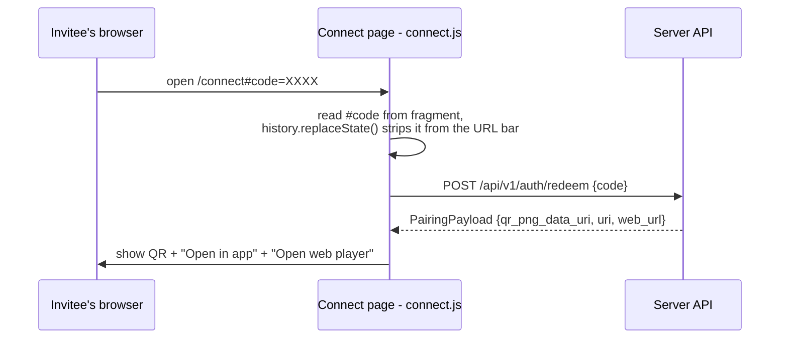

The server ships three web surfaces from `internal/web`:

- The **connect and setup pages**. These are small, dependency-free vanilla
  HTML, CSS and JS pages **embedded in the binary** (`//go:embed assets`). They
  have no build step and no framework, and the assets are written to satisfy a
  strict same-origin CSP.
- The **admin console** at `/admin`. It is `admin-ui/`, a React and Vite app in
  the **Shelf** design, embedded by `internal/web/adminui`. See
  [The admin console](#the-admin-console-admin-ui).
- The **web player** at `/web`, the audiosilo-frontend Expo export. It is
  **not vendored** in this repo. The server serves it at runtime from `web_dir`
  (env `AUDIOSILO_WEB_DIR`), or a native release bakes it into the binary with
  the `embedplayer` build tag.

The console and the player are both single-page apps, and one handler serves
both: `internal/web/spa` (see [Serving the SPAs](#serving-the-spas-internalwebspa)).
All three surfaces are static clients over the JSON API. The HTML itself is
unprivileged, and authorization always happens at the API (see
[Auth & security](auth-and-security.md)).

## Route map

`web.Register(mux, webDir)` mounts everything. API routes registered on the
same `http.ServeMux` win automatically, because `ServeMux` prefers more specific
patterns.

| Route | Serves | CSP |
|---|---|---|
| `GET /` (exact), `GET /connect[/]` | `index.html`, the connect page | strict site-wide |
| `GET /admin[/…]` | the admin console (`adminui.Handler` over `spa.Handler`). A binary compiled without the console answers with a **503** "console not built" page | strict site-wide |
| `GET /assets/…` | the connect and setup pages' embedded CSS, JS, fonts and icons (with `nosniff`) | strict site-wide |
| `GET /favicon.ico` | 301 to `/assets/favicon.svg` | none |
| `GET /sw.js`, `GET /manifest.webmanifest` | the console's PWA worker and manifest. They are served from the **site root** so the worker's scope covers `/admin`. `sw.js` is `Cache-Control: no-cache`, so updates land promptly | strict site-wide |
| `GET /web/…` | the web player (`spa.Handler`). Mounted only when a build with an `index.html` is available | per-document `htmlCSP` |
| `GET /web/reader.html` | the player's ebook reader document, which the player frames. Any path naming it also lands here: `reader`, in any case, with or without a trailing slash. `404` when the export has none | its own `readerCSP`, `X-Frame-Options: SAMEORIGIN` |

There is no classic console any more. `/admin/classic` is an ordinary client
route, which the console answers with its "There's nothing here" page.

Two related routes live in `internal/api`, not `internal/web`:

- The setup page, `GET`/`POST /setup` (see
  [First-run setup page](#first-run-setup-page-setup)).
- In demo mode with a player present, a `GET /{$}` redirect that sends the
  exact site root to `/web/demo` (`webDemoPath` in `api.go`). A demo instance
  then lands visitors straight on the instant-demo flow.

## The strict same-origin CSP

The console, the connect page and the setup page are served with one constant
policy, `contentSecurityPolicy`. It is exported as `web.ContentSecurityPolicy`,
so the setup page in `internal/api` applies the identical one:

```
default-src 'self'; img-src 'self' data:; style-src 'self'; script-src 'self';
connect-src 'self'; manifest-src 'self'; worker-src 'self';
base-uri 'none'; frame-ancestors 'none'
```

- `img-src data:` lets two kinds of image display: the connect page's QR
  pairing PNG (a data URI in the redeem response) and the console's covers
  (`data:` URLs, see [Covers](#covers)).
- `manifest-src` and `worker-src 'self'` let the admin console install as a PWA.
- There is **no** `'unsafe-inline'` anywhere. The pages contain no inline
  `<style>`, no `style=` attributes and no inline `<script>`. The connect and
  setup pages keep all styling in `assets/style.css` and all behaviour in
  external JS files that use `addEventListener`. An inline handler added to one
  of them does nothing under this CSP, and nothing reports it. The console's
  rules are under [The CSP does not change](#the-csp-does-not-change).

:::warning
`web.htmlCSP` and this policy are on the security-critical list. A change to
either needs both an allowed **and** a denied regression test (see
`internal/web/web_test.go` and [Gates & CI](../contributing/gates-and-ci.md)).
:::

## Serving the SPAs (`internal/web/spa`)

`spa.Handler(spa.Config{…})` serves a static single-page app from an `fs.FS`
under a URL prefix. Both apps use it, so caching, MIME types, deep links and
missing files follow **one set of rules** instead of two that drift apart.

| | Console | Player |
|---|---|---|
| `Prefix` | `/admin` | `/web` |
| `FS` | the embedded build (`adminui.FS()`) | the embedded player (`-tags embedplayer`) or `os.DirFS(web_dir)` |
| `AssetDirs` | `assets` | `_expo`, `assets` |
| `DocumentCSP` (HTML) | the strict site-wide policy | `htmlCSP`, hashed per document (see [Per-document CSP](#per-document-csp-htmlcsp)) |
| `FileCSP` (everything else) | the strict site-wide policy | none |

The handler routes on the request path relative to the prefix:

| Request | Response |
|---|---|
| an existing file | the file. `<p>.html` and `<p>/index.html` are tried too, because Expo exports one HTML file per route |
| missing, under one of `AssetDirs` | **404**. A fingerprinted bundle that isn't there must fail loudly, not return HTML |
| missing, a **top-level** name with an extension other than `.html` (`/web/favicon.ico`) | **404** |
| anything else (`/admin`, `/admin/people/user/4`, `/web/connect?token=…`) | `index.html`, so client-side routes deep-link. A deeper dotted segment such as `/library/v1.2` is a route, not a file, so a missing `/web/library/v1.2` boots the SPA |

### Caching and compression

- **Cache-Control.** Files under `AssetDirs` are fingerprinted and get
  `Cache-Control: public, max-age=31536000, immutable`. HTML and every other
  file (`/admin/theme-init.js`) are `no-cache`, so a browser picks up a new
  release at once.
- **ETag.** `spa.Files` serves every static response: the console, the web
  player, the connect page, `/assets/`, `sw.js` and the manifest. It sends a
  strong `ETag`, the first 16 bytes of the file's SHA-256 with `-gz` appended
  for the gzip form, and answers `If-None-Match` with `304`. A `no-cache`
  document therefore revalidates without its body.
- **Gzip.** `spa.Files` gzips text types (html, js, css, json, svg,
  webmanifest, map, txt, wasm) when the client accepts it, with
  `Vary: Accept-Encoding`. It keeps the gzip form only when it is smaller.
- **Work per file.** Embedded files are hashed and compressed once per process.
  Files from `web_dir` are cached by path and redone when their size or
  modification time changes.
- **Ranges and conditionals.** `HEAD`, `Range` and `If-Modified-Since` go
  through `http.ServeContent`. A `Range` request always gets the plain bytes.
- **Not the API.** Nothing under `/api/` (media, covers) goes through
  `spa.Files`. The API compresses its own JSON answers (see
  [Response compression](api/index.md#response-compression)).

### Headers and content types

Every response carries `X-Content-Type-Options: nosniff`. HTML gets
`DocumentCSP`, computed from the document's bytes, and other files get
`FileCSP`.

Content types come from an explicit table pinned in `spa`'s `init`. Go's MIME
lookup falls back to the OS registry, which on some Windows hosts maps `.js` to
`text/plain`, and a module script served that way never runs. Paths that
aren't valid `fs` paths (`..` segments) never resolve to a file.

## The admin console (`admin-ui`)


The admin console is a single-page app in the **Shelf** design. Its plan lives
in the workspace's `ADMIN-CONSOLE-PLAN.md`, and its design system in
`admin-ui/STYLEGUIDE.md`, which is authoritative for the build. It is a static
client over the JSON API, and the API enforces the admin role. It is the only
console: the classic `admin.html` and `admin.js`, their i18n keys and CSS, and
the `AUDIOSILO_ADMIN_NEXT` switch are gone.

**Stack:**

- React 19, Vite, TypeScript (strict), shadcn/ui on **Base UI**, Tailwind v4.
- TanStack Query, Router, Table and Virtual (the books table and the
  virtualized cover grid).
- cmdk for the ⌘K palette.
- Recharts for the Activity charts, through shadcn's chart component (see
  [Charts](#charts)).
- react-hook-form and zod for forms and validation.
- dnd-kit for library reordering, keyboard accessible.
- uqr for invite QR codes, drawn as SVG in the browser.
- i18next, lucide-react, and fontsource (self-hosted Bricolage Grotesque,
  Figtree, JetBrains Mono).

Each screen is a lazy-loaded chunk, so the first paint carries only the shell
and the overview. Interface strings work the same way. English is bundled in
the entry, and it is also the fallback for any missing key. Each other language
is its own chunk (`import.meta.glob` in `src/i18n/index.ts`), loaded when it is
chosen.

### Lazy screens

A section's screen is a `lazyScreen` (`lib/lazy-screen.tsx`, listed in
`features/section-page.tsx`):

- Its destination route's loader starts fetching the chunk
  (`preloadSection`, never awaited). The chunk therefore loads beside the
  session check rather than after it.
- Until the chunk is in, the screen shows the page skeleton itself instead of
  suspending.
- A chunk that fails to load throws in render, to the router's error boundary.

The reason is `React.lazy`'s fallback throttle. It made React hold a Suspense
boundary's content for up to 300 ms after its fallback showed, and the page's
own requests waited for that commit. On a 5,000-book library on a Mac,
Health > Issues was ready in about 490 ms with `React.lazy`. With `lazyScreen`
it is ready in about 270 ms when the summary is counted afresh, and about
150 ms when the [list answer cache](overview.md#the-list-answer-cache) answers
it.

A person's page, the book page and the setup page stay `lazyRouteComponent`.

### Build and embed

- `npm --prefix admin-ui run build` writes into `internal/web/adminui/dist`,
  which `internal/web/adminui` embeds with `//go:embed all:dist`. Only
  `dist/.gitkeep` is committed (the rest is gitignored), so a plain
  `go build` without Node still compiles. `/admin` then answers **503** with a
  short "console not built" page that says how to build it.
- `scripts/build-admin.sh` is the one recipe: `npm ci`, `npm run check`,
  `npm run build`. `--build-only` skips the check, and `--vite-only` also skips
  the typecheck.
- **CI** (`ci.yml`) runs the full recipe in its `admin-ui` job. Its Go job runs
  `--vite-only` **before** the Go steps, so `TestEmbeddedBuild` checks the real
  embedded `index.html`. The test skips locally when nothing is built.
- The **Dockerfile** has a `node:24-alpine` stage that builds the console and
  copies `dist` in before `go build`. **GoReleaser** runs the script as a
  before-hook.
- A Vite plugin fails the build on any CSP violation.
- `go.mod` carries `ignore ./admin-ui/node_modules`. Some npm packages ship Go
  source, which `./...` would otherwise build, vet, test and lint.

### Serving

`adminui.Handler(fsys, csp)` mounts the build on `spa.Handler` with prefix
`/admin`, asset dir `assets` and the strict site-wide CSP for every response.
The shared rules (see [Serving the SPAs](#serving-the-spas-internalwebspa))
then give:

- `/admin/assets/…` is immutable, and a missing file is a 404.
- Other top-level files such as `theme-init.js` revalidate.
- Every other path is `index.html`, so client routes deep-link.

When the embedded FS holds no `index.html`, the handler answers every request
with the 503 "console not built" page instead.

#### The service worker

The PWA service worker (`/sw.js`) caches the console's shell:

- Every online `/admin` navigation refreshes the cached `index.html`
  (network-first, with an offline fallback).
- `theme-init.js`, the icons and the manifest are precached.
- The console's **unhashed** files under `/admin/` (`theme-init.js`) change in
  place with a release, so the worker fetches them **network-first** too, and
  uses the cached copy only when offline. Running a stale copy once after an
  upgrade would pair old code with a new page.
- The hashed `/admin/assets/*` files, the icons and the manifest are
  stale-while-revalidate (cached on first use), so the console works offline
  after one online visit.
- It never intercepts `/api/` or `/web/`.

The web manifest (`manifest.webmanifest`, scope `/admin`) uses the Shelf
colours.

#### A tab left open across an upgrade

A tab left open across an upgrade still runs the old build, whose lazy route
chunks the new server no longer has. The router's `defaultErrorComponent` is
`RouteError` (`features/route-error.tsx`), a styled page inside the shell with
Reload and Go to the overview.

When the error is a chunk that failed to load, `RouteError` reloads the tab once
per build:

- `isChunkLoadError` recognises the error in Chromium's, Safari's and Firefox's
  words, and also a missing stylesheet chunk.
- `reloadOnce` in `lib/stale-build.ts` guards the reload with a
  `sessionStorage` key, `audiosilo.admin.reloaded-for`, keyed on the build id
  that Vite stamps (`__ADMIN_BUILD_ID__`). Past that one reload, the page says
  "AudioSilo was updated". Without `sessionStorage` it never reloads.
- Only a page that failed to open reloads. A chunk preloaded on a link's hover
  or focus fails quietly, so there is no window-wide `vite:preloadError`
  handler.

### The CSP does not change

The console runs under the same `script-src 'self'; style-src 'self'` policy
(no nonce) as the connect page, so it is built to need nothing inline:

- `index.html` loads only files: `/admin/theme-init.js`, which applies the
  stored light, dark or system theme before first paint, and the Vite bundle.
  `admin-ui/scripts/check-csp.mjs` (a Vite plugin) fails the build on any inline
  `<script>`, `<style>`, `style=""` or `on*=""` attribute, and the Go test
  applies the same check to the embedded build.
- Base UI renders under `<CSPProvider disableStyleElements>`. The one rule it
  would inject lives in `globals.css`.
- ESLint bans libraries that inject styles or scripts: Radix, sonner, vaul,
  next-themes, ECharts, cmdk's `Command.Dialog` and shadcn's `ChartStyle`. A
  test asserts that no `<style>` element appears while the palette, a menu and
  a toast are open.
- Dynamic styling uses React's `style` prop, which writes through CSSOM and is
  allowed. Build assets are never inlined as `data:` URIs.
- **Covers never carry the session token in a URL.** The media routes accept
  `?token=` for the player's `` and `<audio>`. The console's session,
  though, is a full-privilege admin credential, and a URL can leak into proxy
  access logs and history. The console fetches covers itself, with the
  `Authorization` header, and renders them as `data:` URLs (`img-src` allows
  `data:`, not `blob:`). See [Covers](#covers).
- **zod is imported from `@/lib/zod`, never from `zod`.** zod probes once for
  `new Function` to compile its object schemas. Under a CSP without
  `'unsafe-eval'` the probe throws, and zod catches it, but the browser still
  reports a `script-src` violation. `@/lib/zod` sets
  `z.config({ jitless: true })`, which skips the probe and the compiler. An
  ESLint rule bans importing `zod` anywhere else.
- **Invite QR codes are drawn in the browser** (uqr, rendered as inline SVG
  elements), so a fresh invite code never travels back to the server inside an
  image request.

### Covers

Grids and shelves show hundreds of covers, so the console asks for them in
batches:

1. `useCover(libraryId, path, size, enabled, version)`
   (`admin-ui/src/api/hooks.ts`) queues each cover it needs.
2. `src/api/cover-batch.ts`, on the shared batcher (`src/api/batcher.ts`),
   sends everything asked for in the same moment as one
   [`POST /api/v1/admin/covers`](api/reference.md#post-apiv1admincovers)
   request of up to 60 books.
3. The server answers with small JPEG thumbnails that are already `data:` URLs
   (server side: [Thumbnails for the admin console](media.md#thumbnails-for-the-admin-console-post-admincovers)).

A grid therefore costs a handful of requests and about 20 KB a cover.

In memory (TanStack Query), a cover is fresh for an hour. It is dropped five
minutes after the last cover showing it unmounts, so a long grid doesn't hold
every `data:` URL. Below memory sits the
[thumbnail cache](#the-thumbnail-cache).

`BookCover`'s `size` depends on where the cover shows:

| `size` | Where |
|---|---|
| `96` | a books-table or command-palette row (its 36 px cover) |
| `160` | list rows |
| `320` | tiles (the default) |
| `640` | the book hero's thumbnail |

`load` false holds a skeleton without asking. A long list uses it to ask for
covers only as they near the viewport.

The console never loads full art. The book page's hero shows the largest
thumbnail (`640`). The browser computes the hero's background tint from the
`160` one (`use-hero-tint.ts`, a same-origin canvas over the `data:` URL). A
book with no art gets a generated cover (`src/components/generated-cover.tsx`,
a React SVG component with colours from `src/lib/cover-model.ts`), never an
`innerHTML` string.

Covers are square frames. `CoverArt` in `src/components/book-cover.tsx`
measures the art on load. Art that isn't square is drawn whole with
`object-fit: contain` over a blurred copy of itself. Square art, which is most
of it, gets no second layer, since each blur is its own compositing pass.

Book pages are addressed by identity, never by an internal book id:
`/admin/library/book?library=<id>&path=<path>` (`src/lib/book-route.ts`).
Names and series link to the Books list through `BooksLink`
(`src/components/books-link.tsx`, built on `booksRoute`). It filters on the
exact value and keeps the page's `library` and the list's `view`. It memoizes
the route per value, because TanStack's `<Link>` rebuilds its href whenever
`search` changes identity, and `booksRoute`'s `search` is a function.

#### The thumbnail cache

The thumbnail cache is `admin-ui/src/api/thumb-cache.ts`. The `data:` URLs
arrive inside JSON, so the browser's HTTP cache never holds them. Without a
cache of its own, every reload or re-scroll would fetch every cover again.

Admin book rows carry `cover_version`
([`GET /admin/books`](api/reference.md#get-apiv1adminbooks)).
`useCover(libraryId, path, size, enabled, version)` passes it to `loadThumb`
(`cover-batch.ts`), which looks the thumbnail up in the cache before queueing
it in a batch.

- **Store.** The cache is an IndexedDB database, `audiosilo-admin-thumbs`. The
  entries' metadata (key, bytes, last used, stored) and the `data:` URLs live in
  separate object stores, so the cache reads the index once, on first use,
  without the image data. It uses IndexedDB rather than Cache Storage because a
  console reached over plain HTTP on a LAN address is not a secure context, and
  Cache Storage doesn't exist there.
- **Fallback.** Where IndexedDB is missing, fails to open, or doesn't open
  within 5 seconds (private browsing in some browsers, blocked site data), the
  cache falls back to memory for the page's life.
- **Keys.** `thumbKey(ref, size, version)` joins the library id, path, size and
  `cover_version`, separated by NUL. New art is a new version and so a new key,
  and the old entry ages out. A thumbnail is kept under the `version` that its
  [`POST /admin/covers`](api/reference.md#post-apiv1admincovers) answer names,
  not the row's (the reference says why).
- **Not kept.** A book with no art is not kept, because its art may only be
  unreadable for now. Neither is a request made without a version.
- **New art in place.** When a sidecar is replaced in place under the same
  name, the next scan moves `cover_version` (it is the art file's own version),
  so the new art gets a new key.
- **Bounds.** The cache holds at most 5000 entries or 50 MB in IndexedDB, and
  1500 entries or 16 MB in memory, whichever comes first. Over a limit, the
  least recently used entries go, down to 90% of both, so a full cache evicts
  in batches.
- **Age.** A read refreshes an entry's last-used time at most once an hour, so
  a read isn't otherwise a write. An entry older than 7 days is asked for again
  (`MAX_AGE_MS`).
- **Invalidation.** After a cover upload or removal, `invalidateCover` forgets
  every kept size of that book (`ThumbCache.forget`) before refetching it.
- **Sign-out.** Every sign-out calls `clearThumbCache()`, including one after a
  401 or a lost admin role (`SessionProvider`). The covers one admin saw are
  then not there for whoever signs in next in that browser. A thumbnail still
  on its way at the moment of the sign-out is dropped rather than stored,
  because the cache's `epoch` moved.
- **Failed writes.** A failed store write (quota, a closed database) loses only
  that entry. The next view asks the server again.

### Downloading a file from an authenticated endpoint

**Export book list** in a library's menu downloads the library's book list from
[`GET /api/v1/admin/libraries/{id}/export`](api/reference.md#get-apiv1adminlibrariesidexport).
That is the file a user imports on meta.audiosilo.app's Watching page.

**Export with file paths and tags...** asks first, in a `ConfirmDialog`
warning that the file is not for a public issue or the community site. It then
downloads the list with `?include=paths,tags,description&copies=separate`: one
row per copy, with its own path, tags and description
(`downloadLibraryExport(id, { personal: true })`).

The console authenticates with a bearer token held in `localStorage`, so this
cannot be a plain `<a href>` download. The request has to carry the
`Authorization` header. `downloadLibraryExport` (`admin-ui/src/api/client.ts`)
therefore does the download itself:

1. It `fetch`es the endpoint.
2. It reads the file name out of the response's `Content-Disposition` header.
3. It wraps the body in a blob object URL and clicks a temporary
   `<a download>`.
4. It revokes the URL a few seconds later.

`downloadBackup` does the same for a backup from
[`GET /admin/backups/{name}`](api/reference.md#get-apiv1adminbackupsname).

This needs **no CSP change**. An object URL the page creates for itself is not
a fetched resource, and a download triggered by `a.download` is not a resource
load either, so nothing in the strict policy applies to it.

### Session

The session token lives in `localStorage` under `audiosilo_token`. That is the
key the classic console used, so an admin signed in before the cutover stays
signed in. The language choice shares the connect page's storage key.

- A 401 drops the session ("Your session ended").
- A 403 from an admin endpoint re-checks `GET /me`. If the account is no longer
  an admin, because another admin demoted it mid-session, the console signs out
  with "This account is not an administrator."
- Every sign-out also empties the console's
  [thumbnail cache](#the-thumbnail-cache).

Every API call also names the console to the server with
`X-AudioSilo-Client: AudioSilo Admin (web)` (`CLIENT_IDENTITY` in
`admin-ui/src/api/client.ts`). The server's devices and sessions can then tell
a console session from a player. The header carries no version, because the
console ships inside the server. The console is always same-origin, so the
header never costs a CORS preflight. See
[Client identification](api/index.md#client-identification-x-audiosilo-client).

### Dev loop

```sh
# the server, plain HTTP
AUDIOSILO_TLS_MODE=off go run ./cmd/audiosilo --data ./data
# hot-reloading console on http://localhost:5173/admin/
npm --prefix admin-ui run dev
```

The Vite dev server proxies `/api`, `/assets`, `/sw.js`, `/manifest.webmanifest`
and `/web` to the Go server at `http://127.0.0.1:8080` (`AUDIOSILO_DEV_SERVER`
overrides it). The dev server is **not** under the production CSP, so check
CSP-sensitive work against a real build served by Go. The console's own gate is
`npm --prefix admin-ui run check` (typecheck, ESLint, Prettier, Vitest). See
[Gates & CI](../contributing/gates-and-ci.md).

### What the console has today

This section lists each screen and the API it runs on. Interface text is in
all six languages.

#### Shell

- **Sign-in** is for admins only. A non-admin's fresh session is revoked at
  once.
- **Top bar.** It shows the server's name (`GET /server`'s `name`), or the
  page's host while the name is the default "AudioSilo". It holds the five
  destinations (Library, People, Activity, Health, Server), a health line
  (version, offline libraries, server unreachable), ⌘K search, the
  notifications bell (see [The bell](#the-bell)), and the theme and account
  menus. The account menu ends with a "Support AudioSilo" link to GitHub
  Sponsors (`SPONSOR_URL` in `lib/support.ts`).
- Each destination has a section bar. Phones get a bottom tab bar.
- Every section has a screen (`PAGES` in `features/section-page.tsx`). An
  unknown section is a 404.

#### ⌘K palette


The palette lists:

- navigation and sections;
- settings: one entry per Settings topic, each with search keywords such as
  "https", "proxy" or "ffmpeg", plus scan schedules and skipped files, theme,
  and language;
- actions: invite someone, add a library, rescan a library, rescan every
  library (when there is more than one), open the web player, sign out.

From two typed characters it also searches content
(`components/shell/palette-search.tsx`):

- books, through the server's full-text search (`GET /admin/books?q=`), after a
  200 ms pause in typing;
- people, authors, series, narrators and shares, matched in the browser from
  their lists;
- a final "Search all books for ..." entry, which opens Library > Books with
  the query.

#### Overview

The Overview is built on `GET /admin/stats`, `GET /admin/sessions/live`,
`GET /admin/settings`, `GET /admin/update`, `GET /admin/libraries`,
`GET /server` and `GET /admin/issues`.

- **`GET /admin/update`** gives the Server card's "*version* available" link to
  About, cached ten minutes.
- **`GET /admin/libraries`** gives the offline-library notices.
- **`GET /admin/issues`** gives the "Needs attention" card: up to six
  categories with something to fix, each linking to its Health queue.
- **Listening now** (`GET /admin/sessions/live`) has one card per live session,
  playing first, each linking to Activity > Live now. A card's second line is the chapter label described
  under [Activity > Live now](#activity--live-now), else the author or device.
  A failed live list reads as nobody live rather than holding the page back.
- **Recent listening** is the stats' progress feed minus the user and book
  pairs that are live (`splitListening` in
  `features/overview/overview-model.ts`).
- **Side column.** It starts with the
  [Finish setting up card](#the-first-run-setup-flow) while a first-run step is
  still skipped. It ends with the [support card](#the-support-card) when
  `GET /admin/support` says it shows.

#### Library > Books

- **The list.** The cover grid (virtualized) or the table, over
  `GET /admin/books`. Keyset pages load as you scroll.
- **Shelves.** "Recently added" and "Continue curating".
- **Finding books.** The library filter, search, sort and a Filters sheet over
  `GET /admin/books/facets`. Every filter is in the URL, so each view
  deep-links.
- **The Filters sheet.** Its Library group is hidden below two book
  libraries, as the library filter is, unless a link set it. Its Genre and Tag
  groups are the facets' `genres` and `tags`, matched by `labelKey` in
  `lib/labels.ts`.
- **Selection** opens a floating bulk bar. It makes bulk field edits through
  `POST /admin/books/bulk`, and its **Tags and genres** boxes send `add` and
  `remove` through `bulkLabelEdit`. It also adds books to a share.

#### Library > Authors, Narrators and Series

These screens run on `GET /admin/authors`, `/admin/narrators` and
`/admin/series`. Narrators' merge suggestions are applied as a bulk edit, with
Undo.

**Series gaps.** A series card shows community series gaps, hidden when
metadata is off:

- The gaps come from the `GET /libraries/{id}/meta` of each series' first book
  with an ASIN or ISBN (`metaCandidate`, `hasIdentifier`). A book matched with
  neither is skipped, although `/meta` would answer it from its recorded match.
- The card offers "Match a book" when that `/meta` found no match. When no book
  has an ASIN or ISBN, it offers it when none of the series is matched.
- Each card resolves its books with an ASIN or ISBN to community work ids
  through `POST /admin/books/works` (`useBookWorks`). `src/api/work-batch.ts`
  batches every card's books asked for in the same moment, up to 100, on the
  same `createBatcher` as the covers.
- `placeBooks` (`features/library/series/series-model.ts`) places each book on
  the rail entry of its work. A book that doesn't resolve falls back to
  `series_index`. A book known to be another work is drawn after the rail and
  fills no gap.
- Gaps wait for the works to answer, and until then the card shows its plain
  "N books" line. A resolved or cleanly unmatched answer is kept for the
  session. A failed one is asked again no sooner than two minutes later.

**Ranges.** A position may be a range, such as an omnibus:
`series_index_end` or `position_end` on the book, or `"1-3"` on a rail entry.

- A book at a range holds every rail entry inside it.
- A range entry is a slot of its own only on a rail that numbers none of the
  books inside it (`railEntries`, `holds`).
- The range grammar is `parseSeriesRange` in `features/book/field-rules.ts`,
  which mirrors the server's.

#### Library > Folders

The screen shows a folder tree per library (`/fs`) and the selected folder's
detection choice (`…/folder-override`). It saves the choice through
`setFolderMode` in `src/api/hooks.ts`, which notes the rescan and refetches the
listings.

`joinChoices` (`features/library/folders/folders-model.ts`) decides which
choices a folder offers:

| Folder | Choices |
|---|---|
| has audio of its own | all three |
| audio only in disc folders (the admin `split_discs` mark on `/fs`), or already joined | Automatic and Always one book, worded as a join ("Here: 3 disc folders become one book, in disc order.") |
| any other folder without audio | only clearing an override |

The detection dialog applies the same rule from the entry alone
(`offersBook`, `offersCollection`). With only podcast libraries, the page says
"No book libraries yet" (`folders.podcastsOnly.*`) rather than "No libraries
yet".
#### Book page

The book page lives at `/admin/library/book?library=&path=` and runs on
`GET`/`PATCH /admin/libraries/{id}/book`. It holds:

- click-to-edit fields with provenance and revert;
- `genres` and `tags` as chips, edited with `components/label-input.tsx`;
- `abridged` as a three-way `NativeSelect`;
- a save bar with a diff, and chapter renames;
- custom covers (`PUT`/`DELETE …/cover`);
- the match dialog (see [The match dialog](#the-match-dialog));
- listeners, shares, and the "Files on disk" section with the disabled
  on-disk rename.

The more menu's "Read the files again" calls `POST …/book/rescan`. `?match=1`
opens the match dialog on arrival (Health's "Review match"), and closing the
dialog drops the param.

**Series swaps.** When the admin commits **Series** as a name that the book's
Other series lists, the page drafts the server's series swap beside it
(`commitField` and `seriesSwap` in `book-model.ts`). It does not when the admin
drafted Other series themselves. When the admin took a drafted swap back,
`saveRequest` sends the saved list, so the server never swaps behind the
dialog. The Undo of a series revert that swapped (`undoRevertRequest`) sends
the list and position the book had.

##### The match dialog

The match dialog calls `GET …/book/match`, which matches the book's tag and
path facts through metaserve's `works/match`.

- **Search box.** It opens with the book page's `match_query`, so the console
  never works the query out itself. The server builds it with
  `meta.SearchPrefill`: the title and author, or the folders' reading of the
  path when the tags look swapped or junk, or when the title is a whole
  `Author; Series; Book NN` leaf.
- **Starting pick.** The dialog starts from the book's `community_match` when
  the search lists it.
- **Accepting.** The ticked fields, ASIN and ISBN included, are accepted as one
  `PATCH …/book` with `source: "community"` and
  `match: {work_id, recording_id, asin, isbn}` (`acceptRequest`). That records
  the book's match. `asin` and `isbn` are the identifiers the match offers,
  ticked or not.
- **A book with no ASIN or ISBN.** A pick other than its recorded match is
  itself something to accept. With nothing ticked, the button reads "Match to
  this work" and sends `match` alone.
- **Cover only.** A cover-only accept sends `match` after the cover, so it
  records the match too. That includes a cover-only accept of the book's
  recorded match (work and recording, `isRecorded`), which records its offered
  identifiers again.
- **Candidates' covers** are thumbnails the server fetched
  (`POST /admin/meta/covers`), batched by URL in `src/api/cover-batch.ts`,
  because the CSP loads no other host's images.
- **The Cover row.** It is ticked by default only for a book with no art whose
  preview loaded (`defaultCoverTick`). A ticked Cover row is kept with
  `PUT …/cover/community` after the fields. If that fails and nothing else was
  ticked, the dialog stays open.

##### Listen in player

**Listen in player** shows while `GET /server`'s `web_player` is on. It opens
the book in the web player in a new tab, as the same user:

1. The click opens the tab at once (`window.open('', '_blank')`), so no pop-up
   blocker stops it. The tab's `opener` is cleared.
2. `POST /auth/pair` mints a single-use, 10-minute pairing token.
3. The tab goes to the same-origin
   `/web/connect?token=&sid=&uid=&book=&path=` (`playerConnectUrl` in
   `book-model.ts`). It never uses the payload's `web_url`, whose base may be
   the `public_url`, another origin.

A failed call closes the tab and shows a toast. What the player does with the
link is in
[Connect and onboarding](../frontend/connect-and-addresses.md#a-link-that-names-a-book).

##### The Community card

The aside's Community card (`book-aside.tsx`) shows the book's
`community_match` whenever it has one:

- the work id, linking `web_url`, and the `recording_id` when set;
- how and when it was matched (`howKey`): "No ASIN or ISBN: matched to its
  store listing ..." without an identifier, and "Matched by a bulk match ..."
  or "Matched ..." with one. A match whose `/meta` recording carries
  `librivox` (and is the match's `recording_id`, when it names one) reads
  "Matched to its LibriVox recording ...". Until the book's `/meta` answers, the
  line stays the neutral "Matched ...";
- **Unlink**, behind a `ConfirmDialog` (no undo). It sends
  `PATCH …/book {match: {work_id: ""}}` and refreshes the issues.

The confirm reads `unlinkBodyKeeps` when the book keeps an identifier of its
own, so it still shows as matched. That is an ASIN or ISBN not overridden by
the community, or a community override over a scanned value.

The card goes on with the Bridge actions described under
[Bridge actions on the book page](#bridge-actions-on-the-book-page).

##### The Chapters card

The Chapters card opens with the **Community chapters** panel
(`features/book/community-chapters.tsx`). Its words and its one action come
from `communityState` in `book-model.ts`, a pure function of the page's
`community_chapters`, `chapter_source` and `chapter_choice`.

The panel shows for a book with an ASIN or ISBN (`canCheckChapters`, not
`matched`, because a store listing matched with neither has nothing to check),
or for one with a check. It holds:

- the status line;
- the notes: "Not in this copy: …", the approximate starts while community
  chapters are in use, and the merge hint for `crosses_files`;
- the source switch, as one `PATCH …/book {chapter_source}`: "Use the
  community's", "Use detailed chapters" or "Use the file's chapters".
  Switching a `fill` back from the files sends `auto`;
- "Review titles" for a `titles` check. Each title, or all of them, goes as one
  `chapters.set` rename, so they are ordinary revertable renames. A title the
  admin already took drops out of the list;
- "Check now" or "Check again" (`POST …/book/community-chapters`), shown with
  the `metadata` capability on a book with an ASIN or ISBN.

While `community_checking` is set, the page polls the book (`useAdminBook`) and
the panel shows a spinner. When the check ends, the page refetches the book
lists and the Health issues. With community chapters in use, a rename's toast
and the revert hint name the community's title instead of the file's.

**Chapters a Bridge found.** With chapters a Bridge found in the narration in
use (`chapter_source: "generated"`):

- The card says "Found in the narration on this server." and offers
  **Use the file's chapters** (`PATCH {chapter_source: "files"}`).
- With a source chosen, unless the book is on community chapters, the card
  offers **Use automatic** (`auto`). A note shows when a `files` choice is
  keeping found chapters that fit out (`generated_chapters_fit`). That control
  is `chapterSourceAction` in `book-model.ts`, and it never shows beside the
  community panel's own action.
- A rename's hints then name the narration's title ("Found: ...").

The card follows the book's `chapters.detect` job (`useBookGenerateJob` with
`KIND_DETECT`) and fetches the book again when it ends.

##### The Read-along card

The **Read-along** card (`features/book/readalong-card.tsx`,
`readalong-dialog.tsx`, the pure rules in `readalong-model.ts`) follows the
Chapters card. It shows only for a book with an `ebook`, and only when it has
something to show: a map, an offer, a job or a Bridge note. It is per book
only; there is no bulk action.

**The map.** The card shows the book's
[`readalong`](api/reference.md#get-apiv1librariesiditem) in one of three
states:

- ready: "Ready: lines up 99% of the ebook's text", and when it was made. The
  coverage is rounded down, so it never reads 100% short of it;
- stale, with why: the ebook or the audio files changed since. Listeners don't
  see a stale map;
- none.

**The offer.** **Make read-along**, or **Make again** over a map, is offered
when all three hold:

- An online Bridge lists the `readalong` feature. `readalongBridge` is then
  `ready`. An online Bridge without the feature is `too_old`, a paired one with
  no heartbeat is `offline`, and none paired is `none`. Those last states are
  read from `GET /admin/bridge`, only while no Bridge is online, and the state
  is `unknown` until that answers.
- No read-along job is open for the book.
- No `sidecars.generate` or `chapters.detect` job holds the book
  (`readalongBlocker`). That is any open one, parked included, but not one
  being cancelled. Its status and a note show in place of the offer.

**The Bridge note.** When there is no offer because of the Bridge, a
`bridgeNote` line says why and links Server > Settings > Bridge. It shows only
for a stale map, after a failed job, or for a `too_old` Bridge. The lines are:

- "Making a read-along needs a Bridge.", with Set up a Bridge;
- "The Bridge is offline: ...";
- "This Bridge can't make read-alongs. Update it to 0.5.0 or newer." The
  version is one constant, `READALONG_BRIDGE_VERSION`.

**The last job.** The book's last job shows under the map only when it says
more (`readalongJobShown`): open, parked or failed; cancelled with a server
reason; or done, but only over a map that isn't ready or one that reused a
transcript. It never shows over a stale map.

**The confirmation** reads `GET /admin/bridge/estimate?kind=readalong.align`.
It shows:

- the ebook's name;
- "Up to N h, less if the Bridge still has this book's transcript";
- Agent cost "None: no agent is used";
- when a ready map it replaces was made;
- that a match under half of the text stops the job and saves nothing.

It can't be confirmed for a library the Bridge can't write, for a book with no
ebook, or for a `too_old` Bridge, which shows a "The Bridge is too old for
read-alongs" notice. An offline Bridge doesn't stop it; the job waits. Its
button reads Make again for a remake. It queues `readalong.align` with
`params: {}` (`queueInOrder`), and words a `generate_open` or `detect_open`
refusal in the card's own words.

**The job's status** is `GenerateStatus`: "99% of the text lined up", "the
transcript was reused".

- A failed job's "the ebook and the narration don't match: N% lined up"
  becomes `book.readalong.failed.noMatch`, which says what to do. Any other
  error is shown starting with a capital (`readalongFailure`).
- While aligning, the transcription's last message is hidden.
- `KIND_READALONG` counts in the page's job poll. The page fetches the book
  again when the job ends, so its new map shows.

#### Library > LibriVox

Library > LibriVox (`features/librivox/`) adds a LibriVox recording to a books
library through the Bridge's `librivox.fetch`. The design is in
[Add from LibriVox](../bridge/librivox.md).

- **Metadata off**: with the `metadata` capability off the page says so and links
  Settings > Metadata, and asks nothing.
- **Search**: a search box over
  [`GET /admin/librivox/search`](api/reference.md#get-apiv1adminlibrivoxsearch),
  asked as the admin types. A result opens the work beside it.
- **The work**: [`GET /admin/librivox/work`](api/reference.md#get-apiv1adminlibrivoxwork)
  lists the recordings, each with its readers, length, section count, project id
  and a **LibriVox page** link. A recording in `in_library` shows **In library**
  with a link to each book.
- **The Bridge note** (`bridgeNote` in `librivox-model.ts`, from
  `GET /admin/bridge`): `addBlock` stops Add while the status loads or fails, with
  no Bridge paired, or when its `features` lack `librivox`, each with a sentence.
  With no Bridge paired, the sentence links Settings > Bridge. An offline Bridge
  is no block: the note says a book added waits for it.
- **Add**: a library picker when there are several books libraries (podcast
  libraries are never offered), then `POST /admin/librivox/fetch`. A refusal shows
  as a toast (`errors.librivoxInLibrary` for `409 in_library`).
- **Following the job**: a row follows its job by id
  (`GET /admin/bridge/jobs/{id}`) every few seconds while it is open
  (`jobPollMs`), and stops for a job that is gone (`404`, `jobGone`). The work
  itself is not polled. When the job ends it asks the work again and, for a done
  job, once more after `DONE_RECHECK_MS` (2 s), since the fold commits just after
  the job reads done. A parked or failed job keeps its reason on the row
  (`fetchReason`).

#### Library > Libraries

**Library cards** come from `GET /admin/libraries`, with `book_count`,
`available`, `scan` and the scan settings. The console polls it every second
while any library scans or waits in the job queue, and every minute otherwise.

**Add and edit** use the server folder picker (`GET /admin/fs/dirs`) and the
scan settings:

- "Scan automatically" with a time, for a daily schedule;
- "Skip these files and folders", as a textarea;
- `features/libraries/scan-settings.ts` converts between the form and
  `scan_schedule` and `ignore_patterns`;
- an `invalid_schedule`, `invalid_pattern` or `invalid_metadata_source` error
  lands on its field;
- "Book details come from" (`metadata_source`). A change refetches the
  library's books and the Health issues, since the server re-resolved them.

**Other actions on a card:**

- drag-and-drop or keyboard reorder (`PUT /admin/libraries/order`);
- rescan with live progress, from the list's `scan`. That includes `queued`,
  shown as a "Waiting" badge, and `unavailable`;
- the next scheduled scan, from `next_scan_at`;
- folder detection (`/fs` browse and `…/folder-override`);
- export, and delete.

**Config libraries.** A library named in `GET /admin/setup`'s
`config_libraries` has its **Delete library...** disabled, with the reason. The
server may still refuse a delete with `409 config_library`, when the config
changed after the console read it. The console then closes the dialog, shows
that reason as an error toast and reads the setup again, so the card locks.
Any other failure keeps the dialog open with its message.

#### People > People, Invites, Shares and Devices

- **Person cards.** The book a person is playing comes from
  `GET /admin/sessions/live`, else from their newest unfinished progress in
  `GET /admin/stats`. The devices line comes from `GET /admin/devices`,
  sessions only.
- **The invite flow** creates a password-less member, grants access, mints an
  invite, and shows the QR, link and code once.
- **A person's page** is `/admin/people/user/<id>`, with its tab in `?tab=`:
  listening (the default, no param), access, devices, invites, sign-in,
  account.
- **The cross-account invite list** (`GET /admin/invites`) has rotate and
  revoke.
- **Shares** have a list and a detail view, with `member_ids`.
  `whole_library_id` sets whole-library grants apart.
- **The devices list** (`features/people/devices-page.tsx`) runs on
  `GET /admin/devices`. Sign out and Revoke go through
  `DELETE /admin/devices/{id}` after a confirm. The row marked `current` is
  disabled, and a `409 current_device` would read as "That's the device you're
  using".

Error messages that name a fix branch on the API's error `code`.

#### A person's Listening tab

The Listening tab (`features/people/user-listening.tsx`) shows:

- **Their listening year.** Hours and the best streak come from their days of
  the server's current year (`GET /admin/listening?range=year&user_id=`). Books
  finished come from their progress' `finished_at`, counted in the server's
  year with the answer's `utc_offset`. Hours per month show as a small bar
  chart.
- **In progress and Finished**, from `GET /admin/users/{id}/progress`.
- **Sessions.** Their first page of `GET /admin/sessions?user_id=`, with a link
  to Activity > Sessions.

**The Devices tab** reuses the devices list for `?user_id=`. The sessions come
first, and their count is the tab's count, as on the person card. The person's
API keys follow under their own heading.

**Sign out everywhere** (`SignOutEverywhere` in `user-page.tsx`) shows under
the sessions while one of them isn't the console's own (`current`). It
confirms first, with words for a password holder, a paired-only person, a kid
(naming the owner) or the admin themselves. It then sends
`POST /admin/users/{id}/sign-out` and shows its `signed_out` count in a toast.

**The Sign-in tab's password dialog** (`password-dialog.tsx`) says that a
change signs the person out. For the admin's own account it says "This console
stays signed in". A first password keeps the old "Paired devices stay signed
in". Both dialogs invalidate the devices lists (`invalidateDevices`) and the
person.

#### Progress menu

The progress menu (`features/people/progress-actions.tsx`) is on each row of
the Listening tab and on each listener on the book page. It offers:

- **Mark as finished**, with an Undo that sends `finished: false` and the old
  `position`;
- **Mark as not finished**;
- **Edit dates** (`progress-dates-dialog.tsx`). Date inputs are sent as
  `YYYY-MM-DD`, only the changed ones, with `null` to clear. The server reads a
  day-only finish as the end of that day, so a same-day start and finish fit.
  The dialog refuses future dates, and a finish before the start, before the
  server does;
- **See listening sessions**.

All of them go through
[`PATCH /admin/libraries/{id}/progress`](api/reference.md#patch-apiv1adminlibrariesidprogress).
The console then refetches the person's progress, the book page, the stats and
the Activity data (`invalidateProgress`). The codes `no_access` and
`book_not_found` map to their own messages.

#### Health > Issues


Health > Issues (`features/health/issues-page.tsx`) runs on
`GET /admin/issues`. It shows:

- notices for offline libraries, saying what was kept, with Retry;
- one card per category, with its count and up to three fanned covers;
- the open category's triage list (`issue-books.tsx`), a
  `GET /admin/books?issue=` list with keyset paging.

**Navigation.** The category and the ignored view live in the URL
(`?issue=<kind>&ignored=1`). Without `?issue=`, the page opens the first
category needing attention and keeps it open, so clearing it shows "All clear"
instead of jumping to the next. "Show ignored" lists the ignored books
(`?issue_ignored=true`). "Check again" queues a scan of every library
(`POST /admin/scan`).

**Row actions.** Each row has Ignore, with Undo in the toast
(`POST`/`DELETE /admin/issues/ignore`), and its category's fix
(`FIXES` in `issues-model.ts`):

| Fix | What it does |
|---|---|
| "Upload a cover" | opens the book page |
| "Review match" | opens the book page with `?match=1` |
| "Choose detection" | opens Library > Folders on the book's folder |
| "Read again" | calls `POST …/book/rescan` and says in a toast whether the problem is gone |
| "Join into one book" (`split_discs`, listed by its first disc) | sets `book` on the folder holding the discs (`setFolderMode`) |
| "Use detailed chapters" (`detailed_chapters`) | a `POST /admin/books/bulk` with `chapter_source: "community"` (`useIssueActions().takeDetailed`, which the bulk bar uses too, in batches of 1000) |

A row's re-read or join runs once at a time. Its fix button is disabled while
it is in flight (`useIssueActions().fixing`).

**The bulk bar.** Rows select into a floating bulk bar. It acts only on the
selected books still listed, since one fixed or ignored on its own row has
left. Its bulk "Read again" (`useIssueActions().rescanMany`) re-reads two books
at a time, each a synchronous re-read.

##### Books with no chapters

A `no_chapters` row whose `chapters_check` is a failed check
(`length_mismatch`, `structure_mismatch`, `crosses_files`, `no_match`,
`unavailable`) adds a line saying why community chapters weren't used
(`chaptersCheckNote`).

A `no_chapters` row also offers **Detect chapters**, on the row and in bulk.
`fixFor` offers it with `detectAvailable`: the `bridge` capability and the
`chapters` feature. A book whose `chapter_choice` is set says why instead
(`rowFix`, `detectChosenNote`) and is left out of the bar's selection.

`health/detect-chapters-dialog.tsx` confirms first. It shows the transcription
time from the Bridge's status (`detectPlan`, one request for any selection) and
"None: no agent is used". It then queues `chapters.detect` per book
(`queueInOrder`), and stays open while it queues. It passes over a book, and
names it in its toast (`skipNotes`), when the book is refused `generate_open`,
`describe_open`, `chapters_chosen` or `readalong_open`, or when the answer is
the book's own parked detect job.

##### Duplicates

Duplicates (`duplicates.tsx`) render each group from
`GET /admin/issues/duplicates` side by side, the copy worth keeping first.
"They're different books" ignores every copy.

- **Paging.** The groups come 50 at a time (`useDuplicates`, an infinite query
  on `limit` and `cursor`; `DUPLICATES_PAGE`). A "Show more" button
  (`LoadMore`) under the list fetches the next page. It also fetches it by
  itself as it nears the viewport, except after a failed page. The pages
  already shown stay.
- **Moving groups.** A group that moves across a page boundary between loads
  is shown once, where its copies first appeared.
- **The count.** "n of total" uses the newest page's `total`, or the groups
  shown if those are more.
- **Covers.** Each copy's cover loads only as its column nears the viewport
  (`useInView`, `src/lib/use-in-view.ts`).
- **Big groups.** A group of more than 10 copies shows the first 10 until
  "Show all n copies".

##### Series spelled several ways

Series spelled several ways (`series-spellings.tsx`) are grouped too, with one
notice per series and library from `GET /admin/issues/series-spellings`:

- The suggested spelling is picked first in a select.
- "Use this spelling" runs the Authors page's merge (`useMerge` on `series`).
  That is a bulk `series` edit of the books whose main series is that series,
  with Undo.
- Ignore and Show again cover every one of the series' books.

##### Match automatically

Above the "Not matched" list, **Match automatically** (`bulk-match.tsx`, with
the rules in `bulk-match-model.ts`) follows the newest
[match run](api/reference.md#bulk-community-matching). It reads
`GET /admin/match-runs`, polled each second while a run works. It shows:

- Find matches, and, with a preferred marketplace set, "Use *country* ASINs",
  a repick;
- the run's progress, with Stop;
- then the counts and "Review and apply". When the run's `error` is
  `metadata_unavailable`, these sit under a "stopped early" notice
  (`stoppedEarly`), which the last run's line repeats.

The review dialog:

- pages each outcome's items (`GET …/items?outcome=`) and ticks the confident
  ones;
- shows what the chosen scope writes, from each item's server-computed
  `changes`, a tidied title among them under fill;
- words a `none` item from its `detail` (`weak_match` with its `score`,
  `identifier_unknown`, `work_unknown`), and a `review` item from its own
  (`length_differs`, `dramatization_only`, `identifier_disagrees`);
- lists a change's `match` as "the community match" when no ASIN or ISBN is
  written beside it (`changeParts`);
- posts the admin's picks as `exclude` and `include` ids.

When the newest run's status changes to one that isn't working, the console
refetches the book lists, issues, book pages and covers (`invalidateMatches`).
A small apply can finish between two polls.

Marketplace names come from `lib/regions.ts` (`Intl.DisplayNames`, with each
store's domain), shared with the Settings select.

#### Health > Jobs

Health > Jobs (`features/health/jobs-page.tsx`) runs on `GET /admin/jobs`,
polled every second while a job runs or waits and every 15 seconds otherwise.
It shows:

- the running scan with its progress, its counters and Stop;
- the queue, with Cancel (both Stop and Cancel are `DELETE /admin/jobs/{id}`);
- a Schedules card;
- a "Run a job" menu: rescan one library, or all;
- the history from `GET /admin/scan-runs`, paged with `before` and filtered by
  library. Its rows expand to their log (`GET /admin/scan-runs/{id}`, fetched
  when opened).

`jobs-model.ts` words statuses, counts and log events. A `joined` event with
code `length_unknown` says the disc's progress stayed with it.

#### Activity > Overview

Activity > Overview (`features/activity/activity-page.tsx`) runs on
[`GET /admin/stats?range=`](api/reference.md#range-listening-activity). The
period is in `?range=`, and an absent one means `30d`. Each period is cached
for a minute, and the previous one stays on screen while the next loads.

The page shows:

- stat tiles, with a hand-drawn SVG sparkline and the change against
  `previous`;
- the hours chart: a bar a day, or a bar a week past 92 days. The four biggest
  listeners are stacked, and the rest show as "Everyone else";
- the year calendar, which always covers the last year, whatever the period.
  Unless the page already shows 1 year, its days come from
  [`GET /admin/listening?range=1y`](api/reference.md#get-apiv1adminlistening)
  rather than a second full Activity computation;
- the hour x weekday grid;
- top books, people, authors and narrators;
- the inactive-people notice;
- the funnel with drop-offs, linking to Health's read problems when
  `scan_error`;
- the playback donut;
- apps in use. A build older than another of the same app and platform is
  flagged (`compareVersions` in `activity-model.ts`);
- library growth, and storage with coverage rings.

The pure logic (bucketing, ticks, streaks, the calendar grid) lives in
`activity-model.ts`, which is unit-tested.

#### Activity > Live now

Activity > Live now (`live-page.tsx`) runs on `GET /admin/sessions/live`,
polled every 10 seconds (`useLiveSessions`, also used by the overview and the
people cards). Playing sessions come first.

The chapter under each title is `chapterLabel`
(`features/activity/live-model.ts`, shared with the Overview's cards and the
funnel's drop-offs):

1. the server's `chapter`, when it sent one;
2. else "Chapter N" from `chapter_index`, in the viewer's language;
3. else nothing (a book with one chapter).

The server decides what a title says with `metadata.ChapterTitle`:

- A filename-shaped title is tidied the way the player's
  `prettifyChapterTitle` tidies it.
- A title that names nothing ("024", "Track 01") is left out. The test is
  `metadata.IsGenericTitle`, which reads letters in every script, so a title in
  another script stays.
- "Chapter 10" or "Part 7" is kept as written.

#### Activity > Sessions

Activity > Sessions (`sessions-page.tsx`) runs on `GET /admin/sessions` as an
infinite query: 50 a page, and "Show older sessions" passes `next_before`. It
filters by `?person=`, `?library=` and `?path=`; a book needs its library. Its
`SessionTable` is reused on the person page.

#### Activity > Year in listening

Year in listening (`year-page.tsx`) runs on `GET /admin/stats?range=<year>` for
the year in `?year=`. With no `?year=`, it asks `range=year`, the server's
current year, and the answer names that year. The browser's clock can be on
the other side of New Year. The picker offers that year and the four before.

The page tells the year as a story: the headline, the book of the year, facts,
the year's calendar, the most played covers, and who listened.

#### Health > System

Health > System (`features/health/system-page.tsx`) runs on
[`GET /admin/system`](api/reference.md#get-apiv1adminsystem), polled every 30
seconds while the page is open (`useSystem({poll: true})`). Settings and About
read the same query without polling, and it stays fresh for a minute.

The page is one list of rows: ffmpeg, ffprobe, community metadata, HTTPS
certificate, database, backups, each library's folder with its disk space, web
player, and AudioSilo version. Each row has a status: Healthy, Needs attention,
Missing, Off, Waiting, Downloading, Opening, Update available or Failed.

- **The rules** live in the pure `system-model.ts` (`systemRows`). A disk
  under 10% free and a certificate under 14 days are warnings.
  `certificateLook` is shared with Settings.
- **The Backups row** reads the answer's `backups` block. It is Failed, with
  the reason, when the last attempt failed. It is Off when nothing is
  scheduled, in warning tone when there is no backup at all either. Otherwise it is
  Healthy, with the latest backup and the next one.
- **Notices** above the list cover unreachable library folders, and community
  metadata that doesn't answer, with a link to its settings (`metadataDown`).
  In mirror mode the metadata notice shows only while the copy isn't
  answering, since the health check goes where lookups go.

##### Mirror mode

Mirror mode is `activeMirror`: `metadata.mirror` is present and the lookup is
on. The row, Settings' status line and `metadataDown` share this one rule.

In mirror mode, the community metadata row reads `metadata.mirror` instead
(`mirrorLook`). Its states, in this order:

1. a failed first download;
2. no copy yet;
3. the copy opening, with nothing answering;
4. a first download;
5. a copy newer than the server;
6. a failed update;
7. a fallback;
8. a new copy opening, or an update downloading, over a working copy;
9. ready.

A copy that still answers is never shown as down.

A `MirrorPanel` under the row shows:

- the download's progress;
- the copy's facts: data version, built, schema, size, downloaded, and the
  last and next check. The next check reads "Checking now" while one runs;
- the schema-newer, failure and fallback notices;
- **Check now**
  ([`POST /admin/meta/mirror/check`](api/reference.md#post-apiv1adminmetamirrorcheck)).
  It is disabled while a download runs or a copy opens. `errorMessage` words a
  `metadata_off` or `not_mirror_mode` refusal.

While the copy is busy (`mirrorBusy`: downloading, opening, a check running,
or a check due now), `useMirrorPoll` polls only
[`GET /admin/meta/mirror`](api/reference.md#get-apiv1adminmetamirror) every 2
seconds. It merges each answer into the cached system status. It fetches
`GET /admin/system` once when the copy settles, or when the route answers
`metadata_off` or `not_mirror_mode`, which drops the copy from the cache and
stops the poll. The page's own 30-second poll is unchanged.

#### Server > Settings

Server > Settings (`features/settings/`) runs on
[`GET`/`PATCH /admin/settings`](api/reference.md#admin-settings).

**Topics.** An in-page topic list sits in `?topic=`. `general` is the default
and has no param. The others are `network`, `players`, `metadata`,
`transcoding`, `household`, `demo`, `backups`, `notifications`, `import`,
`bridge`, `modules`, and `audible` while its module is on. The list is
`SETTINGS_PAGES` in `settings-model.ts`, less any module page (mapped in
`MODULE_PAGES`) whose toggle is off (`visiblePages`).

**Forms.** Each card is a `SettingsForm` (`settings-form.tsx`):

- It holds a draft of its fields, with Reset and Save changes.
- It sends only the changed fields (`sectionPatch`).
- List settings are edited as one entry per line.
- A refusal's `field` puts the server's message under that field.
- `useSaveSettings` puts the answer in the cache and refetches `GET /server`,
  the system status and the update status.

**Badges.** `SettingBadges` reads the envelope:

- `locked` gives the environment variable that sets a field, and the field is
  disabled;
- `restart_settings` gives "Restart to apply";
- `restart_pending` gives "Waiting for a restart", and also drives the notice
  at the top of every topic.

The Network & HTTPS cards pass `confirmRestart`, so saving a restart setting
there asks first.

**Per topic:**

- **General** has a Listening history card (`session_days`, a number field).
- **The two switches** (update check, community metadata) are
  `InstantSwitch`es that save at once with an optimistic cache write.
- **Status rows.** Network's certificate row, Metadata's status row and the
  read-only Transcoding topic read `GET /admin/system`. In mirror mode,
  Metadata's status row shows the local copy's state, links to
  Health > System, and follows it with `useMirrorPoll` while it is busy.
- **Metadata's Source card** is a two-column radio `SettingsForm` field for
  `metadata.mode` (`METADATA_MODES`), a restart setting.
- **Metadata's Danger zone** (`clear-matches.tsx`, the shared
  `components/danger-zone.tsx`) ends the topic. Clear community matches picks a
  library or all (`components/library-select.tsx`, shared with Match
  automatically) and asks for a typed word (`ConfirmDialog`). It then calls
  [`DELETE /admin/community-matches`](api/reference.md#delete-apiv1admincommunity-matches)
  and refetches what a match apply does (`invalidateMatches`, shared with Match
  automatically), plus the match runs.

#### Server > Logs

Server > Logs (`features/logs/logs-page.tsx`) runs on
[`GET /admin/logs`](api/reference.md#get-apiv1adminlogs). It has a level filter
(All, Warnings, Errors), a search box debounced 300 ms, and a Live tail switch.

- The tail polls every 2 s with `after=<last_seq>` and appends
  (`appendPage` in `logs-model.ts`). The first page has 500 lines, the panel
  holds at most 1000 lines, and a gap marker shows when the answer says `truncated`.
- A filter change starts a fresh tail.
- The panel is a `role="log"` deep-ink block (`.log` in `globals.css`, the
  same in both themes). It follows new lines while scrolled to the bottom.

#### Server > About

Server > About (`features/about/about-page.tsx`) reads `GET /admin/system`.

**The update card** has six states: off; update available, with the release
notes link and an `install`-specific how-to; check failed; development build;
up to date; not checked yet.

- "Check now" calls
  [`POST /admin/update/check`](api/reference.md#post-apiv1adminupdatecheck)
  and writes the answer into the system and update caches.
- The update-available notice ends with the one sponsor line, "AudioSilo is
  free; sponsors keep it going. Sponsor on GitHub".

**The "About *name*" facts card** links to the docs, source, issues and
Support AudioSilo (GitHub Sponsors).

#### Server > Settings > Backups

The Backups topic (`features/settings/backups-topic.tsx`) runs on
[`GET /admin/backups`](api/reference.md#get-apiv1adminbackups) (`useBackups`),
polled every second while `status.running`. It shows:

- a notice saying what a backup holds;
- the restore notices: a restore waiting for a restart, with Cancel restore,
  and the last restore's outcome for 14 days;
- the Schedule card, a `SettingsForm` over the `backups` section.
  `schedule-input.tsx` edits `backups.schedule` as Off, Every day or Every
  week, with a day and a time, and `backups-model.ts` converts both ways.
  `keep` is a number field, and the folder is read-only;
- the list of backups.

The list's actions:

- **Back up now** (`POST /admin/backups`). The 202 answer already reads
  `running: true`, so polling starts at once. The page shows the outcome in a
  toast when `running` turns false.
- **Download**, per backup (`downloadBackup`, see
  [Downloading a file from an authenticated endpoint](#downloading-a-file-from-an-authenticated-endpoint)).
- **Restore...**, a type-to-confirm dialog with the word "restore". It lists
  what a restore means, including that signed-out devices and revoked API keys
  work again, then sends `POST …/restore`.
- **Delete**.

#### Server > Settings > Notifications

The Notifications topic (`notifications-topic.tsx`, `target-dialog.tsx`) runs
on [`GET /admin/notifications`](api/reference.md#get-apiv1adminnotifications).
It shows:

- one row per destination: the redacted address, the last delivery
  (`deliveryLook` in `notify-model.ts`), Send test, an on/off switch, Edit and
  Delete;
- the "What to send" matrix, a checkbox per event and destination. Each tick
  saves at once, with an optimistic cache write and a rollback on failure;
- the privacy notice.

The add and edit dialog:

- picks the kind (webhook, ntfy, Discord), on add only;
- never shows the saved address or secret. An empty field keeps it, and
  "Remove the saved secret" sends `""`;
- when the typed address is on another server than the saved one
  (`movesServer`), says in the secret field to enter the secret again or remove
  it, which is what the server requires;
- offers the events the server knows (`knownEvents`), and preselects the
  problem events (`DEFAULT_EVENTS`: scan failed, library offline, update,
  backup failed);
- puts an `invalid_target` refusal under its `field`, worded from its
  `reason`. `errorMessage` in `lib/errors.ts` words any coded error with a
  `reason` as `errors.<code>.<reason>` (here `errors.invalid_target.*`), and
  falls back to the server's English `error`.

An edit puts the server's answer into the cache (`withTarget`).

#### Server > Settings > Bridge

The Bridge topic (`features/bridge/`) runs on two polls:

- [`GET /admin/bridge`](api/reference.md#get-apiv1adminbridge) (`useBridge`),
  every 15 seconds, or every 3 while a pairing code waits;
- [`GET /admin/bridge/jobs`](api/reference.md#get-apiv1adminbridgejobs), in
  pages of 30. Every loaded page is asked again every 3 seconds while a job on
  any of them is open, else every 30.

`bridge-model.ts` holds the pure rules, and they are tested.

**Not paired.** The topic says what the Bridge is and offers **Connect a
bridge**. That dialog (`pair-dialog.tsx`) shows the code once, with its
countdown, the server address and the two environment variables
(`AUDIOSILO_BRIDGE_SERVER_URL`, `AUDIOSILO_BRIDGE_PAIR_CODE`). It closes with a
toast once the status poll sees a new pairing (`codeExchanged`: paired at
another moment than when the code was made).

**Paired.** The topic shows these cards:

- **Status**: Online, Offline or Waiting for its first report, from
  `presence`. Open its page shows only for an `http(s)` `ui_url`
  (`safeHttpUrl`). The card also lists the heartbeat's `estimates.sidecars` as
  Agent (backend and Ready), Paid by, This month (spend against the cap) and
  Estimates from rows.
- **Libraries**: each library's mapping as Ready, Can't write, Not found or
  Not reported yet (`mappingState`). **Verify** opens a dialog for a book path
  and a hold (`verify-dialog.tsx`).
- **Audible accounts**, while the `audible` module is on (see
  [The Audible accounts card](#the-audible-accounts-card)).
- **Workers**.
- **Jobs** (see [The job list](#the-job-list)).
- the Unpair danger zone.

A **Setup** card shows too (see [The Setup card](#the-setup-card)).

##### The job list

The job list (`bridge-jobs.tsx`) has a state filter and cancel. It sums up the
result with `resultSummary` and shows the raw JSON under Details. A cancelled
row of any kind is `CancelledStatus` (see
[Cancelling](../bridge/pairing-and-jobs.md#cancelling)), never its raw `error`.

- The list also shows while no Bridge is paired, when there are jobs, so
  queued ones can be cancelled.
- Queuing a job whose open twin is still stopping after a cancel
  (`cancel_requested`) gets that job back, and the toast says it is still
  stopping.

**Book jobs.** The list words the book kinds (`isBookKind`) with
`GenerateStatus`, with the job's path linking to the book's page. They are
`sidecars.generate`, `sidecars.describe`, `chapters.detect` ("Chapters"),
`readalong.align` ("Read-along"), `sidecars.contribute` ("Community share")
and `meta.correct` ("Corrections").

`GenerateStatus` shows the job's stage, counts, time left and cost. A parked
job shows the park's reason with **Open in the Bridge**, a link to
`<ui_url>#/jobs/<id>`. A finished job shows the counts and cost, and a
generate job also shows whether its description came.

**Audible jobs.** The list words them as follows:

- an `audible.poll` reads "Checking an Audible library";
- an `audible.import` reads "Backing up an Audible book", with its ASIN
  (`backupAsin`);
- an `audible.sync` reads "Syncing places with Audible";
- one the server queued reads "Scheduled by the server" (`serverScheduled`,
  which counts `audible.sync`).

A failed Audible job's code reads as a sentence (`audibleJobReason`):

- an `audible.import`'s code comes from its result's `code`, or from an error
  starting `<code>:`, and reads as `audible.code.<code>`;
- an `audible.poll` or `audible.sync` that failed `audible_refused` or
  `audible_sign_in` reads as `audible.pollCode.<code>`;
- an unknown code keeps the Bridge's own text.

A sync cancelled by turning sync off shows the server's reason, "sync with
Audible was turned off for the account" (`SERVER_CANCEL_REASONS`).

**LibriVox jobs.** A `librivox.fetch` reads "Adding from LibriVox", with its
project ("Project 192", `librivoxProject`). Its failure or park code reads as
`librivox.code.<code>` (`fetchReason`: a park's code, else the result's `code`,
else an error starting `<code>:`), and an unknown one keeps the Bridge's text.

##### The Setup card

The **Setup** card reads "Get set up" while a required step is still to do. It
lists the heartbeat's `setup` checklist (`setup-list.tsx`, with the pure rules
in `setup-model.ts`):

- Each step is done, still to do or optional.
- Under a step goes the Bridge's `detail`. For a step not done with no
  `detail`, the console shows its own hint, `bridge.setup.hint.<id>`.
- Given the page's address, a step not done offers **Fix on the Bridge**,
  linking to the tab that fixes it. `paired` has none.
- The optional `audible` step links the Bridge's Accounts tab.

The card then shows the GitHub account, the agent credential and whether the
Bridge can contribute, with **Open Accounts on the Bridge**.

##### The Audible accounts card

While the `audible` module is on, an **Audible accounts** card
(`features/audible/audible-accounts-card.tsx`) sits under Libraries, in the
paired view only (`Paired` in `bridge-topic.tsx`). With no Bridge paired,
**Remove** on Server > Settings > Audible is the console's way to clear an
orphaned account.

The card runs on
[`GET /admin/audible/accounts`](api/reference.md#get-apiv1adminaudibleaccounts),
every 30 seconds. For each account it shows:

- its mapping, read-only, and its title counts;
- **Placement**: its template, or "Beside the series' other books";
- the **Sync** row (`SyncState`): Off; On, not synced yet; On, synced
  &lt;when&gt;, from `last_sync_at`; On, paused with the account; or, in
  warning tone, stopped since Audible refused the account (`refused_at`);
- **Check now**;
- **Account settings...** (`account-settings-button.tsx`): the policy, the
  template and the **Sync listening places with Audible** switch, through
  [`PATCH /admin/audible/accounts/{account}`](api/reference.md#patch-apiv1adminaudibleaccountsaccount).
  Each field is sent only when it changed;
- **Back up everything...** (`backup-all-button.tsx`): a confirm with
  `backup_estimate`'s "N books, ~X GB", then
  [`POST .../backup-all`](api/reference.md#post-apiv1adminaudibleaccountsaccountbackup-all).
  It is off when there is nothing to back up or the account is paused;
- **Remove...**, and **View titles**.

#### Server > Settings > Audible

The Audible topic (`features/audible/audible-topic.tsx`) is a `MODULE_PAGES`
page, listed only while the `audible` module is on. It runs on
[`GET /admin/audible/titles`](api/reference.md#get-apiv1adminaudibletitles), in
pages of 50 with **Load more**. See also
[Audible](../bridge/audible.md#the-console).

**Filters.** A search (title, author, exact ASIN), the account (with more than
one), state, and on this server. The legal line sits under the filters.

**Each title** shows:

- its byline (`titleByline`), length, a preorder's release date, ASIN, and
  state dot (`TITLE_STATE_TONE`);
- **On this server**, linking to the matched book, or **Not here**;
- **Matched by title** for a `fuzzy` match, **Backed up here** for an `import`
  one, **Not this book** for a rejected title, and **Not synced** for a
  `no_sync` one;
- the backup's state and code (`importStatus`, `audible.code.<code>`).

**Per-title actions** (`title-actions.tsx`):

- **Back up** (`canBackUp`), off while the account is paused,
  [`POST .../backup`](api/reference.md#post-apiv1adminaudibletitlesaccountasinbackup);
- **Not this book**, and its undo;
- **Destination...**;
- **Don't sync** and **Sync again**, shown while `canSync` (matched, not
  rejected, ignored, gone or `no_sync`) or while the title is already
  `no_sync`, through
  [`PATCH /admin/audible/titles/{account}/{asin}`](api/reference.md#patch-apiv1adminaudibletitlesaccountasin).

**An unmatched title** says where its backup would go, and why it isn't here:

- `PlannedNote` (`plannedLine` over the title's `planned`) is in warning tone
  when the place is taken or the plan failed. It adds a note when the
  account's template changed since. While a destination is set, it reads "Your
  destination is checked when the backup starts".
- `ReasonNote` says why it isn't here. `contested` names the other titles and
  links the book through `bookRoute`. A machine code reads as a sentence
  (`reasonKey`).
- **Destination...**'s placeholder is the planned path
  (`plannedPlaceholder`), never its value.

**Account actions** act on the chosen or only account (`pollTarget`):

- **Check now** (`POST .../poll`). A toast reports a new, an already open, or a
  still-stopping poll. `errorMessage` words `account_paused` and
  `unknown_account`.
- **Back up everything...**, between the other two.
- **Remove...** (`remove-account-button.tsx`). A confirmation says it removes
  the account from this server only, then the console sends
  [`DELETE /admin/audible/accounts/{account}`](api/reference.md#delete-apiv1adminaudibleaccountsaccount).

The loaded titles refresh when an account's `last_poll_at` moves
(`useTitlesAfterPolls`), and every 5 seconds while a title's backup is queued
or running (`backupRunning`).

#### Server > Settings > Modules

The Modules topic (`features/settings/modules-topic.tsx`) runs on
[`GET /admin/modules`](api/reference.md#get-apiv1adminmodules) (`useModules`).
It refetches every 15 seconds, like the Bridge's status, and after every
settings save.

Each [managed module](modules.md) has a card with:

- its name and blurb (`settings.module.<id>.*`);
- **Learn more**, linking the User Guide's
  [Modules](/users/admin/server#modules) (`MODULES_DOCS_URL`);
- the **Enable** switch, an `InstantSwitch` patching `{modules: {<id>: on}}`,
  disabled while locked;
- the Bridge state line (`settings.modules.bridge.<state>`). For `no_feature`
  it shows the module's own `needs` line. Unless the state is ready, it adds
  **Bridge settings**, linking to `?topic=bridge`;
- the "hidden from listeners" notice, while the toggle is on but the Bridge
  state isn't `ready`. The notice is worked out from the envelope's toggle, not
  the list's `active`.

The switch reads the settings envelope, which a save updates at once, rather
than the module list, which can lag it by a refetch. The command palette lists
the topic, with keywords that include "plugins" and "contributions". A
settings page that a module brings is in
[Managed modules](modules.md#the-console-settings--modules).

#### Bridge actions on the book page

The book page's Community card also carries the Bridge's actions: generate,
describe, share and corrections. The Characters and recaps card follows the
Community card.

##### Generate characters and recaps

The generate parts (`features/bridge/generate-*.tsx`, `use-generate.ts`,
`series-generate-dialog.tsx`, with the pure rules in `generate-model.ts`,
tested) are offered while `generateAvailable`: `metadata`, `bridge` and the
`sidecars` feature.

The book page's Community card ends with **`GenerateSection`**. It shows:

- **The book's generate job.** It is polled every 10 seconds while it is queued
  or working, and every minute while it is parked (`generatePollMs`). The jobs
  are asked whenever the server reports the `bridge` capability at all, so a
  job stays visible while the Bridge is away.
- **The action**, from the brief estimate (`generateAction`): `generate`,
  `regenerate` or `covered`. The player follows the same offer rule (see
  [Who sees the action](../bridge/generating.md#who-sees-the-action)).
- **For `covered`**, in place of the action: "The community already has
  characters and recaps for this book." with **See them**. That scrolls to the
  Characters and recaps card (`STORY_CARD_ID`) and moves focus there.

**`GenerateDialog`** reads the full estimate. It shows:

- the source, length, transcription and agent cost for every book it queues;
- where the results go;
- a contribute switch, on by default, only while the `contributions` flag is on
  and the estimate's `can_contribute` (`contributeOffered`);
- the earlier books, ticked;
- notices for an offline Bridge, an agent not ready or not reported, and a
  library it can't write. The last one blocks the submit.

It queues the books one by one in reading order (`queueInOrder`) and reports
a partial failure.

**For a series.** Each series card (`features/library/series/`) offers
**Generate for the series** once its books are loaded. `SeriesGenerateDialog`
asks every book's brief estimate, four at a time. It queues the books with no
recaps and no open job, earliest first, and counts the ones it leaves out.

**Books another job holds.** The series batch and the dialog pass over a book
by name (`GENERATE_SKIPS`), rather than stopping, when it is refused:

- `detect_open`: its chapters are still being found;
- `contribute_open`: its characters and recaps are being shared;
- `readalong_open`: its read-along is being made.

`GenerateSection` then shows one of these in place of Generate
(`generateBlocker`, `blocksGenerate`):

- a queued or working detect job's status;
- for a queued or working share, the note "The characters and recaps are being
  shared with the community...";
- for a queued or working read-along, the note "A read-along is being made for
  the book. Generate once that has finished: it reuses the transcription."

`blocksGenerate` reads the job list, else the estimate's `open_job`. A queued
share counts only while the `contributions` toggle is on. The console reads the
toggle from the settings envelope (`useSettings`, counted as on until it
arrives) rather than from the flag, because the server lets a generate job
cancel a held one.

See [Characters and recaps](../bridge/generating.md) and
[Chapterless books](../bridge/chapters.md).

##### A generated description

`DescribeSection` (`features/bridge/describe-section.tsx`) follows
`GenerateSection` in the Community card. It shows:

- the admin book detail's `generated_description`, with the "Generated on this
  server" mark and its time. Past about four lines it is clamped behind Show
  more (`clampsDescription`);
- a note when the player's About shows another description instead: the
  book's own, or the community's;
- the book's describe job, through `GenerateStatus`;
- **Write a description**, which confirms (`DescribeDialog`) and queues
  `sidecars.describe` when `describeOffered` allows it. It never does while a
  `chapters.detect` job is open or parked for the book.

See
[A description on its own](../bridge/generating.md#a-description-on-its-own-sidecarsdescribe).

##### Share with the community and Suggest corrections

**Share with the community** and **Suggest corrections**
(`features/bridge/share-section.tsx`, `features/book/corrections-dialog.tsx`
and `corrections-model.ts`) sit in the Community card after the generate
parts. They are offered only while the `contributions` flag is on. A job that
exists shows with its Cancel either way.

- **`ShareSection`** offers Share for each dimension generated here that the
  community lacks and no finished job has filed. `shareOffered` needs the
  estimate's `can_contribute`, a community answer, and no generate or share job
  open. Share queues `sidecars.contribute` with those `dimensions`
  (`shareRequest`).
- **`CorrectionsSection`** offers Suggest corrections for a matched book with
  an ASIN or ISBN and an edited correctable field, while the Bridge offers the
  `meta` feature (`correctionsOffered`). Its dialog queues `meta.correct`. The
  rows it leaves unticked and the evidence it won't send are in
  [Contributions](../bridge/contributions.md#corrections-metacorrect).

##### The Characters and recaps card

`StoryCard` (`features/book/story-card.tsx`, with the pure rules in
`story-model.ts`) follows the Community card in the book page's aside
(`BookAside`). It shows while `metadata` is on, with a Bridge or without one.

It shows the book's
[`GET /libraries/{id}/meta`](api/reference.md#generated-content) read-only
(`useBookMeta`, the full work, not `?spoilers=hide`). It has a **Characters**
and a **Recaps** tab, each with its count. The Recaps count includes the
whole-book summary's row.

- **Characters** list the name, role (`roleKey`), aliases, description and
  "From chapter N". A character can instead read "From the start", or "Near
  the end" for a reveal past the book's last chapter.
- **Recaps** list one row each in chapter order (`recapRows`), plus "The whole
  book" for the `recap_summary`. At chapter 0, `recapHeading` reads
  "Previously, in earlier books" for a `series` scope and "Before this book"
  otherwise. Each recap stays closed behind its own button until the admin
  opens it.
- Each list shows the first 10 rows, then "Show all N" (`ShowAllToggle`,
  shared with the Chapters card).
- An empty dimension reads "No characters yet." or "No recaps yet.".

**Sources.** Each tab is headed by where its dimension came from
(`storySources`, from `work.generated`):

- **Community** (the `ProvenanceMarker`), with the envelope's `attribution`
  credit and licence;
- or **Generated on this server**, with `generated.generated_at`. It adds
  "Contributed, waiting for review", linking the community issue that the
  book's newest `done` `sidecars.generate` job, or a `done`
  `sidecars.contribute` job since, filed for that dimension
  (`contributedLinks` over the jobs' `result.contributed`). A later failed,
  cancelled or open job doesn't hide it. Whether the issue was reviewed
  doesn't reach the server yet.

The summary has a source of its own (`generated.recap_summary`). It shows on
the summary's row only when it differs from the list's, so a community summary
beside a generated list keeps its credit.

#### The bell

The bell (`components/shell/notifications-bell.tsx`) runs on
`GET /admin/events` (`useServerEvents`: the newest 20, every minute). It lists
eight in a popover. `describeEvent` in `lib/server-events.ts` words each one,
and each links to where it can be dealt with: Library, Health > Jobs,
People > Devices or Invites, Server > About, or Server > Settings > Backups.

- The dot and the "N new" label count events newer than a per-browser cursor
  in `localStorage` (`audiosilo_events_seen`). Opening the bell moves the
  cursor to the newest event.
- **See all** opens Server > Events.
- Each row is `ServerEventItem` (`components/server-event-item.tsx`), shared
  with that page.

#### Server > Events

Server > Events (`features/events/events-page.tsx`) runs on
[`GET /admin/events`](api/reference.md#get-apiv1adminevents) as an infinite
query (`useServerEventList`: 50 a page, Show older, refreshed every minute). It
filters by kind (`?kind=`, the kinds in `EVENT_KINDS`). Each event shows its
date and time instead of the bell's "3 hours ago".

#### Server > Audit log

Server > Audit log (`features/audit/audit-page.tsx`) runs on
[`GET /admin/audit`](api/reference.md#get-apiv1adminaudit) as an infinite
query (50 a page, Show older). It filters by area, by person (the admins from
`GET /admin/users`) and by a debounced search.

`audit-model.ts` words each action as `audit.action.<code>`, or "Other change
(code)" for one it doesn't know. It words the details too:

- a settings save as one "from → to" line per setting;
- a backup schedule in words;
- an ignored issue's kind by its Health name;
- a book edit per field;
- a share's paths as the first few and a count.

### The support card

`features/overview/support-card.tsx` is a quiet card at the foot of the
Overview's side column. It says that AudioSilo is free and that GitHub Sponsors
is where to support it.

The server decides when it shows
([`GET /admin/support`](api/reference.md#get-apiv1adminsupport), `{show}`).
The rule is `catalog.SupportCardDue`:

- never after an "I've donated", and not while a "Not now" lasts;
- otherwise once the server's age is at least 30 days
  (`catalog.SupportAfterDays`), or at least 7 (`SupportMinDays`) with at least
  10 books finished on it (`SupportAfterFinished`).

The server's age runs from the earliest non-demo `users.created_at`. A server
restored from a backup therefore keeps its age, and one whose setup isn't
finished has none. Only finishes by non-demo accounts, dated on or after that
first account, count. An Audiobookshelf import can bring a household's
finished books on day one, which is also why the 7-day floor exists.

**The buttons:**

- **Sponsor on GitHub** is a link (`SPONSOR_URL`), and it hides nothing.
- **I've donated** and **Not now** both send
  [`POST /admin/support`](api/reference.md#post-apiv1adminsupport), with
  `"donated"` or `"snoozed"`.

The answer goes into the support query's cache (`keys.support`), so the card
disappears at once. The toast is worded from the answer, not the button. With
`until` it says "Hidden until *date*", and without it "Thank you". A "Not now"
after another admin's donation stores nothing and comes back without `until`.

The answer is server-wide, for every admin, and taken on trust. Nothing is
checked, nothing is sent anywhere, and it unlocks nothing; a donation stays a
gift. The card is console-only. The player never asks, and there is no
capability flag.

Its strings are the `support.*` i18n group, which also holds the account
menu's item, About's link and the update notice's line. `settings.support`
audit events read "Answered the support card", with `choice` worded as the
button.

The same sponsor line closes every GitHub Release's notes (the GoReleaser
`release.footer`; see [Releasing](../contributing/releasing.md)).

### The first-run setup flow

"Set up your server" (`features/setup/`) is the console's first-run flow. Its
eight steps take a new admin from the first sign-in to a named, matched library
and a paired phone. The account itself still comes from the first-run banner or
the [`/setup` page](#first-run-setup-page-setup). The flow is console-only and
admin-only. It has no capability flag, and the player never asks for it.

The headless first-run banner (`writeBanner` in `pkg/launcher`) prints the
admin username and password, the auth code and the config file's path. It then
sends the reader to this flow and to the connect page, using the configured
base URL: `public_url`, else one derived from `tls.mode` and `bind`.

```
 Finish setting up: open https://audiosilo.example.com/admin and sign in as admin.
 Connect a device: open https://audiosilo.example.com/ and enter the auth code.
 (API: POST /api/v1/auth/redeem or /api/v1/auth/login.)
```

#### Where it shows

The console route `/setup` (so `/admin/setup`) renders as a page of its own,
outside `AppShell`. `Root` signs the admin in, then `SignedIn` renders the bare
`<Outlet/>` on the setup path and the shell everywhere else.

`useSetupRedirect` sends a signed-in admin there (with `replace`) while
`GET /admin/setup` reports `finished: false`. It does so **once per browser
session**, so **Finish later** (a link to Overview) or any link out stays where
it goes.

- The guard is the `sessionStorage` key `audiosilo.setup.redirected`. It is
  also set when the admin opens the flow some other way. A module variable
  stands in when storage is blocked.
- `?step=<id>` deep-links one step. Without it, `resumeStep` opens the first
  step with no mark, or the last step when all have one.

**A lost folder.** The folder is lost (`folderLost`) when its step is marked
`done`, but this browser holds no draft and the server has no books library.
That happens when the step was finished in another browser, whose
`localStorage` kept the draft. Then:

- the stepper shows the folder step unmarked;
- the step says so ("Choose the folder again", `setup.folder.lostBody`);
- `naming` or `metadata`, opened by `resumeStep` or by `?step=`, opens the
  folder step instead (`needsFolder`).

A library made on this visit clears the draft before the list refetches, so it
is never lost then.

#### State

The server keeps only the flow's progress and answers the folder preview. The
progress is `state`: `finished`, `dismissed`, and `steps` with each id `done`
or `skipped`. An absent id is unseen. See the
[API reference](api/reference.md#admin-first-run-setup).

Every step writes through the ordinary admin APIs (`PATCH /admin/settings`,
`POST /admin/libraries` with `kind: "books"`, `PATCH /admin/libraries/{id}`).
It then marks itself with `PUT /admin/setup` (`saveSetup`).

Leaving the last step sends `finished: true` with `finishMarks`. Every step
still without a mark goes down as `skipped`, so the Overview card lists what is
left. Once the flow is finished, a step reopened from the card goes on to the
next step still skipped (`nextStep`), then back to Overview.

Every settings write goes through `unlockedPatch`, which leaves out any setting
that the envelope's `locked` names. The server would refuse such a setting with
`setting_locked`. In the flow it shows a lock and "Set by your config", and it
is disabled.

#### The steps

The step ids, in order, are `folder naming metadata reach abs backups phone
bridge` (`SETUP_STEPS`). Each step has Skip and, after the first, Back
(`StepFooter`).

1. **folder.** A typed path, with no folder picker and no new listing route.
   `POST /admin/setup/preview` checks it and returns:
   - the counts;
   - `same_root`, shown as a warning;
   - `path_not_absolute`, `folder_unreadable` (worded for the Docker host-path
     mistake) and `root_overlaps`, in plain words (`folderErrorKey`).

   The envelope's `mount_hints` show as chips. Libraries the server has are
   listed as already added, and those named in `config_libraries` are marked
   "From your config". The library is **not** created here. The folder and
   name become a draft, kept in `localStorage` (`audiosilo.setup.draft`,
   `parseDraft`) until step 3.
2. **naming.** The preview's samples, as a two-column table per book (tags,
   folders), with the rows that differ highlighted (`compareField`,
   `disagreements`). Then the `metadata_source` pick (`RadioCards`), with the
   preview's `suggested` side preselected and badged for the draft. A books
   library that exists already (a config library, or one an older `/setup`
   made) keeps its own source preselected, with the suggestion as a hint.
   Choosing the other PATCHes it, which re-resolves its books, with the same
   toast as Libraries.
3. **metadata.** `metadata.enabled`, `region` and `mode`. The step states the
   mirror's size up front, and `mode` is restart-only. The draft then becomes
   the library (`useCreateDraftLibrary`: `POST /admin/libraries` with the
   draft's source), and its scan starts. Skip keeps the settings but still
   creates the library. From this step on, `ScanStatus` shows every library
   scanning or queued, and the one the flow made once it is done, from
   `useLibraries`' `scan`. `useScanWatcher` runs on the page, since the shell
   isn't mounted.
4. **reach.**
   - The browser's `location.origin` is offered as `lan_url`, `public_url` or
     both (`reachOffers`). A home-network host by the server's own rule
     (`isHomeHost`) suits the home address first. Loopback suits neither.
   - The two address fields.
   - A reverse proxy offered for `trusted_proxies` when `request.proxied` and
     the peer isn't trusted (`proxyToTrust`).
   - A note when the server saw another address than the browser's
     (`addressMismatch`).
   - The TLS mode, with what it means for phones, plus `tls_home_http` in
     self-signed mode. These are restart settings, badged.
5. **abs.** Points to Server > Settings > Import (in a new tab) and says that
   ABS `metadata.json` files are read. Continue records `done` only once the
   import was opened, else `skipped`.
6. **backups.** `backups.schedule` and `keep` (1-365), the backup folder shown
   read-only, and `general.update_check`. `backups.dir` is restart-only and
   read-only in the settings API.
7. **phone.** An `api.pairSelf()` QR, single use and valid ten minutes; New
   code refetches. The web player in a new tab with its own token
   (`usePlayerTab`, only with the `web_player` capability). The ffmpeg line
   from `useSystem().tools`, and the household note.
8. **bridge.** What a Bridge is, a compose snippet, and the existing pairing
   dialog (`usePairCode`, `PairDialog`).
   - The snippet is `bridgeCompose`, from audiosilo-bridge's
     `compose.example.yaml`. It has one read-write volume per library root, at
     the same path, and shows whole with no height limit. With no library yet,
     its one `/audiobooks` volume's comment says it is an example.
   - Once `useBridge()` reports a paired Bridge, the step shows
     `BridgeSetupList` from the heartbeat's `setup` block instead.
   - Finish setup records `done`, paired or not, because the Bridge is
     optional. Skip records `skipped`.

#### The Overview card

`features/overview/finish-setup-card.tsx` ("Finish setting up") shows when
`finished && !dismissed` and at least one step is `skipped`
(`showFinishCard`). It lists the skipped steps, each a link to
`/setup?step=<id>`. **Dismiss** sends `dismissed: true`, server-wide, for every
admin. The welcome card with **Add your first library** (no libraries at all)
is separate and stays.

Strings are the `setup.*` i18n group, in all six locales. A server upgraded
from a release without the flow never sees it (migration `0053`, see
[Data model](data-model.md#server-state)).

### Charts

The Activity charts use **Recharts** through `src/components/ui/chart.tsx`,
which is shadcn's chart component **minus `ChartStyle`**. shadcn injects each
chart's colours as a `<style>` element, which the strict CSP blocks and ESLint
bans. Instead:

- Series colours are CSS variables handed straight to Recharts
  (`fill="var(--chart-1)"`).
- The chart look lives in `globals.css` under `.chart`: the dashed recessive
  grid, the muted tabular axis text, the hover cursor and the tooltip pill
  (`.chart-tip`).
- Recharts itself writes styles only through the CSSOM (the `style` prop),
  which the CSP allows.

`ChartContainer` wraps `ResponsiveContainer` with a fixed height and an
`initialDimension`, so it renders before its first measure and in tests. It
carries `role="img"` and an `aria-label`, and every chart also says its numbers
in text nearby: a tooltip, a legend or a total.

Recharts, with its `react-is` peer, is not in the entry bundle. It loads in a
shared lazy chunk with the screens that draw a chart (Activity and a person's
page).

The heatmaps (the year calendar and the hour x weekday grid,
`features/activity/heatmaps.tsx`) are **hand-built** CSS grids, not Recharts.
Each cell is an element with one of six shades of a one-hue scale
(`bg-seq-0..5`). The calendar names the hovered day in a live text readout,
and the week grid names its busiest hour. The sparkline and the coverage rings
are small hand-written SVGs. Colours follow `admin-ui/STYLEGUIDE.md`
("Charts").

### Catalog edits and scans

The Library screens and the book page run on the
[admin catalog API](api/reference.md#admin-catalog). Edits are path-keyed
overrides in the database, and no file on disk is modified.

A scan has finished when a library that was running or queued is neither any
more. The console then refetches what a scan changes: the library list and
book pages, every admin book list and aggregate, the Health issues and the
scan history.

## The connect page flow

The connect page is the target of the invite link the admin console shows
when it creates or rotates an invite (and encodes in the invite's QR code):
`<base>/connect#code=…`. The auth code rides in the URL
**fragment**, so it never reaches the server or its access logs.



`connect.js` auto-fills and submits when a fragment code is present. A code
can also be typed into the form, and invite and recovery codes redeem through
the same field.

Redeeming consumes nothing. The pairing token in the response is linked to the
code and honors its uses and expiry. The page therefore tells the user that
each device can scan the QR. For a bounded invite it also says how many
devices it can still pair, from `uses_remaining`.

The redeem response (`PairingPayload`, built by `buildPairing` in
`internal/api/qr.go`) carries the pairing token in two forms:

- **`web_url`** = `<base>/web/connect?token=…`, which is what the **QR
  encodes**. Scanning it opens the native app when the app claims the domain
  (Universal Link or App Link). Otherwise it opens the embedded web player's
  connect route, which exchanges the token.
- **`uri`** = `audiosilo://connect?server=…&token=…`, behind the custom-scheme
  "Open in app" button. Custom schemes are not domain-bound, so this launches
  an installed app on any self-hosted domain.

## The web player at `/web`

### Where the build comes from

`playerFS(webDir)` picks the source. A player **embedded in the binary** takes
precedence. Otherwise it is `os.DirFS(webDir)`, from config `web_dir` or env
`AUDIOSILO_WEB_DIR`; the Docker image bakes the player in at `/app/web`.

`/web/` is mounted only when the chosen source contains an `index.html`.
`web.HasPlayer` gates both the mount and the `web_player` capability flag in
`GET /server`. An empty `web_dir` and no embedded player means no `/web`.

The export must be built with the frontend's `baseUrl=/web`, so its asset URLs
resolve under the subpath (see the
[release pipeline](../architecture/release-pipeline.md)).

### Request resolution (SPA fallback vs. 404)

The player is mounted with `spa.Handler` (prefix `/web`, asset dirs `_expo`
and `assets`), so it follows the shared rules in
[Serving the SPAs](#serving-the-spas-internalwebspa):

- The handler tries the exact path, then `<path>.html`, then
  `<path>/index.html`, because Expo emits per-route HTML.
- A missing file under `_expo/` or `assets/`, or a missing top-level file with
  a non-`.html` extension, is a **404**. A missing fingerprinted bundle must
  fail loudly, not return HTML.
- Anything else is treated as a **client-routed deep link** and falls back to
  `index.html`, so the SPA boots. This is what makes `/web/connect?token=…`
  work.
- HTML and other non-asset files are `Cache-Control: no-cache`. The
  content-fingerprinted `_expo/` and `assets/` files are
  `public, max-age=31536000, immutable`.
- Everything gets `X-Content-Type-Options: nosniff`. Only HTML carries a CSP,
  the per-document one in the next section.

### Per-document CSP: `htmlCSP`

The Expo export ships HTML with inline bootstrap `<script>`s, which the strict
site-wide CSP would block. Instead of granting `'unsafe-inline'`, the server
gives each HTML response a **scoped policy computed from the served bytes**.
`htmlCSP` finds every inline `<script>` in that document, hashes each body with
SHA-256, and emits the policy below. It skips scripts with a `src=` attribute,
because `'self'` covers those.

```
default-src 'self'; img-src 'self' data: blob:; media-src 'self' blob:;
font-src 'self' data:; style-src 'self' 'unsafe-inline';
script-src 'self' https://www.gstatic.com/cv/js/sender/v1/cast_sender.js
  https://www.gstatic.com/cast/sdk/libs/sender/1.0/cast_framework.js
  https://www.gstatic.com/eureka/clank/ 'sha256-…' […]; connect-src 'self';
base-uri 'none'; frame-ancestors 'none'
```

- **`script-src` stays strict.** Only the exact inline scripts present in that
  document run, and there is no `'unsafe-inline'`.
- **The Cast sender's scripts** are the only remote sources: Google's Cast Web
  Sender's three scripts on `https://www.gstatic.com`, named **by path**
  (`castSenderScripts`). They are `cast_sender.js` (the player adds
  `?loadCastFramework=1`, which a source's path ignores), the Cast framework it
  loads, and the Chrome sender API it loads from `/eureka/clank/`. The player
  loads them lazily on Chromium to cast (capability `cast`, see
  [Chromecast](../frontend/chromecast.md)).
- **Never the whole origin.** `www.gstatic.com` also serves AngularJS, a known
  CSP allowlist bypass that would let an HTML injection run script. Nothing else
  widens the policy. `TestHTMLCSPCastSender` pins the whole policy string, so
  another source, or a Cast source leaking into another directive, fails the
  test.
- **`style-src` allows `'unsafe-inline'`** deliberately. react-native-web and
  Uniwind inject style rules at runtime, which cannot be hashed ahead of time.
  With the Cast sender's script sources, it is one of the policy's two
  relaxations, and both are confined to the player.
- **Swapped builds.** The hashes are computed from the bytes being served, so
  the policy stays correct after the player build is swapped (a new Docker
  image, a refreshed `web_dir`) with no server change.
- **`media-src blob:` and `img-src blob:`** support the player's offline
  playback paths, through the service worker and object URLs.
- **`img-src` names no other host**, deliberately
  (`TestHTMLCSPImagesStaySameOrigin` pins it). Community covers, whose
  `cover_url` points at a third-party host, reach the player through the server
  instead, as thumbnails from
  [`GET /libraries/{id}/meta/cover`](api/reference.md#get-apiv1librariesidmetacover)
  (`meta_covers`). On a server without that route, the web player shows
  placeholders.

### The reader document: `readerCSP`

The player's ebook reader (capability `ebooks`) runs
[foliate-js](https://github.com/johnfactotum/foliate-js) over an EPUB. An EPUB
is untrusted content: a book can carry scripts, forms and remote images. The
reader therefore never runs in the player's own document:

1. The frontend builds it into one self-contained page, `public/reader.html`.
   foliate and the reader are **one** inline script plus an inline style, with
   no subresources (see [The ebook reader](../frontend/reader.md)).
2. The Expo export copies that page beside the app, and the player's reader
   screen frames it.
3. The server serves it at `GET /web/reader.html` (`web.readerDocument`) with a
   policy of its own instead of `htmlCSP`:

```
default-src 'none'; script-src 'sha256-…'; style-src 'unsafe-inline' blob:;
img-src blob: data:; font-src blob: data:; frame-src blob:; media-src 'none';
connect-src 'none'; object-src 'none'; base-uri 'none'; form-action 'none';
frame-ancestors 'self'
```

- **`script-src` is only the hash** of the document's inline script as served
  (`web.inlineScriptHashes`, the same hashing `htmlCSP` uses). It is `'none'`
  when the document has no inline script. There is no `'self'` and no remote
  source, so the reader loads nothing.
- **`connect-src 'none'`.** The reader makes no request at all. The player
  fetches the EPUB with its bearer header
  ([`GET /libraries/{id}/ebook`](api/reference.md#get-apiv1librariesidebook))
  and posts the bytes into the frame, so the reader never holds a token or an
  API URL.
- **`frame-src blob:`** admits foliate's section frames. Each EPUB section is
  laid out in a `blob:` iframe, which inherits this policy, so the book's own
  inline scripts are blocked. The reader also never loads the book's script
  files and removes its meta refreshes, so a hostile EPUB runs and navigates
  nothing.
- **`img-src` and `font-src`** take the book's own images and fonts as `blob:`
  or `data:` only.
- **Framing.** `frame-ancestors 'self'`, plus `X-Frame-Options: SAMEORIGIN` in
  place of the site-wide `DENY` (`secureHeaders`) for browsers that read only
  the header. Any other site framing it is refused.
- **Caching.** `Cache-Control: no-cache` with an ETag
  (`spa.Files.ServeDocument`), like the player's documents, and `nosniff`.

**Paths.** The `/web/` handler sends every path that would name the file to
this handler (`web.isReaderPath`: `reader.html` or `reader`, in any case, with
or without a trailing slash). The file is therefore never served under the
player's policy. The player's own reader route is
[`/read`](../frontend/reader.md#the-reader-document).

**An older web build.** An export without `reader.html` gets a `404`, never
the app shell, and the player's service worker never answers it with the shell
either.

The player's own `htmlCSP` is unchanged by all this. `TestHTMLCSPCastSender`
still pins it, and `TestReaderCSP` pins this one.

The iOS and Android apps never fetch this document. They bundle their own
variant of it, with the same meta CSP, and load it into a WebView (see
[The app host](../frontend/reader.md#the-app-host)).

### The `embedplayer` build tag

Native single-binary releases bake the player in, so `/web` works with no
`web_dir` on disk:

- `internal/web/player_embed.go` (built with `-tags embedplayer`) embeds
  `internal/web/player/` (`//go:embed all:player`). That directory is
  **gitignored**, and only a `.gitkeep` is committed. Before building, the
  release pipeline populates it from the pinned web image with
  `scripts/fetch-web-player.sh`.
- `internal/web/player_disk.go` (the default, `!embedplayer`) reports no
  embedded player, so serving falls through to `web_dir`.
- A `-tags embedplayer` build **without** the population step still compiles,
  because the `.gitkeep` satisfies the embed. It exposes no player, though.
  There is no `index.html`, so `HasPlayer` is false, exactly as with an empty
  `web_dir`.

## First-run setup page (`/setup`)

The setup page is the `--setup` alternative to the headless first-run banner.
It is a browser page where a non-technical user chooses the admin's username
and password. It asks for **the account only**, then hands over to the admin
console's [first-run setup flow](#the-first-run-setup-flow), which adds the
books folder and everything else.

The page (`assets/setup.html` and `setup.js`) lives in `internal/web`'s
embedded assets. Its handlers live in `internal/api/handlers_setup.go`,
because the page creates the admin account.

It is locked down three ways, so it is safe even on an exposed port:

1. **Off unless enabled.** The page responds only when the launcher called
   `API.EnableSetup(token)` with a freshly minted one-time token (18 random
   bytes, `pkg/launcher`). When it was never enabled, `GET /setup` is a plain
   404, so a normal deployment exposes no setup surface at all.
2. **Self-closes the moment an admin exists** (`setupAvailable`). With a token
   set but an admin already present, `GET /setup` redirects to `/admin` and
   `POST /setup` answers `409`. Any error resolving admin state also closes it.
3. **Constant-time token check.** The token rides in the URL **fragment**
   (`/setup#token=…`), so it never appears in server or proxy logs. `setup.js`
   reads it client-side and includes it in the POST body, where the handler
   compares it with `crypto/subtle.ConstantTimeCompare`.

`setup.js` posts `{token, username, password}`. A successful `POST /setup`
creates the admin and answers `201 {user}`. The username defaults to `admin`,
and `auth.CreateUser` enforces that admins have a password. The page then shows
"Your account is ready" with a **Continue setup** link to `/admin`, whose first
visit opens the console's flow.

`POST /setup` creates the account only, and the library is added in the
console's flow. The handler decodes the body strictly. Any other field is
`400 invalid request` and creates nothing. That includes the old
`library_name` and `library_root` pair, which only the archived desktop manager
sent.

The launcher prints the token-carrying URL in a startup banner
(`setupBanner` in `pkg/launcher`). The banner's last line reads "You'll choose
an admin password, then the console walks you through the rest."

## Well-known app-association files

`GET /.well-known/apple-app-site-association` and
`GET /.well-known/assetlinks.json` (handlers in `internal/api/wellknown.go`)
let a domain pointed at this server deep-link straight into the installed app,
through iOS Universal Links and Android App Links:

- They are **config-driven** from `app_links` in `config.yaml`
  (`config.AppLinkConfig`). Apple needs `apple_app_ids` (`<TEAMID>.<bundleId>`
  entries). Android needs `android_package` **and** at least one
  `android_sha256` signing-cert fingerprint.
- When the relevant identifiers are unset, each endpoint returns **404**.
  Clients then fall back to the embedded web player plus the custom-scheme
  "Open in app" button.
- The advertised paths are `appLinkPaths`: `/web/connect*` and `/connect*`,
  the pairing handoff and the copy-invite target.

:::note
Serving these files is necessary but not sufficient. The shipped app build must
also claim the domain in its own entitlements or manifest. Arbitrary
self-hosted domains therefore never get auto-app-launch from a QR scan. By
design they get the web player, and the custom-scheme button covers the
installed-app case.
:::
